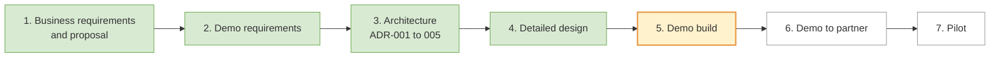

# Restaurant & Catering Reservation System

A reservation, waitlist and floor-plan system for restaurants, designed to connect to a partner's point-of-sale (POS) system. Guests book and pay deposits online; hosts run the floor on a tablet; seated tables, deposits and bills flow to and from the POS.

| | |
| --- | --- |
| **Phase** | Design frozen (v1.0, 9 November 2026) — demo build next |
| **Next milestone** | Build the working demo (3–4 weeks, about 17 working days), then a 20-minute walkthrough with the partner |
| **Owner** | Antonio Huang |
| **Last updated** | 9 November 2026 |

---

## Where the project is



| Phase | Status | Output |
| --- | --- | --- |
| 1. Business requirements and proposal | Done | Business requirements and delivery proposal (Word, with Appendix A) |
| 2. Demo requirements | Done, agreed | [`docs/Requirements.md`](docs/Requirements.md) |
| 3. Architecture decisions | Done, all ADRs *Accepted* | [`docs/adr/`](docs/adr/), [`docs/Architecture.md`](docs/Architecture.md) |
| 4. Detailed design | Done, frozen (v1.0) | [`docs/Design.md`](docs/Design.md), `docs/Design.docx` (8 November changes highlighted) |
| 5. Demo build | **Next** | This repository's code |
| 6. Demo to the partner | Not scheduled | Six-step, 20-minute script (Requirements §10) |
| 7. Pilot | Not started | Partner's AWS accounts, real venues |

---

## What the demo shows

One dinner service at a fictional restaurant, **Golden Dragon** (Auckland, 14 tables, English and Chinese):

1. A guest books a table on a phone in under a minute, paying a deposit for 6+ guests (Stripe test mode).
2. The booking appears on the host's floor plan within 2 seconds, on every screen.
3. The host seats a walk-in in three taps or adds the party to a waitlist with a quoted wait.
4. A table frees up and the waiting guest gets a "table ready" text (on-screen phone panel).
5. Guests get a reminder they can confirm or cancel with one tap; deposits are refunded by rule.
6. A POS log shows exactly what the system sends to and receives from the POS, including delivery while the POS is offline.

Out of scope for the demo: real SMS and POS connections, staff sign-in (the demo uses a passcode page), the floor-plan editor, split bills, reports and multiple venues.

---

## Documents

| Document | Purpose | Status |
| --- | --- | --- |
| [`docs/Requirements.md`](docs/Requirements.md) | Demo scope, acceptance criteria, business rules BR-01–BR-13, quality targets QA-1–QA-8, demo script | Frozen (v1.0) |
| [`docs/Architecture.md`](docs/Architecture.md) | One-page architecture: context, stack, events, data, cross-cutting concerns, deployment | Frozen (v1.0) |
| [`docs/Design.md`](docs/Design.md) | Detailed design: domain model, state machines, events, outbox, POS, messaging, payments, schema, API, jobs | Frozen (v1.0) |
| [ADR-001](docs/adr/ADR-001%20Technology%20Selection.md) | Technology selection (Next.js vs Nuxt, .NET, PostgreSQL, SignalR, PWA, floor plan) | Accepted |
| [ADR-002](docs/adr/ADR-002%20Event-driven%20Architecture.md) | Event-driven architecture (outbox, worker, event catalogue, delivery rules) | Accepted |
| [ADR-003](docs/adr/ADR-003%20Data%20Architecture.md) | Data architecture (PostgreSQL vs SQL Server, double booking, offline, privacy) | Accepted |
| [ADR-004](docs/adr/ADR-004%20Cross-cutting%20Concerns.md) | Cross-cutting concerns (security, contracts, FluentValidation, error handling, logging) | Accepted |
| [ADR-005](docs/adr/ADR-005%20AWS%20Hosting%20and%20Deployment.md) | AWS hosting and deployment (Lightsail demo, ECS pilot, CDK, GitHub Actions) | Accepted |

The `docs/adr/` files are the authoritative versions; revisions are made there.

### Design changes before the freeze (5–8 November 2026)

| Change | Design section |
| --- | --- |
| Booking terms (deposit, cancellation, turn time) copied onto each booking at booking time | §2.6 |
| Late-match rule: a POS bill that arrives after the host cleared the table still reaches the right booking | §6.5 |
| One bill per booking, keyed by POS bill ID, with room for split bills later | §6.6 |
| `MessageDeliveryWorker`: texts and emails queued in PostgreSQL, sent with retries and expiry | §7.1 |

---

## Technology (planned)

| Layer | Choice |
| --- | --- |
| Front end | Next.js (React, TypeScript), static export, installable as a PWA; SVG floor plan |
| API | ASP.NET Core, C#, EF Core (Npgsql), SignalR |
| Data | PostgreSQL (Amazon RDS) |
| Events | Domain events, transactional outbox and inbox, background workers |
| Validation and errors | FluentValidation; central exception handler with Problem Details |
| Contracts | OpenAPI → generated TypeScript client (`orval`) |
| Payments | Stripe (test mode in the demo) |
| Hosting | AWS: Lightsail container + RDS + S3/CloudFront (demo); ECS on Fargate (pilot) |
| Infrastructure and CI/CD | AWS CDK (C#), GitHub Actions with OIDC |
| Tests | xUnit, Testcontainers, Playwright |

All data stays in AWS. Exact versions will be pinned when the code starts.

---

## Repository layout (planned)

```
/
├─ docs/
│  ├─ Requirements.md
│  ├─ Architecture.md
│  ├─ Design.md
│  └─ adr/                    ← ADR-001 … ADR-005
├─ src/
│  ├─ Api/                    ← endpoints, features (vertical slices), pipeline, SignalR hub
│  ├─ Domain/                 ← aggregates, value objects, policies, domain events
│  ├─ Contracts/              ← event envelope and event types
│  └─ Infrastructure/         ← EF Core, outbox/inbox, workers, Stripe, mock POS (in-process), message senders
├─ web/                       ← Next.js app (guest, host, presenter screens)
├─ tests/                     ← Unit, Integration (Testcontainers), E2E (Playwright)
├─ infra/                     ← AWS CDK stacks
└─ docker-compose.yml         ← local PostgreSQL
```

## Getting started

There is no code yet. Once the demo build starts, this section will cover:

- prerequisites (.NET SDK, Node.js, Docker)
- `docker compose up` for PostgreSQL (the mock POS runs inside the API)
- running the API and the Next.js app
- resetting the Golden Dragon demo data

---

## Next steps

1. **Set up the repository.** Solution skeleton, `docker-compose.yml`, CI with build and tests, demo AWS account with a budget alarm.
2. **Build the demo in this order:** data model and seed → booking and availability → floor plan and SignalR → walk-ins and waitlist → messages and phone panel → Stripe deposits and refunds → mock POS and POS log → reminders → demo controls and reset.
3. **Rehearse.** Run the demo script end to end three times without errors (QA-6), and record a 3-minute fallback video.
4. **Arrange the walkthrough** with the partner, and bring the open questions below.

Design changes after the freeze go through a new or superseding ADR, then `Design.md`.

## Consistency pass (9 November 2026)

| Gap | Resolution |
| --- | --- |
| Staff sign-in: out of scope in the requirements, Cognito in ADR-004 and `Architecture.md` | Demo uses a fixed demo host session; Cognito is for the pilot (ADR-004, ADR-005, `Architecture.md`) |
| ADR-001 listed the floor-plan editor and combining tables as demo needs | Marked as pilot features; the demo uses a seeded layout. `react-i18next` named for languages |
| ADR-004 validation examples (deposit 8+, party 1–20) | Deposit 6+ (BR-06), online party 1–8 (BR-04) |
| Requirements doc used older event names | Aligned with ADR-002 (`BookingSeated`, `MessageSent`) |
| ADR-002 catalogue lacked late bill matching | `BookingBillAttached` added; `BookingCompleted` carries `source` and `posBillId`; `sequence` comes from `LastEventSequence` |
| ADR-003 and `Architecture.md` lacked recent design changes | Booking terms (DM-11), `booking_bills` (DM-12), message and POS workers, late match |
| Reminder timing only in the design | BR-13 added to the requirements |

## Questions for the partner

- How does the POS send "bill paid" (webhook, polling or export)? Does it accept idempotency keys?
- Can the POS return the booking ID it received when the table was opened?
- Does the POS support split bills per table, and do venues use virtual tables to fake them?
- Does the partner already use Cognito or another identity service for POS staff (pilot only)?
- Are the reminder timing rules (BR-13) right for their venues?
- Which AWS accounts and region should the pilot use (Auckland or Sydney)?
- What uptime and recovery targets do they promise venues today?
- Which domain should guests see on booking pages and texts?

---

## Conventions

- **Decisions** are recorded as ADRs; the design must not contradict an accepted ADR.
- **Design changes** are made in `docs/Design.md` first; `Design.docx` is generated from it.
- **Commits** use Conventional Commits, e.g. `docs(design): …`, `feat(bookings): …`, `fix(pos): …`.
- **Confidentiality:** the partner and their products are not named in this repository.
