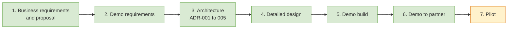

# Restaurant & Catering Reservation System

A reservation, waitlist and floor-plan system for restaurants, designed to connect to a partner's point-of-sale (POS) system. Guests book online (with an optional deposit); hosts run the floor on a tablet; seated tables, deposits and bills flow to and from the POS.

> **This is the demo version, and it is complete.** It was presented to the partner on 19 November 2026. Development towards the pilot continues in a private repository, so this one is no longer updated.

| | |
| --- | --- |
| **Phase** | Demo complete and presented; pilot in development (private) |
| **Owner** | Antonio Huang |
| **Last updated** | 21 November 2026 |

---

## Where the project is



| Phase | Status | Output |
| --- | --- | --- |
| 1. Business requirements and proposal | Done | Business requirements and delivery proposal (Word, with Appendix A) |
| 2. Demo requirements | Done (v1.4) | [`docs/Requirements.md`](docs/Requirements.md) |
| 3. Architecture decisions | Done, all ADRs *Accepted* | [`docs/adr/`](docs/adr/), [`docs/Architecture.md`](docs/Architecture.md) |
| 4. Detailed design | Done (v1.0, with build notes added per milestone) | [`docs/Design.md`](docs/Design.md) |
| 5. Demo build | **Done**: milestones M0 to M12b | This repository; [`docs/BUILD-PLAN.md`](docs/BUILD-PLAN.md) |
| 6. Demo to the partner | **Done**, 19 November 2026, on AWS | Requirements §10 demo script |
| 7. Pilot | In development (private repository) | Real venues |

---

## What the demo shows

One dinner service at a fictional restaurant, **Golden Dragon** (Auckland, 14 tables, English and Chinese):

1. A guest scans a QR code on the presenter screen and books a table on their own phone in under a minute; parties of 6 or more pay a deposit (Stripe test mode, including 3-D Secure).
2. The booking appears on the host's floor plan within 2 seconds, on every screen.
3. The host seats a walk-in in three taps, or adds the party to the waitlist with a quoted wait.
4. A table frees up and the waiting guest gets a "table ready" text (on-screen phone panel).
5. Guests get a reminder they can confirm or cancel with one tap; deposits are refunded by rule.
6. A POS log shows exactly what the system sends to and receives from the POS, including delivery while the POS is offline.

The host screen installs as an app on an iPad (Add to Home Screen) or goes full screen in the browser. A presenter screen runs the demo: a demo clock, reset, reminders, the simulated phone and the mock POS.

Out of scope for the demo: real SMS and POS connections, staff accounts (the demo uses a passcode page), the floor-plan editor, split bills, reports and multiple venues.

### Measured results

| Check | Result |
| --- | --- |
| Demo script as one end-to-end run (QA-6) | Passes three times in a row from a reset |
| Host actions (QA-4, limit 1 s) | 86–162 ms locally; 187–536 ms on AWS through CloudFront |
| A booking reaches every host screen (AC2.1) | Within 2 seconds |
| Tests | xUnit unit and integration tests (Testcontainers), CDK assertion tests, 117 web unit tests and 43 Playwright end-to-end tests, run in GitHub Actions |

---

## Technology (as built)

| Layer | Choice |
| --- | --- |
| Front end | Next.js 16 (React 19, TypeScript), static export, installable as a PWA; SVG floor plan; TanStack Query; react-i18next (English and Chinese) |
| API | .NET 10, ASP.NET Core minimal APIs, EF Core (Npgsql), SignalR |
| Data | PostgreSQL 16 |
| Events | Domain events, transactional outbox and inbox, background workers |
| Validation and errors | FluentValidation; central exception handler with Problem Details |
| Contracts | OpenAPI → generated TypeScript client (`orval`); signed POS message contract ([`docs/api/pos-messages.md`](docs/api/pos-messages.md)) |
| Payments | Stripe (test mode) with signed webhooks |
| Hosting (demo) | AWS: CloudFront + S3 for the site, a Lightsail container for the API, RDS PostgreSQL, Secrets Manager; the API accepts traffic only through CloudFront; security headers and a hash-based Content Security Policy (report-only) |
| Infrastructure and CI | AWS CDK in C#; GitHub Actions |
| Tests | xUnit, Testcontainers, Playwright |

The AWS demo environment has been removed now that the demo is over. [`docs/RUNBOOK-aws.md`](docs/RUNBOOK-aws.md) recreates it step by step.

---

## Documents

| Document | Purpose |
| --- | --- |
| [`docs/Requirements.md`](docs/Requirements.md) | Demo scope, acceptance criteria, business rules BR-01–BR-13, quality targets QA-1–QA-8, demo script |
| [`docs/Architecture.md`](docs/Architecture.md) | One-page architecture: context, stack, events, data, cross-cutting concerns, deployment |
| [`docs/Design.md`](docs/Design.md) | Detailed design, with build notes for each milestone |
| [`docs/BUILD-PLAN.md`](docs/BUILD-PLAN.md) | The milestones M0–M12b and what each one delivered |
| [`docs/RUNBOOK-aws.md`](docs/RUNBOOK-aws.md) | Deploying the demo to AWS by hand, and removing it |
| [`docs/api/pos-messages.md`](docs/api/pos-messages.md) | The POS message contract |
| [`docs/api/openapi.json`](docs/api/openapi.json) | The API contract |
| [ADR-001](docs/adr/ADR-001%20Technology%20Selection.md) | Technology selection |
| [ADR-002](docs/adr/ADR-002%20Event-driven%20Architecture.md) | Event-driven architecture |
| [ADR-003](docs/adr/ADR-003%20Data%20Architecture.md) | Data architecture |
| [ADR-004](docs/adr/ADR-004%20Cross-cutting%20Concerns.md) | Cross-cutting concerns |
| [ADR-005](docs/adr/ADR-005%20AWS%20Hosting%20and%20Deployment.md) | AWS hosting and deployment |

---

## Repository layout

```
/
├─ docs/                      ← requirements, architecture, design, build plan, runbook, ADRs, API contracts
├─ src/
│  ├─ Api/                    ← endpoints (vertical slices), pipeline, SignalR hub
│  ├─ Domain/                 ← aggregates, value objects, policies, domain events
│  ├─ Contracts/              ← event envelope and event types
│  └─ Infrastructure/         ← EF Core, outbox/inbox, workers, Stripe, mock POS, message senders
├─ web/                       ← Next.js app (guest, host and presenter screens)
├─ tests/                     ← Unit, Integration (Testcontainers), E2E (Playwright)
├─ infra/                     ← AWS CDK stacks (C#)
└─ docker-compose.yml         ← local PostgreSQL
```

## Running it locally

Prerequisites: .NET 10 SDK (pinned in `global.json`), Node.js 22, Docker Desktop.

```bash
docker compose up -d                          # PostgreSQL 16 (the mock POS runs inside the API)
# once: set the user secrets listed under "Commands" in CLAUDE.md (connection string, demo passcodes, signing keys)
dotnet test                                   # unit + integration (Docker must be running)
dotnet run --project src/Api                  # https://localhost:5001, migrates and seeds the Golden Dragon evening
cd web && npm ci && npm run dev               # https://localhost:3000
```

Open `/demo-login/` to sign in to the host or presenter screen. The presenter's **Reset** brings back the seeded evening at 6:25 pm.

---

## Conventions

- **Decisions** are recorded as ADRs; the design must not contradict an accepted ADR.
- **Commits** use Conventional Commits, e.g. `docs(design): …`, `feat(bookings): …`, `fix(pos): …`.
- **Confidentiality:** the partner and their products are not named in this repository.
- **No secrets in the repository:** local secrets live in .NET user secrets, AWS secrets in Secrets Manager.

Copyright © 2026 Antonio Huang. All rights reserved. The code is published to show the work; no licence is granted to copy or reuse it.