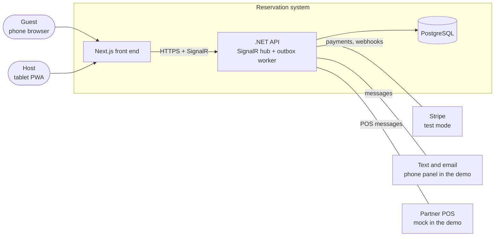
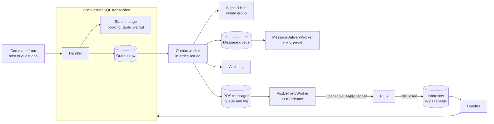
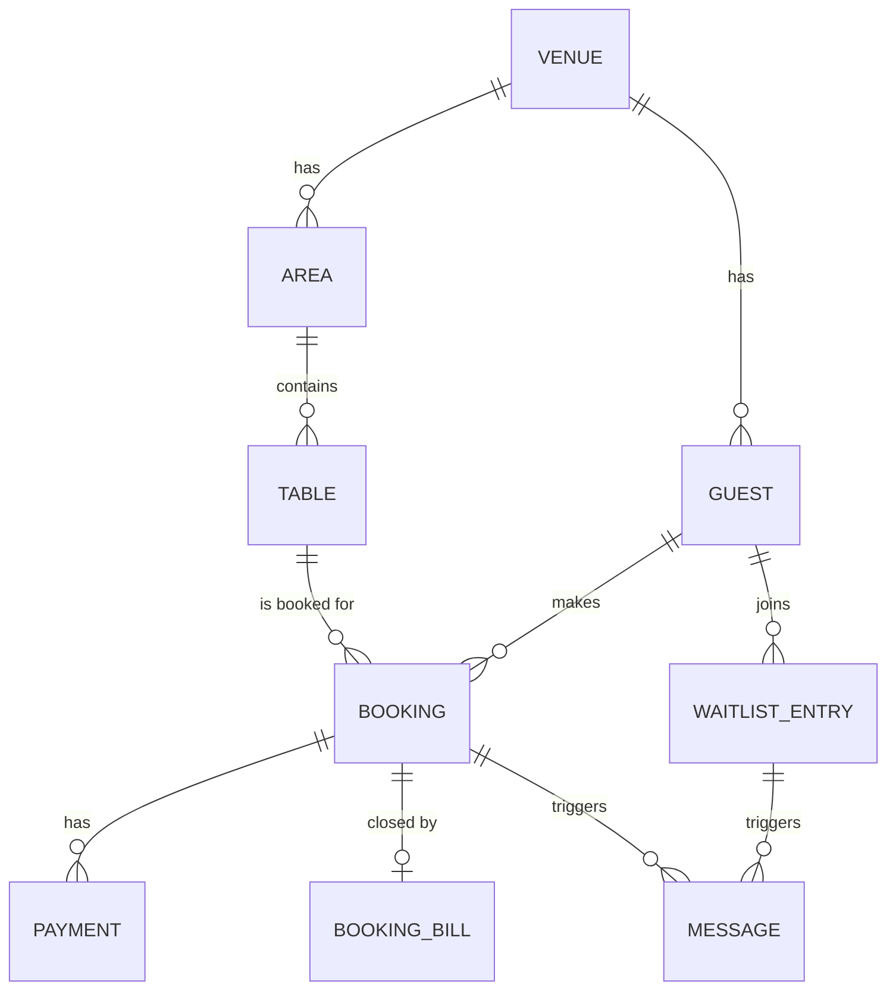
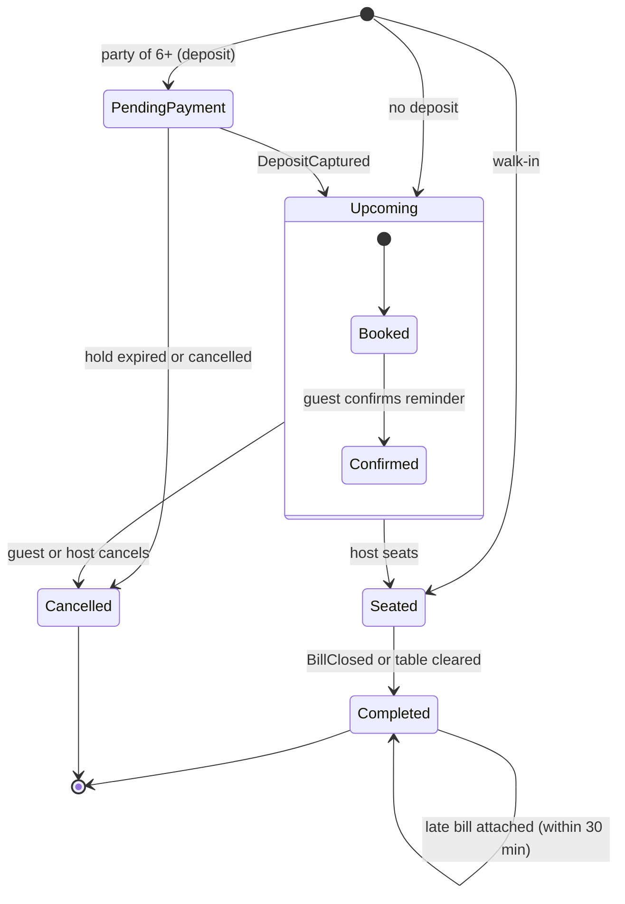
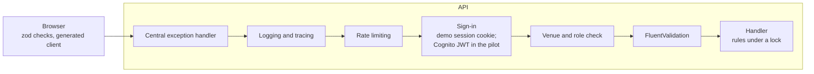
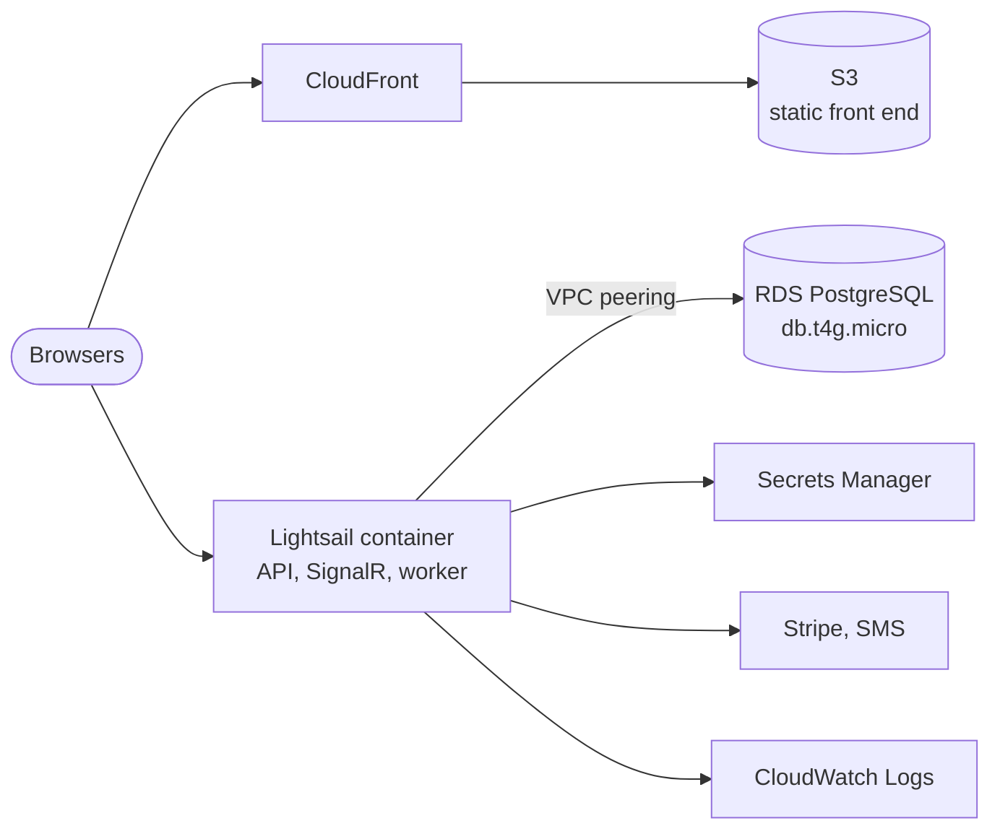

# Architecture: Reservation Demo

| | |
| --- | --- |
| **System** | Restaurant and catering reservation system, demo build |
| **Status** | Frozen (v1.0) for the demo build (3–4 weeks, about 17 working days); ADRs accepted |
| **Owner** | Antonio Huang |
| **Last updated** | 9 November 2026 |
| **Decisions** | ADR-001 to ADR-005 (see [Decision records](#13-decision-records)) |

This file is the entry point for anyone working on the code, including Claude Code. It summarises **what** the system is and **how** its parts fit together. The ADRs record **why** each choice was made. Where this file and an ADR disagree, the ADR wins; fix this file.

---

## 1. What the demo does

A venue (sample data: **Golden Dragon**) takes bookings online, runs its floor on a tablet and passes seated tables to its POS. The demo covers six steps:

| Step | What happens | Main events and POS messages |
| --- | --- | --- |
| 1. Guest booking | Guest picks a time, pays a deposit by card (Stripe test mode), gets a confirmation | `BookingCreated`, `DepositCaptured`, `MessageSent` |
| 2. Live floor plan | Host sees every table's status update within 2 seconds on all screens | `BookingSeated`, `TableCleared` |
| 3. Walk-in and waitlist | Host seats a walk-in or adds the party to the waitlist with a quoted wait | `WaitlistJoined`, `BookingSeated` (`source: walkIn`) |
| 4. "Table ready" text | Host notifies the party; the message appears in an on-screen phone panel | `WaitlistNotified`, `MessageSent` |
| 5. Reminder confirm or cancel | Guest confirms or cancels from a reminder; the cancellation rule decides any refund | `BookingConfirmed`, `BookingCancelled`, `DepositRefunded` |
| 6. POS message log | Seating opens a table in the (mock) POS and applies the deposit; the POS reports the bill closed | POS messages `OpenTable`, `ApplyDeposit` (out) and `BillClosed` (in), which leads to the event `BookingCompleted` |

**Out of scope for the demo:** a real POS connection, real text messages, Alipay and WeChat Pay, a full offline mode, more than one venue in use, and reports.

---

## 2. Quality goals

| Goal | Target | How |
| --- | --- | --- |
| Live updates | Floor plan and waitlist change on every host screen within 2 s | SignalR push and refetch (§6.3) |
| No double bookings | Zero, even with two hosts acting at once | PostgreSQL exclusion constraint and pacing lock (§7.3) |
| Reliable POS delivery | No POS message lost or applied twice, even if the POS is offline | Outbox, inbox and idempotency keys (§6) |
| Bookings never blocked by side tasks | A slow text provider or POS never fails a booking | Side tasks run after commit, from the outbox |
| Two languages | English and Simplified Chinese on every screen and message | Translation files; the API returns codes, not sentences |
| Privacy | Minimum personal data, never in logs; data stays in AWS | §8, §9 |
| Low cost, fast delivery | About USD 35 a month; built by one developer in 3–4 weeks (about 17 working days) | §11 |

---

## 3. System context



---

## 4. Technology stack

| Layer | Choice | ADR |
| --- | --- | --- |
| Guest page and host app | Next.js (React, TypeScript), static export, installable as a PWA | 001 |
| Floor plan | SVG drawn by React components; `react-zoom-pan-pinch`; `@use-gesture/react` for the layout editor (pilot; the demo uses a seeded layout) | 001 |
| Languages | English and Simplified Chinese through `react-i18next` (works with the static export) | 001 |
| API | ASP.NET Core Web API, C#, Entity Framework Core (Npgsql) | 001 |
| Real-time | SignalR in the API; `@microsoft/signalr` in the browser | 001, 002 |
| Database | PostgreSQL on Amazon RDS | 003 |
| Events | Domain events behind `IEventPublisher`; transactional outbox and inbox; background worker | 002 |
| Integrations | `IPosAdapter` (mock in the demo), `IPaymentProvider` (Stripe) | 001, 002 |
| Staff sign-in | Demo: a passcode at `/demo-login` issues a fixed demo session cookie (role `Host` or `Presenter`). Pilot: Amazon Cognito user pool, code flow with PKCE | 004 |
| Contracts | ASP.NET Core OpenAPI document; `orval` generates the TypeScript client, query hooks and zod schemas | 004 |
| Validation | FluentValidation through one endpoint filter | 004 |
| Errors | Central `IExceptionHandler` and Problem Details with stable error codes | 004 |
| Logging and tracing | `ILogger` JSON logs and OpenTelemetry, sent to CloudWatch and X-Ray | 004 |
| Tests | xUnit, Testcontainers (PostgreSQL), Playwright | 001 |
| Hosting | Lightsail container, RDS, S3 + CloudFront in Sydney; ECS on Fargate for the pilot | 005 |
| Infrastructure and CI/CD | AWS CDK (C#); GitHub Actions with OIDC | 005 |

Exact package versions are pinned at project start and recorded in the repository.

---

## 5. Building blocks

### 5.1 Containers

| Container | Responsibility | Runs on (demo) |
| --- | --- | --- |
| **Front end** (`web/`) | Guest booking page, manage-booking page, host app (floor plan, waitlist, messages, POS log; layout editor in the pilot) | Static files on S3, served by CloudFront |
| **API** (`src/Api`) | HTTP endpoints, SignalR hub, command handlers, Stripe and POS webhooks | One Lightsail container |
| **Background workers** | `OutboxDispatcher` delivers outbox events to SignalR, notifications, the POS queue and the audit log. `PosDeliveryWorker` sends queued POS messages in venue order. `MessageDeliveryWorker` sends queued texts and emails with retries and expiry | Hosted services in the same API container |
| **Database** | Bookings, tables, guests, payments, waitlist, messages, outbox, inbox, POS messages, audit log | RDS PostgreSQL, one zone |

### 5.2 Feature modules (vertical slices)

Each feature folder holds its own endpoints, requests, validators, handlers and tests. Cross-cutting code lives only in the request pipeline (§8.1), never copied into features.

| Feature | Owns |
| --- | --- |
| `Bookings` | Create, hold, confirm, cancel, seat, complete; availability search |
| `Tables` | Areas, tables, layout versions (seeded in the demo), table status |
| `Waitlist` | Join, quote, notify, end |
| `Payments` | Deposits, refunds, Stripe webhooks (`IPaymentProvider`) |
| `Messaging` | Confirmations, reminders, "table ready"; messages queued in PostgreSQL and sent by `MessageDeliveryWorker`; message log; on-screen phone panel |
| `Pos` | `IPosAdapter`, mock adapter, `pos_messages` queue and log, `BillClosed` inbox handler, late bill matching |
| `Guests` | Guest profiles, matched by phone number |
| `Venues` | Venue settings (JSONB), opening hours, rules, staff membership |
| `Admin` | Failed events, replay, demo reset |

### 5.3 Repository layout (proposed)

```
/
├─ docs/
│  ├─ Architecture.md           ← this file
│  └─ adr/                      ← ADR-001 … ADR-005
├─ src/
│  ├─ Api/
│  │  ├─ Features/              ← Bookings, Tables, Waitlist, Payments, Messaging, Pos, Guests, Venues, Admin
│  │  ├─ Pipeline/              ← exception handler, validation filter, auth policies, rate limits
│  │  ├─ Realtime/              ← SignalR hub, groups, UI notifications
│  │  └─ Program.cs
│  ├─ Domain/                   ← entities, rules, domain events
│  ├─ Contracts/                ← event envelope and event types (versioned)
│  └─ Infrastructure/           ← EF Core DbContext, migrations, outbox/inbox, Stripe, POS mock, Secrets
├─ web/                         ← Next.js app (generated API client in web/src/api/)
├─ tests/
│  ├─ Unit/
│  ├─ Integration/              ← Testcontainers
│  └─ E2E/                      ← Playwright demo script
├─ infra/                       ← AWS CDK (C#) stacks
├─ docker-compose.yml           ← local PostgreSQL (the mock POS runs inside the API)
└─ .github/workflows/
```

---

## 6. Events and real-time (ADR-002)

### 6.1 Flow



### 6.2 Rules

- Each state change and its event are saved in **one transaction**. Nothing is sent from inside the request.
- Delivery is **at least once**; every consumer is **idempotent** (it records `(consumer, eventId)` in the inbox).
- Events for one aggregate are delivered in `sequence` order; rows are claimed with `FOR UPDATE SKIP LOCKED`. Each aggregate keeps its own counter (`LastEventSequence`) for this; the row version (`xmin`) is only for concurrency.
- Each consumer runs in a savepoint inside the dispatcher's transaction, so one failing consumer does not undo the others.
- Retries back off (5 s, 30 s, 2 min, 10 min, then every 30 min for 24 h), after which the row is marked `failed` and shown to platform admins.
- Payloads carry IDs, not personal details.

### 6.3 Real-time host screens

- Each host screen joins the SignalR group `venue:{venueId}` after sign-in (in the demo, the demo session from `/demo-login`).
- The server pushes small notices (`floorPlanChanged`, `waitlistChanged`, `messageLogChanged`) with the changed IDs and `sequence`.
- The screen refetches what changed from the API. The API is the only source of truth.
- After a dropped connection the screen reconnects and refetches the whole floor plan once (the demo's offline behaviour).

### 6.4 Event catalogue (v1)

| Event | Raised when |
| --- | --- |
| `BookingCreated` | A booking is created (a payment hold starts if a deposit is needed) |
| `DepositCaptured` | Stripe confirms the deposit |
| `BookingConfirmed` | The guest confirms from the reminder |
| `BookingCancelled` | The guest or host cancels, or the hold expires |
| `DepositRefunded` | A refund succeeds under the cancellation rule |
| `BookingSeated` | A party sits down; `source` is `booking` or `walkIn` |
| `BookingCompleted` | The POS reports the bill closed (`source: billClosed`, with `posBillId`), or the host clears the table first (`source: clearedByHost`) |
| `BookingBillAttached` | A POS bill arrives after the host cleared the table and is matched within 30 minutes, or a manager matches it by hand |
| `TableCleared` | A host marks a table free |
| `WaitlistJoined` | A walk-in joins the waitlist |
| `WaitlistNotified` | The host sends "table ready" |
| `WaitlistEnded` | The entry is seated, leaves or is removed |
| `MessageSent` | A text or email is accepted; `purpose` is `confirmation`, `reminder`, `tableReady`, `cancellation` or `refund` |

### 6.5 Event envelope

```json
{
  "eventId": "UUID v7",
  "eventType": "BookingSeated",
  "eventVersion": 1,
  "occurredAt": "2026-11-20T06:42:10Z",
  "venueId": "UUID",
  "aggregateType": "Booking",
  "aggregateId": "UUID",
  "sequence": 2,
  "correlationId": "UUID",
  "causationId": null,
  "actor": { "type": "staff", "role": "Host", "id": "UUID" },
  "payload": { }
}
```

Adding an optional field keeps the version. Renaming, removing or changing a field's meaning needs a new `eventVersion`.

---

## 7. Data (ADR-003)

### 7.1 Core records



Integration records sit beside these, written in the same transaction as each change: **outbox events**, **inbox entries**, **POS messages** (`pos_messages`, queue and log in one table), **queued messages** and the **audit log**.

Each booking also keeps a copy of the venue's **terms** (deposit, cancellation window, turn time) taken when it is made, so later changes to venue settings never change what a guest agreed to. POS bills are kept in `booking_bills`, keyed by the POS bill ID, with a unique index on `booking_id` (one bill per booking now; split bills later only drop the index).

### 7.2 Data rules

| ID | Rule |
| --- | --- |
| DM-01 | One shared database; every record carries `venue_id`, and every query filters by it |
| DM-02 | IDs are UUID v7, created by the application |
| DM-03 | Money is whole cents, NZD, GST-inclusive |
| DM-04 | Times are stored in UTC and shown in the venue's time zone (`Pacific/Auckland`) |
| DM-05 | Phone numbers are stored in E.164 (`+64…`) and are the guest match key |
| DM-06 | Statuses are fixed lists stored as text |
| DM-07 | Every record has a row version (`xmin`) used only for optimistic concurrency; event order comes from each record's own event counter |
| DM-08 | Venue settings and message payloads are JSONB |
| DM-09 | Every change to bookings, deposits and refunds goes to the audit log |
| DM-10 | Schema changes only through EF Core migrations; a seed script loads and resets the demo data |
| DM-11 | Each booking keeps a copy of the venue's terms taken at booking time |
| DM-12 | POS bills live in `booking_bills`, at most one per booking for now |

### 7.3 Preventing double bookings

1. A PostgreSQL **exclusion constraint** on table and time range rejects overlapping active bookings for the same table.
2. **Pacing** (covers per time slot) is checked under a short lock inside the transaction.
3. A booking with a deposit is **held for 10 minutes** while the guest pays; the hold expires into `BookingCancelled`.
4. A failure returns `409 slot_taken`, and the front end offers the next free times.

### 7.4 Booking status



### 7.5 Offline

The demo reconnects and refreshes. The pilot adds a read-only browser cache (IndexedDB) and a queue of host actions. There is no full local database.

---

## 8. Cross-cutting concerns (ADR-004)

### 8.1 Request pipeline



Every failure leaves as **Problem Details** with a stable `code` and a `traceId`.

### 8.2 Security

| Caller | Proves identity with | Can |
| --- | --- | --- |
| Guest | Nothing (public page) or a signed, expiring link (`GuestLinkSigner`, HMAC-SHA256, key in Secrets Manager); opening a link only shows the page, the action is a POST | Book, pay, confirm or cancel their own booking |
| Host | Demo: passcode at `/demo-login` → demo session cookie with role `Host`. Pilot: Cognito | Floor plan, walk-ins, waitlist, messages for their venue |
| Presenter (demo only) | Passcode at `/demo-login` → demo session cookie with role `Presenter` | Host actions plus `/demo/*` (reset, clock, POS online/offline, reminders) and the message and POS logs |
| Manager | Cognito with MFA (pilot) | Host actions plus layout, settings, refunds |
| Platform admin | Cognito with MFA (pilot) | Venue set-up, failed events, replay |
| Stripe, POS | Signed webhooks | Payment events; `BillClosed` |

- A `venue_ids` claim is checked against the route on every request; endpoints deny by default.
- Demo passcodes (`HostPasscode`, `PresenterPasscode`) are secrets, compared in constant time. The session cookie is `HttpOnly`, `Secure`, `SameSite=Strict` and valid for 12 hours; `/demo-login` is limited to 5 attempts a minute per IP address. Guest pages stay public.
- Card details never reach our servers (Stripe Elements, PCI DSS SAQ A).
- Secrets come from AWS Secrets Manager. Locally, .NET user secrets. Never in code.
- HTTPS and HSTS; CORS limited to our domains; a content security policy that allows only the app and Stripe.

### 8.3 Contracts

- C# request and response types are the source of truth. The API publishes OpenAPI, and `orval` generates the TypeScript client and zod schemas.
- JSON uses camelCase, string enums, UUID strings, UTC ISO 8601 times, and money as `{ amountCents, currency }`.
- Paths look like `/api/v1/venues/{venueId}/bookings`. Lists use cursor paging; updates send `version`; create and pay requests accept `Idempotency-Key`.
- CI runs `oasdiff` and fails on an unplanned breaking change.

### 8.4 Validation

| Layer | Checks | Tool |
| --- | --- | --- |
| Front end | Shape and format, for quick feedback | zod, react-hook-form |
| API request | Shape, format, simple cross-field rules | FluentValidation |
| Domain and database | Rules needing current state or a lock | Handler code; PostgreSQL constraints |

### 8.5 Error codes

| HTTP | Code |
| --- | --- |
| 400 | `validation_failed` |
| 401 | `not_signed_in` |
| 403 | `forbidden` |
| 404 | `not_found` |
| 409 | `slot_taken`, `version_conflict`, `hold_expired`, `invalid_transition` (the record is not in a state that allows the action) |
| 422 | `rule_broken` for a business rule broken by valid input (or a specific code such as `deposit_required`) |
| 429 | `too_many_requests` |
| 502 | `payment_provider_error` |
| 500 | `unexpected` |

### 8.6 Logging

- Structured JSON through `ILogger`, with `traceId`, `correlationId`, `venueId`, `userId` and `role` on each line.
- **Never logged:** names, full phone numbers, emails, booking notes, tokens (including the SignalR `access_token` query string), Stripe keys, request bodies.
- Front-end errors go to `/api/v1/client-errors`, then to CloudWatch, so no third-party error tool is needed.

### 8.7 Other conventions

- Read time through `TimeProvider`.
- Options are validated at start-up (`ValidateOnStart`).
- Health checks: `/health/live` and `/health/ready`.
- Feature flags live in a venue settings table.

---

## 9. Deployment (ADR-005)



| Item | Demo | Pilot |
| --- | --- | --- |
| Account and region | Antonio's account, Sydney `ap-southeast-2` | Partner's accounts; Auckland `ap-southeast-6` if every service is offered, else Sydney |
| API | One Lightsail container (Micro) | ECS on Fargate: API (2+ tasks, two zones) and a separate worker service |
| Front end | S3 + CloudFront | Same, plus WAF |
| Database | RDS, one zone, 7-day backups | RDS Multi-AZ, private subnets, cross-region snapshot copy |
| Edge | Lightsail HTTPS endpoint | Application Load Balancer + WAF |
| SignalR backplane | None | ElastiCache (Redis) when there are 2+ API tasks |
| Cost (approx.) | USD 35 a month | USD 220 a month |

### 9.1 Pipeline (GitHub Actions)

1. **Check:** build, unit and integration tests, `oasdiff`, dependency scan.
2. **Package:** build the API image once, tag it with the git SHA, scan it and push it to ECR. Build the front end.
3. **Migrate:** run the EF Core migration bundle against the target database.
4. **Deploy the API:** a new Lightsail deployment (demo) or an ECS rolling deployment with circuit breaker (pilot).
5. **Deploy the front end:** upload to S3, then invalidate CloudFront.
6. **Verify:** run the Playwright smoke test of the demo script.

GitHub signs in to AWS through OIDC, so no keys are stored.

Migrations follow **expand, then contract**, so a rollback is just redeploying the previous image.

### 9.2 Environments

| Environment | Where | Deployed |
| --- | --- | --- |
| Local | Docker Compose (PostgreSQL); API with `dotnet run` (mock POS in-process); `next dev` | On save |
| Demo | Demo AWS account, Sydney | Every merge to `main` |
| Pilot staging / production | Partner account | Staging on merge; production by manual approval |

---

## 10. Testing

| Level | Covers | Tool |
| --- | --- | --- |
| Unit | Domain rules, validators, event mapping | xUnit |
| Integration | Double-booking constraint, outbox delivery and retries, inbox de-duplication, venue isolation, Problem Details for every code, webhook signature rejection, log scrubbing | xUnit + Testcontainers |
| Contract | OpenAPI breaking changes; event schema per version | `oasdiff`; JSON schema tests |
| End to end | The six-step demo script, in English and Chinese | Playwright |

Every consumer test sends each event **twice** to prove idempotency.

---

## 11. Running the demo locally

```bash
docker compose up -d          # PostgreSQL only; the mock POS runs inside the API
dotnet run --project src/Api  # API on https://localhost:5001; in Development it applies migrations and the seed at start-up
                              # (Database:MigrateOnStartup=true, Development only). Manual alternative: dotnet ef database update
cd web && npm install && npm run generate:api && npm run dev
```

The demo reset (Admin) reloads the Golden Dragon seed data. CI and AWS never migrate at start-up; they run the EF Core migration bundle (§9.1, ADR-005).

> These commands are placeholders until the repository is created; keep them in step with the real scripts.

---

## 12. Risks and open questions

| Item | Status |
| --- | --- |
| How the POS sends `BillClosed` (webhook, polling or export) and whether it accepts idempotency keys | Ask the partner |
| Whether the partner already uses Cognito or another identity service for POS staff (affects the pilot only) | Ask the partner |
| Whether the POS can return the booking ID it received, and whether it supports split bills | Ask the partner; late matching (30 min) and `booking_bills` cover both for now |
| Reminder timing rules (BR-13) | Proposed in Design §7.1; partner to confirm |
| AWS accounts and region for the pilot; whether Auckland has every service needed | Ask the partner; check the AWS regional services list |
| Whether Lightsail keeps SignalR WebSocket connections open (SignalR falls back to SSE or long polling) | Check in week 1 |
| Recovery targets and log retention for the pilot | Proposed in ADR-005; partner to confirm |

---

## 13. Decision records

| ADR | Title | Covers |
| --- | --- | --- |
| [ADR-001](adr/ADR-001%20Technology%20Selection.md) | Technology Selection for the Reservation Demo | Next.js vs Nuxt, .NET, PostgreSQL, SignalR, PWA, floor plan |
| [ADR-002](adr/ADR-002%20Event-driven%20Architecture.md) | Event-driven Architecture | Outbox, worker, event catalogue, envelope, delivery, versioning |
| [ADR-003](adr/ADR-003%20Data%20Architecture.md) | Data Architecture for the Reservation System | PostgreSQL vs SQL Server, data model, double booking, offline, privacy |
| [ADR-004](adr/ADR-004%20Cross-cutting%20Concerns.md) | Cross-cutting Concerns | Security, contracts, validation, error handling, logging |
| [ADR-005](adr/ADR-005%20AWS%20Hosting%20and%20Deployment.md) | AWS Hosting and Deployment | Region, compute, network, CI/CD, monitoring, cost |

All five ADRs are **Accepted** (9 November 2026). The files in [`adr/`](adr/) are the authoritative versions; change them there.

---

## 14. Glossary

| Term | Meaning |
| --- | --- |
| Outbox | Table where events are saved in the same transaction as the change, then delivered by the worker |
| Inbox | Table recording which messages each consumer has already processed, so repeats are skipped |
| Pacing | Limit on how many covers a venue accepts per time slot |
| Cover | One guest at a table |
| Payment hold | The 10 minutes a pending booking reserves its table while the guest pays |
| Problem Details | Standard JSON error format (RFC 9457) |
| PWA | Progressive web app: a website installed to the home screen and opened full screen |
