# Detailed Design: Reservation Demo

|                  |                                                                                                |
|------------------|------------------------------------------------------------------------------------------------|
| **System**       | Restaurant and catering reservation system, demo build                                         |
| **Status**       | Draft for the demo build                                                                       |
| **Owner**        | Antonio Huang                                                                                  |
| **Last updated** | 12 November 2026                                                                               |
| **Inputs**       | [`Requirements.md`](Requirements.md), [`Architecture.md`](Architecture.md), ADR-001 to ADR-005 |

This file turns the requirements and ADRs into buildable design: classes and their relationships, state machines, events, sequences, database tables, endpoints and background jobs. It is written for the developer and for Claude Code.

**Scope rule:** where an ADR describes a pilot feature that `Requirements.md` puts out of scope for the demo (staff sign-in, the layout editor, combining tables), this design keeps a seam for it but does not build it. Each such seam is marked **\[pilot\]**.

## What changed since the 5 November version

Changes made on **8 November** are **highlighted in yellow with an orange bar in the left margin**; in tables, only the changed rows are highlighted. Earlier changes are listed below without highlighting.

| **Change**                                  | **What it does**                                                                                                                                                                                                                    | **Where**                                                                        |
|---------------------------------------------|-------------------------------------------------------------------------------------------------------------------------------------------------------------------------------------------------------------------------------------|----------------------------------------------------------------------------------|
| Booking terms copied at booking time        | Each booking keeps its own copy of the deposit and cancellation rules and turn time, so later changes to the venue's settings don't affect it (AC5.6)                                                                               | New §2.6; also §2.2, §2.3, §3.1, §8.1–§8.3, §13, §19                             |
| Late-match rule for POS bills               | A `BillClosed` that arrives after the host cleared the table is still attached to the right booking; anything uncertain is kept as unmatched for a manager                                                                          | New §6.5; also §2.2, §3.1, §3.5, §4.1–§4.3, §6.3, §9.2, §9.3, §13, §14, §19, §20 |
| One bill per booking, ready for split bills | Bills are keyed by POS bill ID and stored one row per bill, so duplicates are ignored, a second bill is flagged, and split bills can be added later without changing the data model                                                 | New §6.6; also §2.1–§2.3, §3.1, §4.2, §6.3, §6.5, §13, §19, §20                  |
| Message delivery worker                     | Handlers only queue texts and emails; a background worker sends them, retries with backoff, expires stale ones (a late "table ready" text is dropped) and records delivery reports. PostgreSQL is the queue; no extra queue product | New §7.1; also §2.2, §3.4, §5.5, §7, §10.1, §13, §14, §16, §19, §20              |
| Event sequence counter (8 Nov) | Each aggregate counts the events it raises (`LastEventSequence`); `Version` (`xmin`) is for concurrency only | §2.2, §5.2, §13 |
| Event handlers share the dispatcher's transaction (8 Nov) | Each handler runs under its own savepoint inside the dispatcher's batch, so order is kept and a failing handler rolls back only its own work | §5.4 |
| Refund decided once, at cancellation (8 Nov) | `Booking.Cancel` asks `RefundPolicy`; `BookingCancelled` carries the decision; the refund handler only acts on it | §8.1, §8.3 |
| Reminder timing (8 Nov) | No reminder for bookings made under 24 h ahead or starting within 2 h; a warning before a late cancellation | §7.1, §9.2, §20 |
| Front-end translation library (8 Nov) | react-i18next, which works with the static export | §18.1, §18.2, §20 |
| Pre-build decisions D1–D12 (9 Nov) | `invalid_transition` (409) separate from `rule_broken` (422); demo login with `Host` and `Presenter` roles; payment after an expired hold; ADR-004 and translation rows in §20 resolved | §3.1, §8.1, §8.3, §9.2, §12, §14, §17, §18.1, §18.2, §20 |
| Domain build clarifications (M1, 9 Nov) | Method signatures completed (`now` where a guard needs time, `tableStillFree` on `CaptureDeposit`, `policyShown` on `RecordReminder`, `matchedBy` and window on `AttachLateBill`); booking keeps its cancel reason and refund decision; late-match window counts either side of the clear; turn time for parties above the last rule; both reminder rules always apply | §2.2, §2.6, §3.1, §6.5, §7.1, §13 |
| Database build details (M2, 10 Nov) | `guests.last_visit_at` added; `booking_bills` keyed by `(booking_id, pos_bill_id)` with bill IDs unique per venue; mapping notes for converters, JSON shapes, shadow `venue_id`, the named venue filter and constraint names; seed of 11 bookings built for the demo script with the DemoClock fixed at 18:25 | §13, §17 |
| Booking API details (M4a, 11 Nov) | Request pipeline in the ADR-004 order; demo session cookie and policies; request venue context; phone bookings and host confirm routes; idempotency keys table; availability reads and pacing count; venue setting `BookingWindowDays`; OpenAPI document committed and checked | §2.2, §2.6, §9.2, §13, §14, §14.1, §20 |
| Table locks against deadlock (12 Nov) | `BookingCreator` locks the chosen tables in ascending ID order before inserting; `40P01` / `40001` → `409 slot_taken` | §12 |
| Guest booking page (M4b, 11 Nov) | Public `getVenue` (slot grid, limits, contact phone); venue setting `ContactPhone`; FluentValidation rules copied into OpenAPI; orval client and zod schemas; `/book` flow, translations and error mapping; dev server over HTTPS; Playwright in CI | §2.2, §13.1, §14, §14.1, §18.4, §20 |
| Event infrastructure details (M3, 10 Nov) | Two clocks: workers use the infrastructure clock, the domain uses the business clock; envelope in `src/Contracts`; payload shape; request context and causation in the dispatcher; one row per aggregate per batch; every handler runs; retry schedule counted from `created_at`; duplicate event sequence → concurrency error; outbox health check | §5.6, §16, §20 |
| Clean-up (8 Nov) | Schema aligned with §6.6 and §7.1, inbound POS fields, explanations tidied, API and traceability updated | §2.1–§2.4, §3.1, §3.3, §4.3, §6.1, §6.2, §6.5, §9.1, §13, §14, §19 |

## Contents

1.  [Conventions](#1-conventions)
2.  [Domain model](#2-domain-model)
3.  [State machines](#3-state-machines)
4.  [Domain events](#4-domain-events)
5.  [Event infrastructure: outbox, dispatcher, inbox](#5-event-infrastructure-outbox-dispatcher-inbox)
6.  [POS integration](#6-pos-integration)
7.  [Messaging and the phone panel](#7-messaging-and-the-phone-panel)
8.  [Payments](#8-payments)
9.  [Application layer](#9-application-layer)
10. [Key sequences](#10-key-sequences)
11. [Availability and table assignment](#11-availability-and-table-assignment)
12. [Concurrency and consistency](#12-concurrency-and-consistency)
13. [Database schema](#13-database-schema)
14. [HTTP API](#14-http-api)
15. [Real-time contract (SignalR)](#15-real-time-contract-signalr)
16. [Background jobs](#16-background-jobs)
17. [Demo-only components](#17-demo-only-components)
18. [Front-end design](#18-front-end-design)
19. [Traceability](#19-traceability)
20. [Open items](#20-open-items)

## 1. Conventions

| **Topic**  | **Rule**                                                                                                                                                                                                         |
|------------|------------------------------------------------------------------------------------------------------------------------------------------------------------------------------------------------------------------|
| Layers     | `Domain` (entities, value objects, rules, events) has no dependencies. `Application` lives inside `Api/Features` as vertical slices. `Infrastructure` holds EF Core, outbox, Stripe, POS and messaging adapters. |
| Aggregates | Changed only through methods that check rules and raise events. Setters are private.                                                                                                                             |
| Failures   | Expected failures return `Result` / `Result<T>` with an `Error` (code + message key). Exceptions are for bugs and infrastructure faults only (ADR-004).                                                          |
| IDs        | UUID v7 strongly typed IDs (`BookingId`, `TableId`, …) as `readonly record struct`.                                                                                                                              |
| Time       | `TimeProvider` everywhere; `DemoClock` in the demo (§17). Stored as UTC `timestamptz`.                                                                                                                           |
| Money      | `Money(long Cents, string Currency)`; NZD, GST-inclusive.                                                                                                                                                        |
| Naming     | Commands are imperative (`SeatBooking`); events are past tense (`BookingSeated`); handlers end in `Handler`.                                                                                                     |

## 2. Domain model

### 2.1 Aggregates and boundaries

| **Aggregate root** | **Owns**                                                       | **Why it is its own aggregate**                      |
|--------------------|----------------------------------------------------------------|------------------------------------------------------|
| `Venue`            | `Area`, `Table`, `VenueSettings`                               | Layout and rules change rarely and together          |
| `Guest`            | Visit summary (last bill total, visit count)                   | Shared by bookings and waitlist; matched by phone    |
| `Booking`          | `Deposit`, `TableAssignment`s, `BookingBill`s, reminder record | Its status, tables and deposit must change together  |
| `WaitlistEntry`    | Notification record                                            | Independent lifecycle; becomes a booking when seated |
| `Message`          | Delivery attempts                                              | Sent asynchronously after the change that caused it  |
| `PosMessage`       | Delivery attempts                                              | Ordered delivery queue per venue (§6). Not an `AggregateRoot`: it raises no domain events |

Rules that span aggregates (a table can hold one party at a time; pacing per slot) are enforced by the database and a lock in the command handler (§12), not by loading every booking into memory.

#### Why rules between bookings live in the database

Each `Booking` is its own aggregate: it loads alone, checks its own rules (for example "can't seat a cancelled booking") and saves alone. Two rules, however, are about the relationship between bookings:

1. **One party per table at a time:** booking A for table 5 at 19:00–20:30 must not overlap booking B for table 5 at 20:00–21:30.
2. **Pacing:** no more than 12 covers may start in any 15-minute slot (BR-03), across all bookings in that slot.

Checking these in C# would mean loading every other booking for that table or slot, and it would still fail under concurrency: two guests booking the last free table at the same moment both see it free and both save. This is the classic "check-then-act" race. The design lets the database decide instead, because it is the one place that sees every write at once:

1. **Table overlap:** a PostgreSQL exclusion constraint on `table_assignments` (`EXCLUDE USING gist (table_id WITH =, period WITH &&) WHERE (active)`) rejects the second of two overlapping bookings with error `23P01`, which the API returns as `409 slot_taken`.
2. **Pacing:** the booking transaction first takes a lock on that venue and slot (`pg_advisory_xact_lock`), then counts the covers already booked. A second request for the same slot waits at the lock, then counts again. The lock is released at commit and blocks only that slot.

Details are in §12.

### 2.2 Class diagram: core domain

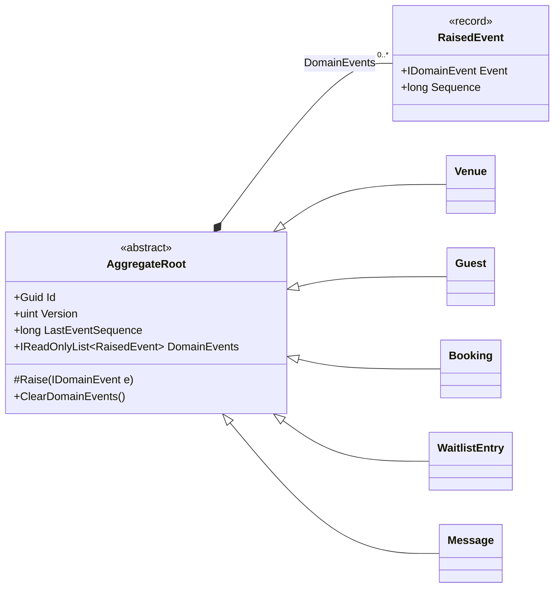

It shows that the five main business records all inherit from one base class, AggregateRoot, which gives them the same machinery for identity, change tracking and events.

| **Member**          | **Purpose**                                                                                                                                                                                                              |
|---------------------|--------------------------------------------------------------------------------------------------------------------------------------------------------------------------------------------------------------------------|
| Id                  | The record’s unique ID: a UUID v7, created by the app (ADR-003 DM-02).                                                                                                                                                   |
| Version             | A row version for optimistic concurrency (PostgreSQL `xmin`). If two hosts change the same booking, the second save fails with 409 version_conflict instead of silently overwriting the first. It is used for concurrency only; it does not number events. |
| LastEventSequence   | Counts the events this record has raised (1, 2, 3 …). `Raise` increases it and stamps the new number on the event, so consumers get events in order and can spot a gap. Saved in the record's `last_event_sequence` column. |
| DomainEvents        | A read-only list of events this record has raised since it was loaded, such as BookingSeated, each with its sequence number (`RaisedEvent`).                                                                                                                            |
| Raise(event)        | Protected, so only the record itself can raise events, from inside its own methods. Nothing outside can fake a “booking seated” event without going through Booking.Seat() and its rules. It also increases `LastEventSequence` and stamps the event with the new number.                                |
| ClearDomainEvents() | Empties the list once the events have been saved, so they aren’t saved twice.                                                                                                                                            |

How it fits with the outbox (ADR-002)

A handler calls booking.Seat(...). The booking changes its status and adds BookingSeated to its event list. Nothing is sent yet.

The handler calls SaveChangesAsync(). The outbox interceptor finds every tracked AggregateRoot, collects its events and writes them to the outbox table in the same transaction as the status change.

After commit, the interceptor calls ClearDomainEvents().

The shared base class is what makes step 2 generic: the interceptor doesn’t need to know about bookings or waitlists. It just asks every aggregate root for its events.

Why these five (Venue, Guest, Booking, WaitlistEntry, Message)

Each one is changed and saved as a unit, so each can raise events. Records inside an aggregate, such as Deposit and TableAssignment inside Booking, don’t inherit from it, because they only change through their parent.

`PosMessage` (§2.1) is not shown: it raises no domain events (it is a delivery queue item), so it does not inherit from `AggregateRoot`.

#### Venue aggregate

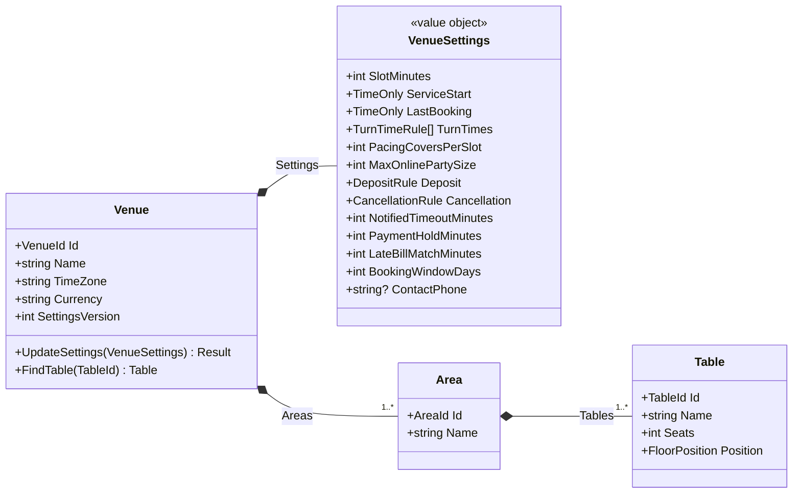

`BookingWindowDays` (30 by default, AC1.1) sets how far ahead a booking can be made: from today to that many days ahead, in venue time.

`ContactPhone` (M4b, optional) is the number the guest page shows to parties too large to book online (BR-04), e.g. `+64 9 000 0000` for Golden Dragon (fictional). When set it must be a possible NZ number of any kind (`PhoneNumber.IsPossibleNz`, else `contact_phone_invalid`). It is stored as entered, for display, and is not a booking term (§2.6).

`LateBillMatchMinutes` (30 minutes by default) sets how long after a host clears a table a late `BillClosed` from the POS can still be attached to that booking. The rule, and how to choose the window, are in §6.5.

#### Booking aggregate

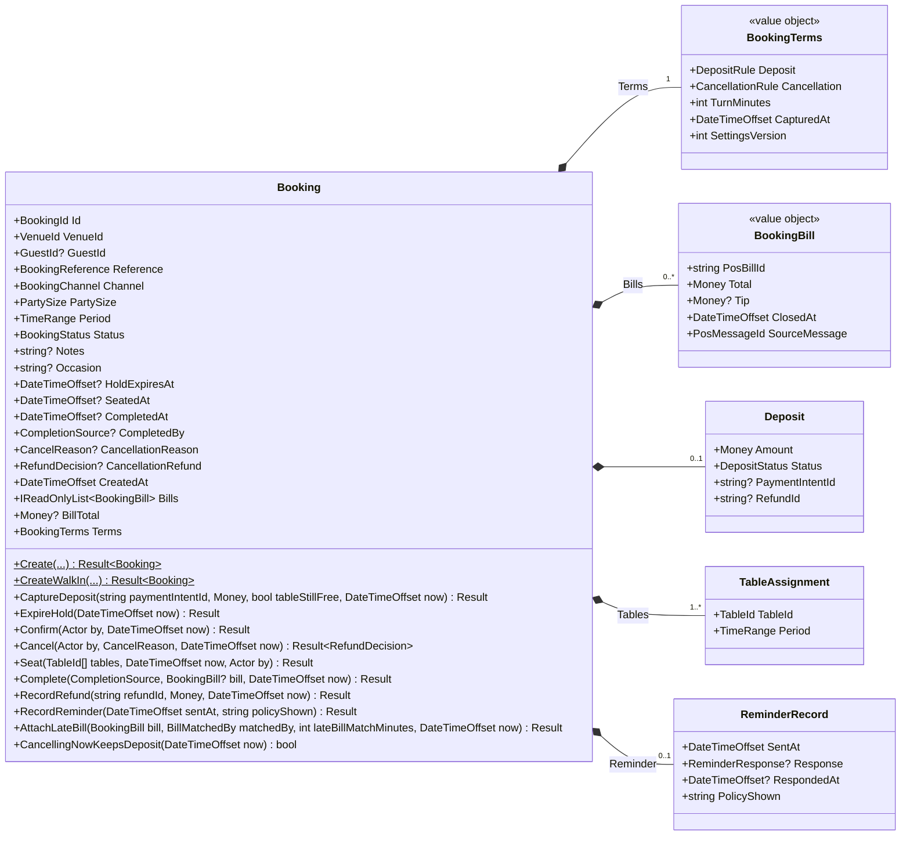

In practice, there is no Deposit repository, no deposit endpoint, and no code that loads or saves a deposit on its own. The deposit’s status changes only through Booking methods. CaptureDeposit moves it from Pending to Captured, ExpireHold or Cancel moves it to Released, and RecordRefund moves it to Refunded. Those methods also raise the events, such as DepositCaptured and DepositRefunded, so the events come from the booking, with the booking’s ID and sequence number.

The reason is that the deposit and the booking must always agree. A booking can’t be Booked while its deposit is still Pending. Cancelling a paid booking must start the refund decision at the same moment. Keeping both inside one aggregate means each change is checked and saved together in one transaction, so the two can never drift apart.

We can see this in the database too. The deposit has no table of its own: it’s stored as columns on the bookings table (deposit_cents, deposit_status, payment_intent_id, refund_id).

BillTotal is how much the guests spent, taken from the POS bill. It’s empty until a bill is matched to the booking. Having it on the booking means the guest’s visit history, average spend and later reports (revenue per cover, per channel) can use real amounts. An empty BillTotal also marks a booking that hasn’t received its bill yet, which is how the late-match rule knows a cleared booking can still take a late bill.

Domain methods take `now` as a value; handlers read it from `TimeProvider`, so the domain never reads the clock itself. `CaptureDeposit` cannot see other bookings, so `CaptureDepositHandler` re-checks the table and passes the answer as `tableStillFree`; it only matters once the hold has expired. `CancellationReason` and `CancellationRefund` keep why the booking was cancelled and the refund decision made at that moment: the first drives the `hold_expired` rule (§3.1), the second is returned again if `Cancel` is repeated.

CompletedBy records how the booking reached Completed: either BillClosed (the POS reported the bill paid) or ClearedByHost (a host tapped “Clear”). The late-match rule needs this, because it only attaches a late bill to bookings cleared by a host. A booking completed by BillClosed already has its bill. It also helps reports and checks: lots of ClearedByHost at a venue suggests the POS link isn’t working, or staff are skipping the POS.

#### Guest, waitlist entry and message aggregates

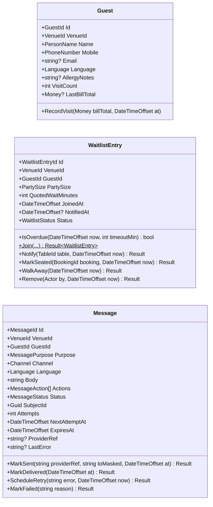

#### References between aggregates (by ID only)

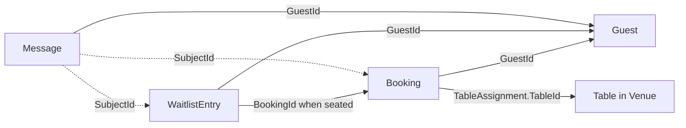

References between aggregates are **by ID only**; there are no navigation properties across aggregate boundaries.

### 2.3 Value objects

| **Value object**   | **Rules**                                                                                                                                 |
|--------------------|-------------------------------------------------------------------------------------------------------------------------------------------|
| `PartySize`        | 1–20 overall; online bookings limited by `MaxOnlinePartySize` (8, BR-04) in the command, not the type                                     |
| `PhoneNumber`      | Parsed from NZ input to E.164 (`+64…`) with libphonenumber; mobiles only (BR-12)                                                          |
| `PersonName`       | Trimmed, 1–80 characters                                                                                                                  |
| `Money`            | `long Cents`, `string Currency`; no floating point (BR-11)                                                                                |
| `TimeRange`        | `[Start, End)` in UTC; `End > Start`; maps to PostgreSQL `tstzrange`                                                                      |
| `BookingReference` | 6 characters from an unambiguous alphabet (no 0/O/1/I), unique per venue, e.g. `GD7K4P`                                                   |
| `FloorPosition`    | `X`, `Y`, `Rotation`, `Shape` (`Round` / `Rect`), `Width`, `Height` in floor units (ADR-001)                                              |
| `Actor`            | `Type` (`Guest` / `Staff` / `System` / `Pos`), `Id`, `Role?` (ADR-002 envelope)                                                           |
| `BookingTerms`     | A copy of the venue's deposit rule, cancellation rule and turn time, taken when the booking is created; never changed afterwards (§2.6)   |
| `BookingBill`      | One settled POS bill: POS bill ID, total, optional tip, closed time, source POS message. `Booking.BillTotal` is the sum of `Bills` (§6.6) |

### 2.4 Enumerations

| **Enum**                             | **Values**                                                                  |
|--------------------------------------|-----------------------------------------------------------------------------|
| `BookingStatus`                      | `PendingPayment`, `Booked`, `Confirmed`, `Seated`, `Completed`, `Cancelled` |
| `BookingChannel`                     | `Online`, `Phone`, `WalkIn`                                                 |
| `DepositStatus`                      | `Pending`, `Captured`, `Refunded`, `Released` (hold expired before payment) |
| `CancelReason`                       | `GuestRequest`, `HostRequest`, `HoldExpired`                                |
| `CompletionSource`                   | `BillClosed` (from POS), `ClearedByHost`                                    |
| `WaitlistStatus`                     | `Waiting`, `Notified`, `Seated`, `WalkedAway`, `Removed`                    |
| `MessagePurpose`                     | `Confirmation`, `Reminder`, `TableReady`, `Cancellation`, `Refund`          |
| `MessageStatus`                      | `Queued`, `Sent`, `Delivered`, `Failed`                                     |
| `TableState` (derived, never stored) | `Free`, `Booked`, `ArrivingSoon`, `Seated`                                  |

All enums are stored as text (ADR-003 DM-06).

#### About `BillClosed` and `ClearedByHost`

BillClosed and ClearedByHost are the two values of CompletionSource, an enum that records why a seated booking ended. A booking moves from Seated to Completed in one of two ways, and the design keeps track of which one happened.

BillClosed is the normal path once the POS is connected. The guests pay at the POS, and the POS sends a BillClosed message to the reservation system with the table and the bill total. The system finds the booking seated at that table and completes it with source: billClosed. It saves the bill total on the booking and adds a visit to the guest’s profile through Guest.RecordVisit, as AC6.6 requires. It then raises BookingCompleted and TableCleared, so every host screen shows the table as free. In the demo, the host’s “Bill paid” button stands in for the POS: it makes the mock POS send a signed BillClosed message, exactly as a real POS would, which is the flow shown in sequence 10.3.

`ClearedByHost` is the fallback, used when the host taps "Clear" on a seated table (AC4.1). It covers the times when no bill will come from the POS: the party left without ordering or paid somewhere else, the POS is offline or not yet connected, or the host is fixing a mistake such as a party seated at the wrong table. The booking completes with `source: clearedByHost` and no bill, so no spend is added to the guest's profile. The same two events are raised, so the floor plan updates exactly as it does after a paid bill. If the POS's bill arrives a little later, the late-match rule can still attach it (§6.5).

### 2.5 Table state is derived, not stored

A table has no status column. Its state on the floor plan is computed from active bookings for that table at `now` (venue time):

| **Order** | **Condition**                                                                                 | `TableState`   |
|-----------|-----------------------------------------------------------------------------------------------|----------------|
| 1         | A `Seated` booking is assigned to the table                                                   | `Seated`       |
| 2         | A `PendingPayment`, `Booked` or `Confirmed` booking starts within the next 30 minutes (AC2.3) | `ArrivingSoon` |
| 3         | Such a booking starts later today                                                             | `Booked`       |
| 4         | Otherwise                                                                                     | `Free`         |

This removes a whole class of "table and booking disagree" bugs. Clearing a table means completing the booking seated at it (§3.1).

### 2.6 Booking terms are copied at booking time

The venue's rules live in `venues.settings` (`VenueSettings`) and a manager can change them at any time. A guest must be held to the terms shown **when they booked** (AC5.6), not to whatever the venue's settings say later. So `Booking.Create` and `Booking.CreateWalkIn` copy the rules that matter into the booking as `BookingTerms`:

| **Copied**                                                                 | **From**                                                                 | **Used by**                                           |
|----------------------------------------------------------------------------|--------------------------------------------------------------------------|-------------------------------------------------------|
| `Deposit` (min party size, per-guest amount)                               | `VenueSettings.Deposit`                                                  | Deposit amount at creation; shown on the confirmation |
| `Cancellation` (free-until hours, refund when in time, host-cancel refund) | `VenueSettings.Cancellation`                                             | `RefundPolicy` when the booking is cancelled          |
| `TurnMinutes`                                                              | `VenueSettings.TurnTimes` for the party size                             | Booking period; seating length                        |
| `CapturedAt`, `SettingsVersion`                                            | Clock; a counter on the venue that goes up each time the settings change | Audit: which version of the rules applied             |

Rules:

- `BookingTerms` is set once, in `Create` / `CreateWalkIn`, and has no setters. Changing the venue's settings never touches existing bookings.
- `RefundPolicy` and the guest's manage-booking page read `booking.Terms`, never the venue's current settings.
- The confirmation and reminder messages render the cancellation wording from `booking.Terms`; `ReminderRecord.PolicyShown` stores the exact text the guest saw.
- If a venue needs to change terms for existing bookings (rare, e.g. a goodwill refund), a manager cancels with a host refund (§8.3) rather than editing the terms.
- Pacing, slots, service hours and the booking window (`BookingWindowDays`) are **not** copied: they apply when a booking is made or seated, not afterwards.
- `TurnMinutes` for a party larger than every `TurnTimeRule` (a phone booking or walk-in of 9–20) uses the rule with the largest party size (120 minutes at Golden Dragon).

Stored as `bookings.terms jsonb` (§13), mapped with `OwnsOne(b => b.Terms, t => t.ToJson())`. Example:

```
{
  "deposit": { "minPartySize": 6, "perGuestCents": 2000 },
  "cancellation": { "freeUntilHoursBefore": 2, "refundWhenInTime": "full", "hostCancelRefund": "full" },
  "turnMinutes": 120,
  "capturedAt": "2026-11-20T05:12:44Z",
  "settingsVersion": 3
}
```

## 3. State machines

### 3.1 Booking

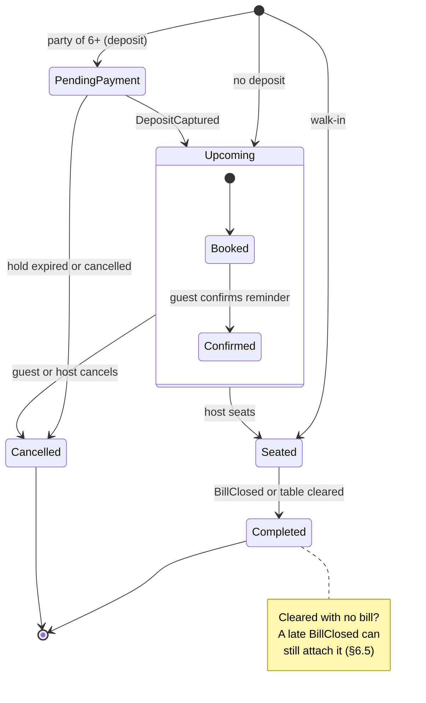

| **Transition**                 | **Method**       | **Guards**                                                                                                                 | **Effects**                                                                                                           | **Events raised**                                           |
|--------------------------------|------------------|----------------------------------------------------------------------------------------------------------------------------|-----------------------------------------------------------------------------------------------------------------------|-------------------------------------------------------------|
| → `PendingPayment`             | `Create`         | Online booking; party within online limit; slot within service hours; deposit rule applies (phone bookings never take a deposit) | `Terms` copied from venue settings (§2.6); `HoldExpiresAt = now + 10 min`; `Deposit.Status = Pending`; table assigned | `BookingCreated`                                            |
| → `Booked`                     | `Create`         | As above, no deposit                                                                                                       | `Terms` copied (§2.6); table assigned                                                                                 | `BookingCreated`                                            |
| → `Seated`                     | `CreateWalkIn`   | Table free now for the turn time                                                                                           | `Channel = WalkIn`; `Period = [now, now + turn)`; `SeatedAt = now`                                                  | `BookingCreated`, `BookingSeated` (`source: walkIn`)        |
| `PendingPayment` → `Booked`    | `CaptureDeposit` | Status is `PendingPayment`; amount equals deposit due; `now < HoldExpiresAt`, **or** the hold has expired but the expiry job has not run yet and the re-checked table is still free | `Deposit.Status = Captured`; `HoldExpiresAt = null`                                                                   | `DepositCaptured`                                           |
| `PendingPayment` → `Cancelled` | `CaptureDeposit` | Status is `PendingPayment`; the hold has expired (expiry job not run yet) and the re-checked table is taken | `Deposit.Status = Captured`, then `Cancel(HoldExpired)`: table released, refund decision `full` (§8.3)                | `BookingCancelled` (`reason: HoldExpired`) (+ `DepositRefunded` later, from Stripe) |
| `Cancelled` (no change)        | `CaptureDeposit` | Status is `Cancelled` with reason `HoldExpired` (the expiry job already ran)                                               | None. Returns `Error hold_expired`; `CaptureDepositHandler` refunds the payment (§8.1)                                | —                                                           |
| `PendingPayment` → `Cancelled` | `ExpireHold`     | `now ≥ HoldExpiresAt`                                                                                                      | `Deposit.Status = Released`; table released                                                                           | `BookingCancelled` (`reason: HoldExpired`)                  |
| `Booked` → `Confirmed`         | `Confirm`        | Status `Booked`; `now < Period.Start`                                                                                      | Reminder response recorded                                                                                            | `BookingConfirmed`                                          |
| → `Seated`                     | `Seat`           | Status `Booked` or `Confirmed`; tables free from `now` to `now + turn`                                                     | `Period = [now, now + turn)`; `SeatedAt = now`; tables reassigned if host chose others                                | `BookingSeated` (`source: booking`)                         |
| → `Cancelled`                  | `Cancel`         | Status `PendingPayment`, `Booked` or `Confirmed`                                                                           | Table released; refund decision (§8.3)                                                                                | `BookingCancelled` (+ `DepositRefunded` later, from Stripe) |
| `Seated` → `Completed`         | `Complete`       | Status `Seated`                                                                                                            | Bill added to `Bills` if from POS                                                                                     | `BookingCompleted`, `TableCleared`                          |
| `Completed` → `Completed`      | `AttachLateBill` | Completed by `ClearedByHost`; `Bills` empty; `matchedBy = Manual` or `closedAt` within `LateBillMatchMinutes` of `CompletedAt`, before or after, otherwise `outside_late_match_window`. The same `posBillId` again is a no-op; a different bill returns `second_bill` | Bill added to `Bills`                                                                                                 | `BookingBillAttached`                                       |

Any transition not in the table returns `Error.Conflict("invalid_transition")` → HTTP `409` with code `invalid_transition`. The front end refetches the record and shows "This booking has just changed". `422 rule_broken` is kept for business rules broken by valid input (e.g. `deposit_required`). Calling a method that leads to the current state (for example a second `Confirm`) is a no-op that returns success and raises nothing, so repeated taps and retried requests are safe.

**Active statuses** (hold a table in the exclusion constraint): `PendingPayment`, `Booked`, `Confirmed`, `Seated`.

### 3.2 Waitlist entry

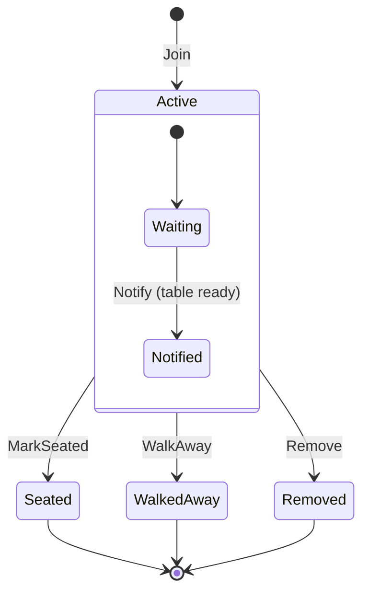

| **Transition**        | **Guard**                                                                               | **Events**                                          |
|-----------------------|-----------------------------------------------------------------------------------------|-----------------------------------------------------|
| `Join`                | Party size 1–20; quoted wait 0–240 min                                                  | `WaitlistJoined`                                    |
| `Notify`              | Status `Waiting` or `Notified` (re-notify allowed; `NotifiedAt` updated)                | `WaitlistNotified`                                  |
| `MarkSeated`          | Status `Waiting` or `Notified`; the walk-in booking was created in the same transaction | `WaitlistEnded` (`outcome: seated`)                 |
| `WalkAway` / `Remove` | Status `Waiting` or `Notified`                                                          | `WaitlistEnded` (`outcome: walkedAway` / `removed`) |

**Overdue** (AC4.6, BR-10) is a computed flag, not a state: `Status == Notified && now − NotifiedAt > 10 min`. The host app shows it; a timer job (§16) pushes `waitlistChanged` when an entry becomes overdue so screens update without polling.

### 3.3 Deposit (inside `Booking`)

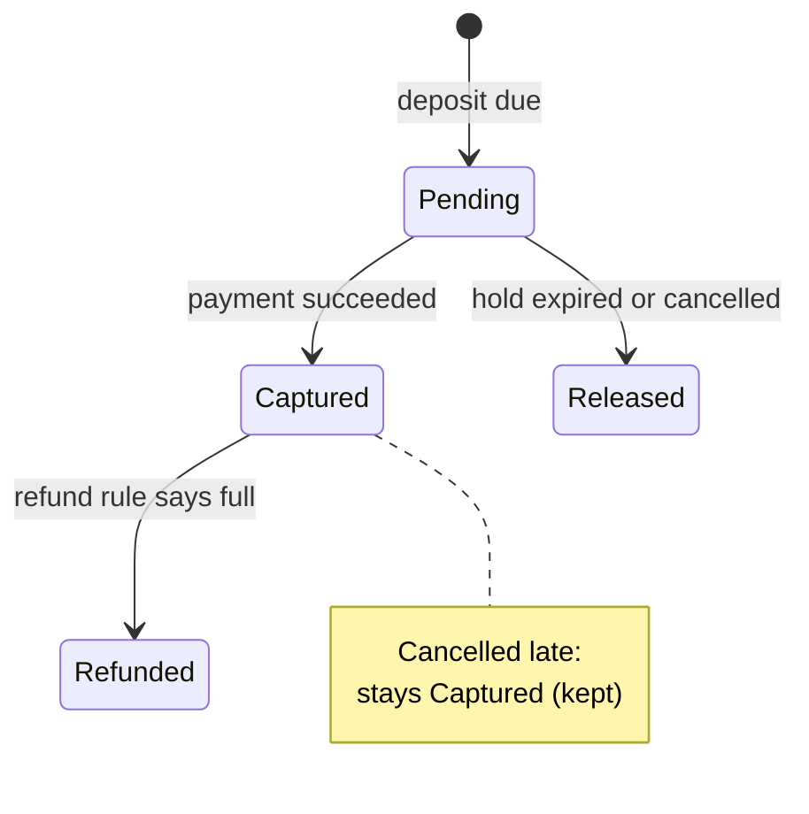

### 3.4 Message

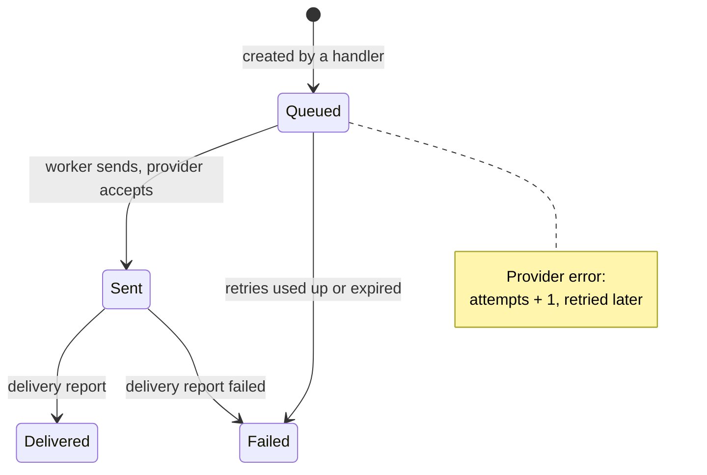

Queued is a status on the messages row, not a separate queue product: PostgreSQL is the queue (§7.1). MessageDeliveryWorker moves rows from Queued to Sent, and MessageSent is raised on that transition. In the demo the phone-panel sender marks Delivered about 1 s after Sent (AC4.4).

### 3.5 Outbox row and POS message

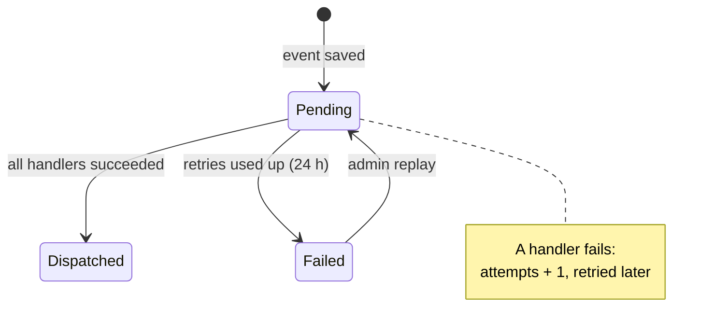

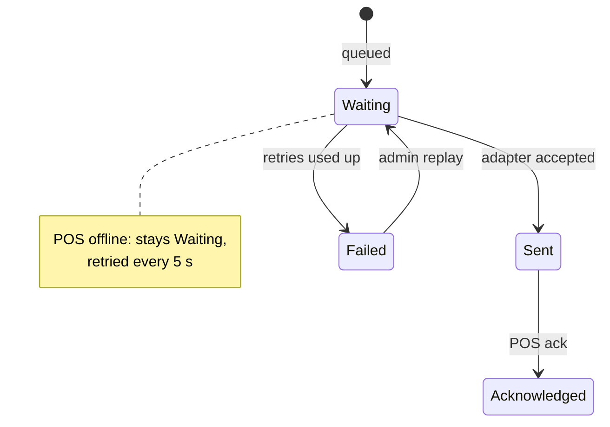

Inbound POS messages (BillClosed) are stored in the same table with direction = inbound:

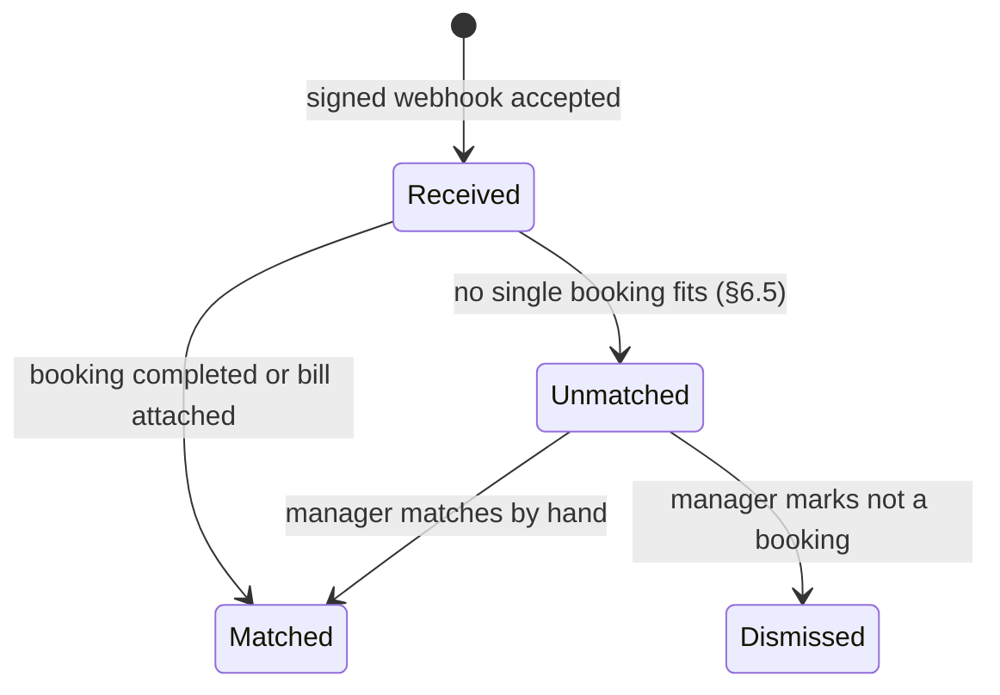

## 4. Domain events

### 4.1 Types

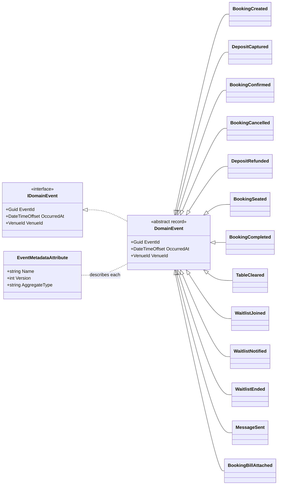

```
public abstract record DomainEvent(Guid EventId, DateTimeOffset OccurredAt, VenueId VenueId) : IDomainEvent;

[EventMetadata("BookingSeated", Version = 1, AggregateType = "Booking")]
public sealed record BookingSeated(
    Guid EventId, DateTimeOffset OccurredAt, VenueId VenueId,
    BookingId BookingId, TableId[] TableIds, int PartySize,
    SeatSource Source, Guid? WaitlistEntryId, DateTimeOffset SeatedAt)
    : DomainEvent(EventId, OccurredAt, VenueId);
```

### 4.2 Catalogue with payloads (v1)

| **Event**             | **Aggregate** | **Payload (besides the envelope)**                                                                                |
|-----------------------|---------------|-------------------------------------------------------------------------------------------------------------------|
| `BookingCreated`      | Booking       | `bookingId, guestId?, reference, channel, partySize, startsAt, endsAt, tableIds[], depositCents?, holdExpiresAt?` |
| `DepositCaptured`     | Booking       | `bookingId, paymentIntentId, amountCents`                                                                         |
| `BookingConfirmed`    | Booking       | `bookingId, confirmedBy (actor)`                                                                                  |
| `BookingCancelled`    | Booking       | `bookingId, reason, cancelledBy, refundDecision (full / none / notApplicable)`                                    |
| `DepositRefunded`     | Booking       | `bookingId, refundId, amountCents`                                                                                |
| `BookingSeated`       | Booking       | `bookingId, tableIds[], partySize, source (booking / walkIn), waitlistEntryId?, seatedAt`                         |
| `BookingCompleted`    | Booking       | `bookingId, source (billClosed / clearedByHost), posBillId?, billTotalCents?, closedAt`                           |
| `TableCleared`        | Booking       | `bookingId, tableIds[], clearedAt`                                                                                |
| `WaitlistJoined`      | WaitlistEntry | `waitlistEntryId, guestId, partySize, quotedMinutes`                                                              |
| `WaitlistNotified`    | WaitlistEntry | `waitlistEntryId, tableId, notifiedAt`                                                                            |
| `WaitlistEnded`       | WaitlistEntry | `waitlistEntryId, outcome (seated / walkedAway / removed), bookingId?`                                            |
| `MessageSent`         | Message       | `messageId, purpose, channel, subjectId, toMasked`                                                                |
| `BookingBillAttached` | Booking       | `bookingId, posBillId, billTotalCents, posMessageId, matchedBy (lateMatch / manual), attachedAt`                  |

`TableCleared` belongs to the `Booking` aggregate because table state is derived (§2.5); it exists so floor-plan consumers do not need to know completion rules.

### 4.3 Who consumes what

| **Event**                          | **Realtime**                 | **Notifications**                        | **POS**                       | **Audit** | **Waitlist suggester** | **Guest**       |
|------------------------------------|------------------------------|------------------------------------------|-------------------------------|-----------|------------------------|-----------------|
| `BookingCreated`                   | ●                            | ● (confirmation, unless pending payment) | ● `UpsertMember`              | ●         |                        |                 |
| `DepositCaptured`                  | ●                            | ● (confirmation)                         |                               | ●         |                        |                 |
| `BookingConfirmed`                 | ●                            |                                          |                               | ●         |                        |                 |
| `BookingCancelled`                 | ●                            | ● (cancellation)                         |                               | ●         | ●                      |                 |
| `DepositRefunded`                  | ●                            | ● (refund)                               |                               | ●         |                        |                 |
| `BookingSeated`                    | ●                            |                                          | ● `OpenTable`, `ApplyDeposit` | ●         |                        |                 |
| `BookingCompleted`                 | ●                            |                                          |                               | ●         |                        | ● `RecordVisit` |
| `TableCleared`                     | ●                            |                                          |                               | ●         | ●                      |                 |
| `WaitlistJoined` / `WaitlistEnded` | ●                            |                                          |                               | ●         |                        |                 |
| `WaitlistNotified`                 | ●                            | ● (table ready)                          |                               | ●         |                        |                 |
| `MessageSent`                      | ● (phone panel, message log) |                                          |                               | ●         |                        |                 |
| `BookingBillAttached`              | ● (POS log)                  |                                          |                               | ●         |                        | ● `RecordVisit` |

**The columns (the consumers)**

| **Column** | **Handler** | **What it does** |
| --- | --- | --- |
| Realtime | `RealtimeNotifier` | Pushes a small SignalR notice (`floorPlanChanged`, `waitlistChanged`, …) so host screens refetch and update within 2 seconds |
| Notifications | `NotificationHandler` | Queues a text or email to the guest; `MessageDeliveryWorker` sends it (§7.1) |
| POS | `PosProjectionHandler` | Turns the event into a message for the POS (`UpsertMember`, `OpenTable`, `ApplyDeposit`) and queues it for ordered delivery (§6) |
| Audit | `AuditHandler` | Writes a row to the audit log: who did what, and when |
| Waitlist suggester | `WaitlistSuggester` | When a table frees up, works out which waiting party fits first (AC4.2, BR-09) and highlights it; it changes no data |
| Guest | `GuestVisitHandler` | Updates the guest's profile (visit count and last bill) |

**Reading the rows**

- **Realtime and Audit react to every event.** Every change should show on host screens straight away, and every change should be traceable. Those two columns are full for that reason.
- **`BookingCreated` sends a confirmation "unless pending payment".** For a party of 6 or more, the booking starts as `PendingPayment` while the guest pays the deposit. Confirming before the payment succeeds would be wrong, so in that case the confirmation is sent on `DepositCaptured` instead. `BookingCreated` also sends `UpsertMember` to the POS, so the guest is known as a member before they arrive.
- **`BookingSeated` is the main POS trigger.** It opens the table in the POS (`OpenTable`) and, if a deposit was paid, credits it to the bill (`ApplyDeposit`).
- **`BookingCancelled` and `TableCleared` trigger the waitlist suggester.** Both free a table, so the suggester checks whether someone on the waitlist now fits.
- **`BookingCompleted` and `BookingBillAttached` update the guest.** A booking ends with a bill from the POS, or a late bill is attached afterwards (§6.5). Either way the guest's visit and spend are recorded with `RecordVisit`.
- **`WaitlistNotified` sends the "table ready" text.**
- **`MessageSent` and `BookingBillAttached` show in the presenter's logs.** These are the phone panel and the POS log. The demo audience watches them, so they get their own real-time notices.

## 5. Event infrastructure: outbox, dispatcher, inbox

### 5.1 Classes

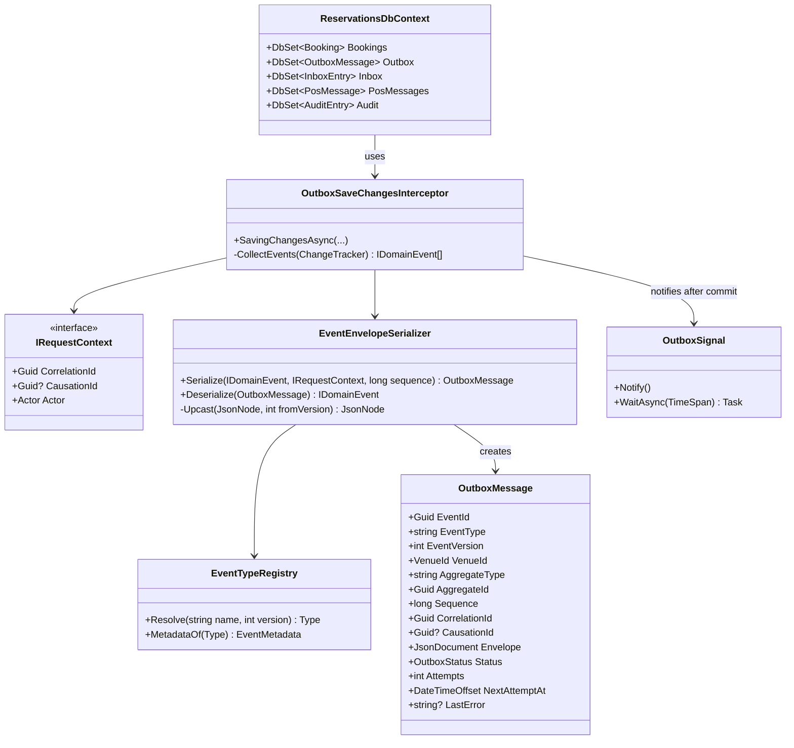

When a handler calls SaveChangesAsync(), OutboxSaveChangesInterceptor collects the events the changed records raised, turns each one into an OutboxMessage row (using EventEnvelopeSerializer and IRequestContext), and adds those rows to the same save. After commit, it pokes OutboxSignal so the dispatcher wakes up at once.

| **Class**                    | **Role**                                                                                                                                                                                                                                                                                                                                                                    |
|------------------------------|-----------------------------------------------------------------------------------------------------------------------------------------------------------------------------------------------------------------------------------------------------------------------------------------------------------------------------------------------------------------------------|
| ReservationsDbContext        | The EF Core database context: one DbSet per table, here bookings, outbox, inbox, POS messages and audit. “uses” means the interceptor is registered on it, so every save goes through the interceptor automatically.                                                                                                                                                        |
| OutboxSaveChangesInterceptor | An EF Core interceptor, a hook that runs just before EF writes to the database. SavingChangesAsync runs on every save, and CollectEvents asks every tracked AggregateRoot for its DomainEvents. Handlers never write outbox rows themselves, so they can’t forget to.                                                                                                       |
| IRequestContext              | Who and why: the CorrelationId (shared by everything one guest or host action causes), the CausationId (the event or command that caused this one) and the Actor (guest, staff, system or POS). These go into every event’s envelope (ADR-002), so any change can be traced end to end.                                                                                     |
| EventEnvelopeSerializer      | Converts between events and rows. Serialize wraps an event in the standard envelope (ID, type, version, venue, aggregate, sequence, correlation, actor) and produces an OutboxMessage. Deserialize does the reverse for the dispatcher. Upcast upgrades an old event version to the current one, so old rows can still be read after an event changes (ADR-002 versioning). |
| EventTypeRegistry            | A lookup between event names and C# types. Resolve("BookingSeated", 1) returns the BookingSeated type, and MetadataOf reads its \[EventMetadata\] attribute (name, version, aggregate type). The table stores a name, not a C# type name, so renaming a class doesn’t break stored events.                                                                                  |
| OutboxMessage                | One row in the outbox table. The event fields (EventId, EventType, EventVersion, VenueId, AggregateType, AggregateId, Sequence, CorrelationId, CausationId) and the full JSON Envelope are written once. The delivery fields (Status, Attempts, NextAttemptAt, LastError) are later updated by the dispatcher as it delivers and retries.                                   |
| OutboxSignal                 | A tiny in-process doorbell. Notify() is called after commit; the dispatcher waits on WaitAsync(1s). Events go out within milliseconds instead of waiting for the next once-a-second poll.                                                                                                                                                                                   |

#### Dispatching side

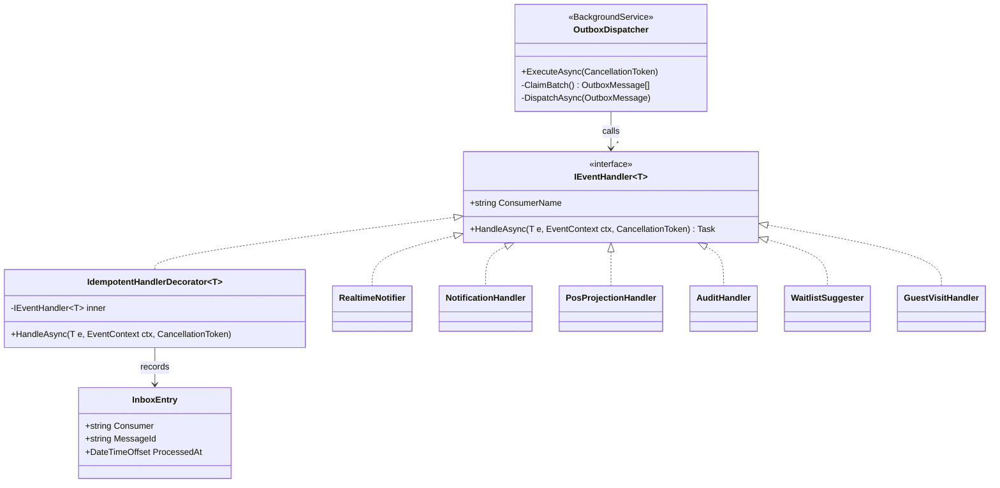

`OutboxDispatcher` also uses `OutboxSignal` (to wake) and `EventEnvelopeSerializer` (to read rows). Every handler except `RealtimeNotifier` is registered wrapped in `IdempotentHandlerDecorator<T>`.

`IEventPublisher` (named in ADR-002) is the interface command handlers use when they need to raise an event that does not come from an aggregate (rare: demo reset). Its implementation adds the event to the current `DbContext` so it is written by the same interceptor. Aggregates never call it; they use `Raise`.

### 5.2 Writing events (inside the request)

1.  A handler loads aggregates, calls domain methods, and calls `SaveChangesAsync`.
2.  `OutboxSaveChangesInterceptor` collects `DomainEvents` from every tracked `AggregateRoot`, uses the sequence number stamped on each event when it was raised (`LastEventSequence`, §2.2), wraps each in the envelope with `correlationId`, `causationId` and `actor` from `IRequestContext`, and adds `OutboxMessage` rows **to the same transaction**.
3.  After commit, it clears the events from the aggregates and calls `OutboxSignal.Notify()` so the dispatcher wakes in milliseconds instead of waiting for the 1 s poll.

### 5.3 Dispatching events (outside the request)

```
loop:
  await signal.WaitAsync(1s)                          -- or the 1 s poll
  BEGIN
    rows = SELECT … FROM outbox
           WHERE status = 'Pending' AND next_attempt_at <= now()
             AND aggregate_id NOT IN (aggregates with an earlier Pending/Failed row)
           ORDER BY aggregate_id, sequence
           LIMIT 50
           FOR UPDATE SKIP LOCKED
    for each row (in order per aggregate):
      event = deserialize(row)                        -- with upcasting
      for each handler of event type:
        await handler.HandleAsync(event)              -- each handler idempotent
      row.status = 'Dispatched'
      on exception in any handler:
        row.attempts++; row.next_attempt_at = now + backoff(attempts)
        row.status = attempts > max ? 'Failed' : 'Pending'
        skip the rest of this aggregate's rows in this batch (keeps order)
  COMMIT
```

Backoff: 5 s, 30 s, 2 min, 10 min, then every 30 min until 24 h after the first attempt (ADR-002).

### 5.4 Idempotent handlers

`IdempotentHandlerDecorator<T>` wraps every handler that changes state. It runs **inside the dispatcher's transaction** (§5.3), which holds the lock on the outbox rows and so keeps events in order. Each handler gets its own savepoint: if it fails, only its own work and its inbox row are rolled back, and the dispatcher schedules a retry for the event. Nothing is committed until the dispatcher commits the batch, and a handler that already succeeded is skipped on the retry because its inbox row exists.

```
public async Task HandleAsync(T e, EventContext ctx, CancellationToken ct)
{
    var tx = _db.Database.CurrentTransaction!;               // the dispatcher's transaction
    await tx.CreateSavepointAsync(_inner.ConsumerName, ct);
    try
    {
        var inserted = await _db.Database.ExecuteSqlAsync(
            $"INSERT INTO inbox (consumer, message_id, processed_at) VALUES ({_inner.ConsumerName}, {e.EventId.ToString()}, now()) ON CONFLICT DO NOTHING", ct);
        if (inserted == 0) return;                           // already processed
        await _inner.HandleAsync(e, ctx, ct);                // writes its own rows via the same DbContext
        await _db.SaveChangesAsync(ct);
    }
    catch
    {
        await tx.RollbackToSavepointAsync(_inner.ConsumerName, ct);
        throw;                                               // the dispatcher retries this event later
    }
}
```

The dispatcher and its handlers share one `DbContext` per batch. Side effects outside the database (a SignalR push, a Stripe refund request) can happen before the batch commits, so they must be safe to repeat: pushes only trigger a refetch, and Stripe calls carry an idempotency key.

`RealtimeNotifier` is **not** wrapped: a repeated push only causes one extra refetch.

### 5.5 Inbound messages (Stripe, POS)

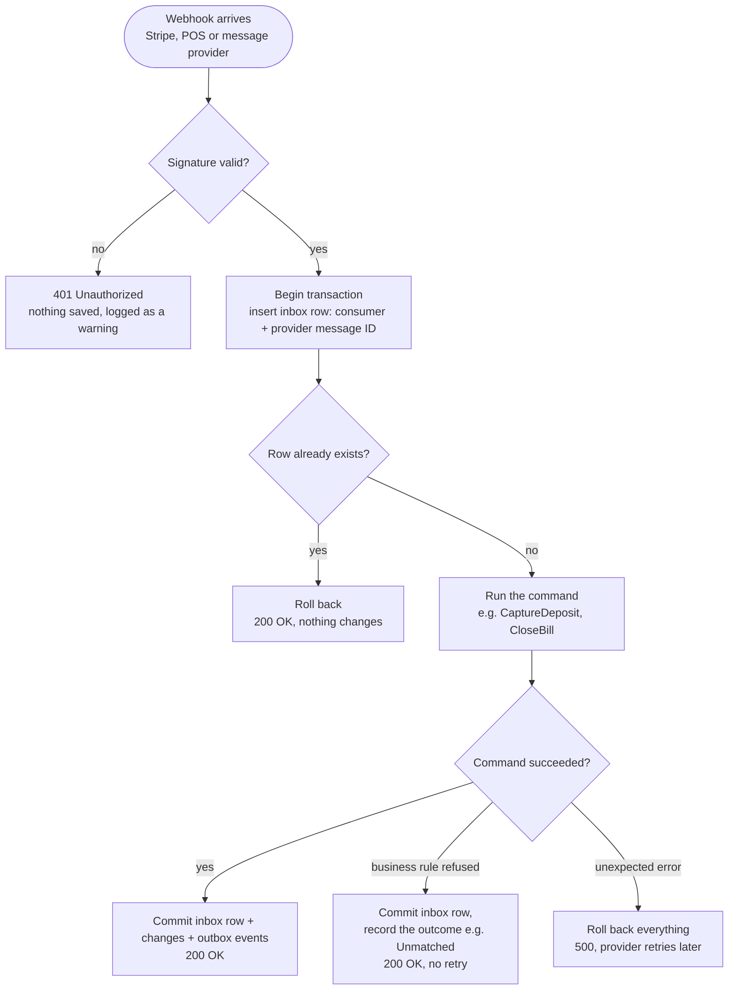

Webhooks use the same inbox table with consumer = 'stripe-webhook', 'pos-webhook' or 'message-webhook' \[pilot\] and the provider's message ID. The webhook endpoint verifies the signature, inserts the inbox row and runs the command in one transaction, then returns 200. A repeat returns 200 and does nothing.

*How a webhook becomes a command*

The endpoint reads the provider’s message and maps it to a command. CaptureDeposit and CloseBill are the two main examples.

| **Webhook**                                | **Command**           | **What the handler does**                                                     | **Main outcome**                                                                       |
|--------------------------------------------|-----------------------|-------------------------------------------------------------------------------|----------------------------------------------------------------------------------------|
| Stripe payment_intent.succeeded            | CaptureDeposit        | Loads the booking by its payment intent and calls booking.CaptureDeposit(...) | PendingPayment → Booked; raises DepositCaptured, and the guest gets the confirmation   |
| Stripe charge.refunded                     | RecordRefund          | Calls booking.RecordRefund(...)                                               | Deposit → Refunded; raises DepositRefunded                                             |
| POS BillClosed                             | CloseBill             | Applies the matching rules in §6.5                                            | Completes the seated booking, or attaches a late bill, or stores the bill as Unmatched |
| Message provider delivery report \[pilot\] | Update message status | Finds the message by provider reference                                       | Message → Delivered or Failed                                                          |

### 5.6 Build notes (M3)

Details §5.1–§5.4 left open, settled when the event infrastructure was built (`src/Infrastructure/Outbox`, `src/Contracts`).

**Two clocks.** Workers use the infrastructure clock; the domain uses the business clock.

| **Clock** | **Registered as** | **Used for** |
|-----------|-------------------|--------------|
| Business | The default `TimeProvider`; `DemoClock` replaces it in the demo (§17) | The `now` handlers pass to aggregates, so every event's `occurredAt` (and `audit_log.occurred_at`); anything else domain-related |
| Infrastructure | Keyed `TimeProvider` `"infrastructure"` (`Clocks.Infrastructure`), always `TimeProvider.System`, never replaced by `DemoClock` | `OutboxSignal.WaitAsync` and the 1 s poll; the claim query's "now"; `outbox.created_at`, `next_attempt_at` and `dispatched_at`; `OutboxRetryPolicy`; `OutboxHousekeeping`; `OutboxHealthCheck`; `inbox.processed_at` |

With `DemoClock` fixed at 18:25, retries, polling and housekeeping still run on real time. The M7 `MessageDeliveryWorker`, the M9 `PosDeliveryWorker` and the other §16 jobs follow the same rule. A job's timer, retry and bookkeeping times use the infrastructure clock. Any `now` it passes to the domain, such as `ExpireHold` or message expiry, uses the business clock. Tests set both clocks to separate `TestClock`s.

| **Topic** | **Decision** |
|-----------|--------------|
| Envelope | `EventEnvelope` and `EnvelopeActor` in `src/Contracts` (no Domain reference), shaped as in ADR-002. Stored in `outbox.envelope` |
| Payload | The event record as JSON (camelCase, enums as camelCase strings, strongly typed IDs as plain UUIDs, `EventJson.Options`), minus `eventId`, `occurredAt` and `venueId`, which live in the envelope. `Deserialize` puts them back. `occurredAt` is the event's own `OccurredAt` (business clock) |
| Event names | `EventTypeRegistry` reads `[EventMetadata]` from the Domain assembly at start-up and fails on a duplicate name or a missing aggregate type |
| Upcasting | Every event is v1, so there are no upcasters yet. Reading an unknown older or newer version fails that row, which is then retried and eventually `Failed` |
| Request context | `RequestContext` is scoped and mutable. By default it has a new UUID v7 correlation ID per scope and the system actor; `RequestContext.DemoHost` is `Staff("demo-host", "Host")`. M4 fills it from the HTTP request. The dispatcher sets it per event (correlation copied, causation = the event's ID, actor = system), so events raised by handlers trace back to their cause |
| Interceptor lifetime | `OutboxSaveChangesInterceptor` is scoped (one per `DbContext`), because it remembers what the current save added. On a failed or cancelled save it detaches the outbox rows it added, so a retry doesn't add them twice. It clears the aggregates' events only after a successful save |
| Signal after commit | With no explicit transaction, `Notify()` runs right after the save. Inside one, it runs when that transaction commits (the interceptor is also an `IDbTransactionInterceptor`). A rollback rings nothing |
| Stale aggregate | Two writers of one aggregate raise the same sequence. The outbox key `(aggregate_id, sequence)` can refuse the second before the xmin check runs, so `ReservationsDbContext` turns that unique violation into `DbUpdateConcurrencyException` (→ `409 version_conflict`, §12) |
| Claim query | Rows that are `Pending`, due (`next_attempt_at <= now`), and have no earlier row of their aggregate that is not `Dispatched`, `ORDER BY next_attempt_at, event_id LIMIT 50 FOR UPDATE SKIP LOCKED`. So at most one row per aggregate per batch, and a `Failed` row holds later events of its own aggregate only. A full batch loops at once; otherwise the dispatcher waits for the signal or the poll |
| All handlers run | Every handler of the event runs, even after one fails, each in its own savepoint (`outbox_handler`, released on success). The row is `Dispatched` only if all succeeded. Otherwise `attempts + 1`, and `last_error` is `consumer: ExceptionType: message` (all failures joined, at most 2000 characters). Handlers that succeeded are skipped on the retry by their inbox rows. After a failed handler, and after each event, the dispatcher clears the change tracker so no stale entity crosses a savepoint |
| Unwrapped handlers | Registered with `AddEventHandler(..., idempotent: false)` (the later `RealtimeNotifier`). They must be safe to repeat and must not write to the database |
| Retry schedule | `OutboxRetryPolicy`: 5 s, 30 s, 2 min, 10 min, then every 30 min. The 24 hours count from `created_at`, since the schema has no first-attempt column. A retry that would fall later marks the row `Failed` (52 attempts in all) and logs an error. Each retry logs a warning. Updates use `ExecuteUpdate`, not tracked entities |
| Audit consumer | `AuditHandler<T>` (consumer `audit`) is registered for every event, wrapped. It writes one `audit_log` row: actor = the envelope actor, summary = the payload (IDs only), `occurred_at` = the event's `OccurredAt` |
| Options | Section `Outbox`: `PollInterval` (1 s), `BatchSize` (50), `RunWorkers` (true; the API test host sets it to false), validated at start-up |
| Housekeeping | `OutboxHousekeeping` runs once at start, then daily on a `PeriodicTimer` on the infrastructure clock. It deletes `Dispatched` rows whose `dispatched_at` is more than 30 days old |
| Health | `/health/ready` adds `OutboxHealthCheck`. It is Degraded (still `200`) when any row is `Failed` or the oldest due `Pending` row is more than 30 s overdue, and Unhealthy when the outbox can't be read |
| Test hooks | `OutboxDispatcher.DispatchBatchAsync` runs one claim–deliver–commit cycle; `OutboxHousekeeping.PurgeAsync` runs one purge. Tests drive these directly, and run the background loop only where the polling itself is under test |

## 6. POS integration

### 6.1 Classes

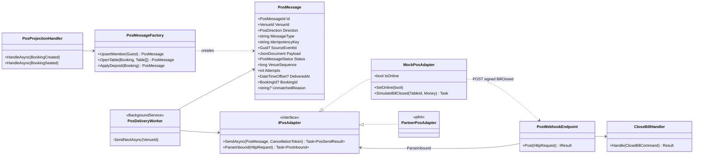

It shows two paths. The outbound path, along the top and left, sends messages from the reservation system to the POS. The inbound path, on the right, receives BillClosed back from the POS. Both go through one interface, IPosAdapter, so the rest of the system never depends on which POS is on the other end.

*Outbound: from event to POS*

The outbox dispatcher delivers BookingCreated and BookingSeated to PosProjectionHandler.

It asks PosMessageFactory to build the right POS message: UpsertMember for a new booking with a guest, OpenTable (and ApplyDeposit if a deposit was paid) when a party is seated.

The factory creates a PosMessage row with status Waiting. It isn’t sent yet, just stored in order.

PosDeliveryWorker, a background service, picks up waiting rows for each venue in VenueSequence order and sends them through IPosAdapter.SendAsync. If the POS is offline, the message stays Waiting and is retried (AC6.5).

*Inbound: from POS bill to booking*

The POS posts a signed BillClosed to PosWebhookEndpoint. In the demo, MockPosAdapter.SimulateBillClosed does this when the host taps “Bill paid”.

The endpoint calls IPosAdapter.ParseInbound, which checks the message and turns the POS’s own format into a standard PosInbound object.

It then calls CloseBillHandler, which applies the matching rules in §6.5: complete the seated booking, attach a late bill, or store the bill as Unmatched.

| Class                       | Role                                                                                                                                                                                                                                                |
|-----------------------------|-----------------------------------------------------------------------------------------------------------------------------------------------------------------------------------------------------------------------------------------------------|
| PosProjectionHandler        | Event handler that decides which POS messages an event needs. It only creates messages and never calls the POS, so a slow POS can’t hold up other handlers.                                                                                         |
| PosMessageFactory           | Builds each message’s payload and its idempotency key ({eventId}:OpenTable), which the POS uses to ignore repeats.                                                                                                                                  |
| PosMessage                  | One row in pos_messages, for both directions. It holds the type, payload, idempotency key, source event, status, the per-venue sequence number that keeps the order, the attempt count and the delivered time. For inbound bills, `BookingId` records the booking the bill was matched to, and `UnmatchedReason` records why it wasn't matched (`no_match`, `ambiguous`, `second_bill`). The POS log screen reads these rows. |
| PosDeliveryWorker           | Sends waiting messages per venue strictly in order. Message n + 1 is never sent before n. It retries while the POS is offline.                                                                                                                      |
| IPosAdapter                 | The single seam to the POS: SendAsync for outbound, ParseInbound for inbound. Everything POS-specific lives behind it.                                                                                                                              |
| MockPosAdapter              | The demo’s POS. It accepts messages, can be switched online and offline (SetOnline), and simulates BillClosed for the “Bill paid” button.                                                                                                           |
| PartnerPosAdapter \[pilot\] | The real adapter for the partner’s POS, built once their API, message formats and security are known. Only this class changes.                                                                                                                      |
| PosWebhookEndpoint          | Receives inbound POS messages, verifies the signature, uses the inbox to skip repeats (§5.5), then runs CloseBill.                                                                                                                                  |
| CloseBillHandler            | Matches the bill to a booking (§6.5) and records the outcome.                                                                                                                                                                                       |

### 6.2 Why two steps (event → POS message → delivery)

The POS log must show messages **waiting** while the POS is offline (AC6.5), so a POS message is a stored record from the moment its event is handled, with its own ordered delivery per venue. The outbox delivers the event once; the POS queue then retries the POS call as long as needed without holding up other event handlers.

Both POS log and POS queue refer to the same thing: the pos_messages table, used in two ways. The POS queue is how the system sends from it. The POS log is how people see it.

***The POS queue***

There is no separate queue product. The queue is simply the outbound rows in pos_messages that are still Waiting, worked through by PosDeliveryWorker.

How a message moves through it:

1. A party is seated, so `BookingSeated` is raised and saved to the outbox.
2. The outbox dispatcher hands the event to `PosProjectionHandler`, which inserts an `OpenTable` row: direction `outbound`, status `Waiting`, the next `VenueSequence` number for that venue. Inserting a row takes milliseconds and can't fail because of the POS, so the outbox marks the event done.
3. `PosDeliveryWorker` picks up the venue's oldest waiting row and calls `IPosAdapter.SendAsync`:
    - **accepted:** the row becomes `Sent`, then `Acknowledged` if the POS confirms
    - **POS offline:** the row stays `Waiting` and is tried again in 5 seconds
    - **retries used up:** the row becomes `Failed` and appears for an admin to replay

***The POS log***

The POS log is a screen: the side panel on the presenter screen in the demo (step 6, AC6.1–AC6.2), and an admin page in the pilot. It reads pos_messages rows in both directions, newest first.

It updates live: every status change pushes posLogChanged over SignalR, so the screen refetches without a reload. Managers can filter it to status=unmatched to match or dismiss bills (§6.5).

How the two look together in the demo (QA-5)

| Time  | Presenter does              | POS queue                                     | POS log shows                            |
|-------|-----------------------------|-----------------------------------------------|------------------------------------------|
| 14:00 | Switch the mock POS offline | —                                             | —                                        |
| 14:01 | Seat three tables           | Rows 41, 42, 43 Waiting; 41 retried every 5 s | Three OpenTable messages marked Waiting  |
| 14:03 | Switch the mock POS online  | 41, then 42, then 43 sent                     | All three turn Sent, in order, once each |

### 6.3 Mapping

| **Event**        | **Condition**          | **POS message**                               | **Payload**                                                                         | **Idempotency key**                                   |
|------------------|------------------------|-----------------------------------------------|-------------------------------------------------------------------------------------|-------------------------------------------------------|
| `BookingCreated` | Booking has a guest    | `UpsertMember`                                | `memberPhone, name, language`                                                       | `{eventId}:UpsertMember`                              |
| `BookingSeated`  | Always                 | `OpenTable`                                   | `tableIds, partySize, guestName?, bookingId`                                        | `{eventId}:OpenTable`                                 |
| `BookingSeated`  | Deposit captured       | `ApplyDeposit`                                | `tableIds, amountCents, paymentRef, bookingId`                                      | `{eventId}:ApplyDeposit`                              |
| (inbound)        | POS sends `BillClosed` | → `CloseBillCommand` (matching rules in §6.5) | `posMessageId, posBillId, tableId, billTotalCents, tipCents?, closedAt, bookingId?` | POS message ID in inbox; POS bill ID unique per venue |

`OpenTable` is always queued before `ApplyDeposit` for the same event (sequence order).

### 6.4 Delivery rules

- One worker loop per venue sends `Waiting` messages in `VenueSequence` order; it never sends message *n + 1* before *n* is `Sent` (AC6.5).
- Mock offline → `PosSendResult.Unavailable` → retry after 5 s (demo) without counting towards failure for up to 24 h.
- Each status change pushes `posLogChanged` to the venue group.

### 6.5 Matching `BillClosed` to a booking (late-match rule)

A host may tap "Clear" a few minutes before the guests pay at the POS. The POS's `BillClosed` then arrives for a table that has no seated booking. Without a rule, the bill total would be lost and the guest's visit would show no spend. `CloseBillHandler` therefore tries these steps in order and stops at the first that applies:

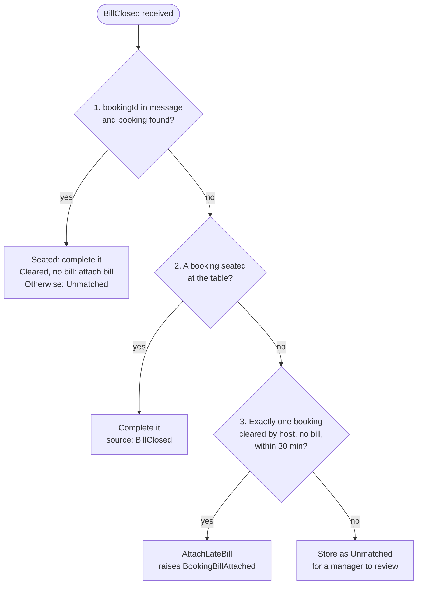

| **Step** | **Rule**                                                                                                                                                    | **Result**                                                                                      |
|----------|-------------------------------------------------------------------------------------------------------------------------------------------------------------|-------------------------------------------------------------------------------------------------|
| 1        | The message carries a `bookingId` (the POS echoes the one sent in `OpenTable`)                                                                              | Exact match: complete it if `Seated`, attach the bill if it was cleared by the host without one |
| 2        | A booking is `Seated` at that table                                                                                                                         | Normal path: `Complete(BillClosed, bill)`                                                       |
| 3        | Exactly one booking at that table was completed by `ClearedByHost`, has no bill total, and was cleared within `LateBillMatchMinutes` (30) of `closedAt`, before or after (a bill closed before the clear arrives late when the POS was offline) | Late match: `AttachLateBill` raises `BookingBillAttached`                                       |
| 4        | None of the above, or more than one candidate                                                                                                               | The inbound POS message is stored as `Unmatched`; no booking changes                            |

#### Rules

- Step 3 never guesses between candidates: two or more possible bookings means `Unmatched`.
- A repeated `BillClosed` with a `posBillId` already recorded is a duplicate and is ignored. A **different** bill for a booking that already has one is stored as `Unmatched` with reason `second_bill` (one bill per booking for now; §6.6).
- `BookingBillAttached` updates the guest's visit (`Guest.RecordVisit`) and the audit log, the same as a normal completion. It does not change the table state, which is already free.
- The window is a venue setting (`VenueSettings.LateBillMatchMinutes`, default 30), so it can be tuned per venue.
- **Manual matching:** the POS log lists `Unmatched` bills. A manager can attach one to a completed booking from that list (`MatchPosBill`), which raises `BookingBillAttached` with `matchedBy: manual`, or dismiss it (e.g. a bar tab with no booking).
- **Monitoring:** the pilot dashboard shows, per venue and day, the share of bookings completed by `ClearedByHost`, late matches and unmatched bills. A high share suggests the POS link is down or staff are skipping the POS (ADR-004 alarms).

#### Choosing the window

The window has to be a sensible size in both directions, which is why it’s a setting rather than a fixed number in the code. If it’s too short, slow payers at a busy counter are missed and their spend disappears from the records. If it’s too long, the table may already have been cleared for a second party, and a bill could be attached to the wrong guest. The design limits that risk by refusing to match when more than one booking qualifies, but a sensible window keeps those cases rare. Venues differ too: a quick lunch café might want 10 minutes, while a banquet restaurant where large groups settle up slowly might want 45. Because the value is stored in the venue’s settings, each venue can be tuned without a code change.

**Partner question:** can the POS return the `bookingId` it received in `OpenTable` when it sends `BillClosed`? If so, step 1 handles almost every case and steps 3–4 become rare.

### 6.6 One bill per booking, ready for split bills

The demo and the pilot assume **one POS bill per booking**. Split *payments* on one bill (cash plus card, several cards) need nothing here: the POS closes one bill with one total, and `BillClosed` carries that bill total, never the sum of payments.

Split *bills* (one table, several separate bills) are not built, because the partner's POS may not support them. Two small choices keep the door open:

| **Choice**                                        | **Now**                                                                                                    | **If split bills are needed later**                   |
|---------------------------------------------------|------------------------------------------------------------------------------------------------------------|-------------------------------------------------------|
| Bills keyed by `posBillId`                        | Duplicates are ignored; a second, different bill is flagged `second_bill` instead of overwriting the first | Same key; the second bill is added instead of flagged |
| Bills stored in `booking_bills`, one row per bill | At most one row per booking (enforced by a unique index on `booking_id`)                                   | Drop that index; `BillTotal` already sums the rows    |

**Not built until needed:** a "table closed" signal from the POS, accepting several bills per booking in the late-match rule, and running totals in `BookingBillAttached`.

**Watch in the pilot:** venues whose POS cannot split bills sometimes fake it by moving items to a virtual table (7A, 7B) or a quick-sale order. Those bills arrive with no matching booking and show as `Unmatched` for a manager (§6.5). A high count of `second_bill` or virtual-table bills is the signal to build split-bill support.

## 7. Messaging and the phone panel

#### Creating messages

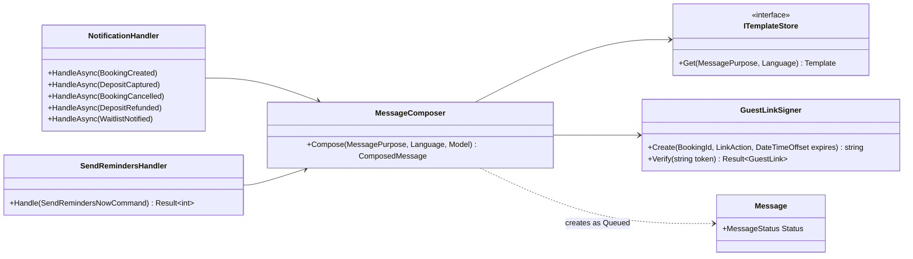

#### Delivering messages

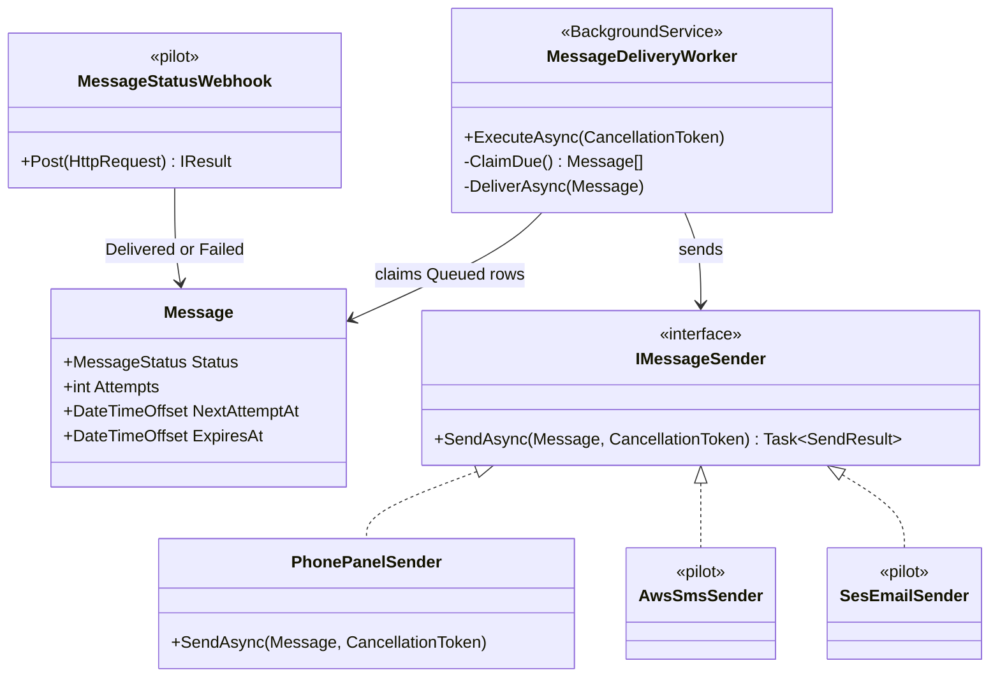

Handlers only **create** messages (status `Queued`) in their own transaction; they never call a provider. `MessageDeliveryWorker` does the sending, so a slow or failing provider never holds up the outbox dispatcher or other event handlers (ADR-002).

- Templates are per purpose and language (English and Simplified Chinese), stored in the API's resource files.
- Reminder messages carry two actions, **Confirm** and **Cancel**, each a signed link (`GuestLinkSigner`, HMAC-SHA256 with a key from Secrets Manager) that expires at the booking start time (ADR-004).
- `PhonePanelSender` stores the message, marks it `Sent`, pushes `messageLogChanged` to the venue's presenter screen, and marks it `Delivered` 1 s later. No real SMS is sent (Requirements §11).
- The phone panel's buttons call the same guest endpoints a real link would (§14), so the flow is identical to the pilot's.

*About GuestLinkSigner*

GuestLinkSigner creates and checks the signed links that let guests act on their booking without an account, such as the **Confirm** and **Cancel** links in reminder messages and the manage-booking link in confirmations. Create(bookingId, action, expires) builds a small payload (the booking ID, the action and an expiry time, normally the booking start) and seals it with an HMAC-SHA256 signature using a secret key. The result is a URL-safe token. Verify(token) recalculates the signature from the payload, compares it with the one in the token using a constant-time comparison, and rejects the link (invalid_link or link_expired) if the payload was changed, the token was forged, or the expiry has passed. Anyone can read a token, but no one can alter or create one without the key, so only links the system actually sent are accepted.

The signing key is stored in AWS Secrets Manager (locally in .NET user secrets). It is loaded once at start-up into GuestLinkOptions, which is checked with ValidateOnStart, and passed to GuestLinkSigner through dependency injection, so the signer never reads configuration or calls AWS itself and can be unit-tested with a fixed key. Tokens may carry a key ID, so the key can be rotated while links already sent keep working until they expire. *To stop email scanners and link previews from acting on a guest’s behalf, opening a link only displays the booking* (GET /guest/bookings?token=…); the change happens only when the guest taps the button, which sends a POST that verifies the token again. Repeating an action is harmless, because confirming twice or cancelling an already-cancelled booking changes nothing.

### 7.1 Message delivery worker

PostgreSQL is the message queue: the `messages` table with its `status` column. No separate queue product is needed for the demo or the pilot (ADR-002); Amazon SQS is the step up only if message volume or separate sender services call for it.

```
loop:
  await signal.WaitAsync(1s)                        -- new message, or every 1 s
  BEGIN
    rows = SELECT … FROM messages
           WHERE status = 'Queued' AND next_attempt_at <= now()
           ORDER BY next_attempt_at
           LIMIT 20
           FOR UPDATE SKIP LOCKED
    for each row:
      if now() > row.expires_at: row.MarkFailed('expired'); continue
      result = await sender.SendAsync(row)          -- IMessageSender
      accepted        → row.MarkSent(providerRef)   -- raises MessageSent
      temporary error → row.ScheduleRetry(error)    -- attempts + 1, retry later
      permanent error → row.MarkFailed(reason)      -- e.g. invalid number
  COMMIT
```

| **Rule**                   | **Detail**                                                                                                                                                                                          |
|----------------------------|-----------------------------------------------------------------------------------------------------------------------------------------------------------------------------------------------------|
| Backoff                    | 5 s, 30 s, 2 min, 10 min, then every 10 min until the message expires                                                                                                                               |
| Expiry by purpose          | `TableReady`: 10 min after creation (a late "table ready" text is worse than none). `Reminder`: the booking start time. `Confirmation`, `Cancellation`, `Refund`: 24 h                              |
| Permanent errors           | Invalid or unreachable number, opted-out recipient: `Failed` at once, no retries                                                                                                                    |
| Idempotency                | Each send passes the message ID as the provider's idempotency or client reference, so a retry after a timeout does not send twice                                                                   |
| Visibility                 | Every status change pushes `messageLogChanged`; failed messages show in the message log with the reason, and a `TableReady` failure is flagged on the waitlist entry so the host can call the guest |
| Delivery reports \[pilot\] | The SMS and email providers report delivery to `/webhooks/messages`; the endpoint verifies the signature, uses the inbox (§5.5) and moves the row to `Delivered` or `Failed`                        |
| Reminder timing            | A reminder is sent 24 h before the booking (AC5.1). No reminder for a booking made less than 24 h ahead (its confirmation carries the manage-booking link instead), and none when the booking starts within 2 h. `SendRemindersNow` in the demo applies the same 2-hour rule. Both rules are checked by `ReminderPolicy.CanSend` inside `Booking.RecordReminder`, for scheduled and `SendRemindersNow` reminders alike (a booking made under 24 h ahead never gets one) |
| Late cancellation warning  | If a guest opens a Confirm or Cancel link inside the free-cancellation window (`booking.Terms`, §2.6), the page says "cancelling now keeps your deposit" before the guest taps Cancel |
| Providers                  | Demo: `PhonePanelSender`. Pilot: AWS End User Messaging SMS and Amazon SES, keeping guest data in AWS (ADR-001 D10). Both sit behind `IMessageSender`                                               |

## 8. Payments

### 8.1 Classes

```mermaid
classDiagram
    direction TB
    class StripeWebhookEndpoint
    class CaptureDepositHandler
    class RecordRefundHandler
    class IPaymentProvider {
        <<interface>>
        +CreateDepositIntent(BookingId, Money, string idemKey) Task~PaymentIntentInfo~
        +Refund(string paymentIntentId, Money, string idemKey) Task~RefundInfo~
        +ParseWebhook(HttpRequest) Task~PaymentWebhook~
    }
    class StripePaymentProvider {
        -StripeClient client
        -string webhookSecret
    }
    class Booking {
        +Cancel(Actor by, CancelReason, DateTimeOffset now) Result~RefundDecision~
    }
    class RefundPolicy {
        +Decide(Booking, CancelReason, Actor, DateTimeOffset now) RefundDecision
    }
    class BookingCancelled {
        <<event>>
        +RefundDecision RefundDecision
    }
    class RefundOnCancelHandler {
        +HandleAsync(BookingCancelled)
    }
    StripeWebhookEndpoint --> IPaymentProvider : ParseWebhook
    StripeWebhookEndpoint --> CaptureDepositHandler : payment succeeded
    StripeWebhookEndpoint --> RecordRefundHandler : charge refunded
    Booking --> RefundPolicy : decides once, at cancel
    Booking ..> BookingCancelled : raises with decision
    RefundOnCancelHandler --> BookingCancelled : reads decision
    RefundOnCancelHandler --> IPaymentProvider : Refund if full
    IPaymentProvider <|.. StripePaymentProvider
```

It shows how the system works with Stripe in both directions: Stripe telling us something happened (webhooks, on the left), and us asking Stripe to do something (refunds, on the right). Everything Stripe-specific sits behind one interface, IPaymentProvider.

**Three payment flows**

1. **Taking a deposit** (not drawn, but it uses the same interface). When a party of 6 or more books, `CreateOnlineBooking` calls `IPaymentProvider.CreateDepositIntent(...)`. Stripe returns a client secret, and the guest pays in Stripe's own card form (Stripe Elements), so card details never reach our servers.
2. **Stripe tells us what happened** (left side).
    1. Stripe posts a webhook to `StripeWebhookEndpoint`.
    2. The endpoint calls `ParseWebhook`, which checks Stripe's signature with the webhook secret and turns Stripe's JSON into a simple `PaymentWebhook` object.
    3. It inserts an inbox row (§5.5), so a repeated webhook is ignored, then passes the event to the right handler:
        - **payment succeeded** → `CaptureDepositHandler`: the booking moves from `PendingPayment` to `Booked`, and `DepositCaptured` is raised.
        - **charge refunded** → `RecordRefundHandler`: the deposit becomes `Refunded`, and `DepositRefunded` is raised.
3. **We ask Stripe for a refund** (right side).
    1. A booking is cancelled. `Booking.Cancel(...)` asks `RefundPolicy` for the refund decision, once, using the terms saved on the booking (§2.6), and raises `BookingCancelled` carrying that decision.
    2. `RefundOnCancelHandler` receives the event from the outbox. If the decision is "full", it calls `IPaymentProvider.Refund(...)` with the idempotency key `{eventId}:refund`. If the handler is retried, Stripe won't refund twice, and the decision can't change.
    3. Stripe later confirms with a `charge.refunded` webhook, which goes through flow 2. The booking only records the refund once Stripe confirms it.

| Class                 | Role                                                                                                                                                                           |
|-----------------------|--------------------------------------------------------------------------------------------------------------------------------------------------------------------------------|
| StripeWebhookEndpoint | Receives Stripe webhooks, verifies them, de-duplicates with the inbox, and routes each to a handler                                                                            |
| CaptureDepositHandler | Calls `booking.CaptureDeposit(...)`. Booking still `PendingPayment` after the hold expired: the table is re-checked; free → captured as normal, taken → `Cancel(HoldExpired)` with a full refund through `RefundOnCancelHandler`. Booking already `Cancelled(HoldExpired)`: the booking returns `hold_expired`, and the handler calls `IPaymentProvider.Refund(...)` with idempotency key = `paymentIntentId`, writes an audit entry and records the inbox row, with no booking state change. Stripe's later `charge.refunded` for that payment changes nothing on the booking. The guest page shows "time no longer available, refunded" (§12). |
| RecordRefundHandler   | Records a refund that Stripe has confirmed                                                                                                                                     |
| IPaymentProvider      | The single seam to the payment provider: create a deposit, refund, parse webhooks                                                                                              |
| StripePaymentProvider | The Stripe implementation; holds the Stripe client and webhook secret (from Secrets Manager)                                                                                   |
| Booking               | `Cancel(...)` asks `RefundPolicy` for the decision at the moment of cancellation and raises `BookingCancelled` with it |
| BookingCancelled      | The event that carries the refund decision (`full`, `none` or `notApplicable`) to the handlers |
| RefundOnCancelHandler | Reads the decision from `BookingCancelled` and requests the refund from Stripe when it is `full`; it never decides itself |
| RefundPolicy          | Applies the cancellation rule (BR-07): full refund at least 2 hours before, otherwise kept; host cancellations always refunded. It uses the terms saved on the booking (§2.6) and is called only by `Booking.Cancel`. |

`DepositPolicy` is used by `CreateOnlineBooking` (§9.2) to work out the deposit due.

### 8.2 Deposit rule (BR-06)

`DepositDue = channel = Online and partySize ≥ 6 ? partySize × NZD 20.00 : none`. Phone bookings and walk-ins never take a deposit and never start as `PendingPayment` (see §20). Values come from `VenueSettings.Deposit` at the moment of booking and are kept in `booking.Terms.Deposit` (§2.6).

### 8.3 Refund rule (BR-07)

| **Who cancels**       | **When**            | **Decision**                |
|-----------------------|---------------------|-----------------------------|
| Guest                 | ≥ 2 h before start  | Full refund                 |
| Guest                 | \< 2 h before start | No refund (deposit kept)    |
| Host                  | Any time            | Full refund                 |
| System (hold expired) | Before payment      | Not applicable (`Released`) |
| System (hold expired) | Payment arrived after the hold expired and the table is taken | Full refund (§3.1, §12) |

The hours and refund amounts come from `booking.Terms.Cancellation` (§2.6), so a later change to the venue's rule does not affect this booking.

The refund decision is made **once**, when the booking is cancelled: `Booking.Cancel(...)` calls `RefundPolicy.Decide(...)` with the terms saved on the booking (§2.6), and `BookingCancelled` carries the result. `RefundOnCancelHandler` never decides again; it reads the decision from the event and, when it is `full`, calls Stripe with idempotency key `{eventId}:refund`. A handler retried after the 2-hour line therefore gets the same answer as at cancellation. Stripe's `charge.refunded` webhook then raises `DepositRefunded` through `RecordRefundHandler`.

## 9. Application layer

### 9.1 Command and query shape

```mermaid
classDiagram
    direction LR
    class Endpoint {
        <<minimal API>>
        +Map(IEndpointRouteBuilder)
    }
    class ValidationFilter~TRequest~ {
        +InvokeAsync(EndpointFilterInvocationContext, next)
    }
    class AbstractValidator~TRequest~ {
        <<FluentValidation>>
    }
    class ICommandHandler~TCommand,TResult~ {
        <<interface>>
        +Handle(TCommand, CancellationToken) Task~Result~TResult~~
    }
    class IQueryHandler~TQuery,TResult~ {
        <<interface>>
        +Handle(TQuery, CancellationToken) Task~Result~TResult~~
    }
    class Result~T~ {
        +bool IsSuccess
        +T Value
        +Error Error
    }
    class Error {
        +string Code
        +string MessageKey
        +ErrorKind Kind
        +IDictionary~string,string[]~? Fields
    }
    class ResultToHttp {
        +ToProblem(Error) IResult
    }
    Endpoint --> ValidationFilter~TRequest~
    ValidationFilter~TRequest~ --> AbstractValidator~TRequest~
    Endpoint --> ICommandHandler~TCommand,TResult~
    Endpoint --> IQueryHandler~TQuery,TResult~
    ICommandHandler~TCommand,TResult~ ..> Result~T~
    Result~T~ *-- Error
    Endpoint --> ResultToHttp
```

It shows the shape every API request follows: an endpoint receives the HTTP call, a validation filter checks the input, a handler does the work and returns a Result, and ResultToHttp turns that result into an HTTP response. Every feature (bookings, waitlist, POS and so on) uses the same pieces, so they all behave the same way.

One request, step by step (take POST /venues/{venueId}/bookings/{id}/seat)

Endpoint (a minimal API route) receives the request and binds it to a SeatBookingRequest.

ValidationFilter\<SeatBookingRequest\> runs first. It finds the matching FluentValidation validator (an AbstractValidator\<SeatBookingRequest\>) and checks the input. If something’s wrong, it returns 400 validation_failed with the field errors, and the handler never runs.

The endpoint calls the ICommandHandler\<SeatBookingCommand, Unit\>, which loads the booking, applies the domain rules and saves.

The handler returns a Result\<T\>: either success with a value, or failure with an Error.

ResultToHttp.ToProblem(error) maps a failure to the right status and a Problem Details body (ADR-004). A success becomes 200, 201 or 204.

| Class                                | Role                                                                                                                                                                                |
|--------------------------------------|-------------------------------------------------------------------------------------------------------------------------------------------------------------------------------------|
| Endpoint                             | One small class per feature that maps its routes (Map(IEndpointRouteBuilder)), attaches the validation filter and calls the handler. It holds no business logic.                    |
| ValidationFilter\<TRequest\>         | A generic endpoint filter that runs the request’s FluentValidation validator before the handler. It’s written once and used by every endpoint.                                      |
| AbstractValidator\<TRequest\>        | FluentValidation’s base class; each request type has one validator, such as CreateBookingRequestValidator (ADR-004).                                                                |
| ICommandHandler\<TCommand, TResult\> | Handles one action that changes data (seat, cancel, join the waitlist). It loads aggregates, calls their methods and saves; the outbox interceptor adds events automatically (§5).  |
| IQueryHandler\<TQuery, TResult\>     | Handles one read (floor plan, waitlist, POS log). It reads directly into response objects and never loads aggregates or changes data.                                               |
| Result\<T\>                          | Either success with a Value, or failure with an Error. Expected failures, like a slot just taken, are returned this way instead of thrown as exceptions.                            |
| Error                                | Code (stable, such as slot_taken, for the front end), MessageKey (for translated text), Kind (Validation, NotFound, Conflict, Rule, Forbidden, External) and optional field errors. |
| ResultToHttp                         | Maps Error.Kind to the HTTP status in ADR-004’s error table (Conflict → 409, NotFound → 404, and so on) and builds the Problem Details response.                                    |

No mediator library is used, which also avoids MediatR's commercial licence (2025); endpoints call handlers directly through dependency injection.

### 9.2 Commands

| **Feature** | **Command**                                                         | **Aggregate method(s)**                                                | **Main errors**                                          |
|-------------|---------------------------------------------------------------------|------------------------------------------------------------------------|----------------------------------------------------------|
| Bookings    | `CreateOnlineBooking`                                               | `Booking.Create`; Stripe intent if deposit due                         | `slot_taken`, `party_too_large`, `outside_service_hours`, `outside_booking_window` |
| Bookings    | `CreatePhoneBooking` (host, M4a)                                    | `Booking.Create` (channel `Phone`, never a deposit)                    | `slot_taken`, `outside_service_hours`                    |
| Bookings    | `ConfirmBooking` (guest link; host from M4a)                        | `Confirm`                                                              | `invalid_link`, `invalid_transition`, `version_conflict` |
| Bookings    | `CancelBooking` (guest link or host)                                | `Cancel`                                                               | `invalid_link`, `invalid_transition`                     |
| Bookings    | `SeatBooking`                                                       | `Seat`                                                                 | `slot_taken`, `version_conflict`                         |
| Bookings    | `SeatWalkIn`                                                        | `Booking.CreateWalkIn` (+ `WaitlistEntry.MarkSeated` if from waitlist) | `slot_taken`                                             |
| Bookings    | `ClearTable`                                                        | `Complete(ClearedByHost)`                                              | `not_found` (no seated booking)                          |
| Bookings    | `CloseBill` (POS inbound)                                           | `Complete(BillClosed, bill)` or `AttachLateBill` (§6.5)                | (idempotent); no match → POS message `Unmatched`         |
| Bookings    | `MatchPosBill` (manager)                                            | `AttachLateBill` (`matchedBy: manual`)                                 | `rule_broken` (booking already has a bill)               |
| Bookings    | `DismissPosBill` (manager)                                          | — (POS message → `Dismissed`)                                          | —                                                        |
| Payments    | `CaptureDeposit` (Stripe inbound)                                   | `CaptureDeposit`                                                       | `hold_expired` → refund by the handler, no state change (§8.1) |
| Payments    | `RecordRefund` (Stripe inbound)                                     | `RecordRefund`                                                         | (idempotent)                                             |
| Waitlist    | `JoinWaitlist`                                                      | `WaitlistEntry.Join`                                                   | `validation_failed`                                      |
| Waitlist    | `NotifyWaitlistEntry`                                               | `Notify`                                                               | `invalid_transition`                                     |
| Waitlist    | `EndWaitlistEntry`                                                  | `WalkAway` / `Remove`                                                  | `invalid_transition`                                     |
| Messaging   | `SendRemindersNow` (presenter)                                      | `RecordReminder` on each unconfirmed booking tonight starting 2 h or more from now (§7.1) | —                                                        |
| Demo        | `ResetDemo`, `SetDemoClock`, `SetMockPosOnline`, `SimulateBillPaid` | —                                                                      | —                                                        |

### 9.3 Queries (read models)

Queries read with `AsNoTracking()` projections straight to DTOs; they never load aggregates.

| **Query**                                 | **Returns**                                                                         |
|-------------------------------------------|-------------------------------------------------------------------------------------|
| `GetAvailability(date, partySize, time?)` | Free slots, or the 3 nearest (§11)                                                  |
| `GetFloorPlan(at)`                        | Areas, tables with `TableState`, current/next booking summary, allergy flag         |
| `GetTonightBookings`                      | Bookings for the service day, in time order                                         |
| `GetWaitlist`                             | Active entries with waited minutes, overdue flag, suggested entry                   |
| `GetSuggestedTable(partySize)`            | Smallest free fitting table now (AC3.1)                                             |
| `GetQuotedWait(partySize)`                | Minutes (BR-08)                                                                     |
| `GetMessageLog`, `GetPosLog`              | Newest first, paged; `GetPosLog?status=unmatched` lists bills waiting to be matched |
| `GetBookingByLink(token)`                 | Guest's view for confirm or cancel                                                  |

## 10. Key sequences

### 10.1 Online booking with deposit (steps 1–2)

```mermaid
sequenceDiagram
    autonumber
    actor G as Guest
    participant W as Guest page
    participant A as API
    participant DB as PostgreSQL
    participant S as Stripe
    participant D as Dispatcher
    participant H as Host screens

    G->>W: party 6, 20:00, details
    W->>A: POST /bookings
    A->>DB: save booking + outbox
    Note over A,DB: One transaction: pacing lock,<br/>PendingPayment, table assignment,<br/>BookingCreated
    A->>S: create PaymentIntent
    A-->>W: 201 (clientSecret)
    D->>H: floorPlanChanged
    W->>S: confirm card (Elements)
    S-->>A: payment succeeded (webhook)
    A->>DB: capture deposit + outbox
    Note over A,DB: Inbox check, Booked,<br/>DepositCaptured
    A-->>S: 200
    loop every 2 s until Booked
        W->>A: GET status
    end
    Note over D: NotificationHandler queues the<br/>confirmation, MessageDeliveryWorker sends it
    D->>H: floorPlanChanged, messageLogChanged
    W-->>G: confirmation + reference
```

### 10.2 Seat a walk-in and open the POS table (steps 3 and 6)

```mermaid
sequenceDiagram
    autonumber
    actor Ho as Host
    participant A as API
    participant DB as PostgreSQL
    participant D as Dispatcher
    participant P as POS worker
    participant M as Mock POS
    participant H as Host screens

    Ho->>A: GET suggestion (party 2)
    A-->>Ho: table T4
    Ho->>A: POST /walk-ins (T4)
    A->>DB: save walk-in + outbox
    Note over A,DB: Seated for 75 min,<br/>BookingCreated, BookingSeated
    A-->>Ho: 201
    D->>H: floorPlanChanged
    D->>DB: queue OpenTable
    P->>M: send OpenTable
    M-->>P: accepted
    P->>DB: mark Sent
    P->>H: posLogChanged
```

### 10.3 Table freed, waiting party notified and seated (step 4)

```mermaid
sequenceDiagram
    autonumber
    actor Ho as Host
    participant A as API
    participant M as Mock POS
    participant DB as PostgreSQL
    participant D as Dispatcher
    participant PP as Phone panel

    Ho->>A: Bill paid (T7)
    A->>M: simulate BillClosed
    M->>A: BillClosed (signed webhook)
    A->>DB: complete booking + outbox
    Note over A,DB: Inbox check, Completed,<br/>BookingCompleted, TableCleared
    D->>DB: record guest visit
    D->>Ho: floorPlanChanged, waitlistChanged
    Note over Ho: T7 free, Lee (4) highlighted
    Ho->>A: notify entry (T7)
    A->>DB: Notified + outbox
    D->>DB: create TableReady message
    D->>PP: messageLogChanged
    Ho->>A: POST /walk-ins (entry, T7)
    A->>DB: seat + end entry + outbox
    Note over A,DB: Seated, BookingCreated,<br/>BookingSeated, WaitlistEnded
```

### 10.4 Reminder → guest cancels → refund (step 5)

```mermaid
sequenceDiagram
    autonumber
    actor Pr as Presenter
    participant A as API
    participant DB as PostgreSQL
    participant D as Dispatcher
    participant PP as Phone panel
    participant S as Stripe

    Pr->>A: send reminders now
    A->>DB: reminders + messages
    D->>PP: messageLogChanged
    PP->>A: cancel (signed link)
    Note over A: Verify link. Refund rule:<br/>full (2 h or more before)
    A->>DB: Cancelled + outbox
    D->>S: refund (idempotency key)
    S-->>A: charge refunded (webhook)
    A->>DB: record refund + outbox
    D->>PP: refund message
```

### 10.5 POS offline, then back online (QA-5)

```mermaid
sequenceDiagram
    autonumber
    actor Pr as Presenter
    participant A as API
    participant P as POS worker
    participant M as Mock POS
    participant L as POS log

    Pr->>A: POS offline
    Note over P,M: Three tables seated:<br/>OpenTable x3 queued (41 to 43)
    P->>M: send 41
    M-->>P: unavailable
    Note over P: Retry every 5 s.<br/>42 and 43 wait behind 41
    L-->>Pr: 3 messages "waiting"
    Pr->>A: POS online
    P->>M: send 41, 42, 43
    M-->>P: accepted x3
    L-->>Pr: all "sent", in order, once
```

## 11. Availability and table assignment

### 11.1 Inputs

`VenueSettings` (BR-01 to BR-05), tables, and active `table_assignments` for the service day.

### 11.2 Algorithm

```
GetAvailability(date, partySize, requestedTime?):
  turn   = TurnTime(partySize)                         -- 75 / 90 / 120 min (BR-02)
  slots  = every 15 min from ServiceStart to LastBooking (BR-01), not in the past
  for slot in slots:
     covers = sum(partySize of bookings starting in [slot, slot+15m))
     if covers + partySize > PacingCoversPerSlot (12): continue      -- BR-03
     table  = smallest table with seats ≥ partySize
              and no active assignment overlapping [slot, slot+turn) -- BR-05
     if table: available.add(slot, table)
  if requestedTime given and not in available:
     return 3 available slots nearest to requestedTime (ties: earlier first)  -- AC1.3
  return available
```

- Runs as one SQL query per day using `tstzrange` overlap (`&&`) and a `GROUP BY` on slot; well under the 1 s target (AC1.1) for 14 tables.
- The chosen table is **re-checked** at write time by the exclusion constraint (§12); availability is advice, not a reservation.

### 11.3 Quoted wait (BR-08)

```
QuotedWait(partySize):
  fitting = tables with seats ≥ partySize
  if any fitting table is Free now: return 0
  expectedFree(t) = seatedAt + turn(seated party)  for each Seated fitting table
  minutes = min(expectedFree) − now
  return ceil(minutes / 5) × 5
```

### 11.4 Suggested waiting party (BR-09, AC4.2)

When a table frees: the first `Waiting` or `Notified` entry, by `JoinedAt`, whose party size ≤ table seats. The host may pick another.

## 12. Concurrency and consistency

| **Risk**                                     | **Defence**                                                                                                 | **Error**                                       |
|----------------------------------------------|-------------------------------------------------------------------------------------------------------------|-------------------------------------------------|
| Two bookings for one table at one time       | `EXCLUDE USING gist (table_id WITH =, period WITH &&) WHERE (active)` on `table_assignments`                | `23P01` → `409 slot_taken`                      |
| Pacing exceeded by two simultaneous bookings | `pg_advisory_xact_lock(hash(venue_id, slot_start))` before counting covers in the create transaction        | `409 slot_taken`                                |
| Two overlapping slots pick the same table     | Different slot locks, so both requests can choose one table; inserting both assignments at once can deadlock in the exclusion constraint. After choosing, `pg_advisory_xact_lock(hash('table:' + table_id))` for each table in ascending ID order, held until commit: the second waits, then hits `23P01`. Safety net: `40P01` / `40001` map to `409 slot_taken` in `GlobalExceptionHandler` | `409 slot_taken` (never 500)                    |
| Two hosts change one booking                 | `xmin`-based row version on every aggregate (EF Core concurrency token)                                     | `409 version_conflict`                          |
| Deposit paid after hold expired              | Booking still `PendingPayment` (expiry job not run yet): `CaptureDeposit` re-checks the table; free → captured as normal, taken → `Cancel(HoldExpired)` and refund. Booking already `Cancelled(HoldExpired)`: `CaptureDeposit` returns `hold_expired`; the handler refunds through `IPaymentProvider` with idempotency key = `paymentIntentId`, writes an audit entry and records the inbox row; no booking state change | Guest sees "time no longer available, refunded" |
| Duplicate Stripe or POS webhooks             | Inbox unique key `(consumer, message_id)`                                                                   | `200`, no-op                                    |
| Duplicate event handling                     | `IdempotentHandlerDecorator` + inbox                                                                        | —                                               |
| Outbox order across workers                  | `FOR UPDATE SKIP LOCKED` + skip aggregates with earlier pending rows                                        | —                                               |

`active` on `table_assignments` is kept in step with the booking status in the same transaction (`true` for the four active statuses).

Lock order in the create transaction (fixed 12 Nov 2026 after a `40P01` in the M4a concurrency test): idempotency key → slot lock → tables, ascending ID. Every request takes them in that order, so no two requests can wait on each other. `ConcurrencyAndIdempotencyTests` races 19:00 and 19:15 for the only table for 8 fifty times and expects one 201 and one 409 every time.

## 13. Database schema

PostgreSQL, snake_case, EF Core migrations (ADR-003 DM-10). Requires the `btree_gist` extension. Every table has `venue_id`, and `xmin` is used as the row version.

```sql
CREATE EXTENSION IF NOT EXISTS btree_gist;
```

```sql
CREATE TABLE venues (
  id uuid PRIMARY KEY, name text NOT NULL, time_zone text NOT NULL,
  currency char(3) NOT NULL DEFAULT 'NZD', settings jsonb NOT NULL,
  settings_version int NOT NULL DEFAULT 1,          -- +1 on every settings change
  last_event_sequence bigint NOT NULL DEFAULT 0      -- events raised by this record (§2.2)
);
```

```sql
CREATE TABLE areas (
  id uuid PRIMARY KEY, venue_id uuid NOT NULL REFERENCES venues(id),
  name text NOT NULL, sort_order int NOT NULL
);
```

```sql
CREATE TABLE tables (
  id uuid PRIMARY KEY, venue_id uuid NOT NULL REFERENCES venues(id),
  area_id uuid NOT NULL REFERENCES areas(id), name text NOT NULL,
  seats int NOT NULL CHECK (seats > 0), position jsonb NOT NULL
);
```

```sql
CREATE TABLE guests (
  id uuid PRIMARY KEY, venue_id uuid NOT NULL REFERENCES venues(id),
  name text NOT NULL, mobile_e164 text NOT NULL, email text, language text NOT NULL,
  allergy_notes text, visit_count int NOT NULL DEFAULT 0, last_bill_cents bigint,
  last_visit_at timestamptz,                         -- Guest.LastVisitAt (M2)
  last_event_sequence bigint NOT NULL DEFAULT 0,     -- events raised by this record (§2.2)
  UNIQUE (venue_id, mobile_e164)
);
```

```sql
CREATE TABLE bookings (
  id uuid PRIMARY KEY, venue_id uuid NOT NULL REFERENCES venues(id),
  guest_id uuid REFERENCES guests(id), reference text NOT NULL,
  channel text NOT NULL, party_size int NOT NULL CHECK (party_size BETWEEN 1 AND 20),
  period tstzrange NOT NULL, status text NOT NULL,
  deposit_cents bigint, deposit_status text, payment_intent_id text, refund_id text,
  hold_expires_at timestamptz, seated_at timestamptz, completed_at timestamptz,
  notes text, occasion text, reminder jsonb,
  terms jsonb NOT NULL,                              -- BookingTerms snapshot (§2.6)
  completion_source text,                            -- BillClosed / ClearedByHost (§6.5)
  cancel_reason text, refund_decision text,          -- set on cancellation (§2.2, §8.3)
  last_event_sequence bigint NOT NULL DEFAULT 0,     -- events raised by this record (§2.2)
  created_at timestamptz NOT NULL, UNIQUE (venue_id, reference)
);
CREATE INDEX ix_bookings_venue_day ON bookings (venue_id, lower(period));
```

```sql
CREATE TABLE booking_bills (                         -- §6.6
  booking_id uuid NOT NULL REFERENCES bookings(id), venue_id uuid NOT NULL,
  pos_bill_id text NOT NULL, total_cents bigint NOT NULL, tip_cents bigint,
  closed_at timestamptz NOT NULL, pos_message_id uuid NOT NULL,
  PRIMARY KEY (booking_id, pos_bill_id)               -- EF owned-collection key (M2, §13.1)
);
CREATE UNIQUE INDEX ux_booking_bills_venue_pos_bill ON booking_bills (venue_id, pos_bill_id);  -- bill IDs unique per venue
CREATE UNIQUE INDEX ux_booking_bills_one_per_booking ON booking_bills (booking_id);  -- drop to allow split bills
```

```sql
CREATE TABLE table_assignments (
  booking_id uuid NOT NULL REFERENCES bookings(id), table_id uuid NOT NULL REFERENCES tables(id),
  venue_id uuid NOT NULL, period tstzrange NOT NULL, active boolean NOT NULL,
  PRIMARY KEY (booking_id, table_id),
  CONSTRAINT ex_table_assignments_no_overlap
    EXCLUDE USING gist (table_id WITH =, period WITH &&) WHERE (active)
);
```

```sql
CREATE TABLE waitlist_entries (
  id uuid PRIMARY KEY, venue_id uuid NOT NULL, guest_id uuid NOT NULL REFERENCES guests(id),
  party_size int NOT NULL, quoted_wait_minutes int NOT NULL, status text NOT NULL,
  joined_at timestamptz NOT NULL, notified_at timestamptz, ended_at timestamptz,
  notified_table_id uuid, booking_id uuid,
  last_event_sequence bigint NOT NULL DEFAULT 0      -- events raised by this record (§2.2)
);
```

```sql
CREATE TABLE messages (
  id uuid PRIMARY KEY, venue_id uuid NOT NULL, guest_id uuid NOT NULL,
  purpose text NOT NULL, channel text NOT NULL, language text NOT NULL,
  body text NOT NULL, actions jsonb, subject_id uuid NOT NULL, status text NOT NULL,
  created_at timestamptz NOT NULL, sent_at timestamptz, delivered_at timestamptz,
  attempts int NOT NULL DEFAULT 0, next_attempt_at timestamptz NOT NULL,   -- §7.1
  expires_at timestamptz NOT NULL, provider_ref text, last_error text,     -- §7.1
  last_event_sequence bigint NOT NULL DEFAULT 0      -- events raised by this record (§2.2)
);
CREATE INDEX ix_messages_queued ON messages (next_attempt_at) WHERE status = 'Queued';
```

```sql
CREATE TABLE outbox (
  event_id uuid PRIMARY KEY, venue_id uuid NOT NULL, event_type text NOT NULL,
  event_version int NOT NULL, aggregate_type text NOT NULL, aggregate_id uuid NOT NULL,
  sequence bigint NOT NULL, correlation_id uuid NOT NULL, causation_id uuid,
  envelope jsonb NOT NULL, status text NOT NULL, attempts int NOT NULL DEFAULT 0,
  next_attempt_at timestamptz NOT NULL, last_error text, created_at timestamptz NOT NULL,
  dispatched_at timestamptz, UNIQUE (aggregate_id, sequence)
);
CREATE INDEX ix_outbox_pending ON outbox (next_attempt_at) WHERE status = 'Pending';
```

```sql
CREATE TABLE inbox (
  consumer text NOT NULL, message_id text NOT NULL, processed_at timestamptz NOT NULL,
  PRIMARY KEY (consumer, message_id)
);
```

```sql
CREATE TABLE pos_messages (
  id uuid PRIMARY KEY, venue_id uuid NOT NULL, direction text NOT NULL,
  message_type text NOT NULL, idempotency_key text NOT NULL UNIQUE,
  source_event_id uuid, payload jsonb NOT NULL, status text NOT NULL,
  venue_sequence bigint NOT NULL, attempts int NOT NULL DEFAULT 0,
  created_at timestamptz NOT NULL, delivered_at timestamptz,
  booking_id uuid,                                   -- inbound: booking it was matched to (§6.5)
  unmatched_reason text,                             -- inbound: no_match, ambiguous, second_bill (§6.5, §6.6)
  UNIQUE (venue_id, venue_sequence)
);
CREATE INDEX ix_pos_unmatched ON pos_messages (venue_id, created_at) WHERE status = 'Unmatched';
```

```sql
CREATE TABLE audit_log (
  id bigserial PRIMARY KEY, venue_id uuid NOT NULL, event_id uuid NOT NULL UNIQUE,
  event_type text NOT NULL, aggregate_id uuid NOT NULL, actor jsonb NOT NULL,
  occurred_at timestamptz NOT NULL, summary jsonb NOT NULL
);
```

```sql
CREATE TABLE idempotency_keys (                      -- M4a: Idempotency-Key on create (ADR-004, §14.1)
  venue_id uuid NOT NULL, operation text NOT NULL, key text NOT NULL,
  request_hash text NOT NULL, status_code int NOT NULL, response jsonb NOT NULL,
  created_at timestamptz NOT NULL,                   -- infrastructure clock; kept 24 hours
  PRIMARY KEY (venue_id, operation, key)
);
CREATE INDEX ix_idempotency_keys_created_at ON idempotency_keys (created_at);
```

### 13.1 Mapping notes (M2)

Details §13 left open, settled when the schema was built (`src/Infrastructure/Persistence`). The migration `Initial` creates every table above.

| **Topic** | **Decision** |
|-----------|--------------|
| Names | snake_case through `EFCore.NamingConventions`; keys `pk_*`, foreign keys `fk_*`, indexes `ix_*` / `ux_*`, checks `ck_*` |
| IDs and value objects | Strongly typed IDs are `uuid` through value converters. `PartySize` → `int`, `PersonName` → `text`, `PhoneNumber` → E.164 `text`, `BookingReference` → `text`, `TimeRange` → `tstzrange` `[start, end)` |
| Money | Columns hold integer cents in the venue currency (NZD, DM-03); there is no currency column per amount. `Deposit` is owned in the `bookings` row |
| Times | Every `DateTimeOffset` is written as UTC (`timestamptz`) |
| Enums | Stored as their C# names (`PendingPayment`, `ClearedByHost`, `Zh`), so partial-index filters such as `status = 'Queued'` match |
| `jsonb` columns | `venues.settings`, `bookings.terms`, `bookings.reminder`, `tables.position`, `messages.actions`: camelCase property names, enums as camelCase strings (`"full"`), computed properties left out. Matches the §2.6 example. A new optional setting is a trailing optional record parameter, so rows without the key still read (as the default). `settings.contactPhone` (M4b) is filled in for Golden Dragon by the data-only migration `AddVenueContactPhone` |
| Shadow `venue_id` | `tables`, `table_assignments` and `booking_bills` have no `VenueId` in the domain; the context copies it from the venue or booking on save |
| `booking_bills` key | EF can't key an owned collection on a value copied from its owner, so the primary key is `(booking_id, pos_bill_id)`; `ux_booking_bills_venue_pos_bill` keeps POS bill IDs unique per venue, as before |
| Row version | `xmin` maps to `AggregateRoot.Version` on venues, guests, bookings, waitlist entries and messages. A stale save throws `DbUpdateConcurrencyException` (→ `409 version_conflict`) |
| Defaults | The column defaults above stay in the database, but EF always writes the value it holds |
| Raw SQL in the migration | `ex_table_assignments_no_overlap` and `ix_bookings_venue_day` (an expression index) are not expressible in the EF model, so the migration adds them with SQL |
| Venue filter | EF named query filter `"Venue"` (`ReservationsDbContext.VenueFilter`) on venues, areas, tables, guests, bookings, waitlist entries, messages, POS messages and the audit log, reading `IVenueContext.VenueId`; `null` matches nothing. Outbox and inbox are not filtered (the workers serve every venue). In the demo `IVenueContext` is fixed to Golden Dragon (§17); M4 reads it from the demo session. Background jobs use `IgnoreQueryFilters([VenueFilter])` |
| Outbox, inbox, POS messages, audit | Tables and plain persistence records exist from M2; their behaviour comes in M3 (outbox, inbox, audit) and M9 (POS) |
| Migrations at start-up | Development only, when `Database:MigrateOnStartup=true`: migrate, then seed if there is no venue (D8). CI fails on model changes without a migration (`dotnet ef migrations has-pending-model-changes`) |

## 14. HTTP API

Base path `/api/v1`. Venue-scoped routes are `/api/v1/venues/{venueId}/…`. All responses are JSON; errors are Problem Details (ADR-004).

| **Method** | **Path**                                                                     | **Caller**           | **Command / query**                                                                         |
|------------|------------------------------------------------------------------------------|----------------------|---------------------------------------------------------------------------------------------|
| POST       | `/demo-login` `{passcode}`                                                   | Public (demo only)   | Issues the demo session cookie with role `Host` or `Presenter` (§17); 5 attempts a minute per IP; `200 {role}` |
| GET        | `/venues/{venueId}`                                                          | Guest                | `GetVenue` (M4b) → `{venueId, name, timeZone, today, slotTimes, maxOnlinePartySize, bookingWindowDays, contactPhone?}` (§18.4) |
| GET        | `/venues/{venueId}/availability?date&partySize&time`                         | Guest                | `GetAvailability`                                                                           |
| POST       | `/venues/{venueId}/bookings`                                                 | Guest                | `CreateOnlineBooking` → `201 {bookingId, reference, status, version, startsAt, endsAt, partySize, tableIds, deposit?, holdExpiresAt?, clientSecret?}`; optional `Idempotency-Key` |
| POST       | `/venues/{venueId}/phone-bookings`                                           | Host                 | `CreatePhoneBooking` (M4a) → `201`, same body and response as above                         |
| GET        | `/venues/{venueId}/bookings/{id}/status`                                     | Guest                | Status poll while paying                                                                    |
| GET        | `/guest/bookings?token`                                                      | Guest link           | `GetBookingByLink`                                                                          |
| POST       | `/guest/bookings/confirm` `{token}`                                          | Guest link           | `ConfirmBooking`                                                                            |
| POST       | `/guest/bookings/cancel` `{token}`                                           | Guest link           | `CancelBooking`                                                                             |
| GET        | `/venues/{venueId}/floor-plan?at`                                            | Host                 | `GetFloorPlan`                                                                              |
| GET        | `/venues/{venueId}/bookings?day`                                             | Host                 | `GetTonightBookings`                                                                        |
| POST       | `/venues/{venueId}/bookings/{id}/seat` `{tableIds, version}`                 | Host                 | `SeatBooking`                                                                               |
| POST       | `/venues/{venueId}/bookings/{id}/confirm` `{version}`                        | Host                 | `ConfirmBooking` by the host (M4a)                                                          |
| POST       | `/venues/{venueId}/bookings/{id}/cancel` `{version}`                         | Host                 | `CancelBooking`                                                                             |
| GET        | `/venues/{venueId}/tables/suggestion?partySize`                              | Host                 | `GetSuggestedTable`                                                                         |
| POST       | `/venues/{venueId}/walk-ins` `{partySize, tableId, name?, waitlistEntryId?}` | Host                 | `SeatWalkIn`                                                                                |
| POST       | `/venues/{venueId}/tables/{tableId}/clear`                                   | Host                 | `ClearTable`                                                                                |
| GET        | `/venues/{venueId}/waitlist`                                                 | Host                 | `GetWaitlist`                                                                               |
| GET        | `/venues/{venueId}/waitlist/quote?partySize`                                 | Host                 | `GetQuotedWait`                                                                             |
| POST       | `/venues/{venueId}/waitlist` `{name, mobile, partySize, quotedWaitMinutes}`  | Host                 | `JoinWaitlist`                                                                              |
| POST       | `/venues/{venueId}/waitlist/{id}/notify` `{tableId}`                         | Host                 | `NotifyWaitlistEntry`                                                                       |
| POST       | `/venues/{venueId}/waitlist/{id}/end` `{outcome}`                            | Host                 | `EndWaitlistEntry`                                                                          |
| GET        | `/venues/{venueId}/messages`                                                 | Presenter            | `GetMessageLog`                                                                             |
| GET        | `/venues/{venueId}/pos-messages?status`                                      | Presenter / manager  | `GetPosLog` (`status=unmatched` lists bills to match)                                       |
| POST       | `/venues/{venueId}/pos-messages/{id}/match` `{bookingId}`                    | Manager              | `MatchPosBill`                                                                              |
| POST       | `/venues/{venueId}/pos-messages/{id}/dismiss`                                | Manager              | `DismissPosBill`                                                                            |
| POST       | `/webhooks/stripe`                                                           | Stripe               | Signed; inbox                                                                               |
| POST       | `/webhooks/pos`                                                              | (Mock) POS           | Signed; inbox → `CloseBill`                                                                 |
| POST       | `/webhooks/messages` \[pilot\]                                               | SMS / email provider | Signed; inbox → message `Delivered` / `Failed` (§7.1)                                       |
| POST       | `/demo/reset`                                                                | Presenter            | `ResetDemo`                                                                                 |
| PUT        | `/demo/clock` `{now}`                                                        | Presenter            | `SetDemoClock`                                                                              |
| PUT        | `/demo/pos/online` `{online}`                                                | Presenter            | `SetMockPosOnline`                                                                          |
| POST       | `/demo/pos/bill-paid` `{tableId, totalCents}`                                | Presenter / host     | `SimulateBillPaid`                                                                          |
| POST       | `/demo/reminders/send-now`                                                   | Presenter            | `SendRemindersNow`                                                                          |

`/demo-login` and `/demo/*` endpoints exist only when `Demo:Enabled = true` and are never mapped in the pilot.

**Callers:** Guest routes are public. Host routes need the `Host` policy, which a `Presenter` also satisfies. Presenter routes (`/demo/*`, the message log and the POS log) need the `Presenter` policy. `/demo/pos/bill-paid` is the one `/demo/*` route a host may also call, because the host app's "Bill paid" button uses it. In the demo, "Presenter / manager" means `Presenter`.

### 14.1 Build notes (M4a)

Details §9, §11 and §14 left open, settled when the booking API was built (`src/Api`). The committed contract is `docs/api/openapi.json`.

**Request pipeline** (ADR-004 order; `ApiComposition.UseApi`): exception handler and status pages → `RequestLoggingMiddleware` (correlation ID, log scope, one line per request) → routing → CORS → rate limiter → authentication (demo session) → authorization (role policies with the venue check) → `RequestContextMiddleware` (venue context and actor) → `ValidationFilter<T>` → handler → `ResultToHttp`.

| **Topic** | **Decision** |
|-----------|--------------|
| Problem Details | Every error has `type` (`https://errors.example.app/{code with dashes}`), English `title`, `status`, `code`, `traceId` (W3C) and `errors`. `errors` is `null` except on 400, where it maps each camelCase field to its rule codes (`{"mobile": ["mobile_not_mobile"]}`), never sentences. `detail` and exception data are never sent. Framework responses (auth, rate limit, status pages) get the `code` for their status |
| New codes | 422 `outside_booking_window` (date outside `BookingWindowDays`), 422 `idempotency_key_reused` (same key, different body), 405 `method_not_allowed`. `party_too_large` and `outside_service_hours` are 422 as in §9.2. Field rule codes: `starts_at_required`, `party_size_required`, `party_size_out_of_range`, `name_length`, `mobile_invalid`, `mobile_not_mobile`, `email_invalid`, `email_too_long`, `notes_too_long`, `allergy_notes_too_long`, `occasion_too_long`, `language_invalid`, `date_required`, `version_required`, `passcode_required`, `passcode_too_long`, `idempotency_key_invalid` |
| Exceptions | `GlobalExceptionHandler` maps `DbUpdateConcurrencyException` → 409 `version_conflict`, `23P01` → 409 `slot_taken`, an unreadable body or parameter (`BadHttpRequestException`, with `ThrowOnBadRequest` on) → 400 `validation_failed` with `errors: null`, and a request the client abandoned → 499, not logged as an error. Anything else is 500 `unexpected`, logged once at Error. EF Core's own failed-save events are lowered to Debug so nothing is logged twice |
| Deny by default | The fallback policy requires a signed-in user, so every endpoint names a policy or calls `AllowAnonymous()`. That includes paths no endpoint matches: anonymous → 401, signed in → 404. Public: venue (M4b), availability, online booking, `/demo-login`, `/health/live`, `/health/ready`, `/openapi/v1.json` |
| Demo session | Cookie scheme `DemoSession`, cookie `__Host-demo-session`: `HttpOnly`, `Secure`, `SameSite=Strict`, path `/`, 12 hours absolute (not sliding), timed on the infrastructure clock so the demo clock never stretches or ends it. Claims `sub` (`demo-host` / `demo-presenter`), `role`, `venue_ids` (Golden Dragon). `/demo-login` hashes the passcode and both configured passcodes with SHA-256 and compares with `CryptographicOperations.FixedTimeEquals`, always both. It returns `200 {role: "host" \| "presenter"}`; a wrong passcode is 401 `not_signed_in`, logged without the passcode. Section `Demo`: `Enabled`, `HostPasscode`, `PresenterPasscode`; when enabled, both must be set and differ (validated at start) |
| Policies | `Host` = role `Host` or `Presenter`; `Presenter` = role `Presenter`; both add `VenueAccessRequirement`, which compares the route's `venueId` with the `venue_ids` claims (mismatch → 403 `forbidden`). `IUserContext` gives the staff actor (`Staff(sub, role)`) or an anonymous guest |
| Venue context | `VenueContext` (scoped, settable) replaces the fixed singleton. `RequestContextMiddleware` sets it from the route's `venueId` after authorization: public guest routes take the venue from the route, staff routes have passed the venue check. Routes without a venue see no venue data. `FixedVenueContext` stays for tests; background jobs keep using `IgnoreQueryFilters` |
| Request context | Correlation ID from the `X-Correlation-Id` request header when it is a GUID, otherwise a new UUID v7; echoed in the response header and copied into every event envelope. Actor: the staff actor from the session, otherwise `Guest`; the online create handler sets `Guest(guestId)` once the guest is known. Causation is empty for requests |
| Logging | JSON console logs with scopes and the `Activity` trace and span IDs. The request scope carries `CorrelationId`, `VenueId`, `UserId` and `Role` (IDs only). The request line logs method, **route template**, status and time; bodies, query strings, headers and cookies are never logged. ASP.NET Core's own scope adds `RequestPath` (the path without the query; IDs only). OpenTelemetry export to X-Ray comes in M12 |
| Rate limits | Fixed one-minute windows per client IP, section `RateLimits`. A global limiter applies `AnonymousPerMinute` (60) to every endpoint that allows anonymous callers; endpoint policies add `booking` (`BookingPerMinute`, 10, online create) and `demo-login` (`DemoLoginPerMinute`, 5). The stricter limit wins. Health checks and the OpenAPI document are exempt. 429 `too_many_requests` with `Retry-After`. Behind a proxy, see §20 |
| CORS | Default policy from `Cors:AllowedOrigins` (`https://localhost:3000` in Development since M4b, §18.4; `https://app.<domain>` in M12), with credentials, headers `Content-Type`, `Idempotency-Key` and `X-Correlation-Id`, and `X-Correlation-Id` exposed |
| JSON | camelCase; enums as camelCase strings; numbers strict (never strings); response times are UTC with `Z`; money as `{amountCents, currency}`; `version` is the row version (`xmin`, an unsigned integer) |
| Availability | `GET …/availability?date&partySize&time` → `{date, partySize, requestedTime?, requestedTimeAvailable?, timeZone, slots: [{startsAt, localTime}]}`. The handler checks the booking window and the online party limit (422). `AvailabilityReader` runs two queries for the service window (first slot to last slot plus the longest turn): active assignments overlapping it, and the party sizes of active bookings starting in it. The pure `AvailabilityCalculator` sums covers per slot (bookings whose start is in `[slot, slot + SlotMinutes)`; walk-ins excluded; a seated booking counts at its seated time, which is already past) and picks the smallest free fitting table, ties in floor order (area order, then table ID). This replaces §11.2's "one SQL query" with two small ones |
| Create | One transaction: claim the idempotency key → `pg_advisory_xact_lock(hashtextextended('{venueId}:{slot start, UTC ISO 8601}', 0))` → reload the day under the lock, check pacing and pick the table (none → 409 `slot_taken`) → find the guest by `(venue, mobile)` or create one → `Booking.Create` → save (outbox rows in the same save) → store the response under the key → commit. An existing guest is reused: its `Language` becomes the one in this request (`Guest.UseLanguage`, §20); the stored name, email and allergy notes are kept. If two first bookings for one new mobile arrive at once, the unique index refuses the second guest and the command is retried once. `clientSecret` stays `null` until payments (M8) |
| Phone bookings | `POST …/phone-bookings` (Host), same body and response as the online create. Party 1–20 (no online limit), never a deposit (§8.2), same slot, window and pacing rules, table by BR-05, actor the staff member |
| Confirm, cancel (host) | Body `{version}`. A booking already in the target state returns its current state whatever version was sent, so a retried tap is safe (§3.1). Otherwise a version that differs from the stored one is 409 `version_conflict`, and a change between the read and the save is caught by the `xmin` check (also `version_conflict`). Cancel uses `HostRequest`; the response carries `refundDecision`. Note: `Booking.Confirm` (M1) also marks an open reminder as confirmed when the host confirms |
| Host list | `GET …/bookings?day` (default: today in venue time) → `{day, timeZone, items}`: every status, in start order, not paged (one day; `nextCursor` can be added without breaking the contract). Items carry the guest name, masked mobile, allergy flag and notes, for the host screens only |
| Idempotency | Optional `Idempotency-Key` header (1–100 printable ASCII characters, else 400 `idempotency_key_invalid`) on both creates, stored in `idempotency_keys` (§13) and keyed by venue, operation (`create-online-booking`, `create-phone-booking`) and key. The key row is inserted first, inside the create transaction, so a concurrent duplicate waits on the primary key. The status and response are written after `SaveChanges` in the same transaction, so a replay returns the same body, `version` included. A failed request rolls back and keeps no key. The same key with another body (SHA-256 of the request) is 422 `idempotency_key_reused`. Keys older than 24 hours on the infrastructure clock are ignored, and `IdempotencyHousekeeping` deletes them hourly (it runs with `Outbox:RunWorkers`). `DemoReset` truncates the table |
| OpenAPI | Built-in `Microsoft.AspNetCore.OpenApi` at `/openapi/v1.json` (anonymous), with operation IDs and tags per endpoint and errors documented as the `ApiProblem` schema. `servers` is removed so the document doesn't depend on the host. `docs/api/openapi.json` is committed, and `OpenApiDocumentTests` fails when it differs from what the API serves (refresh with `UPDATE_OPENAPI=1`, see CLAUDE.md). The CI job `api-contract` runs `oasdiff breaking` against main's copy and fails on `ERR`. The action is pinned and runs with `review: false`, so no spec leaves CI. Since M4b, `FluentValidationSchemaTransformer` copies the basic validator rules into the request schemas (§18.4) |
| Deferred | OpenTelemetry export (M12); Data Protection key storage (M12: keys must survive container restarts, or every session ends on deploy); HSTS, which is on outside Development only; forwarded headers (§20) |

## 15. Real-time contract (SignalR)

**Hub:** `/hubs/venue`. A client calls `JoinVenue(venueId)` after connecting and joins the group `venue:{venueId}`.

| **Server → client** | **Payload**                                        | **Client action**                                  |
|---------------------|----------------------------------------------------|----------------------------------------------------|
| `floorPlanChanged`  | `{ tableIds[], bookingIds[], sequence }`           | Invalidate the `floor-plan` and `bookings` queries |
| `waitlistChanged`   | `{ entryIds[], suggestedEntryId?, freedTableId? }` | Invalidate `waitlist`; highlight the suggestion    |
| `messageLogChanged` | `{ messageIds[] }`                                 | Invalidate `messages` (phone panel)                |
| `posLogChanged`     | `{ posMessageIds[] }`                              | Invalidate `pos-messages`                          |
| `demoReset`         | `{}`                                               | Invalidate everything                              |

Notices carry IDs only, never personal data. On reconnect the client invalidates every query once (AC2.5, QA-2). These message types are published as OpenAPI schemas so `orval` generates them (ADR-004).

## 16. Background jobs

| **Job**                 | **Type**            | **Interval**                           | **Does**                                                                                         |
|-------------------------|---------------------|----------------------------------------|--------------------------------------------------------------------------------------------------|
| `OutboxDispatcher`      | `BackgroundService` | Signal or 1 s                          | §5.3                                                                                             |
| `PosDeliveryWorker`     | `BackgroundService` | Signal or 1 s; 5 s retry while offline | §6.4                                                                                             |
| `MessageDeliveryWorker` | `BackgroundService` | Signal or 1 s; backoff per message     | Sends `Queued` texts and emails through `IMessageSender`; retries; expires stale messages (§7.1) |
| `PaymentHoldExpiryJob`  | `PeriodicTimer`     | 30 s                                   | `ExpireHold` on `PendingPayment` bookings past `HoldExpiresAt`                                   |
| `WaitlistOverdueJob`    | `PeriodicTimer`     | 30 s                                   | Pushes `waitlistChanged` when a notified entry passes 10 min                                     |
| `ArrivingSoonTicker`    | `PeriodicTimer`     | 60 s                                   | Pushes `floorPlanChanged` when a table crosses the 30-minute mark                                |
| `OutboxHousekeeping`    | `PeriodicTimer`     | Daily                                  | Deletes dispatched rows older than 30 days                                                       |

All jobs time themselves on the infrastructure clock (always the system clock) and pass the business clock (`DemoClock` in the demo) to the domain, so they keep running while the demo clock stands still (§5.6). In the demo they run in the API process. For the pilot, the dispatcher, the POS worker and the message worker move to the separate worker service (ADR-005).

## 17. Demo-only components

| **Component**                            | **Purpose**                                                                                                                  | **Requirement**                 |
|------------------------------------------|------------------------------------------------------------------------------------------------------------------------------|---------------------------------|
| `DemoClock : TimeProvider`               | DemoClock fixed at 18:25 after Reset, fixed mode, not offset; the presenter controls can move it. Steps 3 and 5 depend on 18:25 (seed table below) | Assumptions in Requirements §11 |
| `DemoSeeder`                             | Loads Golden Dragon: 2 areas, 14 tables, 11 guests and 11 bookings for tonight (seed table below)                            | Constraints: Reset              |
| `ResetDemo`                              | Truncates venue data, reseeds, resets clock and mock POS, broadcasts `demoReset`                                             | Demo script "Before starting"   |
| `MockPosAdapter`                         | Online/offline switch; accepts messages; simulates `BillClosed`                                                              | Step 6, QA-5                    |
| `PhonePanelSender`                       | Shows texts on the presenter screen                                                                                          | Steps 1, 4, 5                   |
| Presenter controls                       | Reset, clock, POS online/offline, "Send reminders now"                                                                       | Demo script                     |
| Demo login and session **\[pilot: Cognito\]** | Host and presenter screens start at `/demo-login`, which takes a passcode. The API compares it in constant time with `HostPasscode` and `PresenterPasscode` (user secrets locally, Secrets Manager in AWS) and issues a fixed Golden Dragon session as an `HttpOnly`, `Secure`, `SameSite=Strict` cookie with role `Host` or `Presenter`, valid for 12 hours. Rate limit: 5 attempts a minute per IP. Guest pages stay public | Out of scope: staff logins      |

#### Golden Dragon seed (M2)

"Tonight" is today's date in Pacific/Auckland, read from the injected `TimeProvider`. The seeder then drives the domain with its own clock stepped through the evening: every booking is made **the day before at 12:00**, deposits are captured **a minute later**, the confirmed booking is confirmed **today at 10:00**, and seated parties are seated **at their start time**. Stored times therefore look like a real evening whenever the seed runs. Seed events are cleared, so the seed writes no outbox rows. `DemoReset` truncates all venue data (including outbox, inbox and POS messages) and reseeds in one transaction.

Tables: Main room T1–T3 (2 seats), T4–T6 (4), T7–T9 (6), T10 (8); Window W1–W2 (2), W3–W4 (4).

| # | Start | Party | Channel | Status | Table | Used by |
|---|---|---|---|---|---|---|
| 1 | 17:30 | 4 | Phone | Seated 17:30 | T4 | Step 4: "Bill paid" frees T4 for the waiting party of 4 |
| 2 | 17:30 | 5 | Phone | Seated 17:30 | T9 | Step 3: blocks T9 |
| 3 | 17:45 | 3 | Online | Seated 17:45 | W3 | Step 3: blocks W3 |
| 4 | 18:00 | 7 | Phone | Seated 18:00 | T10 | Step 3: blocks T10 until 20:00; step 1's party of 6 at 20:00 gets T10 |
| 5 | 18:15 | 4 | Online | Seated 18:15 | W4 | Step 3: blocks W4 |
| 6 | 18:45 | 4 | Online | Confirmed | T5 | Arriving soon; step 6: seated while the POS is offline (`OpenTable`) |
| 7 | 19:00 | 6 | Online | Booked, deposit captured | T7 | 19:00 pacing full (12 covers) |
| 8 | 19:00 | 6 | Phone | Booked | T8 | 19:00 pacing full |
| 9 | 19:15 | 4 | Online | Booked | T6 | Step 3: blocks T6; too soon for a reminder |
| 10 | 20:30 | 2 | Online | Booked | W1 | Step 5: reminder, guest confirms |
| 11 | 20:30 | 6 | Online | Booked, deposit captured | T9 | Step 5: reminder, guest cancels in time → full refund |

Checks at 18:25 (all covered by `GoldenDragonSeedTests`):

- **Step 1:** the online party of 6 at 20:00 finds T10 free for 20:00–22:00 and pacing room (0 + 6 ≤ 12); the party of 2 at 19:30 finds T1.
- **Step 3:** a walk-in of 2 fits for [18:25, 19:40); a walk-in of 4 fits nowhere for [18:25, 19:55), because every table of 4 or more seats is taken, so they join the waitlist.
- **Step 4:** after "Bill paid" on T4, T4 is the only table that fits the waiting party of 4.
- **Step 5:** only #10 and #11 pass `ReminderPolicy.CanSend` (made 32.5 h ahead, start 2 h 05 min away); cancelling #11 at 18:25 is in time, so the deposit is refunded in full. At 18:30 both would sit exactly on the 2-hour boundary and after 18:30 neither would get a reminder, which is why the clock is fixed at 18:25.
- **Step 6:** seating #6 at 18:25 holds T5 for [18:25, 19:55) with nothing else on T5.

The demo session keeps the ADR-004 pipeline intact: an `IUserContext` reads the cookie and returns a fixed `Staff` actor with role `Host` or `Presenter` and `venue_ids = [GoldenDragon]`. `Presenter` is a demo-only role: host permissions plus `/demo/*` and the message and POS logs. Turning on Cognito in the pilot replaces only this provider and drops the `Presenter` role.

## 18. Front-end design

### 18.1 Structure

```
web/src/
├─ api/                 ← orval output: client, query hooks, zod schemas (do not edit)
├─ realtime/            ← SignalR connection, JoinVenue, notice → query invalidation map
├─ i18n/                ← react-i18next set-up; en.json, zh-CN.json; error code → message keys
├─ features/
│  ├─ booking/          ← guest flow: WhenStep, DetailsStep, PayStep (Stripe Elements), Confirmation
│  ├─ manage/           ← guest link page: confirm / cancel
│  ├─ floor-plan/       ← FloorPlan (SVG), TableShape, TableDetailsPanel, ArrivingSoonBadge
│  ├─ bookings/         ← TonightList, SeatDialog
│  ├─ waitlist/         ← WaitlistPanel, JoinWaitlistDialog, NotifyButton
│  ├─ presenter/        ← PhonePanel, PosLog, DemoControls
│  └─ demo-login/       ← passcode form; goes to /host or /presenter by role
└─ app/                 ← Next.js routes: /book, /manage, /demo-login, /host, /presenter
```

### 18.2 State

- **Server state** lives only in the TanStack Query cache, filled by generated hooks. There is no separate client store for bookings or tables.
- **Real-time:** a notice invalidates the matching queries; the hooks refetch. The API stays the only source of truth (ADR-002).
- **UI state** (selected table, open dialog, language) is React state or URL search params.
- **Errors:** the generated client turns Problem Details into a typed error; one `useApiError` hook maps `code` to a translated toast or field message (ADR-004). On `409 invalid_transition` it refetches the record and shows "This booking has just changed"; on `401` the host and presenter screens go to `/demo-login`.
- **Languages:** react-i18next, which runs fully in the browser and so works with the static export (ADR-005). English is the default; the English / 中文 switch changes language instantly without a reload (AC1.8, QA-7), and the choice is stored in the browser and sent with the booking so messages go out in the guest's language. Dates and money use the browser's `Intl` APIs in the venue's time zone and NZD.

### 18.3 Floor plan components

```mermaid
classDiagram
    direction LR
    class FloorPlan {
        +areas: AreaDto[]
        +tables: TableStateDto[]
        +onSelect(tableId)
    }
    class AreaLayer
    class TableShape {
        +state: TableState
        +label: string
        +badges: Badge[]
        +role = button
        +aria-label
    }
    class TableDetailsPanel {
        +table: TableStateDto
        +actions: Seat, Clear, BillPaid, Notify
    }
    class ZoomPanContainer {
        <<react-zoom-pan-pinch>>
    }
    ZoomPanContainer *-- FloorPlan
    FloorPlan *-- "1..*" AreaLayer
    AreaLayer *-- "1..*" TableShape
    FloorPlan --> TableDetailsPanel : selected table
```

Colour **and** a text badge show each `TableState` (ADR-001 accessibility); allergy notes show as an icon (AC2.6).

### 18.4 Build notes (M4b)

Details §18.1–§18.3 left open, settled when the guest booking page was built (`web/src/features/booking`, `tests/E2E`).

| **Topic** | **Decision** |
|-----------|--------------|
| Venue details | New public `GET /venues/{venueId}` (`getVenue`, tag `Venues`) returns the name, time zone, `today` (venue-local date on the business clock), `slotTimes` (the whole BR-01 grid, free or not), `maxOnlinePartySize`, `bookingWindowDays` and `contactPhone`. The page lists every slot time, so a guest can choose a full one and is offered the 3 nearest (AC1.3). It never hard-codes venue rules, and the date picker never trusts the browser's clock |
| Rules in OpenAPI | `FluentValidationSchemaTransformer` (ADR-004 "How it is used" 4) runs for each request type that has a validator: `NotEmpty` on strings → `minLength: 1` (and `required` when unconditional), `Length` / `MaximumLength` → `minLength` / `maxLength`, `InclusiveBetween` and `≥` / `≤` on numbers → `minimum` / `maximum`, `EmailAddress` → `format: email`. Conditional length and range rules are copied (they only apply when a value is sent). `Must` / `Custom` rules (the NZ mobile check) stay server-only and reach the page as field codes. `$ref` properties (enums) and query parameters are left alone: making `date` / `partySize` required would break the contract. The name and mobile rules gained `NotEmpty` (same codes, `Cascade(Stop)`) so their limits show |
| Contract check | `oasdiff breaking` against main reports 7 ERR for this change: `minLength` 0 → 1 on `name` and `mobile` (both creates) and `passcode`, and `format: email` on `email` (both creates), plus 15 WARN (lengths and ranges set). Each describes a rule the API already enforced, so no request that used to succeed now fails. The job is advisory, the only client is this web app, and the PR explains it |
| Generated client | orval 8 from the committed `docs/api/openapi.json` (never a running API) into `src/api/endpoints` (TanStack Query hooks, split by tag), `src/api/model` and `src/api/zod`. Header parameters are hook variables (`Idempotency-Key`). `npm run generate:api`; the output is committed and not linted (tsc still checks it); CI fails if regenerating changes it |
| Fetch wrapper | `src/lib/apiFetch.ts` (the orval mutator): base URL from `NEXT_PUBLIC_API_BASE_URL` (default `https://localhost:5001`), `credentials: 'include'`, a new `X-Correlation-Id` per request, Problem Details → `ApiError {status, code, fieldErrors, traceId}`; no answer at all → status 0, `unexpected`. Queries retry twice except on 4xx; mutations never retry by themselves |
| Errors on the page | `useApiError` maps `slot_taken`, `party_too_large`, `outside_service_hours`, `outside_booking_window`, `validation_failed`, `too_many_requests` and `unexpected` to `errors.<code>`; any other code reads as `unexpected`. `validation_failed` field codes go onto the form fields (`fieldErrors.<code>`), and client-side zod failures use the same codes. `slot_taken` invalidates availability and returns to the time step, which then shows the nearest free times |
| Idempotency key | `crypto.randomUUID()` when a request is first submitted; reused while the same request (slot, details, language) is sent again, e.g. after a lost answer; replaced when anything changes; dropped after success or `slot_taken` |
| Form | react-hook-form with the generated `CreateOnlineBookingBody` zod schema, picked to the form's fields (a blank optional email is allowed and sent as `null`); `maxLength` attributes from the generated constants; errors linked by `aria-describedby`; focus goes to the first invalid field, and each step moves focus to its heading |
| Large parties | The party list stops at `maxOnlinePartySize` and ends with "9 or more", which shows "please call us" with `contactPhone` as a `tel:` link (BR-04). No availability call is made |
| Deposit | A party of 6+ is `pendingPayment`: the confirmation shows the deposit (NZD, `Intl`) and the hold expiry in venue time, and says the payment step comes next (M8) |
| Languages | `en` and `zh-CN` resources are bundled in the page. The static HTML is English and the stored choice (`localStorage`, guarded) is applied after hydration; `<html lang>` follows the switch. The API's `language` is `en` / `zh` from the language active at submit. `npm test` (node's built-in runner, no package) fails when a key or placeholder exists in one language only, or a listed error code has no message |
| Static routes | `trailingSlash: true` makes the export write `out/book/index.html`, so a plain file server (and S3 + CloudFront in M12) serves `/book/`. The CI job checks `/book/` on `python3 -m http.server` before Playwright runs |
| Local HTTPS | `npm run dev` runs `next dev --experimental-https` (mkcert certificate in `web/certificates/`, git-ignored) on `https://localhost:3000`, and Development CORS allows that origin. Both ends are HTTPS on `localhost`, so the `SameSite=Strict` session cookie is sent (M5) |
| End-to-end tests | `tests/E2E` is its own npm project (`@playwright/test`): mobile Chromium (Pixel 7), one worker. Specs: party of 2 tomorrow at 19:30 in English; party of 2 tomorrow at 19:45 in Chinese with a Chinese confirmation; "9 or more" asks to call. "Tomorrow" is the venue's `today` (the date picker's `min`) plus one. The CI job `e2e` starts PostgreSQL and the API in Development (migrations and seed) over plain HTTP on port 5000 with CI-only passcodes, serves the static export on port 3000, runs Playwright and uploads the report on failure. The API has no `UseHttpsRedirection` and sends HSTS outside Development only, so nothing redirects. Local reruns add bookings for tomorrow (pacing allows 12 covers a slot); a fresh database resets that |

## 19. Traceability

| **Requirement**     | **Design sections**                                          |
|---------------------|--------------------------------------------------------------|
| Step 1, AC1.1–AC1.8 | §3.1, §8, §10.1, §11, §14                                    |
| Step 2, AC2.1–AC2.6 | §2.5, §15, §16, §18                                          |
| Step 3, AC3.1–AC3.8 | §3.1, §3.2, §10.2, §11.3, §11.4                              |
| Step 4, AC4.1–AC4.6 | §3.2, §3.4, §7, §7.1, §10.3, §16                             |
| Step 5, AC5.1–AC5.6 | §2.6, §3.1, §7 (`GuestLinkSigner`), §7.1, §8.3, §10.4        |
| Step 6, AC6.1–AC6.6 | §6, §6.5, §6.6, §10.5, §13 (`pos_messages`, `booking_bills`) |
| BR-01–BR-05         | §11                                                          |
| BR-06, BR-07        | §8.2, §8.3                                                   |
| BR-08–BR-10         | §3.2, §11.3, §11.4                                           |
| BR-11, BR-12        | §2.3                                                         |
| BR-13               | §7.1, §9.2                                                   |
| QA-1, QA-2          | §5.2, §15                                                    |
| QA-5                | §5.3, §6.2, §6.4, §10.5                                      |
| QA-6                | §17 (reset, clock)                                           |

## 20. Open items

| **Item**                                                                                    | **Proposed handling**                                                                                                                                                                                         |
|---------------------------------------------------------------------------------------------|---------------------------------------------------------------------------------------------------------------------------------------------------------------------------------------------------------------|
| Staff sign-in in the demo (Requirements say out of scope; ADR-004 uses Cognito)             | **Resolved 9 Nov 2026.** Demo login and session (§17); Cognito in the pilot. ADR-004 and `Architecture.md` updated                                                                                                                 |
| Layout editor and combining tables (ADR-001 lists them; Requirements put them out of scope) | Seams kept: `FloorPosition` stored, `TableAssignment` supports several tables. Not built for the demo                                                                                                         |
| ADR-004 validation examples (deposit for 8+, party 1–20)                                    | **Resolved 9 Nov 2026.** Should read deposit for 6+ (BR-06) and online party 1–8 (BR-04)                                                                                                                                               |
| Seating a late party whose turn now overlaps the next booking                               | Seat fails with `slot_taken`; host picks another table. Revisit with real venues                                                                                                                              |
| `BillClosed` for a table with no seated booking                                             | Resolved: late-match rule (§6.5); still unmatched → manager matches or dismisses. Ask the partner whether the POS can return `bookingId`                                                                      |
| SMS provider for NZ numbers \[pilot\]                                                       | AWS End User Messaging SMS behind `IMessageSender` (§7.1). Before the pilot, confirm NZ mobile delivery, sender ID or number type, and opt-out handling                                                       |
| Split bills for one table                                                                   | Not built; one bill per booking, keyed by POS bill ID, stored in `booking_bills` (§6.6). Ask the partner whether their POS supports split bills per table, and whether venues use virtual tables to fake them |
| Front-end translation library | **Resolved 9 Nov 2026.** react-i18next (§18.2), chosen because Next.js's built-in i18n routing does not work with a static export. Recorded in ADR-001 |
| Demo session cookie across origins (`SameSite=Strict`) | **Resolved 9 Nov 2026.** The front end and the API use subdomains of one demo domain (`app.<domain>`, `api.<domain>`), which counts as the same site, so the cookie is sent. Requests are still cross-origin, so the API's CORS policy allows `app.<domain>` with credentials (ADR-004). The default `cloudfront.net` and `amazonlightsail.com` hostnames are not used (BUILD-PLAN M12) |
| Reminder timing rules | Proposed in §7.1 (no reminder for bookings made under 24 h ahead or starting within 2 h; warning before a late cancellation). Confirm with the partner |
| Language for guests who switch mid-booking                                                  | Guest's `Language` is the language active when they submit; a returning guest's stored language is updated on each booking (M4a, §14.1)                                                                                                                                                    |
| Deposits for phone bookings (pilot) | Payment link with a longer hold, or a host waiver. Ask the partner. In the demo, deposits apply to online bookings only (§8.2) |
| Booking window | `VenueSettings.BookingWindowDays`, 30 days in the demo (AC1.1). Confirm with the partner how far ahead their venues take bookings |
| Demo session cookie on `localhost` (M4b) | **Resolved 11 Nov 2026.** `http://localhost:3000` and `https://localhost:5001` are different sites to the browser (the scheme counts), so the cookie would not be sent from `next dev` over HTTP. `npm run dev` now runs `next dev --experimental-https` on `https://localhost:3000`, and Development CORS allows that origin (§18.4) |
| Client IP behind CloudFront / Lightsail (M12) | Rate limits partition by the client IP. Behind the proxy that is the proxy's address, so M12 adds `ForwardedHeaders` (`X-Forwarded-For`, `X-Forwarded-Proto`) trusting only the known proxy, before the rate limiter |
| `Demo:Enabled` in the demo environment (M12) | `/demo-login` exists only when `Demo:Enabled` is true. It must be true in the demo deployment (with both passcodes from Secrets Manager) and never in the pilot |
| Guest-link tokens in logs (M10) | ASP.NET Core logs `RequestPath` (the path without the query string) in its own scope, so guest-link tokens must never appear in the URL path. They go in the query string (`/guest/bookings?token=…`, §14), which is not logged, and M10 extends `LogScrubbingTests` to cover a guest-link request |
| Late match when the POS sends `bookingId` | The demo applies the 30-minute window (§6.5 step 1); for the pilot, consider attaching regardless of timing because the ID is explicit |
| Outbox retries while `DemoClock` stands at 18:25 (a fixed business clock would stop `next_attempt_at` from ever coming due) | **Resolved 10 Nov 2026 by the two-clock rule (§5.6).** Workers use the infrastructure clock, which is always the system clock, so retries and polling run during the demo. The M7 and M9 workers follow the same rule |
