# Detailed Design: Reservation Demo

| | |
| --- | --- |
| **System** | Restaurant and catering reservation system, demo build |
| **Status** | Draft for the demo build |
| **Owner** | Antonio Huang |
| **Last updated** | 5 November 2026 |
| **Inputs** | [`Requirements.md`](Requirements.md), [`Architecture.md`](Architecture.md), ADR-001 to ADR-005 |

This file turns the requirements and ADRs into buildable design: classes and their relationships, state machines, events, sequences, database tables, endpoints and background jobs. It is written for the developer and for Claude Code.

**Scope rule:** where an ADR describes a pilot feature that `Requirements.md` puts out of scope for the demo (staff sign-in, the layout editor, combining tables), this design keeps a seam for it but does not build it. Each such seam is marked **[pilot]**.

---

## Contents

1. [Conventions](#1-conventions)
2. [Domain model](#2-domain-model)
3. [State machines](#3-state-machines)
4. [Domain events](#4-domain-events)
5. [Event infrastructure: outbox, dispatcher, inbox](#5-event-infrastructure-outbox-dispatcher-inbox)
6. [POS integration](#6-pos-integration)
7. [Messaging and the phone panel](#7-messaging-and-the-phone-panel)
8. [Payments](#8-payments)
9. [Application layer](#9-application-layer)
10. [Key sequences](#10-key-sequences)
11. [Availability and table assignment](#11-availability-and-table-assignment)
12. [Concurrency and consistency](#12-concurrency-and-consistency)
13. [Database schema](#13-database-schema)
14. [HTTP API](#14-http-api)
15. [Real-time contract (SignalR)](#15-real-time-contract-signalr)
16. [Background jobs](#16-background-jobs)
17. [Demo-only components](#17-demo-only-components)
18. [Front-end design](#18-front-end-design)
19. [Traceability](#19-traceability)
20. [Open items](#20-open-items)

---

## 1. Conventions

| Topic | Rule |
| --- | --- |
| Layers | `Domain` (entities, value objects, rules, events) has no dependencies. `Application` lives inside `Api/Features` as vertical slices. `Infrastructure` holds EF Core, outbox, Stripe, POS and messaging adapters. |
| Aggregates | Changed only through methods that check rules and raise events. Setters are private. |
| Failures | Expected failures return `Result` / `Result<T>` with an `Error` (code + message key). Exceptions are for bugs and infrastructure faults only (ADR-004). |
| IDs | UUID v7 strongly typed IDs (`BookingId`, `TableId`, …) as `readonly record struct`. |
| Time | `TimeProvider` everywhere; `DemoClock` in the demo (§17). Stored as UTC `timestamptz`. |
| Money | `Money(long Cents, string Currency)`; NZD, GST-inclusive. |
| Naming | Commands are imperative (`SeatBooking`); events are past tense (`BookingSeated`); handlers end in `Handler`. |

---

## 2. Domain model

### 2.1 Aggregates and boundaries

| Aggregate root | Owns | Why it is its own aggregate |
| --- | --- | --- |
| `Venue` | `Area`, `Table`, `VenueSettings` | Layout and rules change rarely and together |
| `Guest` | Visit summary (last bill total, visit count) | Shared by bookings and waitlist; matched by phone |
| `Booking` | `Deposit`, `TableAssignment`s, reminder record | Its status, tables and deposit must change together |
| `WaitlistEntry` | Notification record | Independent lifecycle; becomes a booking when seated |
| `Message` | Delivery attempts | Sent asynchronously after the change that caused it |
| `PosMessage` | Delivery attempts | Ordered delivery queue per venue (§6) |

Rules that span aggregates (a table can hold one party at a time; pacing per slot) are enforced by the database and a lock in the command handler (§12), not by loading every booking into memory.

In the design, each Booking is its own aggregate. It loads alone, checks its own rules (for example “can’t seat a cancelled booking”) and saves alone. That is enough for rules about one booking.

Two rules are about the relationship between bookings: ①One party per table at a time: booking A for table 5 at 19:00–20:30 must not overlap booking B for table 5 at 20:00–21:30. ②Pacing: no more than 12 covers may start in any 15-minute slot (BR-03), across all bookings in that slot.

To check these in C#, you would have to load every other booking for that table or slot, check, then save. Even then it fails under concurrency. Two guests booking the last free table at the same moment both load the bookings, both see the table free, and both save. Each check was correct when it ran, and the result is still a double booking. This is the classic “check-then-act” race.

How the design handles it：
①Table overlap: a PostgreSQL exclusion constraint. The table_assignments table has this rule: EXCLUDE USING gist (table_id WITH =, period WITH &&) WHERE (active). In plain words, no two active rows may have the same table_id and overlapping time ranges (&& means “overlaps”). PostgreSQL checks this inside the transaction, at insert time, with its own locking. In the race above, the second insert is rejected with error 23P01. The API turns that error into 409 slot_taken, and the guest is shown the next free times. However many servers or requests run at once, the database never stores a double booking.

②Pacing: a short database lock before counting. A constraint can’t easily express “sum of party sizes in this slot ≤ 12”. Instead, the booking transaction first takes a lock on that venue and slot: SELECT pg_advisory_xact_lock(hashtext(:venueId || :slotStart)). It then counts the covers already booked and inserts only if there is room. A second request for the same slot waits at the lock until the first commits, then counts again and sees the new total. The lock is released automatically at commit and only blocks requests for that one slot, so other slots aren’t slowed down.

In short: each booking enforces its own rules, and the database enforces the rules between bookings, because it is the one place that sees every write at once.

### 2.2 Class diagram: core domain

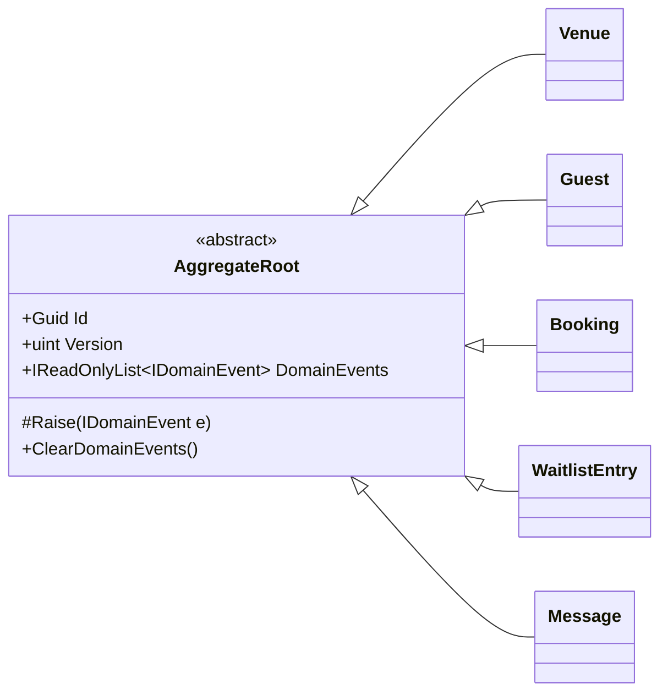

**Venue aggregate**

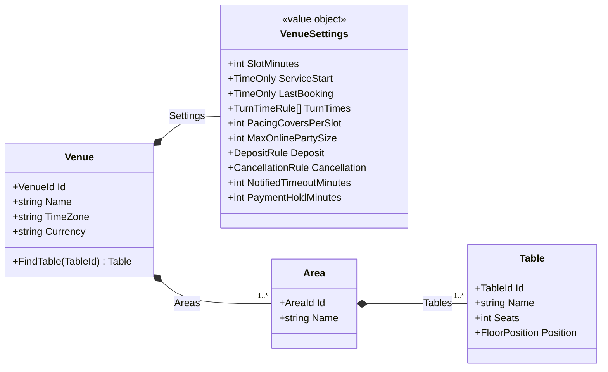

**Booking aggregate**

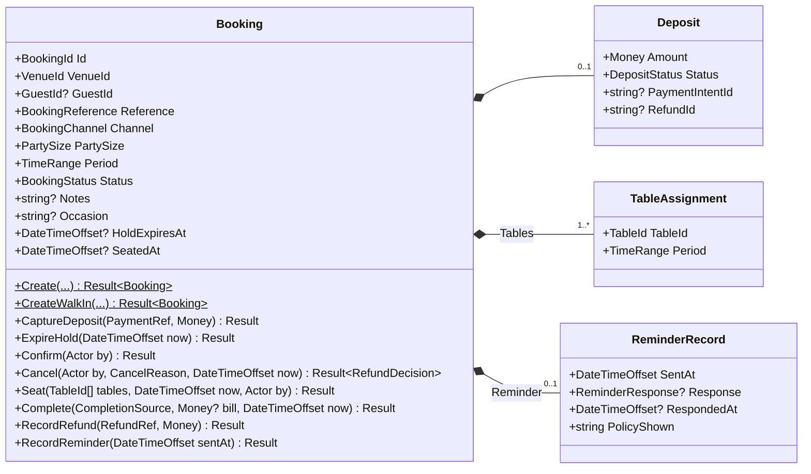

**Guest, waitlist entry and message aggregates**

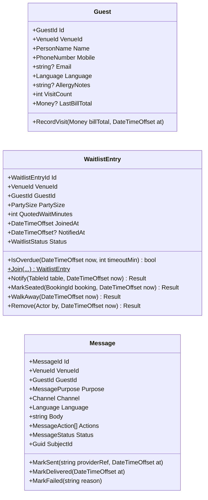

**References between aggregates (by ID only)**

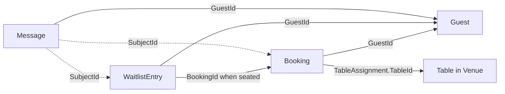

References between aggregates are **by ID only**; there are no navigation properties across aggregate boundaries.

### 2.3 Value objects

| Value object | Rules |
| --- | --- |
| `PartySize` | 1–20 overall; online bookings limited by `MaxOnlinePartySize` (8, BR-04) in the command, not the type |
| `PhoneNumber` | Parsed from NZ input to E.164 (`+64…`) with libphonenumber; mobiles only (BR-12) |
| `PersonName` | Trimmed, 1–80 characters |
| `Money` | `long Cents`, `string Currency`; no floating point (BR-11) |
| `TimeRange` | `[Start, End)` in UTC; `End > Start`; maps to PostgreSQL `tstzrange` |
| `BookingReference` | 6 characters from an unambiguous alphabet (no 0/O/1/I), unique per venue, e.g. `GD7K4P` |
| `FloorPosition` | `X`, `Y`, `Rotation`, `Shape` (`Round` / `Rect`), `Width`, `Height` in floor units (ADR-001) |
| `Actor` | `Type` (`Guest` / `Staff` / `System` / `Pos`), `Id`, `Role?` (ADR-002 envelope) |

### 2.4 Enumerations

| Enum | Values |
| --- | --- |
| `BookingStatus` | `PendingPayment`, `Booked`, `Confirmed`, `Seated`, `Completed`, `Cancelled` |
| `BookingChannel` | `Online`, `Phone`, `WalkIn` |
| `DepositStatus` | `Pending`, `Captured`, `Refunded`, `Released` (hold expired before payment) |
| `CancelReason` | `GuestRequest`, `HostRequest`, `HoldExpired` |
| `CompletionSource` | `BillClosed` (from POS), `ClearedByHost` |
| `WaitlistStatus` | `Waiting`, `Notified`, `Seated`, `WalkedAway`, `Removed` |
| `MessagePurpose` | `Confirmation`, `Reminder`, `TableReady`, `Cancellation`, `Refund` |
| `MessageStatus` | `Queued`, `Sent`, `Delivered`, `Failed` |
| `TableState` (derived, never stored) | `Free`, `Booked`, `ArrivingSoon`, `Seated` |

All enums are stored as text (ADR-003 DM-06).

### 2.5 Table state is derived, not stored

A table has no status column. Its state on the floor plan is computed from active bookings for that table at `now` (venue time):

| Order | Condition | `TableState` |
| --- | --- | --- |
| 1 | A `Seated` booking is assigned to the table | `Seated` |
| 2 | A `PendingPayment`, `Booked` or `Confirmed` booking starts within the next 30 minutes (AC2.3) | `ArrivingSoon` |
| 3 | Such a booking starts later today | `Booked` |
| 4 | Otherwise | `Free` |

This removes a whole class of "table and booking disagree" bugs. Clearing a table means completing the booking seated at it (§3.1).

---

## 3. State machines

### 3.1 Booking

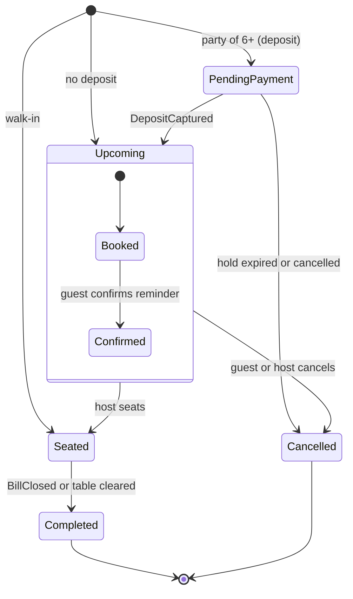

| Transition | Method | Guards | Effects | Events raised |
| --- | --- | --- | --- | --- |
| → `PendingPayment` | `Create` | Party within online limit; slot within service hours; deposit rule applies | `HoldExpiresAt = now + 10 min`; `Deposit.Status = Pending`; table assigned | `BookingCreated` |
| → `Booked` | `Create` | As above, no deposit | Table assigned | `BookingCreated` |
| → `Seated` | `CreateWalkIn` | Table free now for the turn time | `Channel = WalkIn`; `Period = [now, now + turn)`; `SeatedAt = now` | `BookingCreated`, `BookingSeated` (`source: walkIn`) |
| `PendingPayment` → `Booked` | `CaptureDeposit` | Status is `PendingPayment`; amount equals deposit due; hold not expired **or** table still free | `Deposit.Status = Captured`; `HoldExpiresAt = null` | `DepositCaptured` |
| `PendingPayment` → `Cancelled` | `ExpireHold` | `now ≥ HoldExpiresAt` | `Deposit.Status = Released`; table released | `BookingCancelled` (`reason: HoldExpired`) |
| `Booked` → `Confirmed` | `Confirm` | Status `Booked`; `now < Period.Start` | Reminder response recorded | `BookingConfirmed` |
| → `Seated` | `Seat` | Status `Booked` or `Confirmed`; tables free from `now` to `now + turn` | `Period = [now, now + turn)`; `SeatedAt = now`; tables reassigned if host chose others | `BookingSeated` (`source: booking`) |
| → `Cancelled` | `Cancel` | Status `PendingPayment`, `Booked` or `Confirmed` | Table released; refund decision (§8.3) | `BookingCancelled` (+ `DepositRefunded` later, from Stripe) |
| `Seated` → `Completed` | `Complete` | Status `Seated` | Bill total recorded if from POS | `BookingCompleted`, `TableCleared` |

Any transition not in the table returns `Error.Conflict("invalid_transition")` → HTTP `409` with code `rule_broken`. Calling a method that leads to the current state (for example a second `Confirm`) is a no-op that returns success and raises nothing, so repeated taps and retried requests are safe.

**Active statuses** (hold a table in the exclusion constraint): `PendingPayment`, `Booked`, `Confirmed`, `Seated`.

### 3.2 Waitlist entry

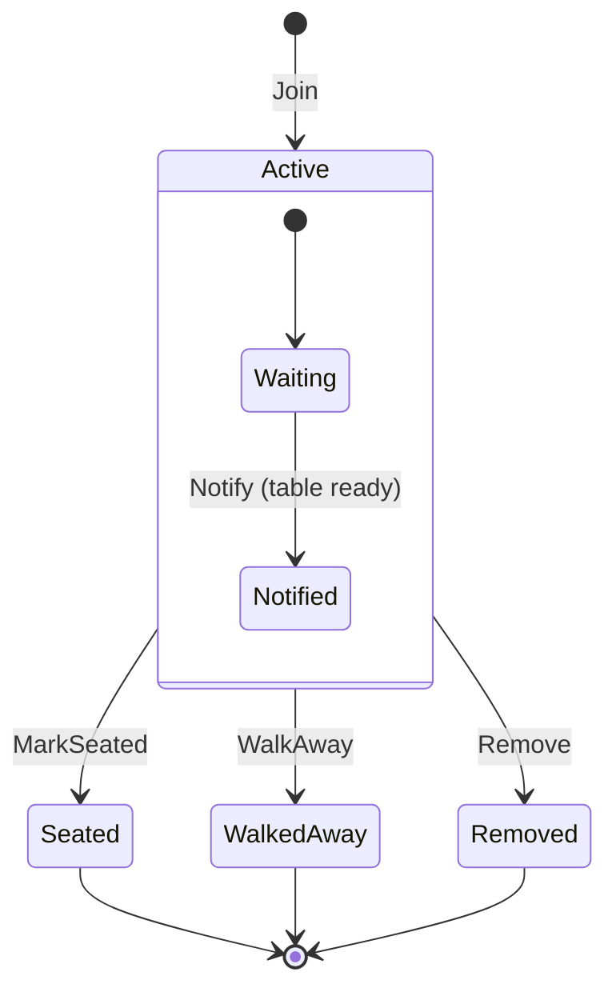

| Transition | Guard | Events |
| --- | --- | --- |
| `Join` | Party size 1–20; quoted wait 0–240 min | `WaitlistJoined` |
| `Notify` | Status `Waiting` or `Notified` (re-notify allowed; `NotifiedAt` updated) | `WaitlistNotified` |
| `MarkSeated` | Status `Waiting` or `Notified`; the walk-in booking was created in the same transaction | `WaitlistEnded` (`outcome: seated`) |
| `WalkAway` / `Remove` | Status `Waiting` or `Notified` | `WaitlistEnded` (`outcome: walkedAway` / `removed`) |

**Overdue** (AC4.6, BR-10) is a computed flag, not a state: `Status == Notified && now − NotifiedAt > 10 min`. The host app shows it; a timer job (§16) pushes `waitlistChanged` when an entry becomes overdue so screens update without polling.

### 3.3 Deposit (inside `Booking`)

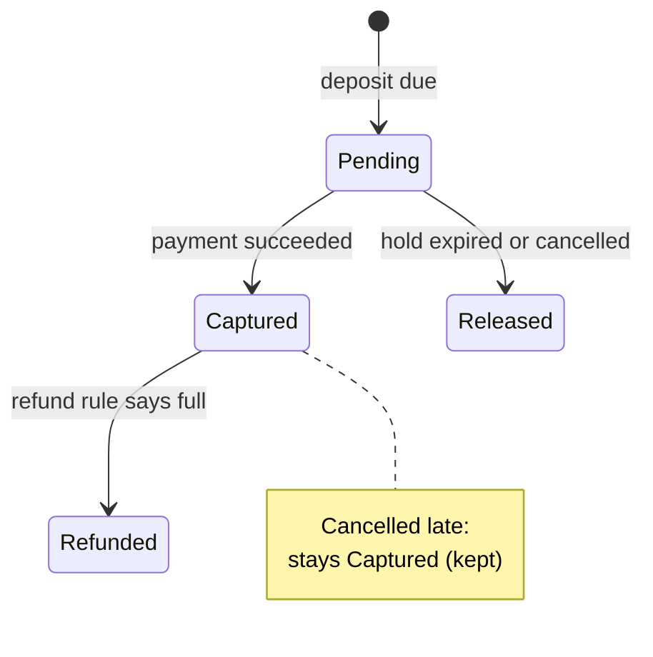

### 3.4 Message

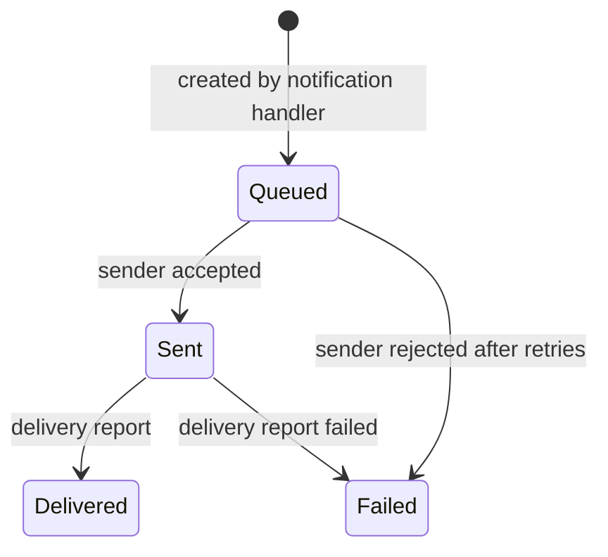

`MessageSent` is raised on `Queued → Sent`. In the demo the phone-panel sender marks `Delivered` about 1 s after `Sent` (AC4.4).

### 3.5 Outbox row and POS message

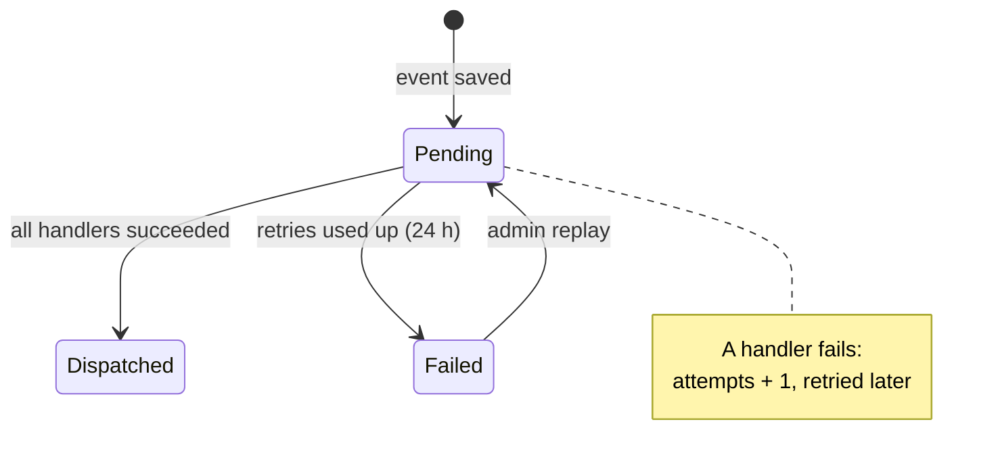

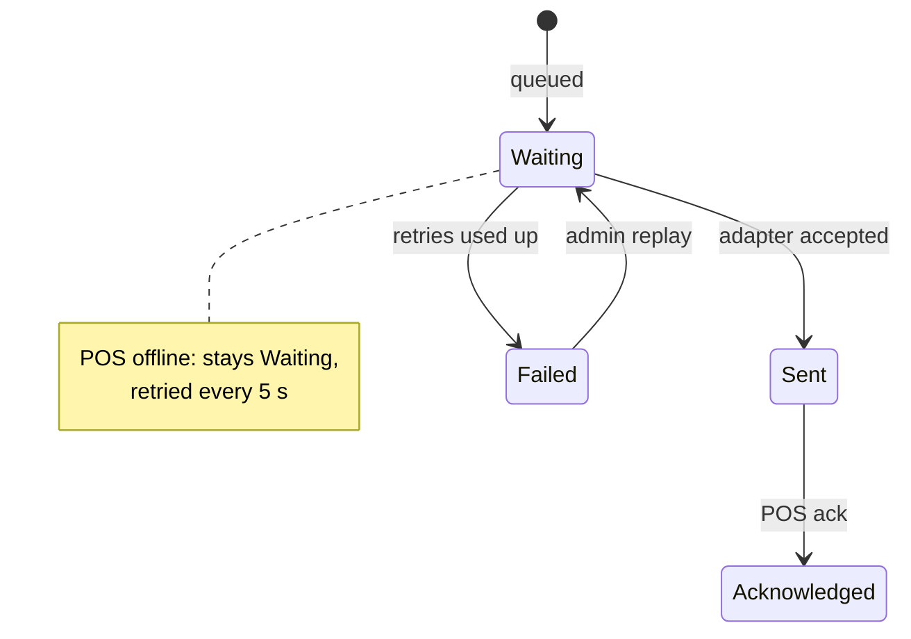

---

## 4. Domain events

### 4.1 Types

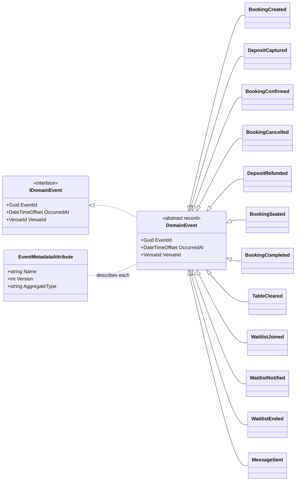

```csharp
public abstract record DomainEvent(Guid EventId, DateTimeOffset OccurredAt, VenueId VenueId) : IDomainEvent;

[EventMetadata("BookingSeated", Version = 1, AggregateType = "Booking")]
public sealed record BookingSeated(
    Guid EventId, DateTimeOffset OccurredAt, VenueId VenueId,
    BookingId BookingId, TableId[] TableIds, int PartySize,
    SeatSource Source, Guid? WaitlistEntryId, DateTimeOffset SeatedAt)
    : DomainEvent(EventId, OccurredAt, VenueId);
```

### 4.2 Catalogue with payloads (v1)

| Event | Aggregate | Payload (besides the envelope) |
| --- | --- | --- |
| `BookingCreated` | Booking | `bookingId, guestId?, reference, channel, partySize, startsAt, endsAt, tableIds[], depositCents?, holdExpiresAt?` |
| `DepositCaptured` | Booking | `bookingId, paymentIntentId, amountCents` |
| `BookingConfirmed` | Booking | `bookingId, confirmedBy (actor)` |
| `BookingCancelled` | Booking | `bookingId, reason, cancelledBy, refundDecision (full / none / notApplicable)` |
| `DepositRefunded` | Booking | `bookingId, refundId, amountCents` |
| `BookingSeated` | Booking | `bookingId, tableIds[], partySize, source (booking / walkIn), waitlistEntryId?, seatedAt` |
| `BookingCompleted` | Booking | `bookingId, source (billClosed / clearedByHost), billTotalCents?, closedAt` |
| `TableCleared` | Booking | `bookingId, tableIds[], clearedAt` |
| `WaitlistJoined` | WaitlistEntry | `waitlistEntryId, guestId, partySize, quotedMinutes` |
| `WaitlistNotified` | WaitlistEntry | `waitlistEntryId, tableId, notifiedAt` |
| `WaitlistEnded` | WaitlistEntry | `waitlistEntryId, outcome (seated / walkedAway / removed), bookingId?` |
| `MessageSent` | Message | `messageId, purpose, channel, subjectId, toMasked` |

`TableCleared` belongs to the `Booking` aggregate because table state is derived (§2.5); it exists so floor-plan consumers do not need to know completion rules.

### 4.3 Who consumes what

| Event | Realtime | Notifications | POS | Audit | Waitlist suggester | Guest |
| --- | :-: | :-: | :-: | :-: | :-: | :-: |
| `BookingCreated` | ● | ● (confirmation, unless pending payment) | ● `UpsertMember` | ● | | |
| `DepositCaptured` | ● | ● (confirmation) | | ● | | |
| `BookingConfirmed` | ● | | | ● | | |
| `BookingCancelled` | ● | ● (cancellation) | | ● | ● | |
| `DepositRefunded` | ● | ● (refund) | | ● | | |
| `BookingSeated` | ● | | ● `OpenTable`, `ApplyDeposit` | ● | | |
| `BookingCompleted` | ● | | | ● | | ● `RecordVisit` |
| `TableCleared` | ● | | | ● | ● | |
| `WaitlistJoined` / `WaitlistEnded` | ● | | | ● | | |
| `WaitlistNotified` | ● | ● (table ready) | | ● | | |
| `MessageSent` | ● (phone panel, message log) | | | ● | | |

The **waitlist suggester** computes "first waiting party that fits" (AC4.2, BR-09) when a table frees and pushes it with `waitlistChanged`; it changes no state.

---

## 5. Event infrastructure: outbox, dispatcher, inbox

### 5.1 Classes

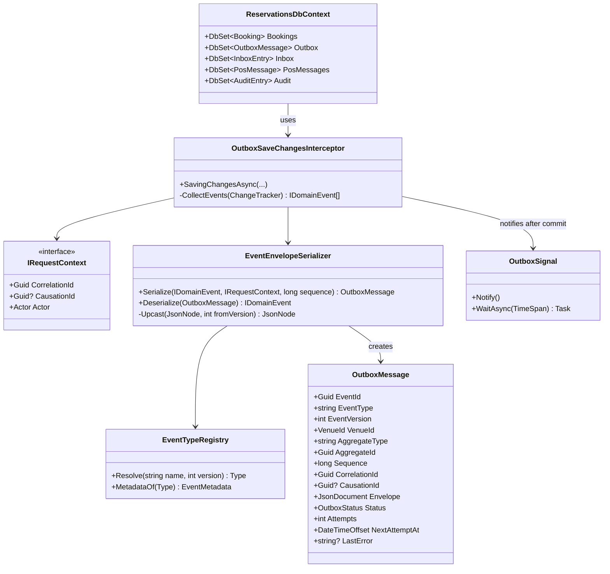

**Dispatching side**


`OutboxDispatcher` also uses `OutboxSignal` (to wake) and `EventEnvelopeSerializer` (to read rows). Every handler except `RealtimeNotifier` is registered wrapped in `IdempotentHandlerDecorator<T>`.

`IEventPublisher` (named in ADR-002) is the interface command handlers use when they need to raise an event that does not come from an aggregate (rare: demo reset). Its implementation adds the event to the current `DbContext` so it is written by the same interceptor. Aggregates never call it; they use `Raise`.

### 5.2 Writing events (inside the request)

1. A handler loads aggregates, calls domain methods, and calls `SaveChangesAsync`.
2. `OutboxSaveChangesInterceptor` collects `DomainEvents` from every tracked `AggregateRoot`, takes the next `sequence` per aggregate (`aggregate.Version` after increment), wraps each in the envelope with `correlationId`, `causationId` and `actor` from `IRequestContext`, and adds `OutboxMessage` rows **to the same transaction**.
3. After commit, it clears the events from the aggregates and calls `OutboxSignal.Notify()` so the dispatcher wakes in milliseconds instead of waiting for the 1 s poll.

### 5.3 Dispatching events (outside the request)

```text
loop:
  await signal.WaitAsync(1s)                          -- or the 1 s poll
  BEGIN
    rows = SELECT … FROM outbox
           WHERE status = 'Pending' AND next_attempt_at <= now()
             AND aggregate_id NOT IN (aggregates with an earlier Pending/Failed row)
           ORDER BY aggregate_id, sequence
           LIMIT 50
           FOR UPDATE SKIP LOCKED
    for each row (in order per aggregate):
      event = deserialize(row)                        -- with upcasting
      for each handler of event type:
        await handler.HandleAsync(event)              -- each handler idempotent
      row.status = 'Dispatched'
      on exception in any handler:
        row.attempts++; row.next_attempt_at = now + backoff(attempts)
        row.status = attempts > max ? 'Failed' : 'Pending'
        skip the rest of this aggregate's rows in this batch (keeps order)
  COMMIT
```

Backoff: 5 s, 30 s, 2 min, 10 min, then every 30 min until 24 h after the first attempt (ADR-002).

### 5.4 Idempotent handlers

`IdempotentHandlerDecorator<T>` wraps every handler that changes state:

```csharp
public async Task HandleAsync(T e, EventContext ctx, CancellationToken ct)
{
    await using var tx = await _db.Database.BeginTransactionAsync(ct);
    var inserted = await _db.Database.ExecuteSqlAsync(
        $"INSERT INTO inbox (consumer, message_id, processed_at) VALUES ({_inner.ConsumerName}, {e.EventId.ToString()}, now()) ON CONFLICT DO NOTHING", ct);
    if (inserted == 0) return;                 // already processed
    await _inner.HandleAsync(e, ctx, ct);      // writes its own rows via the same DbContext
    await _db.SaveChangesAsync(ct);
    await tx.CommitAsync(ct);
}
```

`RealtimeNotifier` is **not** wrapped: a repeated push only causes one extra refetch.

### 5.5 Inbound messages (Stripe, POS)

Webhooks use the same `inbox` table with `consumer = 'stripe-webhook'` or `'pos-webhook'` and the provider's message ID. The webhook endpoint verifies the signature, inserts the inbox row and runs the command in one transaction, then returns `200`. A repeat returns `200` and does nothing.

---

## 6. POS integration

### 6.1 Classes

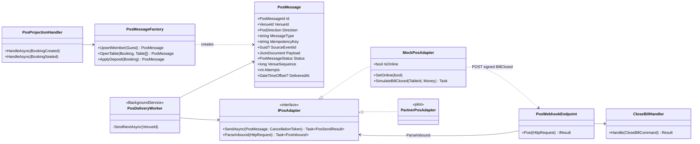

### 6.2 Why two steps (event → POS message → delivery)

The POS log must show messages **waiting** while the POS is offline (AC6.5), so a POS message is a stored record from the moment its event is handled, with its own ordered delivery per venue. The outbox delivers the event once; the POS queue then retries the POS call as long as needed without holding up other event handlers.

### 6.3 Mapping

| Event | Condition | POS message | Payload | Idempotency key |
| --- | --- | --- | --- | --- |
| `BookingCreated` | Booking has a guest | `UpsertMember` | `memberPhone, name, language` | `{eventId}:UpsertMember` |
| `BookingSeated` | Always | `OpenTable` | `tableIds, partySize, guestName?, bookingId` | `{eventId}:OpenTable` |
| `BookingSeated` | Deposit captured | `ApplyDeposit` | `tableIds, amountCents, paymentRef, bookingId` | `{eventId}:ApplyDeposit` |
| (inbound) | POS sends `BillClosed` | → `CloseBillCommand` | `posMessageId, tableId, billTotalCents, closedAt` | POS message ID in inbox |

`OpenTable` is always queued before `ApplyDeposit` for the same event (sequence order).

### 6.4 Delivery rules

- One worker loop per venue sends `Waiting` messages in `VenueSequence` order; it never sends message *n + 1* before *n* is `Sent` (AC6.5).
- Mock offline → `PosSendResult.Unavailable` → retry after 5 s (demo) without counting towards failure for up to 24 h.
- Each status change pushes `posLogChanged` to the venue group.

---

## 7. Messaging and the phone panel

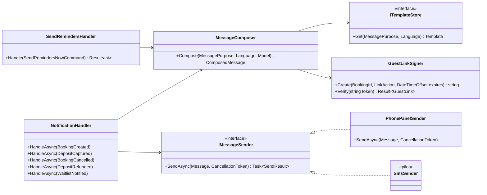

- Templates are per purpose and language (English and Simplified Chinese), stored in the API's resource files.
- Reminder messages carry two actions, **Confirm** and **Cancel**, each a signed link (`GuestLinkSigner`, HMAC-SHA256 with a key from Secrets Manager) that expires at the booking start time (ADR-004).
- `PhonePanelSender` stores the message, marks it `Sent`, pushes `messageLogChanged` to the venue's presenter screen, and marks it `Delivered` 1 s later. No real SMS is sent (Requirements §11).
- The phone panel's buttons call the same guest endpoints a real link would (§14), so the flow is identical to the pilot's.

---

## 8. Payments

### 8.1 Classes

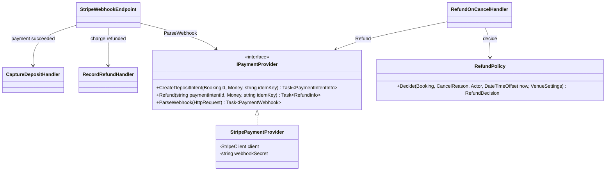

`DepositPolicy` is used by `CreateOnlineBooking` (§9.2) to work out the deposit due.

### 8.2 Deposit rule (BR-06)

`DepositDue = partySize ≥ 6 ? partySize × NZD 20.00 : none`. Values come from `VenueSettings.Deposit`.

### 8.3 Refund rule (BR-07)

| Who cancels | When | Decision |
| --- | --- | --- |
| Guest | ≥ 2 h before start | Full refund |
| Guest | < 2 h before start | No refund (deposit kept) |
| Host | Any time | Full refund |
| System (hold expired) | Before payment | Not applicable (`Released`) |

`RefundOnCancelHandler` consumes `BookingCancelled` where `refundDecision = full` and calls Stripe with idempotency key `{eventId}:refund`. Stripe's `charge.refunded` webhook then raises `DepositRefunded` through `RecordRefundHandler`.

---

## 9. Application layer

### 9.1 Command and query shape

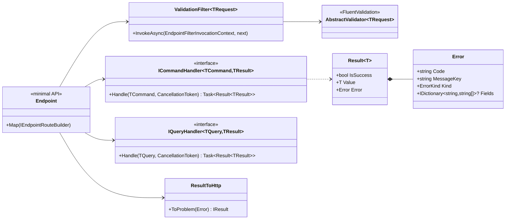

No mediator library is used; endpoints call handlers directly through DI. `ErrorKind` (`Validation`, `NotFound`, `Conflict`, `Rule`, `Forbidden`, `External`) maps to the HTTP status in ADR-004's error table.

### 9.2 Commands

| Feature | Command | Aggregate method(s) | Main errors |
| --- | --- | --- | --- |
| Bookings | `CreateOnlineBooking` | `Booking.Create`; Stripe intent if deposit due | `slot_taken`, `party_too_large`, `outside_service_hours` |
| Bookings | `ConfirmBooking` (guest link) | `Confirm` | `invalid_link`, `rule_broken` |
| Bookings | `CancelBooking` (guest link or host) | `Cancel` | `invalid_link`, `rule_broken` |
| Bookings | `SeatBooking` | `Seat` | `slot_taken`, `version_conflict` |
| Bookings | `SeatWalkIn` | `Booking.CreateWalkIn` (+ `WaitlistEntry.MarkSeated` if from waitlist) | `slot_taken` |
| Bookings | `ClearTable` | `Complete(ClearedByHost)` | `not_found` (no seated booking) |
| Bookings | `CloseBill` (POS inbound) | `Complete(BillClosed, bill)` | (idempotent) |
| Payments | `CaptureDeposit` (Stripe inbound) | `CaptureDeposit` | `hold_expired` → automatic refund |
| Payments | `RecordRefund` (Stripe inbound) | `RecordRefund` | (idempotent) |
| Waitlist | `JoinWaitlist` | `WaitlistEntry.Join` | `validation_failed` |
| Waitlist | `NotifyWaitlistEntry` | `Notify` | `rule_broken` |
| Waitlist | `EndWaitlistEntry` | `WalkAway` / `Remove` | `rule_broken` |
| Messaging | `SendRemindersNow` (presenter) | `RecordReminder` on each unconfirmed booking tonight | — |
| Demo | `ResetDemo`, `SetDemoClock`, `SetMockPosOnline`, `SimulateBillPaid` | — | — |

### 9.3 Queries (read models)

Queries read with `AsNoTracking()` projections straight to DTOs; they never load aggregates.

| Query | Returns |
| --- | --- |
| `GetAvailability(date, partySize, time?)` | Free slots, or the 3 nearest (§11) |
| `GetFloorPlan(at)` | Areas, tables with `TableState`, current/next booking summary, allergy flag |
| `GetTonightBookings` | Bookings for the service day, in time order |
| `GetWaitlist` | Active entries with waited minutes, overdue flag, suggested entry |
| `GetSuggestedTable(partySize)` | Smallest free fitting table now (AC3.1) |
| `GetQuotedWait(partySize)` | Minutes (BR-08) |
| `GetMessageLog`, `GetPosLog` | Newest first, paged |
| `GetBookingByLink(token)` | Guest's view for confirm or cancel |

---

## 10. Key sequences

### 10.1 Online booking with deposit (steps 1–2)

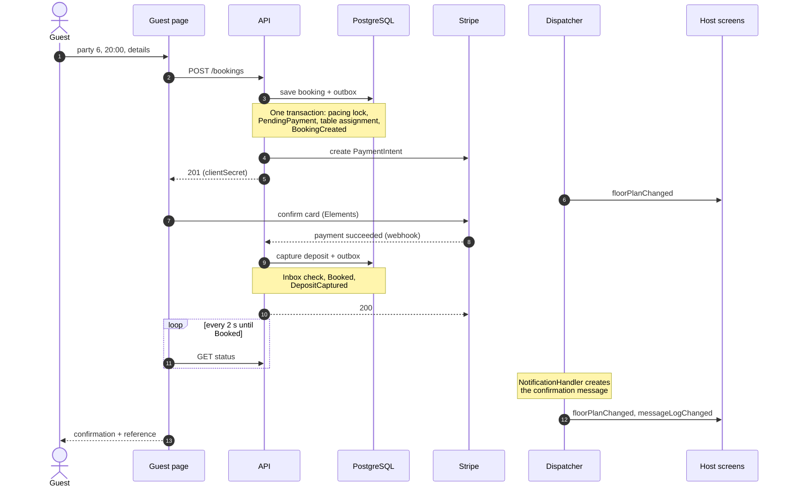

### 10.2 Seat a walk-in and open the POS table (steps 3 and 6)

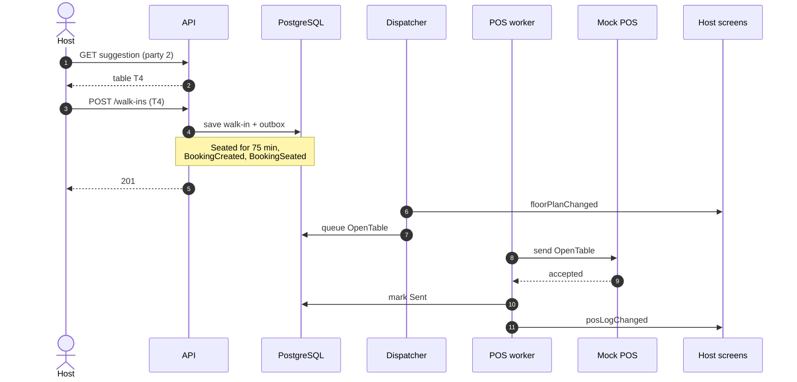

### 10.3 Table freed, waiting party notified and seated (step 4)

```mermaid
sequenceDiagram
    autonumber
    actor Ho as Host
    participant A as API
    participant M as Mock POS
    participant DB as PostgreSQL
    participant D as Dispatcher
    participant PP as Phone panel

    Ho->>A: Bill paid (T7)
    A->>M: simulate BillClosed
    M->>A: BillClosed (signed webhook)
    A->>DB: complete booking + outbox
    Note over A,DB: Inbox check, Completed,<br/>BookingCompleted, TableCleared
    D->>DB: record guest visit
    D->>Ho: floorPlanChanged, waitlistChanged
    Note over Ho: T7 free, Lee (4) highlighted
    Ho->>A: notify entry (T7)
    A->>DB: Notified + outbox
    D->>DB: create TableReady message
    D->>PP: messageLogChanged
    Ho->>A: POST /walk-ins (entry, T7)
    A->>DB: seat + end entry + outbox
    Note over A,DB: Seated, BookingCreated,<br/>BookingSeated, WaitlistEnded
```

### 10.4 Reminder → guest cancels → refund (step 5)

```mermaid
sequenceDiagram
    autonumber
    actor Pr as Presenter
    participant A as API
    participant DB as PostgreSQL
    participant D as Dispatcher
    participant PP as Phone panel
    participant S as Stripe

    Pr->>A: send reminders now
    A->>DB: reminders + messages
    D->>PP: messageLogChanged
    PP->>A: cancel (signed link)
    Note over A: Verify link. Refund rule:<br/>full (2 h or more before)
    A->>DB: Cancelled + outbox
    D->>S: refund (idempotency key)
    S-->>A: charge refunded (webhook)
    A->>DB: record refund + outbox
    D->>PP: refund message
```

### 10.5 POS offline, then back online (QA-5)

```mermaid
sequenceDiagram
    autonumber
    actor Pr as Presenter
    participant A as API
    participant P as POS worker
    participant M as Mock POS
    participant L as POS log

    Pr->>A: POS offline
    Note over P,M: Three tables seated:<br/>OpenTable x3 queued (41 to 43)
    P->>M: send 41
    M-->>P: unavailable
    Note over P: Retry every 5 s.<br/>42 and 43 wait behind 41
    L-->>Pr: 3 messages "waiting"
    Pr->>A: POS online
    P->>M: send 41, 42, 43
    M-->>P: accepted x3
    L-->>Pr: all "sent", in order, once
```

---

## 11. Availability and table assignment

### 11.1 Inputs

`VenueSettings` (BR-01 to BR-05), tables, and active `table_assignments` for the service day.

### 11.2 Algorithm

```text
GetAvailability(date, partySize, requestedTime?):
  turn   = TurnTime(partySize)                         -- 75 / 90 / 120 min (BR-02)
  slots  = every 15 min from ServiceStart to LastBooking (BR-01), not in the past
  for slot in slots:
     covers = sum(partySize of bookings starting in [slot, slot+15m))
     if covers + partySize > PacingCoversPerSlot (12): continue      -- BR-03
     table  = smallest table with seats ≥ partySize
              and no active assignment overlapping [slot, slot+turn) -- BR-05
     if table: available.add(slot, table)
  if requestedTime given and not in available:
     return 3 available slots nearest to requestedTime (ties: earlier first)  -- AC1.3
  return available
```

- Runs as one SQL query per day using `tstzrange` overlap (`&&`) and a `GROUP BY` on slot; well under the 1 s target (AC1.1) for 14 tables.
- The chosen table is **re-checked** at write time by the exclusion constraint (§12); availability is advice, not a reservation.

### 11.3 Quoted wait (BR-08)

```text
QuotedWait(partySize):
  fitting = tables with seats ≥ partySize
  if any fitting table is Free now: return 0
  expectedFree(t) = seatedAt + turn(seated party)  for each Seated fitting table
  minutes = min(expectedFree) − now
  return ceil(minutes / 5) × 5
```

### 11.4 Suggested waiting party (BR-09, AC4.2)

When a table frees: the first `Waiting` or `Notified` entry, by `JoinedAt`, whose party size ≤ table seats. The host may pick another.

---

## 12. Concurrency and consistency

| Risk | Defence | Error |
| --- | --- | --- |
| Two bookings for one table at one time | `EXCLUDE USING gist (table_id WITH =, period WITH &&) WHERE (active)` on `table_assignments` | `23P01` → `409 slot_taken` |
| Pacing exceeded by two simultaneous bookings | `pg_advisory_xact_lock(hash(venue_id, slot_start))` before counting covers in the create transaction | `409 slot_taken` |
| Two hosts change one booking | `xmin`-based row version on every aggregate (EF Core concurrency token) | `409 version_conflict` |
| Deposit paid after hold expired | `CaptureDeposit` re-checks the table; if taken, booking is cancelled and the payment refunded automatically | Guest sees "time no longer available, refunded" |
| Duplicate Stripe or POS webhooks | Inbox unique key `(consumer, message_id)` | `200`, no-op |
| Duplicate event handling | `IdempotentHandlerDecorator` + inbox | — |
| Outbox order across workers | `FOR UPDATE SKIP LOCKED` + skip aggregates with earlier pending rows | — |

`active` on `table_assignments` is kept in step with the booking status in the same transaction (`true` for the four active statuses).

---

## 13. Database schema

PostgreSQL, snake_case, EF Core migrations (ADR-003 DM-10). Requires the `btree_gist` extension. Every table has `venue_id`, and `xmin` is used as the row version.

```sql
CREATE EXTENSION IF NOT EXISTS btree_gist;

CREATE TABLE venues (
  id uuid PRIMARY KEY, name text NOT NULL, time_zone text NOT NULL,
  currency char(3) NOT NULL DEFAULT 'NZD', settings jsonb NOT NULL
);

CREATE TABLE areas (
  id uuid PRIMARY KEY, venue_id uuid NOT NULL REFERENCES venues(id),
  name text NOT NULL, sort_order int NOT NULL
);

CREATE TABLE tables (
  id uuid PRIMARY KEY, venue_id uuid NOT NULL REFERENCES venues(id),
  area_id uuid NOT NULL REFERENCES areas(id), name text NOT NULL,
  seats int NOT NULL CHECK (seats > 0), position jsonb NOT NULL
);

CREATE TABLE guests (
  id uuid PRIMARY KEY, venue_id uuid NOT NULL REFERENCES venues(id),
  name text NOT NULL, mobile_e164 text NOT NULL, email text, language text NOT NULL,
  allergy_notes text, visit_count int NOT NULL DEFAULT 0, last_bill_cents bigint,
  UNIQUE (venue_id, mobile_e164)
);

CREATE TABLE bookings (
  id uuid PRIMARY KEY, venue_id uuid NOT NULL REFERENCES venues(id),
  guest_id uuid REFERENCES guests(id), reference text NOT NULL,
  channel text NOT NULL, party_size int NOT NULL CHECK (party_size BETWEEN 1 AND 20),
  period tstzrange NOT NULL, status text NOT NULL,
  deposit_cents bigint, deposit_status text, payment_intent_id text, refund_id text,
  hold_expires_at timestamptz, seated_at timestamptz, completed_at timestamptz,
  bill_total_cents bigint, notes text, occasion text, reminder jsonb,
  created_at timestamptz NOT NULL, UNIQUE (venue_id, reference)
);
CREATE INDEX ix_bookings_venue_day ON bookings (venue_id, lower(period));

CREATE TABLE table_assignments (
  booking_id uuid NOT NULL REFERENCES bookings(id), table_id uuid NOT NULL REFERENCES tables(id),
  venue_id uuid NOT NULL, period tstzrange NOT NULL, active boolean NOT NULL,
  PRIMARY KEY (booking_id, table_id),
  EXCLUDE USING gist (table_id WITH =, period WITH &&) WHERE (active)
);

CREATE TABLE waitlist_entries (
  id uuid PRIMARY KEY, venue_id uuid NOT NULL, guest_id uuid NOT NULL REFERENCES guests(id),
  party_size int NOT NULL, quoted_wait_minutes int NOT NULL, status text NOT NULL,
  joined_at timestamptz NOT NULL, notified_at timestamptz, ended_at timestamptz,
  notified_table_id uuid, booking_id uuid
);

CREATE TABLE messages (
  id uuid PRIMARY KEY, venue_id uuid NOT NULL, guest_id uuid NOT NULL,
  purpose text NOT NULL, channel text NOT NULL, language text NOT NULL,
  body text NOT NULL, actions jsonb, subject_id uuid NOT NULL, status text NOT NULL,
  created_at timestamptz NOT NULL, sent_at timestamptz, delivered_at timestamptz
);

CREATE TABLE outbox (
  event_id uuid PRIMARY KEY, venue_id uuid NOT NULL, event_type text NOT NULL,
  event_version int NOT NULL, aggregate_type text NOT NULL, aggregate_id uuid NOT NULL,
  sequence bigint NOT NULL, correlation_id uuid NOT NULL, causation_id uuid,
  envelope jsonb NOT NULL, status text NOT NULL, attempts int NOT NULL DEFAULT 0,
  next_attempt_at timestamptz NOT NULL, last_error text, created_at timestamptz NOT NULL,
  dispatched_at timestamptz, UNIQUE (aggregate_id, sequence)
);
CREATE INDEX ix_outbox_pending ON outbox (next_attempt_at) WHERE status = 'Pending';

CREATE TABLE inbox (
  consumer text NOT NULL, message_id text NOT NULL, processed_at timestamptz NOT NULL,
  PRIMARY KEY (consumer, message_id)
);

CREATE TABLE pos_messages (
  id uuid PRIMARY KEY, venue_id uuid NOT NULL, direction text NOT NULL,
  message_type text NOT NULL, idempotency_key text NOT NULL UNIQUE,
  source_event_id uuid, payload jsonb NOT NULL, status text NOT NULL,
  venue_sequence bigint NOT NULL, attempts int NOT NULL DEFAULT 0,
  created_at timestamptz NOT NULL, delivered_at timestamptz,
  UNIQUE (venue_id, venue_sequence)
);

CREATE TABLE audit_log (
  id bigserial PRIMARY KEY, venue_id uuid NOT NULL, event_id uuid NOT NULL UNIQUE,
  event_type text NOT NULL, aggregate_id uuid NOT NULL, actor jsonb NOT NULL,
  occurred_at timestamptz NOT NULL, summary jsonb NOT NULL
);
```

---

## 14. HTTP API

Base path `/api/v1`. Venue-scoped routes are `/api/v1/venues/{venueId}/…`. All responses are JSON; errors are Problem Details (ADR-004).

| Method | Path | Caller | Command / query |
| --- | --- | --- | --- |
| GET | `/venues/{venueId}/availability?date&partySize&time` | Guest | `GetAvailability` |
| POST | `/venues/{venueId}/bookings` | Guest | `CreateOnlineBooking` → `201 {bookingId, reference, status, clientSecret?, holdExpiresAt?}` |
| GET | `/venues/{venueId}/bookings/{id}/status` | Guest | Status poll while paying |
| GET | `/guest/bookings?token` | Guest link | `GetBookingByLink` |
| POST | `/guest/bookings/confirm` `{token}` | Guest link | `ConfirmBooking` |
| POST | `/guest/bookings/cancel` `{token}` | Guest link | `CancelBooking` |
| GET | `/venues/{venueId}/floor-plan?at` | Host | `GetFloorPlan` |
| GET | `/venues/{venueId}/bookings?day` | Host | `GetTonightBookings` |
| POST | `/venues/{venueId}/bookings/{id}/seat` `{tableIds, version}` | Host | `SeatBooking` |
| POST | `/venues/{venueId}/bookings/{id}/cancel` `{version}` | Host | `CancelBooking` |
| GET | `/venues/{venueId}/tables/suggestion?partySize` | Host | `GetSuggestedTable` |
| POST | `/venues/{venueId}/walk-ins` `{partySize, tableId, name?, waitlistEntryId?}` | Host | `SeatWalkIn` |
| POST | `/venues/{venueId}/tables/{tableId}/clear` | Host | `ClearTable` |
| GET | `/venues/{venueId}/waitlist` | Host | `GetWaitlist` |
| GET | `/venues/{venueId}/waitlist/quote?partySize` | Host | `GetQuotedWait` |
| POST | `/venues/{venueId}/waitlist` `{name, mobile, partySize, quotedWaitMinutes}` | Host | `JoinWaitlist` |
| POST | `/venues/{venueId}/waitlist/{id}/notify` `{tableId}` | Host | `NotifyWaitlistEntry` |
| POST | `/venues/{venueId}/waitlist/{id}/end` `{outcome}` | Host | `EndWaitlistEntry` |
| GET | `/venues/{venueId}/messages` | Presenter | `GetMessageLog` |
| GET | `/venues/{venueId}/pos-messages` | Presenter | `GetPosLog` |
| POST | `/webhooks/stripe` | Stripe | Signed; inbox |
| POST | `/webhooks/pos` | (Mock) POS | Signed; inbox → `CloseBill` |
| POST | `/demo/reset` | Presenter | `ResetDemo` |
| PUT | `/demo/clock` `{now}` | Presenter | `SetDemoClock` |
| PUT | `/demo/pos/online` `{online}` | Presenter | `SetMockPosOnline` |
| POST | `/demo/pos/bill-paid` `{tableId, totalCents}` | Presenter / host | `SimulateBillPaid` |
| POST | `/demo/reminders/send-now` | Presenter | `SendRemindersNow` |

`/demo/*` endpoints exist only when `Demo:Enabled = true` and are never mapped in the pilot.

---

## 15. Real-time contract (SignalR)

**Hub:** `/hubs/venue`. A client calls `JoinVenue(venueId)` after connecting and joins the group `venue:{venueId}`.

| Server → client | Payload | Client action |
| --- | --- | --- |
| `floorPlanChanged` | `{ tableIds[], bookingIds[], sequence }` | Invalidate the `floor-plan` and `bookings` queries |
| `waitlistChanged` | `{ entryIds[], suggestedEntryId?, freedTableId? }` | Invalidate `waitlist`; highlight the suggestion |
| `messageLogChanged` | `{ messageIds[] }` | Invalidate `messages` (phone panel) |
| `posLogChanged` | `{ posMessageIds[] }` | Invalidate `pos-messages` |
| `demoReset` | `{}` | Invalidate everything |

Notices carry IDs only, never personal data. On reconnect the client invalidates every query once (AC2.5, QA-2). These message types are published as OpenAPI schemas so `orval` generates them (ADR-004).

---

## 16. Background jobs

| Job | Type | Interval | Does |
| --- | --- | --- | --- |
| `OutboxDispatcher` | `BackgroundService` | Signal or 1 s | §5.3 |
| `PosDeliveryWorker` | `BackgroundService` | Signal or 1 s; 5 s retry while offline | §6.4 |
| `PaymentHoldExpiryJob` | `PeriodicTimer` | 30 s | `ExpireHold` on `PendingPayment` bookings past `HoldExpiresAt` |
| `WaitlistOverdueJob` | `PeriodicTimer` | 30 s | Pushes `waitlistChanged` when a notified entry passes 10 min |
| `ArrivingSoonTicker` | `PeriodicTimer` | 60 s | Pushes `floorPlanChanged` when a table crosses the 30-minute mark |
| `OutboxHousekeeping` | `PeriodicTimer` | Daily | Deletes dispatched rows older than 30 days |

All jobs use `TimeProvider`, so `DemoClock` moves them too. In the demo they run in the API process. For the pilot, the dispatcher and POS worker move to the separate worker service (ADR-005).

---

## 17. Demo-only components

| Component | Purpose | Requirement |
| --- | --- | --- |
| `DemoClock : TimeProvider` | Fixed or offset "now" (e.g. Tuesday 18:30), set from the presenter controls | Assumptions in Requirements §11 |
| `DemoSeeder` | Loads Golden Dragon: 2 areas, 14 tables, 8 bookings for tonight, sample guests | Constraints: Reset |
| `ResetDemo` | Truncates venue data, reseeds, resets clock and mock POS, broadcasts `demoReset` | Demo script "Before starting" |
| `MockPosAdapter` | Online/offline switch; accepts messages; simulates `BillClosed` | Step 6, QA-5 |
| `PhonePanelSender` | Shows texts on the presenter screen | Steps 1, 4, 5 |
| Presenter controls | Reset, clock, POS online/offline, "Send reminders now" | Demo script |
| Demo host session **[pilot: Cognito]** | The host app opens signed in as a fixed demo host for Golden Dragon; the authorisation policies still run with that identity | Out of scope: staff logins |

The demo host session keeps the ADR-004 pipeline intact: an `IUserContext` returns a fixed `Staff/Host` actor with `venue_ids = [GoldenDragon]`. Turning on Cognito in the pilot replaces only this provider.

---

## 18. Front-end design

### 18.1 Structure

```text
web/src/
├─ api/                 ← orval output: client, query hooks, zod schemas (do not edit)
├─ realtime/            ← SignalR connection, JoinVenue, notice → query invalidation map
├─ i18n/                ← en.json, zh-CN.json; error code → message keys
├─ features/
│  ├─ booking/          ← guest flow: WhenStep, DetailsStep, PayStep (Stripe Elements), Confirmation
│  ├─ manage/           ← guest link page: confirm / cancel
│  ├─ floor-plan/       ← FloorPlan (SVG), TableShape, TableDetailsPanel, ArrivingSoonBadge
│  ├─ bookings/         ← TonightList, SeatDialog
│  ├─ waitlist/         ← WaitlistPanel, JoinWaitlistDialog, NotifyButton
│  └─ presenter/        ← PhonePanel, PosLog, DemoControls
└─ app/                 ← Next.js routes: /book, /manage, /host, /presenter
```

### 18.2 State

- **Server state** lives only in the TanStack Query cache, filled by generated hooks. There is no separate client store for bookings or tables.
- **Real-time:** a notice invalidates the matching queries; the hooks refetch. The API stays the only source of truth (ADR-002).
- **UI state** (selected table, open dialog, language) is React state or URL search params.
- **Errors:** the generated client turns Problem Details into a typed error; one `useApiError` hook maps `code` to a translated toast or field message (ADR-004).

### 18.3 Floor plan components

```mermaid
classDiagram
    direction LR
    class FloorPlan {
        +areas: AreaDto[]
        +tables: TableStateDto[]
        +onSelect(tableId)
    }
    class AreaLayer
    class TableShape {
        +state: TableState
        +label: string
        +badges: Badge[]
        +role = button
        +aria-label
    }
    class TableDetailsPanel {
        +table: TableStateDto
        +actions: Seat, Clear, BillPaid, Notify
    }
    class ZoomPanContainer {
        <<react-zoom-pan-pinch>>
    }
    ZoomPanContainer *-- FloorPlan
    FloorPlan *-- "1..*" AreaLayer
    AreaLayer *-- "1..*" TableShape
    FloorPlan --> TableDetailsPanel : selected table
```

Colour **and** a text badge show each `TableState` (ADR-001 accessibility); allergy notes show as an icon (AC2.6).

---

## 19. Traceability

| Requirement | Design sections |
| --- | --- |
| Step 1, AC1.1–AC1.8 | §3.1, §8, §10.1, §11, §14 |
| Step 2, AC2.1–AC2.6 | §2.5, §15, §16, §18 |
| Step 3, AC3.1–AC3.8 | §3.1, §3.2, §10.2, §11.3, §11.4 |
| Step 4, AC4.1–AC4.6 | §3.2, §7, §10.3, §16 |
| Step 5, AC5.1–AC5.6 | §3.1, §7, §8.3, §10.4 |
| Step 6, AC6.1–AC6.6 | §6, §10.5, §13 (`pos_messages`) |
| BR-01–BR-05 | §11 |
| BR-06, BR-07 | §8.2, §8.3 |
| BR-08–BR-10 | §3.2, §11.3, §11.4 |
| BR-11, BR-12 | §2.3 |
| QA-1, QA-2 | §5.2, §15 |
| QA-5 | §5.3, §6.4, §10.5 |
| QA-6 | §17 (reset, clock) |

---

## 20. Open items

| Item | Proposed handling |
| --- | --- |
| Staff sign-in in the demo (Requirements say out of scope; ADR-004 uses Cognito) | Demo host session (§17); Cognito in the pilot. Update ADR-004 and `Architecture.md` to say so |
| Layout editor and combining tables (ADR-001 lists them; Requirements put them out of scope) | Seams kept: `FloorPosition` stored, `TableAssignment` supports several tables. Not built for the demo |
| ADR-004 validation examples (deposit for 8+, party 1–20) | Should read deposit for 6+ (BR-06) and online party 1–8 (BR-04) |
| Seating a late party whose turn now overlaps the next booking | Seat fails with `slot_taken`; host picks another table. Revisit with real venues |
| `BillClosed` for a table with no seated booking | Store in the POS log as `unmatched`; no state change |
| Language for guests who switch mid-booking | Guest's `Language` is the language active when they submit |
