# Detailed Design: Reservation Demo

|                  |                                                                                                |
|------------------|------------------------------------------------------------------------------------------------|
| **System**       | Restaurant and catering reservation system, demo build                                         |
| **Status**       | Draft for the demo build                                                                       |
| **Owner**        | Antonio Huang                                                                                  |
| **Last updated** | 17 November 2026                                                                               |
| **Inputs**       | [`Requirements.md`](Requirements.md), [`Architecture.md`](Architecture.md), ADR-001 to ADR-005 |

This file turns the requirements and ADRs into buildable design: classes and their relationships, state machines, events, sequences, database tables, endpoints and background jobs. It is written for the developer and for Claude Code.

**Scope rule:** where an ADR describes a pilot feature that `Requirements.md` puts out of scope for the demo (staff sign-in, the layout editor, combining tables), this design keeps a seam for it but does not build it. Each such seam is marked **\[pilot\]**.

## What changed since the 5 November version

Changes made on **8 November** are **highlighted in yellow with an orange bar in the left margin**; in tables, only the changed rows are highlighted. Earlier changes are listed below without highlighting.

| **Change**                                  | **What it does**                                                                                                                                                                                                                    | **Where**                                                                        |
|---------------------------------------------|-------------------------------------------------------------------------------------------------------------------------------------------------------------------------------------------------------------------------------------|----------------------------------------------------------------------------------|
| Booking terms copied at booking time        | Each booking keeps its own copy of the deposit and cancellation rules and turn time, so later changes to the venue's settings don't affect it (AC5.6)                                                                               | New §2.6; also §2.2, §2.3, §3.1, §8.1–§8.3, §13, §19                             |
| Late-match rule for POS bills               | A `BillClosed` that arrives after the host cleared the table is still attached to the right booking; anything uncertain is kept as unmatched for a manager                                                                          | New §6.5; also §2.2, §3.1, §3.5, §4.1–§4.3, §6.3, §9.2, §9.3, §13, §14, §19, §20 |
| One bill per booking, ready for split bills | Bills are keyed by POS bill ID and stored one row per bill, so duplicates are ignored, a second bill is flagged, and split bills can be added later without changing the data model                                                 | New §6.6; also §2.1–§2.3, §3.1, §4.2, §6.3, §6.5, §13, §19, §20                  |
| Message delivery worker                     | Handlers only queue texts and emails; a background worker sends them, retries with backoff, expires stale ones (a late "table ready" text is dropped) and records delivery reports. PostgreSQL is the queue; no extra queue product | New §7.1; also §2.2, §3.4, §5.5, §7, §10.1, §13, §14, §16, §19, §20              |
| Event sequence counter (8 Nov) | Each aggregate counts the events it raises (`LastEventSequence`); `Version` (`xmin`) is for concurrency only | §2.2, §5.2, §13 |
| Event handlers share the dispatcher's transaction (8 Nov) | Each handler runs under its own savepoint inside the dispatcher's batch, so order is kept and a failing handler rolls back only its own work | §5.4 |
| Refund decided once, at cancellation (8 Nov) | `Booking.Cancel` asks `RefundPolicy`; `BookingCancelled` carries the decision; the refund handler only acts on it | §8.1, §8.3 |
| Reminder timing (8 Nov) | No reminder for bookings made under 24 h ahead or starting within 2 h; a warning before a late cancellation | §7.1, §9.2, §20 |
| Front-end translation library (8 Nov) | react-i18next, which works with the static export | §18.1, §18.2, §20 |
| Pre-build decisions D1–D12 (9 Nov) | `invalid_transition` (409) separate from `rule_broken` (422); demo login with `Host` and `Presenter` roles; payment after an expired hold; ADR-004 and translation rows in §20 resolved | §3.1, §8.1, §8.3, §9.2, §12, §14, §17, §18.1, §18.2, §20 |
| Domain build clarifications (M1, 9 Nov) | Method signatures completed (`now` where a guard needs time, `tableStillFree` on `CaptureDeposit`, `policyShown` on `RecordReminder`, `matchedBy` and window on `AttachLateBill`); booking keeps its cancel reason and refund decision; late-match window counts either side of the clear; turn time for parties above the last rule; both reminder rules always apply | §2.2, §2.6, §3.1, §6.5, §7.1, §13 |
| Database build details (M2, 10 Nov) | `guests.last_visit_at` added; `booking_bills` keyed by `(booking_id, pos_bill_id)` with bill IDs unique per venue; mapping notes for converters, JSON shapes, shadow `venue_id`, the named venue filter and constraint names; seed of 11 bookings built for the demo script with the DemoClock fixed at 18:25 | §13, §17 |
| Booking API details (M4a, 11 Nov) | Request pipeline in the ADR-004 order; demo session cookie and policies; request venue context; phone bookings and host confirm routes; idempotency keys table; availability reads and pacing count; venue setting `BookingWindowDays`; OpenAPI document committed and checked | §2.2, §2.6, §9.2, §13, §14, §14.1, §20 |
| Table locks against deadlock (12 Nov) | `BookingCreator` locks the chosen tables in ascending ID order before inserting; `40P01` / `40001` → `409 slot_taken` | §12 |
| Guest booking page (M4b, 11 Nov) | Public `getVenue` (slot grid, limits, contact phone); venue setting `ContactPhone`; FluentValidation rules copied into OpenAPI; orval client and zod schemas; `/book` flow, translations and error mapping; dev server over HTTPS; Playwright in CI | §2.2, §13.1, §14, §14.1, §18.4, §20 |
| Real-time server side (M5a, 12 Nov) | Hub joins the venue group from the session's `venue_ids` claim (no `JoinVenue`); `RealtimeNotifier` maps every event to an ID-only notice and never fails the event; notice schemas in OpenAPI; `getFloorPlan` at business-clock now (no `?at`) with current and next booking per table; SignalR headers in CORS | §9.3, §14, §14.1, §15, §15.1 |
| Walk-in and waitlist API (M6a, 12 Nov) | Booking and waitlist contact name; area names in English and Chinese; table suggestion, walk-ins, seat, clear and waitlist endpoints; `Seat` moves a kept table's assignment in place; quoted wait and suggested party rules; `WaitlistSuggester` fills `waitlistChanged`; `WaitlistOverdueJob`; one Playwright sign-in per run | §2.2, §11.5, §12, §13, §13.1, §14, §14.2, §15.1, §16, §18.5, §20 |
| Host screens for walk-ins and the waitlist (M6b, 13 Nov) | Walk-in dialog (three taps for the suggested table), seat a booked guest from the panel or tonight's list, clear a seated table, waitlist panel with join dialog, notify, seat, walked away and remove, overdue badge; the suggested party and freed table highlighted from `waitlistChanged` and `GET …/waitlist?tableId=`; Playwright for step 3 | §18.6 |
| Messaging back end (M7a, 14 Nov) | `NotificationHandler` queues the confirmation (online and phone bookings created as Booked) and the "table ready" text; English and Chinese templates in resource files; language stored on each booking and waitlist entry; `MessageDeliveryWorker` sends, retries, expires and marks the phone panel's texts delivered on the infrastructure clock; message changes pushed only after commit (savepoints included); presenter message log; TableReady status on the waitlist | §2.2, §3.2, §7.2, §13, §13.1, §14, §14.2, §16 |
| Payments back end (M8a, 14 Nov) | `Payments:Provider` (Stripe or Fake); deposit intent created after the booking commits, never under a lock, client secret never stored; payment hold measured on the infrastructure clock; `PaymentHoldExpiryJob`; signed Stripe webhook with the inbox; a payment after the hold expiry ran is recorded (`RecordLatePayment`, new event `LatePaymentReceived`) and refunded through the outbox; refunds on cancellation; cancellation and refund texts; status poll | §3.1, §3.3, §4.1–§4.3, §8.1, §8.4, §12, §13, §14, §16, §20 |
| Mock POS back end (M9a, 15 Nov) | `PosProjectionHandler` queues `UpsertMember`, `OpenTable` and `ApplyDeposit` with a v1 envelope; per-venue `venue_sequence` from a counter row; `PosDeliveryWorker` sends in order, one sender per venue (advisory lock), retries while the POS is unavailable without counting attempts, and a rejection blocks the queue; mock POS state in the database; signed `POST /webhooks/pos` and the demo's "Bill paid" through one processor; `CloseBillHandler`; every completion counts the guest's visit, a late bill only adds the spend; POS log; partner contract `docs/api/pos-messages.md` | §2.2, §2.4, §4.3, §6.1, §6.7, §13, §13.1, §14, §16, §17 |
| POS log on screen (M9b, 16 Nov) | Presenter's POS panel: mock POS online switch with the count waiting, POS log newest first with direction, key fields, status and sequence, live through `posLogChanged`, filter All / Waiting / Unmatched, a row expands to its JSON with Copy JSON; host "Bill paid" with a bill-total dialog when the demo is on; the guest's visits and last bill on booking details. API additions: `tableNames` on POS log items, `demoEnabled` on the floor plan, `visitCount` and `lastBillTotal` on tonight's list | §6.7, §18.5, §18.6, §18.9 |
| Reminders and guest links (M10a, 16 Nov) | `GuestLinkSigner` (HMAC-SHA256, compact URL-safe token, key rotation by key ID, expiry = booking start on the business clock); public guest endpoints to view, confirm and cancel by token with `invalid_link` / `link_expired`; one reminder eligibility rule (`ReminderPolicy.Check`); presenter "Send reminders now" queues Reminder texts with Confirm and Cancel links in its own transaction; confirmations carry a Manage link; the BR-13 late-cancellation warning; message actions and the host list's reminder record; seeded deposits refunded through the simulated path in Stripe mode | §7.3, §14, §19 |
| Demo clock and presenter controls (M11a, 16 Nov) | The demo clock's state (Fixed or Running) is stored in `demo_clock`, so it survives restarts and every instance agrees; presenter routes to read it, set it (Freeze / Run, a later time) and move it forward, with guard rails (forward only, at most 6 h, never past 22:30); only business time moves; `demoClockChanged` makes every screen refetch; the overdue job and the new `ArrivingSoonTicker` re-evaluate at once; the reset puts the clock back to Fixed 18:25; one "Demo" group on the presenter screen; a SignalR 401 goes to sign-in; script row 10 reworded | §15, §16, §17, §17.2 |
| Demo script as one test, QA-6 to QA-8 (M11b, 16 Nov) | Requirements §10 rows 2–12 as one Playwright test on three screens, run three times in a row with no errors or reloads; QA-3 and QA-4 timed and reported; an optional video recording; a language check on every screen in both languages; iPhone and iPad projects in WebKit and a no-horizontal-scroll check at phone width; the overdue badge says what is overdue; the quote reads "was quoted" once the party is notified; a notified party is seated in one tap; script row 10 also shows 6 at 20:30 bookable again | §17, §17.3 |
| AWS infrastructure (M12a, 17 Nov) | One CloudFront `cloudfront.net` origin for the static site and the API (no custom domain, no CORS); Permanent and App CDK stacks so the app can be deleted and recreated without changing the address; secrets as CloudFormation dynamic references in the Lightsail container; the API refuses requests that bypassed CloudFront and takes the client IP from `CloudFront-Viewer-Address`; `Demo` environment migrates and seeds at start-up; CSP with per-page script hashes, report-only first; RUNBOOK | §17.4, §20 |
| Host screens (M5b, 12 Nov) | Business clock fixed at 18:25 today by configuration (`Demo:Clock`), brought forward from M11; stale local data reset at start-up (`Demo:ResetIfStale`); `/demo-login` form; `/host` floor plan, side panel and tonight's list; SignalR connection with reconnect and catch-up; whole-plan refetch per notice (ADR-001 clarification); booking contact name and bilingual area names planned for M6 | §17, §17.1, §18.1, §18.5, §20 |
| Event infrastructure details (M3, 10 Nov) | Two clocks: workers use the infrastructure clock, the domain uses the business clock; envelope in `src/Contracts`; payload shape; request context and causation in the dispatcher; one row per aggregate per batch; every handler runs; retry schedule counted from `created_at`; duplicate event sequence → concurrency error; outbox health check | §5.6, §16, §20 |
| Clean-up (8 Nov) | Schema aligned with §6.6 and §7.1, inbound POS fields, explanations tidied, API and traceability updated | §2.1–§2.4, §3.1, §3.3, §4.3, §6.1, §6.2, §6.5, §9.1, §13, §14, §19 |

## Contents

1.  [Conventions](#1-conventions)
2.  [Domain model](#2-domain-model)
3.  [State machines](#3-state-machines)
4.  [Domain events](#4-domain-events)
5.  [Event infrastructure: outbox, dispatcher, inbox](#5-event-infrastructure-outbox-dispatcher-inbox)
6.  [POS integration](#6-pos-integration)
7.  [Messaging and the phone panel](#7-messaging-and-the-phone-panel)
8.  [Payments](#8-payments)
9.  [Application layer](#9-application-layer)
10. [Key sequences](#10-key-sequences)
11. [Availability and table assignment](#11-availability-and-table-assignment)
12. [Concurrency and consistency](#12-concurrency-and-consistency)
13. [Database schema](#13-database-schema)
14. [HTTP API](#14-http-api)
15. [Real-time contract (SignalR)](#15-real-time-contract-signalr)
16. [Background jobs](#16-background-jobs)
17. [Demo-only components](#17-demo-only-components)
18. [Front-end design](#18-front-end-design)
19. [Traceability](#19-traceability)
20. [Open items](#20-open-items)

## 1. Conventions

| **Topic**  | **Rule**                                                                                                                                                                                                         |
|------------|------------------------------------------------------------------------------------------------------------------------------------------------------------------------------------------------------------------|
| Layers     | `Domain` (entities, value objects, rules, events) has no dependencies. `Application` lives inside `Api/Features` as vertical slices. `Infrastructure` holds EF Core, outbox, Stripe, POS and messaging adapters. |
| Aggregates | Changed only through methods that check rules and raise events. Setters are private.                                                                                                                             |
| Failures   | Expected failures return `Result` / `Result<T>` with an `Error` (code + message key). Exceptions are for bugs and infrastructure faults only (ADR-004).                                                          |
| IDs        | UUID v7 strongly typed IDs (`BookingId`, `TableId`, …) as `readonly record struct`.                                                                                                                              |
| Time       | `TimeProvider` everywhere; `DemoClock` in the demo (§17). Stored as UTC `timestamptz`.                                                                                                                           |
| Money      | `Money(long Cents, string Currency)`; NZD, GST-inclusive.                                                                                                                                                        |
| Naming     | Commands are imperative (`SeatBooking`); events are past tense (`BookingSeated`); handlers end in `Handler`.                                                                                                     |

## 2. Domain model

### 2.1 Aggregates and boundaries

| **Aggregate root** | **Owns**                                                       | **Why it is its own aggregate**                      |
|--------------------|----------------------------------------------------------------|------------------------------------------------------|
| `Venue`            | `Area`, `Table`, `VenueSettings`                               | Layout and rules change rarely and together          |
| `Guest`            | Visit summary (last bill total, visit count)                   | Shared by bookings and waitlist; matched by phone    |
| `Booking`          | `Deposit`, `TableAssignment`s, `BookingBill`s, reminder record | Its status, tables and deposit must change together  |
| `WaitlistEntry`    | Notification record                                            | Independent lifecycle; becomes a booking when seated |
| `Message`          | Delivery attempts                                              | Sent asynchronously after the change that caused it  |
| `PosMessage`       | Delivery attempts                                              | Ordered delivery queue per venue (§6). Not an `AggregateRoot`: it raises no domain events |

Rules that span aggregates (a table can hold one party at a time; pacing per slot) are enforced by the database and a lock in the command handler (§12), not by loading every booking into memory.

#### Why rules between bookings live in the database

Each `Booking` is its own aggregate: it loads alone, checks its own rules (for example "can't seat a cancelled booking") and saves alone. Two rules, however, are about the relationship between bookings:

1. **One party per table at a time:** booking A for table 5 at 19:00–20:30 must not overlap booking B for table 5 at 20:00–21:30.
2. **Pacing:** no more than 12 covers may start in any 15-minute slot (BR-03), across all bookings in that slot.

Checking these in C# would mean loading every other booking for that table or slot, and it would still fail under concurrency: two guests booking the last free table at the same moment both see it free and both save. This is the classic "check-then-act" race. The design lets the database decide instead, because it is the one place that sees every write at once:

1. **Table overlap:** a PostgreSQL exclusion constraint on `table_assignments` (`EXCLUDE USING gist (table_id WITH =, period WITH &&) WHERE (active)`) rejects the second of two overlapping bookings with error `23P01`, which the API returns as `409 slot_taken`.
2. **Pacing:** the booking transaction first takes a lock on that venue and slot (`pg_advisory_xact_lock`), then counts the covers already booked. A second request for the same slot waits at the lock, then counts again. The lock is released at commit and blocks only that slot.

Details are in §12.

### 2.2 Class diagram: core domain

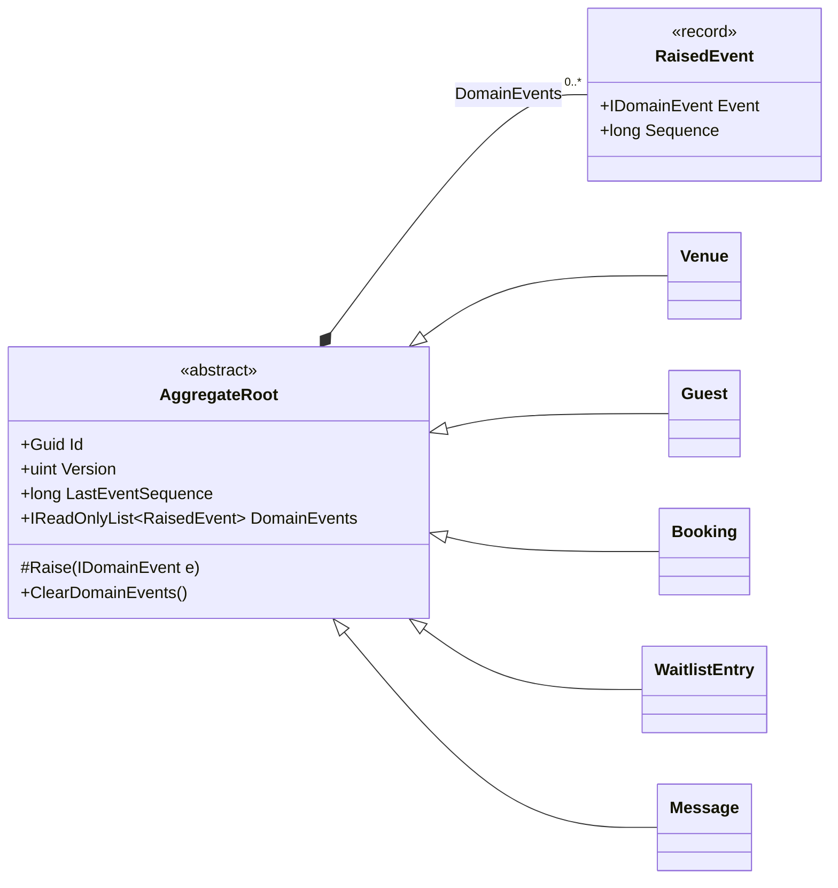

It shows that the five main business records all inherit from one base class, AggregateRoot, which gives them the same machinery for identity, change tracking and events.

| **Member**          | **Purpose**                                                                                                                                                                                                              |
|---------------------|--------------------------------------------------------------------------------------------------------------------------------------------------------------------------------------------------------------------------|
| Id                  | The record’s unique ID: a UUID v7, created by the app (ADR-003 DM-02).                                                                                                                                                   |
| Version             | A row version for optimistic concurrency (PostgreSQL `xmin`). If two hosts change the same booking, the second save fails with 409 version_conflict instead of silently overwriting the first. It is used for concurrency only; it does not number events. |
| LastEventSequence   | Counts the events this record has raised (1, 2, 3 …). `Raise` increases it and stamps the new number on the event, so consumers get events in order and can spot a gap. Saved in the record's `last_event_sequence` column. |
| DomainEvents        | A read-only list of events this record has raised since it was loaded, such as BookingSeated, each with its sequence number (`RaisedEvent`).                                                                                                                            |
| Raise(event)        | Protected, so only the record itself can raise events, from inside its own methods. Nothing outside can fake a “booking seated” event without going through Booking.Seat() and its rules. It also increases `LastEventSequence` and stamps the event with the new number.                                |
| ClearDomainEvents() | Empties the list once the events have been saved, so they aren’t saved twice.                                                                                                                                            |

How it fits with the outbox (ADR-002)

A handler calls booking.Seat(...). The booking changes its status and adds BookingSeated to its event list. Nothing is sent yet.

The handler calls SaveChangesAsync(). The outbox interceptor finds every tracked AggregateRoot, collects its events and writes them to the outbox table in the same transaction as the status change.

After commit, the interceptor calls ClearDomainEvents().

The shared base class is what makes step 2 generic: the interceptor doesn’t need to know about bookings or waitlists. It just asks every aggregate root for its events.

Why these five (Venue, Guest, Booking, WaitlistEntry, Message)

Each one is changed and saved as a unit, so each can raise events. Records inside an aggregate, such as Deposit and TableAssignment inside Booking, don’t inherit from it, because they only change through their parent.

`PosMessage` (§2.1) is not shown: it raises no domain events (it is a delivery queue item), so it does not inherit from `AggregateRoot`.

#### Venue aggregate

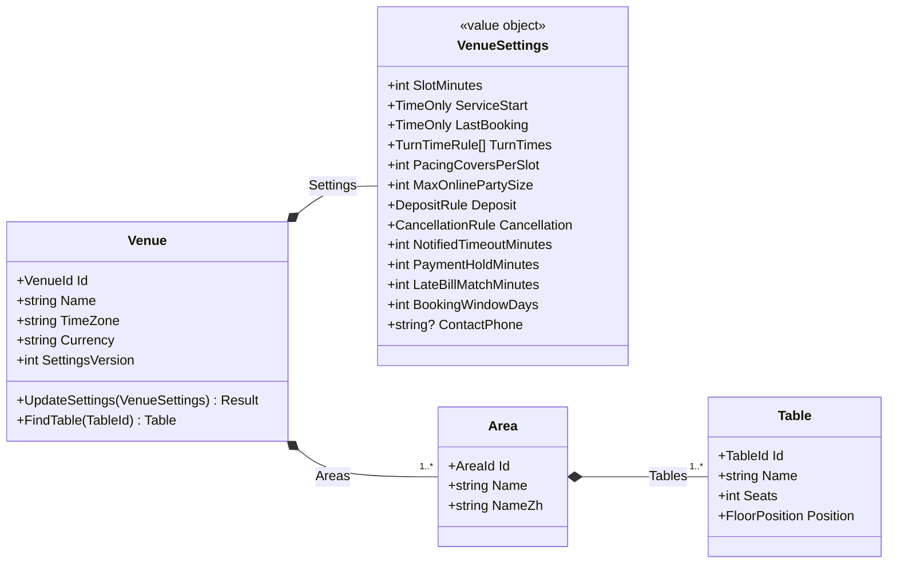

`BookingWindowDays` (30 by default, AC1.1) sets how far ahead a booking can be made: from today to that many days ahead, in venue time.

`ContactPhone` (M4b, optional) is the number the guest page shows to parties too large to book online (BR-04), e.g. `+64 9 000 0000` for Golden Dragon (fictional). When set it must be a possible NZ number of any kind (`PhoneNumber.IsPossibleNz`, else `contact_phone_invalid`). It is stored as entered, for display, and is not a booking term (§2.6).

Each `Area` has an English `Name` and a Simplified Chinese `NameZh` (M6a, QA-7); both are required. The host screen shows the one for the active language.

`LateBillMatchMinutes` (30 minutes by default) sets how long after a host clears a table a late `BillClosed` from the POS can still be attached to that booking. The rule, and how to choose the window, are in §6.5.

#### Booking aggregate

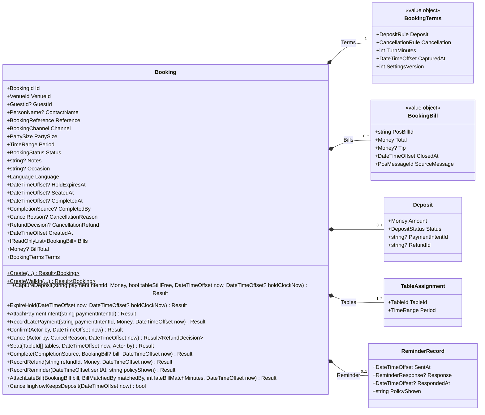

In practice, there is no Deposit repository, no deposit endpoint, and no code that loads or saves a deposit on its own. The deposit’s status changes only through Booking methods. CaptureDeposit moves it from Pending to Captured, ExpireHold or Cancel moves it to Released, and RecordRefund moves it to Refunded. Those methods also raise the events, such as DepositCaptured and DepositRefunded, so the events come from the booking, with the booking’s ID and sequence number.

The reason is that the deposit and the booking must always agree. A booking can’t be Booked while its deposit is still Pending. Cancelling a paid booking must start the refund decision at the same moment. Keeping both inside one aggregate means each change is checked and saved together in one transaction, so the two can never drift apart.

We can see this in the database too. The deposit has no table of its own: it’s stored as columns on the bookings table (deposit_cents, deposit_status, payment_intent_id, refund_id).

BillTotal is how much the guests spent, taken from the POS bill. It’s empty until a bill is matched to the booking. Having it on the booking means the guest’s visit history, average spend and later reports (revenue per cover, per channel) can use real amounts. An empty BillTotal also marks a booking that hasn’t received its bill yet, which is how the late-match rule knows a cleared booking can still take a late bill.

Domain methods take `now` as a value; handlers read it from `TimeProvider`, so the domain never reads the clock itself. `CaptureDeposit` cannot see other bookings, so `CaptureDepositHandler` re-checks the table and passes the answer as `tableStillFree`; it only matters once the hold has expired. `CancellationReason` and `CancellationRefund` keep why the booking was cancelled and the refund decision made at that moment: the first drives the `hold_expired` rule (§3.1), the second is returned again if `Cancel` is repeated.

`Language` (M7a) is the language of the booking's messages: the language active when the guest submitted, or for a party seated from the waitlist the entry's. `WaitlistEntry.Language` is the language chosen when the party joined. Messages use these, not the guest profile's language, which can change with a later booking (§7.2).

`ContactName` (M6a) is the name given when the booking was made: the guest's name on an online or phone booking, the optional name of a walk-in, or the waitlist entry's name when a waiting party is seated. The host screens show it. The guest profile keeps its own stored name, so a known mobile that books under another name shows that name on this booking only (§14.1, §20). `WaitlistEntry.ContactName` is the same for waitlist entries. Neither is put on an event: events stay ID-only.

CompletedBy records how the booking reached Completed: either BillClosed (the POS reported the bill paid) or ClearedByHost (a host tapped “Clear”). The late-match rule needs this, because it only attaches a late bill to bookings cleared by a host. A booking completed by BillClosed already has its bill. It also helps reports and checks: lots of ClearedByHost at a venue suggests the POS link isn’t working, or staff are skipping the POS.

#### Guest, waitlist entry and message aggregates

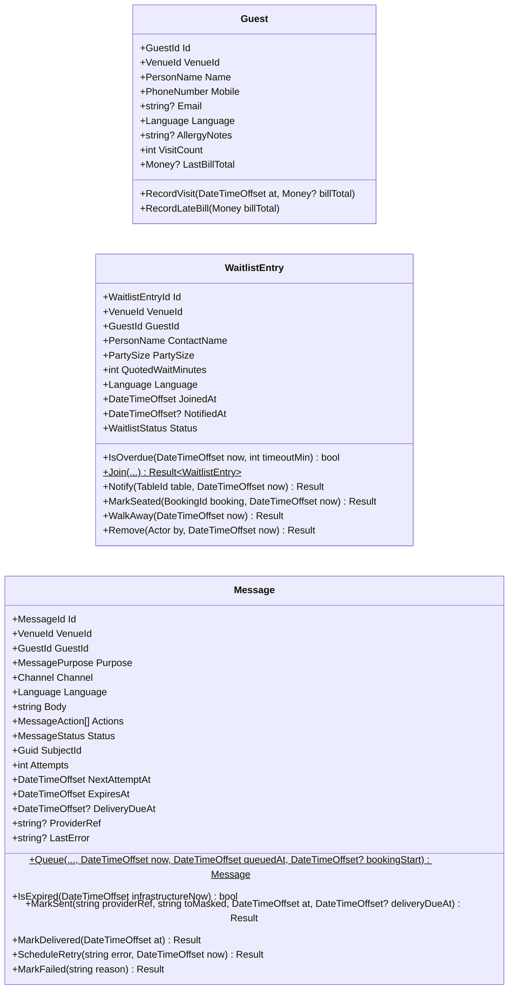

#### References between aggregates (by ID only)

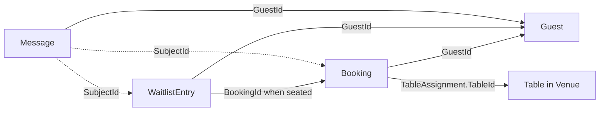

References between aggregates are **by ID only**; there are no navigation properties across aggregate boundaries.

### 2.3 Value objects

| **Value object**   | **Rules**                                                                                                                                 |
|--------------------|-------------------------------------------------------------------------------------------------------------------------------------------|
| `PartySize`        | 1–20 overall; online bookings limited by `MaxOnlinePartySize` (8, BR-04) in the command, not the type                                     |
| `PhoneNumber`      | Parsed from NZ input to E.164 (`+64…`) with libphonenumber; mobiles only (BR-12)                                                          |
| `PersonName`       | Trimmed, 1–80 characters                                                                                                                  |
| `Money`            | `long Cents`, `string Currency`; no floating point (BR-11)                                                                                |
| `TimeRange`        | `[Start, End)` in UTC; `End > Start`; maps to PostgreSQL `tstzrange`                                                                      |
| `BookingReference` | 6 characters from an unambiguous alphabet (no 0/O/1/I), unique per venue, e.g. `GD7K4P`                                                   |
| `FloorPosition`    | `X`, `Y`, `Rotation`, `Shape` (`Round` / `Rect`), `Width`, `Height` in floor units (ADR-001)                                              |
| `Actor`            | `Type` (`Guest` / `Staff` / `System` / `Pos`), `Id`, `Role?` (ADR-002 envelope)                                                           |
| `BookingTerms`     | A copy of the venue's deposit rule, cancellation rule and turn time, taken when the booking is created; never changed afterwards (§2.6)   |
| `BookingBill`      | One settled POS bill: POS bill ID, total, optional tip, closed time, source POS message. `Booking.BillTotal` is the sum of `Bills` (§6.6) |

### 2.4 Enumerations

| **Enum**                             | **Values**                                                                  |
|--------------------------------------|-----------------------------------------------------------------------------|
| `BookingStatus`                      | `PendingPayment`, `Booked`, `Confirmed`, `Seated`, `Completed`, `Cancelled` |
| `BookingChannel`                     | `Online`, `Phone`, `WalkIn`                                                 |
| `DepositStatus`                      | `Pending`, `Captured`, `Refunded`, `Released` (hold expired before payment) |
| `CancelReason`                       | `GuestRequest`, `HostRequest`, `HoldExpired`                                |
| `CompletionSource`                   | `BillClosed` (from POS), `ClearedByHost`                                    |
| `WaitlistStatus`                     | `Waiting`, `Notified`, `Seated`, `WalkedAway`, `Removed`                    |
| `MessagePurpose`                     | `Confirmation`, `Reminder`, `TableReady`, `Cancellation`, `Refund`          |
| `MessageStatus`                      | `Queued`, `Sent`, `Delivered`, `Failed`                                     |
| `TableState` (derived, never stored) | `Free`, `Booked`, `ArrivingSoon`, `Seated`                                  |

All enums are stored as text (ADR-003 DM-06).

#### About `BillClosed` and `ClearedByHost`

BillClosed and ClearedByHost are the two values of CompletionSource, an enum that records why a seated booking ended. A booking moves from Seated to Completed in one of two ways, and the design keeps track of which one happened.

BillClosed is the normal path once the POS is connected. The guests pay at the POS, and the POS sends a BillClosed message to the reservation system with the table and the bill total. The system finds the booking seated at that table and completes it with source: billClosed. It saves the bill total on the booking and adds a visit to the guest’s profile through Guest.RecordVisit, as AC6.6 requires. It then raises BookingCompleted and TableCleared, so every host screen shows the table as free. In the demo, the host’s “Bill paid” button stands in for the POS: it makes the mock POS send a signed BillClosed message, exactly as a real POS would, which is the flow shown in sequence 10.3.

`ClearedByHost` is the fallback, used when the host taps "Clear" on a seated table (AC4.1). It covers the times when no bill will come from the POS: the party left without ordering or paid somewhere else, the POS is offline or not yet connected, or the host is fixing a mistake such as a party seated at the wrong table. The booking completes with `source: clearedByHost` and no bill, so no spend is added to the guest's profile; the visit still counts (M9a, §6.7). The same two events are raised, so the floor plan updates exactly as it does after a paid bill. If the POS's bill arrives a little later, the late-match rule can still attach it (§6.5).

### 2.5 Table state is derived, not stored

A table has no status column. Its state on the floor plan is computed from active bookings for that table at `now` (venue time):

| **Order** | **Condition**                                                                                 | `TableState`   |
|-----------|-----------------------------------------------------------------------------------------------|----------------|
| 1         | A `Seated` booking is assigned to the table                                                   | `Seated`       |
| 2         | A `PendingPayment`, `Booked` or `Confirmed` booking starts within the next 30 minutes (AC2.3) | `ArrivingSoon` |
| 3         | Such a booking starts later today                                                             | `Booked`       |
| 4         | Otherwise                                                                                     | `Free`         |

This removes a whole class of "table and booking disagree" bugs. Clearing a table means completing the booking seated at it (§3.1).

### 2.6 Booking terms are copied at booking time

The venue's rules live in `venues.settings` (`VenueSettings`) and a manager can change them at any time. A guest must be held to the terms shown **when they booked** (AC5.6), not to whatever the venue's settings say later. So `Booking.Create` and `Booking.CreateWalkIn` copy the rules that matter into the booking as `BookingTerms`:

| **Copied**                                                                 | **From**                                                                 | **Used by**                                           |
|----------------------------------------------------------------------------|--------------------------------------------------------------------------|-------------------------------------------------------|
| `Deposit` (min party size, per-guest amount)                               | `VenueSettings.Deposit`                                                  | Deposit amount at creation; shown on the confirmation |
| `Cancellation` (free-until hours, refund when in time, host-cancel refund) | `VenueSettings.Cancellation`                                             | `RefundPolicy` when the booking is cancelled          |
| `TurnMinutes`                                                              | `VenueSettings.TurnTimes` for the party size                             | Booking period; seating length                        |
| `CapturedAt`, `SettingsVersion`                                            | Clock; a counter on the venue that goes up each time the settings change | Audit: which version of the rules applied             |

Rules:

- `BookingTerms` is set once, in `Create` / `CreateWalkIn`, and has no setters. Changing the venue's settings never touches existing bookings.
- `RefundPolicy` and the guest's manage-booking page read `booking.Terms`, never the venue's current settings.
- The confirmation and reminder messages render the cancellation wording from `booking.Terms`; `ReminderRecord.PolicyShown` stores the exact text the guest saw.
- If a venue needs to change terms for existing bookings (rare, e.g. a goodwill refund), a manager cancels with a host refund (§8.3) rather than editing the terms.
- Pacing, slots, service hours and the booking window (`BookingWindowDays`) are **not** copied: they apply when a booking is made or seated, not afterwards.
- `TurnMinutes` for a party larger than every `TurnTimeRule` (a phone booking or walk-in of 9–20) uses the rule with the largest party size (120 minutes at Golden Dragon).

Stored as `bookings.terms jsonb` (§13), mapped with `OwnsOne(b => b.Terms, t => t.ToJson())`. Example:

```
{
  "deposit": { "minPartySize": 6, "perGuestCents": 2000 },
  "cancellation": { "freeUntilHoursBefore": 2, "refundWhenInTime": "full", "hostCancelRefund": "full" },
  "turnMinutes": 120,
  "capturedAt": "2026-11-20T05:12:44Z",
  "settingsVersion": 3
}
```

## 3. State machines

### 3.1 Booking

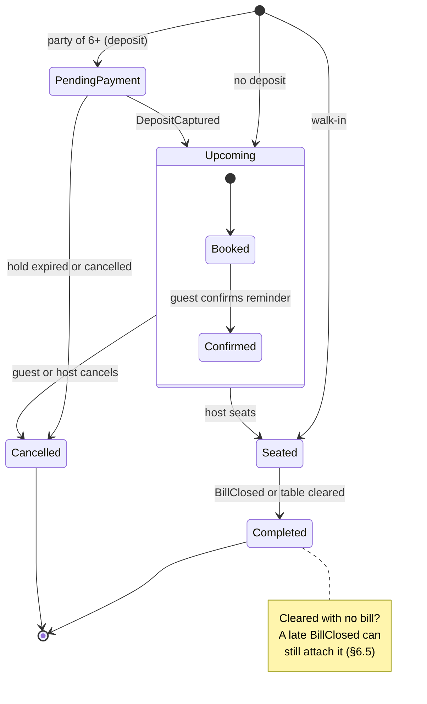

| **Transition**                 | **Method**       | **Guards**                                                                                                                 | **Effects**                                                                                                           | **Events raised**                                           |
|--------------------------------|------------------|----------------------------------------------------------------------------------------------------------------------------|-----------------------------------------------------------------------------------------------------------------------|-------------------------------------------------------------|
| → `PendingPayment`             | `Create`         | Online booking; party within online limit; slot within service hours; deposit rule applies (phone bookings never take a deposit) | `Terms` copied from venue settings (§2.6); `HoldExpiresAt` = infrastructure-clock now + 10 min (M8a, §8.4); `Deposit.Status = Pending`; table assigned | `BookingCreated`                                            |
| → `Booked`                     | `Create`         | As above, no deposit                                                                                                       | `Terms` copied (§2.6); table assigned                                                                                 | `BookingCreated`                                            |
| → `Seated`                     | `CreateWalkIn`   | Table free now for the turn time                                                                                           | `Channel = WalkIn`; `Period = [now, now + turn)`; `SeatedAt = now`                                                  | `BookingCreated`, `BookingSeated` (`source: walkIn`)        |
| `PendingPayment` → `Booked`    | `CaptureDeposit` | Status is `PendingPayment`; amount equals deposit due; `now < HoldExpiresAt`, **or** the hold has expired but the expiry job has not run yet and the re-checked table is still free | `Deposit.Status = Captured`; `HoldExpiresAt = null`                                                                   | `DepositCaptured`                                           |
| `PendingPayment` → `Cancelled` | `CaptureDeposit` | Status is `PendingPayment`; the hold has expired (expiry job not run yet) and the re-checked table is taken | `Deposit.Status = Captured`, then `Cancel(HoldExpired)`: table released, refund decision `full` (§8.3)                | `BookingCancelled` (`reason: HoldExpired`) (+ `DepositRefunded` later, from Stripe) |
| `Cancelled` (no change)        | `CaptureDeposit` | Status is `Cancelled` with reason `HoldExpired` (the expiry job already ran)                                               | None. Returns `Error hold_expired`; `CaptureDepositHandler` calls `RecordLatePayment` instead (§8.1, §8.4)            | —                                                           |
| `Cancelled` (no change)        | `RecordLatePayment` (M8a) | Status is `Cancelled` with reason `HoldExpired`; deposit `Released`; amount equals deposit due; the intent matches any attached one | `Deposit.Status = Captured` (the money Stripe now holds); the booking stays `Cancelled`; refunded through the outbox | `LatePaymentReceived` (+ `DepositRefunded` later, from Stripe) |
| `PendingPayment` → `Cancelled` | `ExpireHold`     | infrastructure-clock now ≥ `HoldExpiresAt` (M8a, §8.4)                                                                     | `Deposit.Status = Released`; table released                                                                           | `BookingCancelled` (`reason: HoldExpired`)                  |
| `Booked` → `Confirmed`         | `Confirm`        | Status `Booked`; `now < Period.Start`                                                                                      | Reminder response recorded                                                                                            | `BookingConfirmed`                                          |
| → `Seated`                     | `Seat`           | Status `Booked` or `Confirmed`; tables free from `now` to `now + turn`                                                     | `Period = [now, now + turn)`; `SeatedAt = now`; tables reassigned if host chose others                                | `BookingSeated` (`source: booking`)                         |
| → `Cancelled`                  | `Cancel`         | Status `PendingPayment`, `Booked` or `Confirmed`                                                                           | Table released; refund decision (§8.3)                                                                                | `BookingCancelled` (+ `DepositRefunded` later, from Stripe) |
| `Seated` → `Completed`         | `Complete`       | Status `Seated`                                                                                                            | Bill added to `Bills` if from POS                                                                                     | `BookingCompleted`, `TableCleared`                          |
| `Completed` → `Completed`      | `AttachLateBill` | Completed by `ClearedByHost`; `Bills` empty; `matchedBy = Manual` or `closedAt` within `LateBillMatchMinutes` of `CompletedAt`, before or after, otherwise `outside_late_match_window`. The same `posBillId` again is a no-op; a different bill returns `second_bill` | Bill added to `Bills`                                                                                                 | `BookingBillAttached`                                       |

Any transition not in the table returns `Error.Conflict("invalid_transition")` → HTTP `409` with code `invalid_transition`. The front end refetches the record and shows "This booking has just changed". `422 rule_broken` is kept for business rules broken by valid input (e.g. `deposit_required`). Calling a method that leads to the current state (for example a second `Confirm`) is a no-op that returns success and raises nothing, so repeated taps and retried requests are safe.

**Active statuses** (hold a table in the exclusion constraint): `PendingPayment`, `Booked`, `Confirmed`, `Seated`.

### 3.2 Waitlist entry

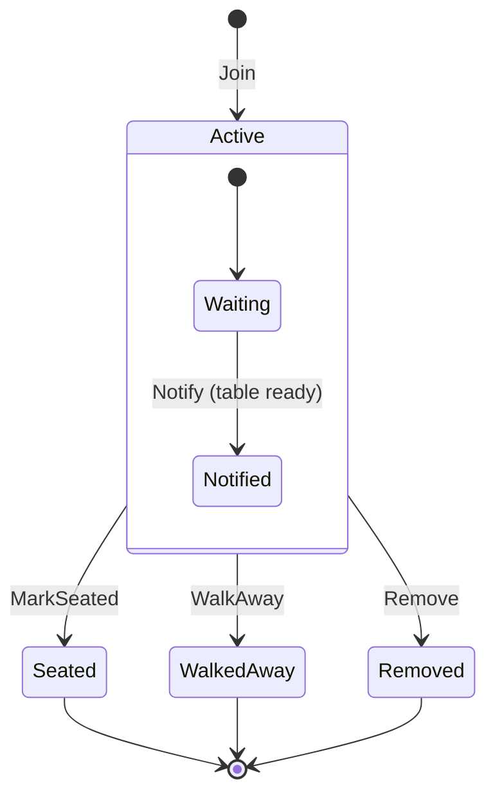

| **Transition**        | **Guard**                                                                               | **Events**                                          |
|-----------------------|-----------------------------------------------------------------------------------------|-----------------------------------------------------|
| `Join`                | Party size 1–20; quoted wait 0–240 min                                                  | `WaitlistJoined`                                    |
| `Notify`              | Status `Waiting` or `Notified` (re-notify allowed; `NotifiedAt` updated; each sends a new "table ready" text, §7.2) | `WaitlistNotified`                                  |
| `MarkSeated`          | Status `Waiting` or `Notified`; the walk-in booking was created in the same transaction | `WaitlistEnded` (`outcome: seated`)                 |
| `WalkAway` / `Remove` | Status `Waiting` or `Notified`                                                          | `WaitlistEnded` (`outcome: walkedAway` / `removed`) |

**Overdue** (AC4.6, BR-10) is a computed flag, not a state: `Status == Notified && now − NotifiedAt > 10 min`. The host app shows it; a timer job (§16) pushes `waitlistChanged` when an entry becomes overdue so screens update without polling.

### 3.3 Deposit (inside `Booking`)

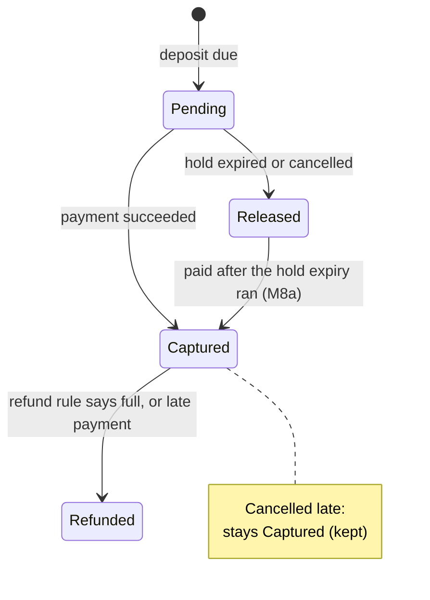

### 3.4 Message

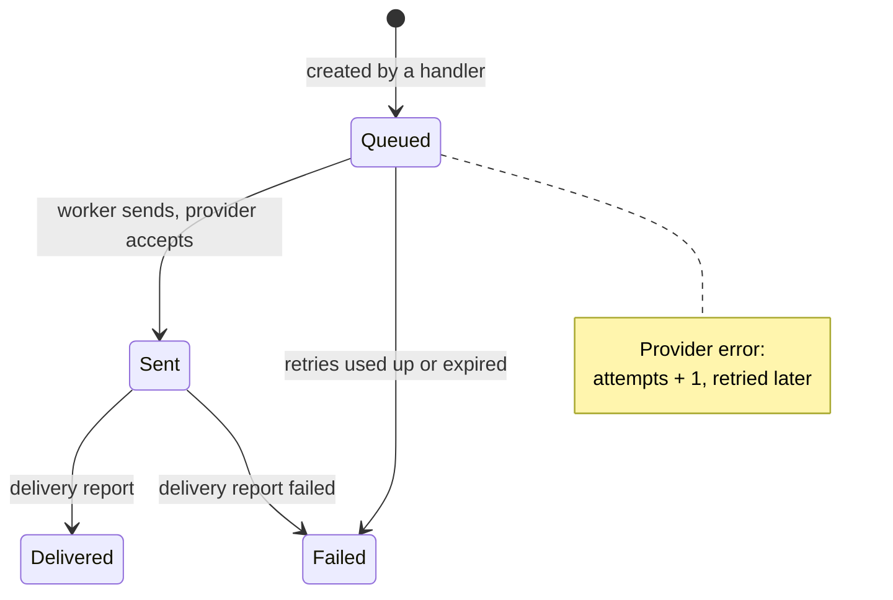

Queued is a status on the messages row, not a separate queue product: PostgreSQL is the queue (§7.1). MessageDeliveryWorker moves rows from Queued to Sent, and MessageSent is raised on that transition. In the demo the phone-panel sender marks Delivered about 1 s after Sent (AC4.4).

### 3.5 Outbox row and POS message

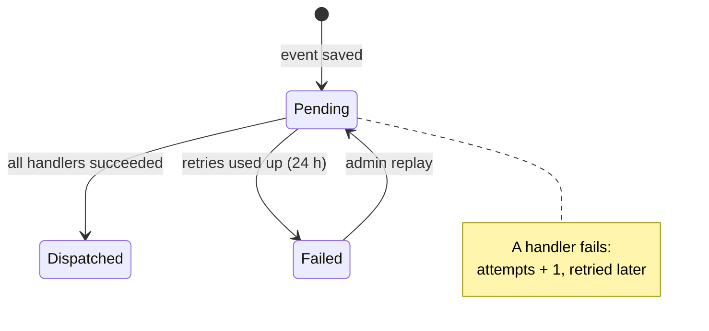

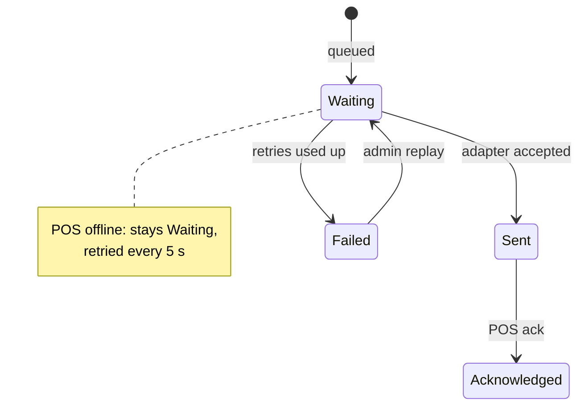

Inbound POS messages (BillClosed) are stored in the same table with direction = inbound:

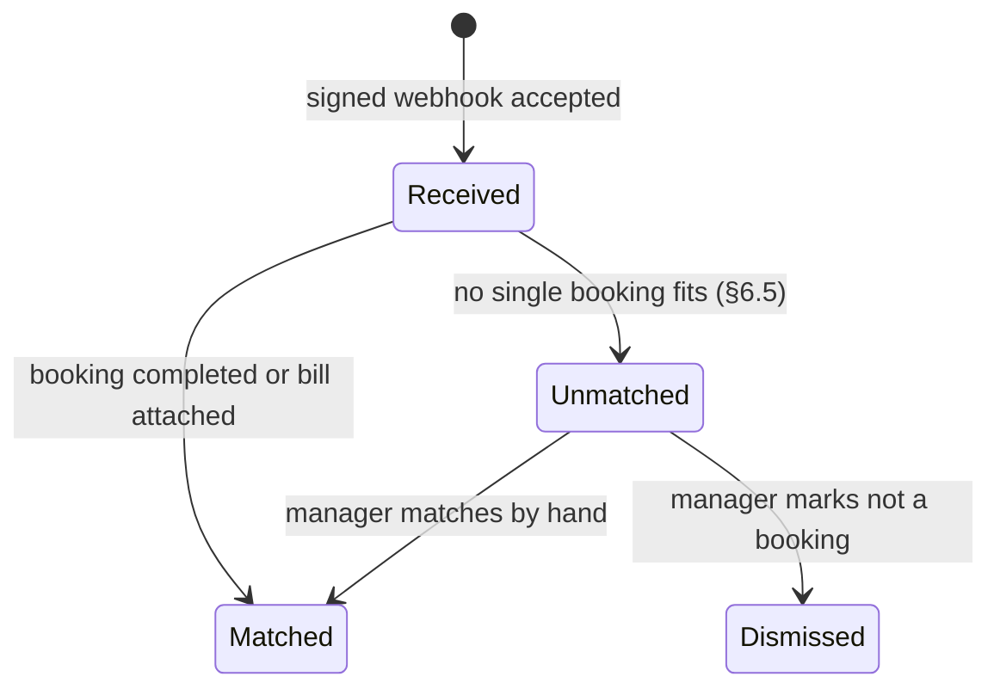

## 4. Domain events

### 4.1 Types

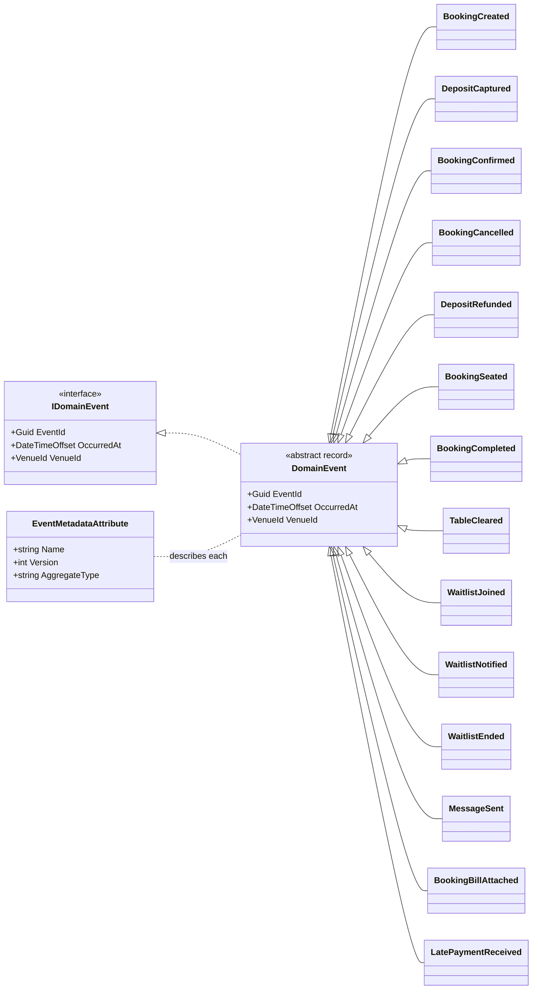

```
public abstract record DomainEvent(Guid EventId, DateTimeOffset OccurredAt, VenueId VenueId) : IDomainEvent;

[EventMetadata("BookingSeated", Version = 1, AggregateType = "Booking")]
public sealed record BookingSeated(
    Guid EventId, DateTimeOffset OccurredAt, VenueId VenueId,
    BookingId BookingId, TableId[] TableIds, int PartySize,
    SeatSource Source, Guid? WaitlistEntryId, DateTimeOffset SeatedAt)
    : DomainEvent(EventId, OccurredAt, VenueId);
```

### 4.2 Catalogue with payloads (v1)

| **Event**             | **Aggregate** | **Payload (besides the envelope)**                                                                                |
|-----------------------|---------------|-------------------------------------------------------------------------------------------------------------------|
| `BookingCreated`      | Booking       | `bookingId, guestId?, reference, channel, partySize, startsAt, endsAt, tableIds[], depositCents?, holdExpiresAt?` |
| `DepositCaptured`     | Booking       | `bookingId, paymentIntentId, amountCents`                                                                         |
| `BookingConfirmed`    | Booking       | `bookingId, confirmedBy (actor)`                                                                                  |
| `BookingCancelled`    | Booking       | `bookingId, reason, cancelledBy, refundDecision (full / none / notApplicable)`                                    |
| `DepositRefunded`     | Booking       | `bookingId, refundId, amountCents`                                                                                |
| `LatePaymentReceived` (M8a) | Booking | `bookingId, paymentIntentId, amountCents`: paid after the hold expiry cancelled the booking; refunded in full (§8.4) |
| `BookingSeated`       | Booking       | `bookingId, tableIds[], partySize, source (booking / walkIn), waitlistEntryId?, seatedAt`                         |
| `BookingCompleted`    | Booking       | `bookingId, source (billClosed / clearedByHost), posBillId?, billTotalCents?, closedAt`                           |
| `TableCleared`        | Booking       | `bookingId, tableIds[], clearedAt`                                                                                |
| `WaitlistJoined`      | WaitlistEntry | `waitlistEntryId, guestId, partySize, quotedMinutes`                                                              |
| `WaitlistNotified`    | WaitlistEntry | `waitlistEntryId, tableId, notifiedAt`                                                                            |
| `WaitlistEnded`       | WaitlistEntry | `waitlistEntryId, outcome (seated / walkedAway / removed), bookingId?`                                            |
| `MessageSent`         | Message       | `messageId, purpose, channel, subjectId, toMasked`                                                                |
| `BookingBillAttached` | Booking       | `bookingId, posBillId, billTotalCents, posMessageId, matchedBy (lateMatch / manual), attachedAt`                  |

`TableCleared` belongs to the `Booking` aggregate because table state is derived (§2.5); it exists so floor-plan consumers do not need to know completion rules.

### 4.3 Who consumes what

| **Event**                          | **Realtime**                 | **Notifications**                        | **POS**                       | **Audit** | **Waitlist suggester** | **Guest**       |
|------------------------------------|------------------------------|------------------------------------------|-------------------------------|-----------|------------------------|-----------------|
| `BookingCreated`                   | ●                            | ● (confirmation, unless pending payment) | ● `UpsertMember`              | ●         |                        |                 |
| `DepositCaptured`                  | ●                            | ● (confirmation)                         |                               | ●         |                        |                 |
| `BookingConfirmed`                 | ●                            |                                          |                               | ●         |                        |                 |
| `BookingCancelled`                 | ●                            | ● (cancellation)                         |                               | ●         | ●                      |                 |
| `DepositRefunded`                  | ●                            | ● (refund)                               |                               | ●         |                        |                 |
| `LatePaymentReceived` (M8a)        | ●                            |                                          |                               | ●         |                        |                 |
| `BookingSeated`                    | ●                            |                                          | ● `OpenTable`, `ApplyDeposit` | ●         |                        |                 |
| `BookingCompleted`                 | ●                            |                                          |                               | ●         |                        | ● `RecordVisit` |
| `TableCleared`                     | ●                            |                                          |                               | ●         | ●                      |                 |
| `WaitlistJoined` / `WaitlistEnded` | ●                            |                                          |                               | ●         |                        |                 |
| `WaitlistNotified`                 | ●                            | ● (table ready)                          |                               | ●         |                        |                 |
| `MessageSent`                      | ● (phone panel, message log) |                                          |                               | ●         |                        |                 |
| `BookingBillAttached`              | ● (POS log)                  |                                          |                               | ●         |                        | ● `RecordLateBill` |

**The columns (the consumers)**

| **Column** | **Handler** | **What it does** |
| --- | --- | --- |
| Realtime | `RealtimeNotifier` | Pushes a small SignalR notice (`floorPlanChanged`, `waitlistChanged`, …) so host screens refetch and update within 2 seconds |
| Notifications | `NotificationHandler` | Queues a text or email to the guest; `MessageDeliveryWorker` sends it (§7.1) |
| POS | `PosProjectionHandler` | Turns the event into a message for the POS (`UpsertMember`, `OpenTable`, `ApplyDeposit`) and queues it for ordered delivery (§6) |
| Audit | `AuditHandler` | Writes a row to the audit log: who did what, and when |
| Waitlist suggester | `WaitlistSuggester` | When a table frees up, works out which waiting party fits first (AC4.2, BR-09) and highlights it; it changes no data |
| Guest | `GuestVisitHandler` | Updates the guest's profile (visit count and last bill) |

**Reading the rows**

- **Realtime and Audit react to every event.** Every change should show on host screens straight away, and every change should be traceable. Those two columns are full for that reason.
- **`BookingCreated` sends a confirmation "unless pending payment".** For a party of 6 or more, the booking starts as `PendingPayment` while the guest pays the deposit. Confirming before the payment succeeds would be wrong, so in that case the confirmation is sent on `DepositCaptured` instead. `BookingCreated` also sends `UpsertMember` to the POS, so the guest is known as a member before they arrive.
- **`BookingSeated` is the main POS trigger.** It opens the table in the POS (`OpenTable`) and, if a deposit was paid, credits it to the bill (`ApplyDeposit`).
- **`BookingCancelled` and `TableCleared` trigger the waitlist suggester.** Both free a table, so the suggester checks whether someone on the waitlist now fits.
- **`BookingCompleted` and `BookingBillAttached` update the guest.** Every completed booking counts a visit with `RecordVisit`, with the bill total when the POS closed the bill. A late bill attached afterwards (§6.5) only records the spend with `RecordLateBill`, so the visit is never counted twice (M9a, §6.7).
- **Refunds (M8a, §8.4) are outbox consumers too.** `RefundOnCancelHandler` acts on `BookingCancelled` when its decision is `full`; `LatePaymentRefundHandler` refunds every `LatePaymentReceived`. Neither has a column above.
- **`WaitlistNotified` sends the "table ready" text.**
- **`MessageSent` and `BookingBillAttached` show in the presenter's logs.** These are the phone panel and the POS log. The demo audience watches them, so they get their own real-time notices.

## 5. Event infrastructure: outbox, dispatcher, inbox

### 5.1 Classes

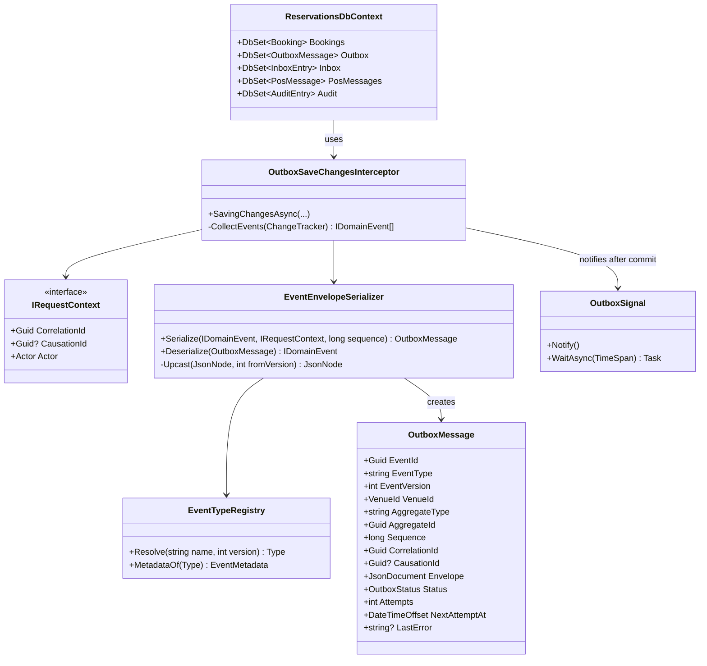

When a handler calls SaveChangesAsync(), OutboxSaveChangesInterceptor collects the events the changed records raised, turns each one into an OutboxMessage row (using EventEnvelopeSerializer and IRequestContext), and adds those rows to the same save. After commit, it pokes OutboxSignal so the dispatcher wakes up at once.

| **Class**                    | **Role**                                                                                                                                                                                                                                                                                                                                                                    |
|------------------------------|-----------------------------------------------------------------------------------------------------------------------------------------------------------------------------------------------------------------------------------------------------------------------------------------------------------------------------------------------------------------------------|
| ReservationsDbContext        | The EF Core database context: one DbSet per table, here bookings, outbox, inbox, POS messages and audit. “uses” means the interceptor is registered on it, so every save goes through the interceptor automatically.                                                                                                                                                        |
| OutboxSaveChangesInterceptor | An EF Core interceptor, a hook that runs just before EF writes to the database. SavingChangesAsync runs on every save, and CollectEvents asks every tracked AggregateRoot for its DomainEvents. Handlers never write outbox rows themselves, so they can’t forget to.                                                                                                       |
| IRequestContext              | Who and why: the CorrelationId (shared by everything one guest or host action causes), the CausationId (the event or command that caused this one) and the Actor (guest, staff, system or POS). These go into every event’s envelope (ADR-002), so any change can be traced end to end.                                                                                     |
| EventEnvelopeSerializer      | Converts between events and rows. Serialize wraps an event in the standard envelope (ID, type, version, venue, aggregate, sequence, correlation, actor) and produces an OutboxMessage. Deserialize does the reverse for the dispatcher. Upcast upgrades an old event version to the current one, so old rows can still be read after an event changes (ADR-002 versioning). |
| EventTypeRegistry            | A lookup between event names and C# types. Resolve("BookingSeated", 1) returns the BookingSeated type, and MetadataOf reads its \[EventMetadata\] attribute (name, version, aggregate type). The table stores a name, not a C# type name, so renaming a class doesn’t break stored events.                                                                                  |
| OutboxMessage                | One row in the outbox table. The event fields (EventId, EventType, EventVersion, VenueId, AggregateType, AggregateId, Sequence, CorrelationId, CausationId) and the full JSON Envelope are written once. The delivery fields (Status, Attempts, NextAttemptAt, LastError) are later updated by the dispatcher as it delivers and retries.                                   |
| OutboxSignal                 | A tiny in-process doorbell. Notify() is called after commit; the dispatcher waits on WaitAsync(1s). Events go out within milliseconds instead of waiting for the next once-a-second poll.                                                                                                                                                                                   |

#### Dispatching side

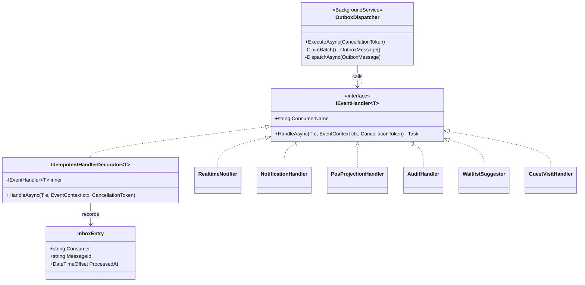

`OutboxDispatcher` also uses `OutboxSignal` (to wake) and `EventEnvelopeSerializer` (to read rows). Every handler except `RealtimeNotifier` is registered wrapped in `IdempotentHandlerDecorator<T>`.

`IEventPublisher` (named in ADR-002) is the interface command handlers use when they need to raise an event that does not come from an aggregate (rare: demo reset). Its implementation adds the event to the current `DbContext` so it is written by the same interceptor. Aggregates never call it; they use `Raise`.

### 5.2 Writing events (inside the request)

1.  A handler loads aggregates, calls domain methods, and calls `SaveChangesAsync`.
2.  `OutboxSaveChangesInterceptor` collects `DomainEvents` from every tracked `AggregateRoot`, uses the sequence number stamped on each event when it was raised (`LastEventSequence`, §2.2), wraps each in the envelope with `correlationId`, `causationId` and `actor` from `IRequestContext`, and adds `OutboxMessage` rows **to the same transaction**.
3.  After commit, it clears the events from the aggregates and calls `OutboxSignal.Notify()` so the dispatcher wakes in milliseconds instead of waiting for the 1 s poll.

### 5.3 Dispatching events (outside the request)

```
loop:
  await signal.WaitAsync(1s)                          -- or the 1 s poll
  BEGIN
    rows = SELECT … FROM outbox
           WHERE status = 'Pending' AND next_attempt_at <= now()
             AND aggregate_id NOT IN (aggregates with an earlier Pending/Failed row)
           ORDER BY aggregate_id, sequence
           LIMIT 50
           FOR UPDATE SKIP LOCKED
    for each row (in order per aggregate):
      event = deserialize(row)                        -- with upcasting
      for each handler of event type:
        await handler.HandleAsync(event)              -- each handler idempotent
      row.status = 'Dispatched'
      on exception in any handler:
        row.attempts++; row.next_attempt_at = now + backoff(attempts)
        row.status = attempts > max ? 'Failed' : 'Pending'
        skip the rest of this aggregate's rows in this batch (keeps order)
  COMMIT
```

Backoff: 5 s, 30 s, 2 min, 10 min, then every 30 min until 24 h after the first attempt (ADR-002).

### 5.4 Idempotent handlers

`IdempotentHandlerDecorator<T>` wraps every handler that changes state. It runs **inside the dispatcher's transaction** (§5.3), which holds the lock on the outbox rows and so keeps events in order. Each handler gets its own savepoint: if it fails, only its own work and its inbox row are rolled back, and the dispatcher schedules a retry for the event. Nothing is committed until the dispatcher commits the batch, and a handler that already succeeded is skipped on the retry because its inbox row exists.

```
public async Task HandleAsync(T e, EventContext ctx, CancellationToken ct)
{
    var tx = _db.Database.CurrentTransaction!;               // the dispatcher's transaction
    await tx.CreateSavepointAsync(_inner.ConsumerName, ct);
    try
    {
        var inserted = await _db.Database.ExecuteSqlAsync(
            $"INSERT INTO inbox (consumer, message_id, processed_at) VALUES ({_inner.ConsumerName}, {e.EventId.ToString()}, now()) ON CONFLICT DO NOTHING", ct);
        if (inserted == 0) return;                           // already processed
        await _inner.HandleAsync(e, ctx, ct);                // writes its own rows via the same DbContext
        await _db.SaveChangesAsync(ct);
    }
    catch
    {
        await tx.RollbackToSavepointAsync(_inner.ConsumerName, ct);
        throw;                                               // the dispatcher retries this event later
    }
}
```

The dispatcher and its handlers share one `DbContext` per batch. Side effects outside the database (a SignalR push, a Stripe refund request) can happen before the batch commits, so they must be safe to repeat: pushes only trigger a refetch, and Stripe calls carry an idempotency key.

`RealtimeNotifier` is **not** wrapped: a repeated push only causes one extra refetch.

### 5.5 Inbound messages (Stripe, POS)

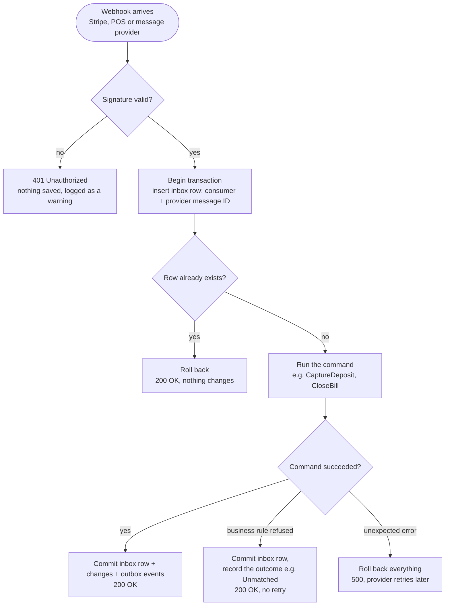

Webhooks use the same inbox table with consumer = 'stripe-webhook', 'pos-webhook' or 'message-webhook' \[pilot\] and the provider's message ID (Stripe: §8.4; POS: §6.7). The webhook endpoint verifies the signature, inserts the inbox row and runs the command in one transaction, then returns 200. A repeat returns 200 and does nothing.

*How a webhook becomes a command*

The endpoint reads the provider’s message and maps it to a command. CaptureDeposit and CloseBill are the two main examples.

| **Webhook**                                | **Command**           | **What the handler does**                                                     | **Main outcome**                                                                       |
|--------------------------------------------|-----------------------|-------------------------------------------------------------------------------|----------------------------------------------------------------------------------------|
| Stripe payment_intent.succeeded            | CaptureDeposit        | Loads the booking by its payment intent and calls booking.CaptureDeposit(...) | PendingPayment → Booked; raises DepositCaptured, and the guest gets the confirmation   |
| Stripe charge.refunded                     | RecordRefund          | Calls booking.RecordRefund(...)                                               | Deposit → Refunded; raises DepositRefunded                                             |
| POS BillClosed                             | CloseBill             | Applies the matching rules in §6.5                                            | Completes the seated booking, or attaches a late bill, or stores the bill as Unmatched |
| Message provider delivery report \[pilot\] | Update message status | Finds the message by provider reference                                       | Message → Delivered or Failed                                                          |

### 5.6 Build notes (M3)

Details §5.1–§5.4 left open, settled when the event infrastructure was built (`src/Infrastructure/Outbox`, `src/Contracts`).

**Two clocks.** Workers use the infrastructure clock; the domain uses the business clock.

| **Clock** | **Registered as** | **Used for** |
|-----------|-------------------|--------------|
| Business | The default `TimeProvider`; `DemoClock` replaces it in the demo (§17) | The `now` handlers pass to aggregates, so every event's `occurredAt` (and `audit_log.occurred_at`); anything else domain-related |
| Infrastructure | Keyed `TimeProvider` `"infrastructure"` (`Clocks.Infrastructure`), always `TimeProvider.System`, never replaced by `DemoClock` | `OutboxSignal.WaitAsync` and the 1 s poll; the claim query's "now"; `outbox.created_at`, `next_attempt_at` and `dispatched_at`; `OutboxRetryPolicy`; `OutboxHousekeeping`; `OutboxHealthCheck`; `inbox.processed_at` |

With `DemoClock` fixed at 18:25, retries, polling and housekeeping still run on real time. The M7 `MessageDeliveryWorker`, the M9 `PosDeliveryWorker` and the other §16 jobs follow the same rule. A job's timer, retry and bookkeeping times use the infrastructure clock. Any `now` it passes to the domain, such as `ExpireHold` or message expiry, uses the business clock. Tests set both clocks to separate `TestClock`s.

| **Topic** | **Decision** |
|-----------|--------------|
| Envelope | `EventEnvelope` and `EnvelopeActor` in `src/Contracts` (no Domain reference), shaped as in ADR-002. Stored in `outbox.envelope` |
| Payload | The event record as JSON (camelCase, enums as camelCase strings, strongly typed IDs as plain UUIDs, `EventJson.Options`), minus `eventId`, `occurredAt` and `venueId`, which live in the envelope. `Deserialize` puts them back. `occurredAt` is the event's own `OccurredAt` (business clock) |
| Event names | `EventTypeRegistry` reads `[EventMetadata]` from the Domain assembly at start-up and fails on a duplicate name or a missing aggregate type |
| Upcasting | Every event is v1, so there are no upcasters yet. Reading an unknown older or newer version fails that row, which is then retried and eventually `Failed` |
| Request context | `RequestContext` is scoped and mutable. By default it has a new UUID v7 correlation ID per scope and the system actor; `RequestContext.DemoHost` is `Staff("demo-host", "Host")`. M4 fills it from the HTTP request. The dispatcher sets it per event (correlation copied, causation = the event's ID, actor = system), so events raised by handlers trace back to their cause |
| Interceptor lifetime | `OutboxSaveChangesInterceptor` is scoped (one per `DbContext`), because it remembers what the current save added. On a failed or cancelled save it detaches the outbox rows it added, so a retry doesn't add them twice. It clears the aggregates' events only after a successful save |
| Signal after commit | With no explicit transaction, `Notify()` runs right after the save. Inside one, it runs when that transaction commits (the interceptor is also an `IDbTransactionInterceptor`). A rollback rings nothing |
| Stale aggregate | Two writers of one aggregate raise the same sequence. The outbox key `(aggregate_id, sequence)` can refuse the second before the xmin check runs, so `ReservationsDbContext` turns that unique violation into `DbUpdateConcurrencyException` (→ `409 version_conflict`, §12) |
| Claim query | Rows that are `Pending`, due (`next_attempt_at <= now`), and have no earlier row of their aggregate that is not `Dispatched`, `ORDER BY next_attempt_at, event_id LIMIT 50 FOR UPDATE SKIP LOCKED`. So at most one row per aggregate per batch, and a `Failed` row holds later events of its own aggregate only. A full batch loops at once; otherwise the dispatcher waits for the signal or the poll |
| All handlers run | Every handler of the event runs, even after one fails, each in its own savepoint (`outbox_handler`, released on success). The row is `Dispatched` only if all succeeded. Otherwise `attempts + 1`, and `last_error` is `consumer: ExceptionType: message` (all failures joined, at most 2000 characters). Handlers that succeeded are skipped on the retry by their inbox rows. After a failed handler, and after each event, the dispatcher clears the change tracker so no stale entity crosses a savepoint |
| Unwrapped handlers | Registered with `AddEventHandler(..., idempotent: false)` (the later `RealtimeNotifier`). They must be safe to repeat and must not write to the database |
| Retry schedule | `OutboxRetryPolicy`: 5 s, 30 s, 2 min, 10 min, then every 30 min. The 24 hours count from `created_at`, since the schema has no first-attempt column. A retry that would fall later marks the row `Failed` (52 attempts in all) and logs an error. Each retry logs a warning. Updates use `ExecuteUpdate`, not tracked entities |
| Audit consumer | `AuditHandler<T>` (consumer `audit`) is registered for every event, wrapped. It writes one `audit_log` row: actor = the envelope actor, summary = the payload (IDs only), `occurred_at` = the event's `OccurredAt` |
| Options | Section `Outbox`: `PollInterval` (1 s), `BatchSize` (50), `RunWorkers` (true; the API test host sets it to false), validated at start-up |
| Housekeeping | `OutboxHousekeeping` runs once at start, then daily on a `PeriodicTimer` on the infrastructure clock. It deletes `Dispatched` rows whose `dispatched_at` is more than 30 days old |
| Health | `/health/ready` adds `OutboxHealthCheck`. It is Degraded (still `200`) when any row is `Failed` or the oldest due `Pending` row is more than 30 s overdue, and Unhealthy when the outbox can't be read |
| Test hooks | `OutboxDispatcher.DispatchBatchAsync` runs one claim–deliver–commit cycle; `OutboxHousekeeping.PurgeAsync` runs one purge. Tests drive these directly, and run the background loop only where the polling itself is under test |

## 6. POS integration

### 6.1 Classes

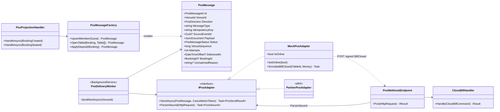

It shows two paths. The outbound path, along the top and left, sends messages from the reservation system to the POS. The inbound path, on the right, receives BillClosed back from the POS. Both go through one interface, IPosAdapter, so the rest of the system never depends on which POS is on the other end.

*Outbound: from event to POS*

The outbox dispatcher delivers BookingCreated and BookingSeated to PosProjectionHandler.

It asks PosMessageFactory to build the right POS message: UpsertMember for a new booking with a guest, OpenTable (and ApplyDeposit if a deposit was paid) when a party is seated.

The factory creates a PosMessage row with status Waiting. It isn’t sent yet, just stored in order.

PosDeliveryWorker, a background service, picks up waiting rows for each venue in VenueSequence order and sends them through IPosAdapter.SendAsync. If the POS is offline, the message stays Waiting and is retried (AC6.5).

*Inbound: from POS bill to booking*

The POS posts a signed BillClosed to PosWebhookEndpoint. In the demo, MockPosAdapter.SimulateBillClosed does this when the host taps “Bill paid”.

The endpoint calls IPosAdapter.ParseInbound, which checks the message and turns the POS’s own format into a standard PosInbound object.

It then calls CloseBillHandler, which applies the matching rules in §6.5: complete the seated booking, attach a late bill, or store the bill as Unmatched.

| Class                       | Role                                                                                                                                                                                                                                                |
|-----------------------------|-----------------------------------------------------------------------------------------------------------------------------------------------------------------------------------------------------------------------------------------------------|
| PosProjectionHandler        | Event handler that decides which POS messages an event needs. It only creates messages and never calls the POS, so a slow POS can’t hold up other handlers.                                                                                         |
| PosMessageFactory           | Builds each message’s payload and its idempotency key ({eventId}:OpenTable), which the POS uses to ignore repeats.                                                                                                                                  |
| PosMessage                  | One row in pos_messages, for both directions. It holds the type, payload, idempotency key, source event, status, the per-venue sequence number that keeps the order, the attempt count and the delivered time. For inbound bills, `BookingId` records the booking the bill was matched to, and `UnmatchedReason` records why it wasn't matched (`no_match`, `ambiguous`, `second_bill`). The POS log screen reads these rows. |
| PosDeliveryWorker           | Sends waiting messages per venue strictly in order. Message n + 1 is never sent before n. It retries while the POS is offline.                                                                                                                      |
| IPosAdapter                 | The single seam to the POS: SendAsync for outbound, ParseInbound for inbound. Everything POS-specific lives behind it.                                                                                                                              |
| MockPosAdapter              | The demo’s POS. It accepts messages, can be switched online and offline (SetOnline), and simulates BillClosed for the “Bill paid” button.                                                                                                           |
| PartnerPosAdapter \[pilot\] | The real adapter for the partner’s POS, built once their API, message formats and security are known. Only this class changes.                                                                                                                      |
| PosWebhookEndpoint          | Receives inbound POS messages, verifies the signature, uses the inbox to skip repeats (§5.5), then runs CloseBill.                                                                                                                                  |
| CloseBillHandler            | Matches the bill to a booking (§6.5) and records the outcome.                                                                                                                                                                                       |

How these were built, and where the code differs from the diagram (`ParseInbound(body, signature)`, the mock's state in the database, `PosWebhookProcessor`), is in §6.7.

### 6.2 Why two steps (event → POS message → delivery)

The POS log must show messages **waiting** while the POS is offline (AC6.5), so a POS message is a stored record from the moment its event is handled, with its own ordered delivery per venue. The outbox delivers the event once; the POS queue then retries the POS call as long as needed without holding up other event handlers.

Both POS log and POS queue refer to the same thing: the pos_messages table, used in two ways. The POS queue is how the system sends from it. The POS log is how people see it.

***The POS queue***

There is no separate queue product. The queue is simply the outbound rows in pos_messages that are still Waiting, worked through by PosDeliveryWorker.

How a message moves through it:

1. A party is seated, so `BookingSeated` is raised and saved to the outbox.
2. The outbox dispatcher hands the event to `PosProjectionHandler`, which inserts an `OpenTable` row: direction `outbound`, status `Waiting`, the next `VenueSequence` number for that venue. Inserting a row takes milliseconds and can't fail because of the POS, so the outbox marks the event done.
3. `PosDeliveryWorker` picks up the venue's oldest waiting row and calls `IPosAdapter.SendAsync`:
    - **accepted:** the row becomes `Sent`, then `Acknowledged` if the POS confirms
    - **POS offline:** the row stays `Waiting` and is tried again in 5 seconds
    - **retries used up:** the row becomes `Failed` and appears for an admin to replay

***The POS log***

The POS log is a screen: the side panel on the presenter screen in the demo (step 6, AC6.1–AC6.2), and an admin page in the pilot. It reads pos_messages rows in both directions, newest first.

It updates live: every status change pushes posLogChanged over SignalR, so the screen refetches without a reload. Managers can filter it to status=unmatched to match or dismiss bills (§6.5).

How the two look together in the demo (QA-5)

| Time  | Presenter does              | POS queue                                     | POS log shows                            |
|-------|-----------------------------|-----------------------------------------------|------------------------------------------|
| 14:00 | Switch the mock POS offline | —                                             | —                                        |
| 14:01 | Seat three tables           | Rows 41, 42, 43 Waiting; 41 retried every 5 s | Three OpenTable messages marked Waiting  |
| 14:03 | Switch the mock POS online  | 41, then 42, then 43 sent                     | All three turn Sent, in order, once each |

### 6.3 Mapping

| **Event**        | **Condition**          | **POS message**                               | **Payload**                                                                         | **Idempotency key**                                   |
|------------------|------------------------|-----------------------------------------------|-------------------------------------------------------------------------------------|-------------------------------------------------------|
| `BookingCreated` | Booking has a guest    | `UpsertMember`                                | `memberPhone, name, language`                                                       | `{eventId}:UpsertMember`                              |
| `BookingSeated`  | Always                 | `OpenTable`                                   | `tableIds, partySize, guestName?, bookingId`                                        | `{eventId}:OpenTable`                                 |
| `BookingSeated`  | Deposit captured       | `ApplyDeposit`                                | `tableIds, amountCents, paymentRef, bookingId`                                      | `{eventId}:ApplyDeposit`                              |
| (inbound)        | POS sends `BillClosed` | → `CloseBillCommand` (matching rules in §6.5) | `posMessageId, posBillId, tableId, billTotalCents, tipCents?, closedAt, bookingId?` | POS message ID in inbox; POS bill ID unique per venue |

`OpenTable` is always queued before `ApplyDeposit` for the same event (sequence order).

### 6.4 Delivery rules

- One worker loop per venue sends `Waiting` messages in `VenueSequence` order; it never sends message *n + 1* before *n* is `Sent` (AC6.5).
- Mock offline → `PosSendResult.Unavailable` → retry after 5 s (demo) without counting towards failure for up to 24 h.
- Each status change pushes `posLogChanged` to the venue group.

### 6.5 Matching `BillClosed` to a booking (late-match rule)

A host may tap "Clear" a few minutes before the guests pay at the POS. The POS's `BillClosed` then arrives for a table that has no seated booking. Without a rule, the bill total would be lost and the guest's visit would show no spend. `CloseBillHandler` therefore tries these steps in order and stops at the first that applies:

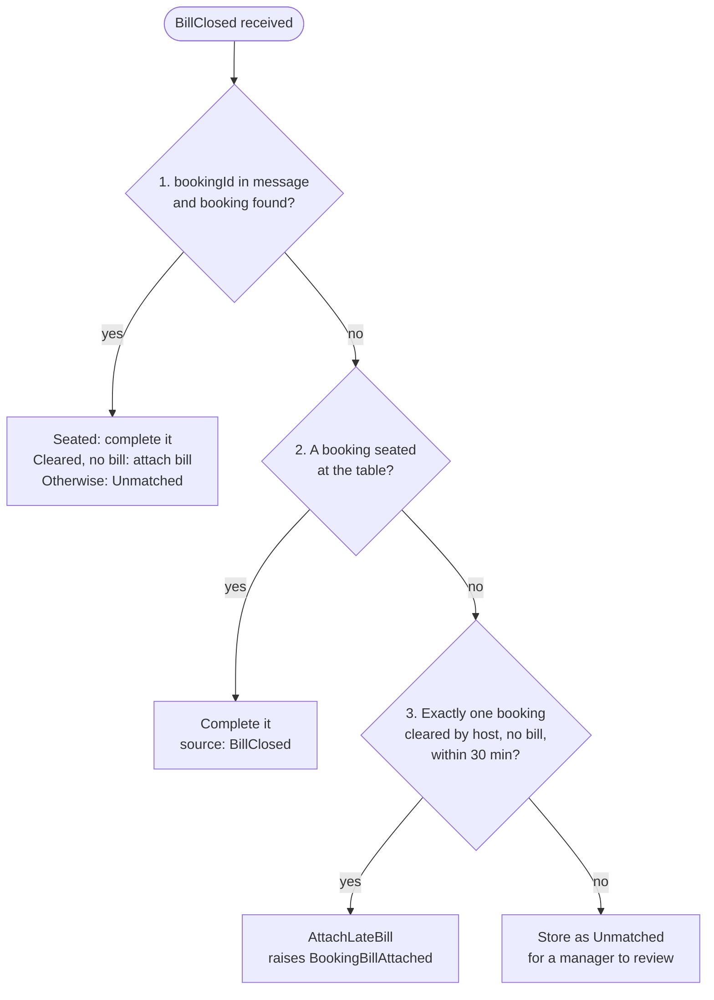

| **Step** | **Rule**                                                                                                                                                    | **Result**                                                                                      |
|----------|-------------------------------------------------------------------------------------------------------------------------------------------------------------|-------------------------------------------------------------------------------------------------|
| 1        | The message carries a `bookingId` (the POS echoes the one sent in `OpenTable`)                                                                              | Exact match: complete it if `Seated`, attach the bill if it was cleared by the host without one |
| 2        | A booking is `Seated` at that table                                                                                                                         | Normal path: `Complete(BillClosed, bill)`                                                       |
| 3        | Exactly one booking at that table was completed by `ClearedByHost`, has no bill total, and was cleared within `LateBillMatchMinutes` (30) of `closedAt`, before or after (a bill closed before the clear arrives late when the POS was offline) | Late match: `AttachLateBill` raises `BookingBillAttached`                                       |
| 4        | None of the above, or more than one candidate                                                                                                               | The inbound POS message is stored as `Unmatched`; no booking changes                            |

#### Rules

- Step 3 never guesses between candidates: two or more possible bookings means `Unmatched`.
- A repeated `BillClosed` with a `posBillId` already recorded is a duplicate and is ignored. A **different** bill for a booking that already has one is stored as `Unmatched` with reason `second_bill` (one bill per booking for now; §6.6).
- `BookingBillAttached` updates the guest's visit (`Guest.RecordVisit`) and the audit log, the same as a normal completion. It does not change the table state, which is already free.
- The window is a venue setting (`VenueSettings.LateBillMatchMinutes`, default 30), so it can be tuned per venue.
- **Manual matching:** the POS log lists `Unmatched` bills. A manager can attach one to a completed booking from that list (`MatchPosBill`), which raises `BookingBillAttached` with `matchedBy: manual`, or dismiss it (e.g. a bar tab with no booking).
- **Monitoring:** the pilot dashboard shows, per venue and day, the share of bookings completed by `ClearedByHost`, late matches and unmatched bills. A high share suggests the POS link is down or staff are skipping the POS (ADR-004 alarms).

#### Choosing the window

The window has to be a sensible size in both directions, which is why it’s a setting rather than a fixed number in the code. If it’s too short, slow payers at a busy counter are missed and their spend disappears from the records. If it’s too long, the table may already have been cleared for a second party, and a bill could be attached to the wrong guest. The design limits that risk by refusing to match when more than one booking qualifies, but a sensible window keeps those cases rare. Venues differ too: a quick lunch café might want 10 minutes, while a banquet restaurant where large groups settle up slowly might want 45. Because the value is stored in the venue’s settings, each venue can be tuned without a code change.

**Partner question:** can the POS return the `bookingId` it received in `OpenTable` when it sends `BillClosed`? If so, step 1 handles almost every case and steps 3–4 become rare.

### 6.6 One bill per booking, ready for split bills

The demo and the pilot assume **one POS bill per booking**. Split *payments* on one bill (cash plus card, several cards) need nothing here: the POS closes one bill with one total, and `BillClosed` carries that bill total, never the sum of payments.

Split *bills* (one table, several separate bills) are not built, because the partner's POS may not support them. Two small choices keep the door open:

| **Choice**                                        | **Now**                                                                                                    | **If split bills are needed later**                   |
|---------------------------------------------------|------------------------------------------------------------------------------------------------------------|-------------------------------------------------------|
| Bills keyed by `posBillId`                        | Duplicates are ignored; a second, different bill is flagged `second_bill` instead of overwriting the first | Same key; the second bill is added instead of flagged |
| Bills stored in `booking_bills`, one row per bill | At most one row per booking (enforced by a unique index on `booking_id`)                                   | Drop that index; `BillTotal` already sums the rows    |

**Not built until needed:** a "table closed" signal from the POS, accepting several bills per booking in the late-match rule, and running totals in `BookingBillAttached`.

**Watch in the pilot:** venues whose POS cannot split bills sometimes fake it by moving items to a virtual table (7A, 7B) or a quick-sale order. Those bills arrive with no matching booking and show as `Unmatched` for a manager (§6.5). A high count of `second_bill` or virtual-table bills is the signal to build split-bill support.

### 6.7 Build notes (M9a)

Details §6.1–§6.6 left open, settled when the POS back end was built (`src/Infrastructure/Pos`, `src/Api/Features/Pos`, `src/Api/Features/Guests`, `src/Contracts/Pos`). The POS log panel, the online/offline control and the host's "Bill paid" button come in M9b. The partner contract is [`docs/api/pos-messages.md`](api/pos-messages.md).

| **Topic** | **Decision** |
|-----------|--------------|
| Envelope v1 | Every message, in both directions, is one flat camelCase JSON object: `version` (1), `messageId`, `messageType`, `venueId`, `bookingId`, `tableIds` (empty for `UpsertMember`), `occurredAt` (the event's business-clock time), plus the type's fields (§6.3). Records `PosUpsertMember`, `PosOpenTable`, `PosApplyDeposit`, `PosBillClosed` in `src/Contracts/Pos`, published as OpenAPI components (`AddPosMessageSchemas`). An outbound `messageId` is the `pos_messages.id` (UUID v7 on the infrastructure clock). `OpenTable.guestName` is the booking's contact name; `ApplyDeposit.paymentRef` is the Stripe intent ID |
| Projection | `PosProjectionHandler` (consumer `pos`, inbox-wrapped) only adds `Waiting` rows. `BookingCreated` with a guest → `UpsertMember` (the guest's stored name, E.164 mobile, language); `BookingSeated` → `OpenTable`, then `ApplyDeposit` when the booking's deposit is `Captured`, read from the booking at handling time. Key `{eventId}:{MessageType}`; `source_event_id` the event; `booking_id` is now set on outbound rows too. Payloads are stored unmasked (the POS needs the mobile) and never logged |
| Venue sequence | `pos_venue_sequences (venue_id, last_sequence)`, one `INSERT … ON CONFLICT DO UPDATE … RETURNING` in the writer's transaction (`PosSequenceAllocator`). The row lock serialises a venue's writers until commit, so numbers are unique and gap-free (a rollback, also to a savepoint, returns the number) and a venue's rows **commit in sequence order**: the worker never sees n + 1 committed while n is still in flight, which `max() + 1` or a PostgreSQL sequence would allow. Inbound bills use the same counter. Lock order is counter → booking everywhere (the webhook allocates before it loads the booking) |
| Counter lock and slow handlers (agreed 15 Nov) | The `pos_venue_sequences` row lock is held until the dispatcher batch commits. A batch that also contains a slow handler, such as a Stripe refund call (§8.4), therefore delays inbound bills and other POS allocations for that venue until the batch ends. Acceptable for the demo. **Pilot:** allocate POS sequences outside slow handlers (e.g. in a short transaction of their own after the event is handled) or move the POS projection to its own dispatcher batch |
| Delivery worker | `PosDeliveryWorker` (section `Pos`: `PollInterval` 1 s, `UnavailableRetry` 5 s, `UnavailableWindow` 24 h; runs with `Outbox:RunWorkers`), woken by `PosSignal` (a new outbound row, or the mock coming back online). Each pass lists venues with a due `Waiting` row (infrastructure clock); per venue, one transaction per message: `pg_try_advisory_xact_lock(hashtextextended('pos-delivery:{venueId}', 0))` (not acquired → another instance owns the venue; skip), then the venue's head = lowest outbound `venue_sequence` that is `Waiting` or `Failed`, `FOR UPDATE`, sent only if `Waiting` and due. So n + 1 is never tried before n is `Sent`, and only one sender per venue runs even across API instances. The transaction stays open during the send: fine for the in-process mock; the pilot adapter needs a short timeout. `DeliverOnceAsync` is the test hook |
| Outcomes | Accepted (or a repeat the POS ignored) → `Sent`, `attempts + 1`, `delivered_at` on the business clock; the worker carries on with the next. **Unavailable** → stays `Waiting`, `attempts` unchanged, `last_error = pos_unavailable`, retried after 5 s, and `Failed` (`unavailable_24h`) only once the POS has been unavailable for 24 h after `queued_at`. Temporary error or an adapter exception (`adapter_exception:{type}`) → `attempts + 1`, `OutboxRetryPolicy`'s backoff (5 s, 30 s, 2 min, 10 min, then 30 min), `Failed` (`retries_used_up`) after 24 h. Permanent rejection → `Failed` with the POS's code at once. `Acknowledged` is not used in the demo (the mock confirms nothing after accepting) |
| Permanent rejection | **Blocks the venue's queue.** The failed row stays the head, so later rows stay `Waiting` until an admin replays it (§3.5 `Failed → Waiting`, pilot). Order is the contract (AC6.5): an `ApplyDeposit` or a later `OpenTable` sent after a refused `OpenTable` would be wrong at the POS. Logged as an Error with the code; the mock never rejects, so the demo can't get stuck this way |
| No duplicate after a crash | Every send carries the row's idempotency key, and the POS must ignore a key it already accepted. The mock records the key in its own committed transaction, so a crash after it accepted and before `Sent` is saved leaves the row `Waiting` (attempts unchanged, the transaction rolled back); the resend is answered as a repeat and recorded once |
| After commit | `PosMessageChangeInterceptor` (scoped, beside the outbox and message interceptors) notes `PosMessage` rows added or whose status or attempts change; after the commit it rings `PosSignal` for new outbound rows and calls `IPosLogNotifier`, which the API's `PosLogPusher` turns into `posLogChanged {posMessageIds}` to `venue:{id}`. Savepoint rollbacks and failed transactions send nothing. An unavailable retry changes neither status nor attempts, so it pushes nothing. The commit, rollback and savepoint bookkeeping moved from `MessageChangeInterceptor` into the shared base `CommittedChangesInterceptor<TChange>`; message behaviour is unchanged |
| Mock POS | `MockPosAdapter` (`IPosAdapter`) behaves as an external system: every call opens its own scope and transaction, so what it records stays committed whatever the worker does next. State lives in the database and survives restarts: `mock_pos_state` (one row, the online switch; no row = online), `mock_pos_received` (each accepted key with its order of arrival; a repeat is accepted and ignored), `mock_pos_open_tables` (table → booking from each `OpenTable`, so `BillClosed` can echo `bookingId`). One mock POS for the installation, as §14's routes have no venue. `DemoReset` (and so `ResetIfStale`) truncates the three tables and `pos_venue_sequences`, which also puts the mock back online. The seed creates no POS rows |
| `IPosAdapter` | `SendAsync(PosOutbound)` → `Accepted(duplicate)`, `Unavailable`, `Temporary(code)` or `Rejected(code)`. `ParseInbound(body, signatureHeader)` takes the raw body and header rather than `HttpRequest` (§6.1), because Infrastructure doesn't reference ASP.NET Core |
| Signature | Header `Pos-Signature: t={unix},v1={hex HMAC-SHA256(secret, "{t}.{body}")}`, Stripe's scheme, checked in constant time with a 5-minute tolerance either side (`Pos:SignatureTolerance`) on the infrastructure clock; several `v1` values allowed for rotation (`PosWebhookSigner`). Key `Pos:WebhookSecret`: user secrets locally, Secrets Manager in AWS, `pos_ci_only_not_a_secret` in CI's e2e env, `pos_test_only_not_a_secret` in the integration tests. Required at start-up when `Demo:Enabled` ("Demo:Enabled is true, so Pos:WebhookSecret must be set…"); without it every POS webhook is refused |
| Webhook | `POST /api/v1/webhooks/pos` (`posWebhook`): public, `DisableRateLimiting`, not in the OpenAPI document, 64 KB cap (413). Bad, missing or stale signature → 401 `invalid_signature`, nothing saved, a Warning with the code only; signed but unreadable, or an unknown venue → 400. `PosWebhookProcessor` (= `ParseInbound` + `PosWebhookHandler`) is the one path for the endpoint and the demo's "Bill paid". One transaction: inbox `('pos-webhook', messageId)` (a repeat → 200, nothing changes) → the venue's next sequence → an inbound row `Received` (key `pos:{messageId}`, payload = the body as received, `created_at` business clock) → `CloseBillHandler` → commit. An xmin conflict (a host cleared the table meanwhile) runs the message again once. Actor `pos`. Unexpected errors roll back and answer 500 (the POS retries) |
| CloseBill | `CloseBillHandler` loads the candidates and applies `LateMatchRule` (§6.5) with `LateBillMatchMinutes` from the venue settings, all on business-clock times: step 1 the echoed booking; step 2 the booking `Seated` with an active assignment on the table; step 3 bookings `Completed` on that table with `completed_at` within the window of `closedAt`. `CompleteSeated` → `Complete(BillClosed, bill)` (`BookingCompleted`, `TableCleared`); `AttachLate` → `AttachLateBill(LateMatch)` (`BookingBillAttached`); the row becomes `Matched` with the booking ID. `Unmatched` reasons `no_match`, `ambiguous`, `second_bill`; a table outside the venue is `no_match`. **Repeated bill:** a `posBillId` already recorded at the venue changes nothing, and the new inbound row is stored `Matched` to the booking that holds the bill, so the log shows it arrived. Manual match and dismiss are not built (pilot) |
| Guest visits (agreed 15 Nov) | `GuestVisitHandler` (consumer `guest-visits`, inbox-wrapped). **Every** `BookingCompleted` for a booking with a guest counts the visit, `BillClosed` or `ClearedByHost`: `Guest.RecordVisit(at: closedAt, billTotal?)`, which sets `LastBillTotal` only when there is a bill. `BookingBillAttached` → `Guest.RecordLateBill(total)`: the spend only, no second visit. A guest who came but whose bill never matched still has the visit. Replaces the M1 `RecordVisit(Money, at)`. Walk-ins without a guest are skipped |
| "Bill paid" | `POST /api/v1/demo/pos/bill-paid {tableId, totalCents}` (`simulateBillPaid`, tag `Demo`, Host policy so a Presenter passes too; only when `Demo:Enabled`). The route has no venue, so the handler checks the table belongs to a venue in the session's `venue_ids` (else 404). `totalCents` 1–10,000,000 (`total_cents_out_of_range`), `tableId` required (`table_required`). The mock builds the `BillClosed` its POS would send (new `messageId`, `posBillId` `bill-{uuid}`, `closedAt` business now, `bookingId` from its open-table record, none for a table it never opened, e.g. the seeded seated tables, which then match by step 2), signs it, hands it to `PosWebhookProcessor`, and then closes its table record. → `200 {posMessageId, status: matched / unmatched, bookingId?, unmatchedReason?}` |
| Online switch | `PUT /api/v1/demo/pos/online {online}` (`setMockPosOnline`, Presenter, only when `Demo:Enabled`) → 204; `online` is required (`online_required`). Going online makes the waiting rows due at once (`next_attempt_at` = now; attempts unchanged) and wakes the worker, so the queue drains without waiting for the next 5-second retry. `GET …/venues/{venueId}/pos/status` (`getPosStatus`, Presenter, only when `Demo:Enabled`) → `{online}` |
| POS log | `GET …/venues/{venueId}/pos-messages?status` (`getPosMessages`, tag `Pos`, Presenter) → `{timeZone, items}`, newest first by `venue_sequence` (the fixed demo clock gives many rows the same `created_at`), at most 200. Items `{id, direction, messageType, status, venueSequence, attempts, createdAt, deliveredAt?, bookingId?, tableIds, tableNames, unmatchedReason?, payload}` (`tableNames` added in M9b, §18.9); `status` filters by one status, case-insensitive (`status_invalid` otherwise). `payload` is the stored JSON with `memberPhone` masked like the phone panel (`PhoneNumber.Mask`); `attempts` counts sends the POS answered |
| Schema | Migration `AddPosDelivery`: `pos_messages.queued_at` (infrastructure clock), `next_attempt_at` (infrastructure clock, outbound only), `last_error` (code only); index `ix_pos_messages_outbound_open (venue_id, venue_sequence) WHERE direction = 'Outbound' AND status IN ('Waiting', 'Failed')`; tables `pos_venue_sequences`, `mock_pos_state`, `mock_pos_received`, `mock_pos_open_tables` |
| Logging | IDs, message type, sequence, status, attempts and codes only: never names, phone numbers, bill IDs, payloads or signatures. `LogScrubbingTests` sends a phone booking with a guest, a seat, a named walk-in, delivery, "Bill paid", and a forged and a real webhook with a marker bill ID, and finds none of them in the logs |
| Tests | Integration (`tests/Integration/Pos`; business clock at 18:25, only the infrastructure `TestClock` moves; the real mock behind a recording `TestPosAdapter`): mapping, keys and envelope; walk-in without a guest; deposit seat → `OpenTable` then `ApplyDeposit`; each event redelivered → one row each; 20 parallel allocations → 1..20, a rollback leaves no gap, two dispatchers at once; QA-5 offline → three `Waiting`, head retried every 5 s with attempts 0, online → sent in order, each received once; two workers → never two sends at once; crash after accept → one receipt; rejection blocks; 24 h unavailable; `posLogChanged` only after commit; online switch survives a restart. Webhook: bad, missing, stale and edited signatures 401; repeat once; steps 1–4, late outside the window, `ambiguous`, `second_bill`, repeated bill ID; "Bill paid" on seeded T4 via step 2; one visit with the total after "Bill paid" and after clear-then-late-bill; log masking, filter, Host 403, anonymous 401; reset; demo routes absent with `Demo:Enabled` false; start-up naming `Pos:WebhookSecret`. Unit: factory and envelope, signer, masking, `Guest.RecordVisit` / `RecordLateBill` |

## 7. Messaging and the phone panel

#### Creating messages

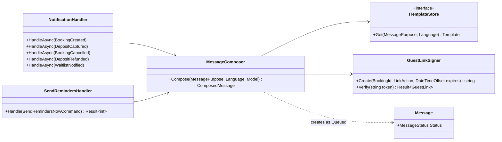

#### Delivering messages

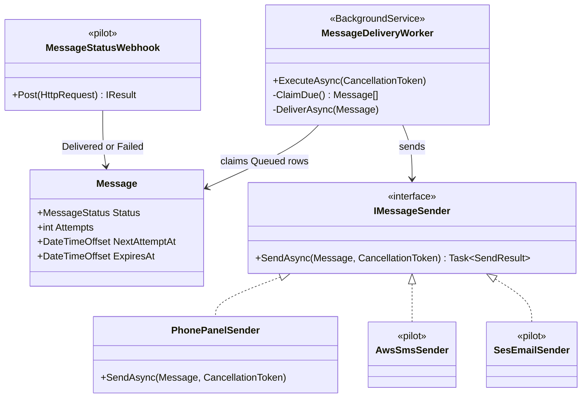

Handlers only **create** messages (status `Queued`) in their own transaction; they never call a provider. `MessageDeliveryWorker` does the sending, so a slow or failing provider never holds up the outbox dispatcher or other event handlers (ADR-002).

- Templates are per purpose and language (English and Simplified Chinese), stored in the API's resource files.
- Reminder messages carry two actions, **Confirm** and **Cancel**, each a signed link (`GuestLinkSigner`, HMAC-SHA256 with a key from Secrets Manager) that expires at the booking start time (ADR-004).
- `PhonePanelSender` stores the message, marks it `Sent`, pushes `messageLogChanged` to the venue's presenter screen, and marks it `Delivered` 1 s later. No real SMS is sent (Requirements §11).
- The phone panel's buttons call the same guest endpoints a real link would (§14), so the flow is identical to the pilot's.

*About GuestLinkSigner*

GuestLinkSigner creates and checks the signed links that let guests act on their booking without an account, such as the **Confirm** and **Cancel** links in reminder messages and the manage-booking link in confirmations. Create(bookingId, action, expires) builds a small payload (the booking ID, the action and an expiry time, normally the booking start) and seals it with an HMAC-SHA256 signature using a secret key. The result is a URL-safe token. Verify(token) recalculates the signature from the payload, compares it with the one in the token using a constant-time comparison, and rejects the link (invalid_link or link_expired) if the payload was changed, the token was forged, or the expiry has passed. Anyone can read a token, but no one can alter or create one without the key, so only links the system actually sent are accepted.

The signing key is stored in AWS Secrets Manager (locally in .NET user secrets). It is loaded once at start-up into GuestLinkOptions, which is checked with ValidateOnStart, and passed to GuestLinkSigner through dependency injection, so the signer never reads configuration or calls AWS itself and can be unit-tested with a fixed key. Tokens may carry a key ID, so the key can be rotated while links already sent keep working until they expire. *To stop email scanners and link previews from acting on a guest’s behalf, opening a link only displays the booking* (GET /guest/bookings?token=…); the change happens only when the guest taps the button, which sends a POST that verifies the token again. Repeating an action is harmless, because confirming twice or cancelling an already-cancelled booking changes nothing.

### 7.1 Message delivery worker

PostgreSQL is the message queue: the `messages` table with its `status` column. No separate queue product is needed for the demo or the pilot (ADR-002); Amazon SQS is the step up only if message volume or separate sender services call for it.

```
loop:
  await signal.WaitAsync(1s)                        -- new message, or every 1 s
  BEGIN
    rows = SELECT … FROM messages
           WHERE status = 'Queued' AND next_attempt_at <= now()
           ORDER BY next_attempt_at
           LIMIT 20
           FOR UPDATE SKIP LOCKED
    for each row:
      if now() > row.expires_at: row.MarkFailed('expired'); continue
      result = await sender.SendAsync(row)          -- IMessageSender
      accepted        → row.MarkSent(providerRef)   -- raises MessageSent
      temporary error → row.ScheduleRetry(error)    -- attempts + 1, retry later
      permanent error → row.MarkFailed(reason)      -- e.g. invalid number
  COMMIT
```

| **Rule**                   | **Detail**                                                                                                                                                                                          |
|----------------------------|-----------------------------------------------------------------------------------------------------------------------------------------------------------------------------------------------------|
| Backoff                    | 5 s, 30 s, 2 min, 10 min, then every 10 min until the message expires                                                                                                                               |
| Expiry by purpose          | `TableReady`: 10 min after creation (a late "table ready" text is worse than none). `Reminder`: the booking start time. `Confirmation`, `Cancellation`, `Refund`: 24 h                              |
| Permanent errors           | Invalid or unreachable number, opted-out recipient: `Failed` at once, no retries                                                                                                                    |
| Idempotency                | Each send passes the message ID as the provider's idempotency or client reference, so a retry after a timeout does not send twice                                                                   |
| Visibility                 | Every status change pushes `messageLogChanged`; failed messages show in the message log with the reason, and a `TableReady` failure is flagged on the waitlist entry so the host can call the guest |
| Delivery reports \[pilot\] | The SMS and email providers report delivery to `/webhooks/messages`; the endpoint verifies the signature, uses the inbox (§5.5) and moves the row to `Delivered` or `Failed`                        |
| Reminder timing            | A reminder is sent 24 h before the booking (AC5.1). No reminder for a booking made less than 24 h ahead (its confirmation carries the manage-booking link instead), and none when the booking starts within 2 h. `SendRemindersNow` in the demo applies the same 2-hour rule. Both rules are checked by `ReminderPolicy.CanSend` inside `Booking.RecordReminder`, for scheduled and `SendRemindersNow` reminders alike (a booking made under 24 h ahead never gets one) |
| Late cancellation warning  | If a guest opens a Confirm or Cancel link inside the free-cancellation window (`booking.Terms`, §2.6), the page says "cancelling now keeps your deposit" before the guest taps Cancel |
| Providers                  | Demo: `PhonePanelSender`. Pilot: AWS End User Messaging SMS and Amazon SES, keeping guest data in AWS (ADR-001 D10). Both sit behind `IMessageSender`                                               |

### 7.2 Build notes (M7a)

Details §7 and §7.1 left open, settled when the messaging back end was built (`src/Api/Messaging`, `src/Api/Features/Messages`, `src/Infrastructure/Messaging`). The presenter phone panel and the host screen change come in M7b.

| **Topic** | **Decision** |
|-----------|--------------|
| What is queued | `NotificationHandler` (consumer `notifications`, wrapped in the inbox decorator, so each event queues at most once) only adds `Queued` rows; it never calls a sender. `BookingCreated` → `Confirmation` when the channel is `Online` or `Phone`, `holdExpiresAt` is empty (not `PendingPayment`; a deposit booking gets its confirmation on `DepositCaptured` in M8) and there is a guest. Walk-ins, including parties seated from the waitlist, get none. `WaitlistNotified` → `TableReady` to the entry's guest. No actions yet: the manage-booking link comes with M10 (`GuestLinkSigner`, token in the query string) |
| Repeated Notify | Every Notify, for the same table or another, queues a new `TableReady`: a second tap is deliberate (a double tap is a stale `version`, `409`). The text names no table, so the body is the same. An earlier `TableReady` for the entry that is still `Queued` is failed with `lastError = superseded`, so the guest never gets two. An entry that ended before the event was handled gets none. **M7b:** the phone panel shows a `superseded` failure as "Replaced", not as an error |
| Language | Stored on each booking (`bookings.language`: the request's language; for a party seated from the waitlist the entry's; `En` for a plain walk-in) and each waitlist entry (`waitlist_entries.language`: the language chosen when joining). The guest profile keeps its own, as in M4a and M6a: a known guest joining in Chinese gets a Chinese text without changing the profile |
| Templates | `TemplatesEnglish.resx` and `TemplatesChinese.resx` in `src/Api/Messaging/Templates`, one neutral resource per language (no satellite assemblies, no culture lookup), keys = purpose names, placeholders `{venue}`, `{party}`, `{date}`, `{time}`, `{reference}`. `MessageComposer` fills them; the venue name is used as stored in both languages (venues have no Chinese name). Dates and times are in the venue's zone and formatted by hand: `Sat 14 Nov`, `7:30 pm`; `11月14日（周六）`, `19:30`. A missing template throws; `MessageComposerTests` covers every purpose in use × language |
| Two clocks | `Message.Queue(..., now, queuedAt)`: `created_at`, `sent_at` and `delivered_at` are business-clock times people see (the waitlist's "time sent" is `sent_at`); `next_attempt_at`, `expires_at` and `delivery_due_at` are infrastructure-clock times the worker schedules by, so with the business clock fixed at 18:25 texts still go out, retry and expire. Expiry counts from `queuedAt`; a reminder's (M10) is `queuedAt + (bookingStart − now)`. The message ID is a UUID v7 on the infrastructure clock, so ordering by ID follows real time |
| Worker | `MessageDeliveryWorker` (section `Messaging`: `PollInterval` 1 s, `BatchSize` 20, `PhonePanelDeliveryDelay` 1 s; runs with `Outbox:RunWorkers`). One transaction per batch: `Queued` rows with `next_attempt_at <= now` and `Sent` rows with `delivery_due_at <= now`, `now` passed in from the infrastructure clock (never SQL `now()`), `LIMIT 20 FOR UPDATE SKIP LOCKED`. Expired → `Failed` (`expired`); otherwise sent with the message ID as the client reference: accepted → `Sent` (`MessageSent` through the outbox), temporary → `ScheduleRetry` (5 s, 30 s, 2 min, 10 min, then every 10 min, failing when the next try would pass the expiry), permanent → `Failed` at once. A sender that throws counts as temporary, recorded as `sender_exception:{type}` only. `DeliverBatchAsync` is the test hook |
| Delivered | `IMessageSender` returns `SendResult`: `Accepted(providerRef, deliveredAfter?)`, `Temporary(code)` or `Permanent(code)`. `PhonePanelSender` accepts with `panel-{id}` and `deliveredAfter` = 1 s; the worker stores `delivery_due_at` and marks the row `Delivered` when it is due. No fire-and-forget delay, so a restart still delivers. Pilot providers leave `deliveredAfter` empty and report through `/webhooks/messages` |
| After commit | `MessageChangeInterceptor` (scoped, next to the outbox interceptor) notes messages added or whose status or attempts change, and after the commit rings `MessageSignal` (for new `Queued` rows) and calls `IMessageChangeNotifier`. It follows savepoints: a rollback to a savepoint forgets what was noted since, so a handler that fails after saving sends no signal and no notice while the other handlers' messages in the batch still do. A rolled-back transaction or a failed save sends nothing. The API's `MessageChangePusher` sends `messageLogChanged {messageIds}` to `venue:{id}`, plus `waitlistChanged {entryIds}` for `TableReady` changes so host screens refresh the status. `MessageSent` → `messageLogChanged` from `RealtimeNotifier` (§15.1) stays; it costs one extra refetch |
| Message log | `GET …/messages` (`getMessages`, tag `Messages`, `Presenter`) → `{at, timeZone, items}`: messages created in today's venue-local day (business clock), the latest 100, oldest first (`created_at`, then ID). Items: `{id, purpose, language, body, mobileMasked, status, sentAt?, deliveredAt?, lastError? (failed only), subjectId, subjectType}`, where `subjectType` is `booking` or `waitlistEntry` |
| Waitlist | Each `GET …/waitlist` item gains `tableReadyStatus?`, `tableReadySentAt?` and `tableReadyFailed` from the entry's latest `TableReady` (AC4.4; a failed one is flagged so the host can call, §7.1 Visibility). Additive |
| Reset and seed | `DemoReset` (and so `ResetIfStale`) already truncates `messages`; the seed writes no events, so it creates no messages. Seeded bookings take their guest's language |
| Logging | Message ID, purpose, status, attempts and the error code only; never bodies, names or numbers. `LogScrubbingTests` sends a booking and a waitlist notify through dispatch and delivery and finds none in the logs |
| Tests | `MessageDeliveryWorkerTests` (harness, both clocks as `TestClock`s, only the infrastructure one moved): sent and delivered, backoff, expiry, permanent error, two workers, crash after send, push only after commit, savepoint rollback, restart, wake on signal. `MessagingTests` through the API; `MessagingDeliveryTests` with the workers running checks AC1.6 (the confirmation is `Sent` in `GET …/messages` within 2 s of the booking response, then `Delivered`) and AC4.3 / AC4.4 (a Chinese entry's text, and its status and time sent on the waitlist) |

### 7.3 Build notes (M10a)

Details §7 ("About GuestLinkSigner"), §7.1, §9.2 and §14 left open, settled when the reminder and guest-link back end was built (`src/Api/GuestLinks`, `src/Api/Features/GuestBookings`, `src/Api/Features/Reminders`, `src/Api/Messaging`, `src/Infrastructure/Payments/SeedDepositRouter.cs`). The guest manage page, the phone panel's buttons and the presenter's "Send reminders now" button come in M10b.

| **Topic** | **Decision** |
|-----------|--------------|
| Seed check (16 Nov) | At 18:25 only #10 (GDB3K7, party of 2, English, no deposit) and #11 (GDC4L8, party of 6, Chinese, deposit NZ$120.00 captured) pass the reminder rule; #6 is confirmed and #7–#9 start within 2 h. Cancelling #11 at 18:25 is 2 h 05 min before its start, so the refund is full. No seed change (§17) |
| Token format | `base64url(payload) "." base64url(HMAC-SHA256(key, payload))`. The payload is compact binary so the texts stay short (about 85 characters a token): format version (1), key ID (length-prefixed ASCII), booking ID (16 bytes), action (`Manage` 1, `Confirm` 2, `Cancel` 3) and expiry (Unix seconds). `Verify` never throws or logs: malformed, over 256 characters, another format version, an unknown key ID or a signature that differs (`CryptographicOperations.FixedTimeEquals`) → `invalid_link`; only a genuine token is then checked for expiry → `link_expired`. Anyone can read a token; no one can change or make one without the key |
| Keys and rotation | Section `GuestLinks`: `SigningKey` (at least 32 characters; .NET user secrets locally, Secrets Manager in AWS), `KeyId` (default `1`, 1–16 ASCII letters or digits) and `PreviousKeys` (key ID → key, still accepted when verifying). Checked with `ValidateOnStart`; each failure names the setting. Rotation: move the current key into `PreviousKeys` under its ID, then set a new key and ID; links already sent keep working until they expire. CI's end-to-end job uses a "not a secret" key; integration tests set their own in `ApiFactory` |
| Expiry on the business clock (rule 14) | A link expires at the booking start (ADR-004's "expires after the booking": it can't be used once the booking has begun). The start is a business time, and whether a guest may still act is a business rule, so `Verify` compares with the business clock (the default `TimeProvider`), not the infrastructure clock. With the demo clock fixed at 18:25 a 20:30 booking's links stay valid for the whole demo; with the system clock they run out at the real start. The text that carries them is a different matter: a reminder message's own expiry stays on the infrastructure clock (`queuedAt + (start − now)`, §7.2), because the delivery worker schedules by it |
| Link URL | `{GuestLinks:BaseUrl}/manage/?token=…` (agreed 16 Nov: the `/manage` route of §18.1, not `/booking`). The token is only ever in the query string, never in a path. `BaseUrl` is the guest web app's absolute http(s) origin (`https://localhost:3000` in `appsettings.Development.json`, `http://localhost:3000` in CI, `https://app.<domain>` in M12) |
| Guest endpoints | Public (`AllowAnonymous`, so the global anonymous limit applies; since M10b per link, §18.10), tag `GuestBookings`. `GET /guest/bookings?token` (`getGuestBooking`) reads only, with `AsNoTracking`, so link scanners and previews change nothing: `{reference, venueName, timeZone, startsAt, localDate, localTime, partySize, status, deposit?{amount, status}, terms{freeUntilHoursBefore, refundWhenInTime}, freeCancellationUntil, cancellingNowKeepsDeposit, refundIfCancelledNow?, cancellationRefund?, linkAction, allowedActions[]}`. No name, mobile, notes or allergies. `refundIfCancelledNow` is `RefundPolicy.Decide` for a guest cancel at this moment, worked out without cancelling; `allowedActions` is what the token's action allows in the current status (a Confirm link: `confirm` while `Booked` and before the start; a Cancel or Manage link: `cancel` while `PendingPayment`, `Booked` or `Confirmed`). `POST /guest/bookings/confirm {token}` (`confirmGuestBooking`) and `POST /guest/bookings/cancel {token}` (`cancelGuestBooking`) verify the token again and check its action (confirm needs a Confirm token; cancel a Cancel or Manage token), then call `Booking.Confirm` / `Booking.Cancel(GuestRequest)` with `Actor.ForGuest(booking.GuestId)`, the same domain methods as the host, so the reminder's response and time are recorded on its `ReminderRecord` (AC5.6) and the refund follows §8.3. No `version`: a booking already in the target state returns success (§3.1), and a change between read and save (xmin) is retried once, then `409 version_conflict`. Response `{status, refundDecision?}` |
| Codes | `invalid_link` 400 (`ErrorKind.Validation`, `errors: null`): malformed, forged, unknown key, an action the token doesn't allow, or a booking that doesn't exist. `link_expired` 410 (new `ErrorKind.Gone`). `invalid_transition` 409 (e.g. confirming a cancelled booking). The token is bound as a plain string, so binding never fails with its value in an exception message |
| Late-cancellation warning (BR-13) | `cancellingNowKeepsDeposit` (`Booking.CancellingNowKeepsDeposit`) is true when a paid deposit would be kept because the free-cancellation window in `booking.Terms` has passed; with `freeCancellationUntil` and `refundIfCancelledNow` the page (M10b) says "cancelling now keeps your deposit" before the guest taps Cancel. Cancelling inside the window decides `none` (deposit stays `Captured`, no provider call); in time it decides `full` (the M8a refund path). Host cancels stay `full` |
| Eligibility | `ReminderPolicy.Check(booking, now) → ReminderEligibility`, the one rule used by `Booking.RecordReminder`, "Send reminders now" and (pilot) the scheduler, checked in this order so the reason is the first rule that fails: `alreadyReminded`, `alreadyConfirmed` / `notBooked`, `noGuest`, `bookedLessThan24hAhead` (start − created < 24 h), `startsWithin2h` (start − now < 2 h, business clock), else `eligible`. Exactly 24 h and exactly 2 h are eligible. `CanSend` is `Check == eligible` |
| Send reminders now (agreed 16 Nov) | `POST /demo/reminders/send-now` (`sendRemindersNow`, tag `Demo`, Presenter; mapped only when `Demo:Enabled`). The route has no venue: it acts on the venues in the session's `venue_ids`. One transaction: tonight's upcoming bookings (venue-local business date; `PendingPayment`, `Booked`, `Confirmed`) are checked; each eligible one gets `RecordReminder(now, policy)` and a Queued Reminder message, in the booking's language, with Confirm and Cancel links that expire at the start. As in §7's class diagram and §10.4 the message is queued in this transaction, **not** through a new event (ADR-002 folds `ReminderSent` into `MessageSent`); nothing is sent here, the worker sends after the commit (rule 3). `RecordReminder` raises no event, so host screens see the reminder on their next refetch (M10b can refetch on `messageLogChanged`). Response `{sent, skipped: [{reason, count}]}`, counts only; a second press sends 0 (`alreadyReminded`). Two presses at once may meet on a booking's xmin → `409 version_conflict` |
| Scheduler \[pilot\] | The real reminder 24 h before each booking is a pilot job: a timer on the infrastructure clock that picks bookings starting in about 24 h and runs the same steps per booking, with `ReminderPolicy.Check` deciding. Not built for the demo |
| Confirmation Manage link (BR-13) | Every Confirmation (`BookingCreated` created as Booked, and `DepositCaptured`) carries a `manage` action expiring at the booking start, so a guest who booked under 24 h ahead, who gets no reminder, can still cancel |
| Templates and wording | New keys in `TemplatesEnglish.resx` / `TemplatesChinese.resx`: `Reminder` (`{venue} {party} {date} {time} {reference} {policy}`); the policy fragments `CancellationPolicyDeposit` ("Cancel free up to {hours} h before and your {amount} deposit is refunded in full; after that it is kept."), `CancellationPolicyDepositKept` (terms that never refund) and `CancellationPolicyNoDeposit` ("Can't make it? Please cancel at least {hours} h before."); and the link labels `ActionConfirm`, `ActionCancel`, `ActionManage`. `MessageComposer.CancellationPolicy` renders the wording from `booking.Terms` and the captured deposit in the guest's language; `ReminderRecord.PolicyShown` stores exactly that text (AC5.6). A message's actions are stored for the phone panel's buttons and also written at the end of the body ("Confirm: {url} Cancel: {url}", "Manage: {url}"), because a real text has no buttons. No names or other personal data in any text |
| Message actions | `GET …/messages` items gain `actions: [{kind: confirm \| cancel \| manage, url}]` (`MessageActionItem`, kind = `LinkAction`); empty for texts without links. The message log is Presenter-only; the links are in the message rows because the text must carry them |
| Host list reminder | Tonight's list items gain `reminder?: {sentAt, response?, respondedAt?}` (`BookingReminder`; `response` `confirmed` or `cancelled`) for the details panel. Additive |
| Headers | `GuestLinkHeadersMiddleware`, first in the pipeline, adds `Referrer-Policy: no-referrer` and `Cache-Control: no-store` to every response under `/api/v1/guest/`, including errors, 429 and status pages (set when the response starts). The M10b page should send `no-referrer` too |
| Logging and tracing | The token, the link and the query string are never logged: the request line already logs the route template (§14.1); `Microsoft.AspNetCore` stays at Warning, so the host's own request lines (with the query) are filtered; the signer never logs or throws; the guest handlers log the booking ID, action and outcome or code only. Send-now logs booking IDs and counts. Message bodies (which hold links) are never logged (§7.2). There is no OpenTelemetry yet; M12's ASP.NET Core instrumentation must drop `url.query` / `url.full` (or record the route only), so tokens never reach a trace. `LogScrubbingTests` sends reminders, dispatches and delivers, opens and posts genuine, expired and garbage tokens, and finds no token, link, `token=`, body, policy wording, name, reference or mobile in the logs |
| Seeded deposits in Stripe mode (agreed 16 Nov) | The seed's captured deposits (#7 and #11) carry `pi_seed_…` intents (`SeedPayments`) that Stripe has never seen, so a refund would be refused and retried until the outbox row failed, leaving "Refund pending" on stage. With `Payments:Provider = Stripe` and `Demo:Enabled = true`, `SeedDepositRouter` sits in front of the Stripe provider (keyed service `stripe`): refunds of `pi_seed_…` intents go to the Fake provider, whose queue `FakeRefundReporter` reports as a signed `charge.refunded` through the same webhook processing (the reporter now also runs in that mode); everything else, including every deposit taken during the demo, goes to Stripe unchanged. Without the demo (the pilot) the router isn't registered. The step-5 refund therefore doesn't appear in the Stripe dashboard; live bookings' refunds do. **Possible M12 rehearsal upgrade (option a):** the reset creates and confirms real test-mode intents for the seeded deposits (`pm_card_visa`, idempotency key from the booking ID, metadata set) before seeding and stores their IDs, so the step-5 refund shows in the dashboard; the cost is that reset needs Stripe reachable, and the resulting `payment_intent.succeeded` webhooks must be no-ops for seeded bookings |
| Tests | Unit: `GuestLinkSignerTests` (round trip, changed payload, changed signature, wrong key, previous key after rotation, unknown key ID, expiry on the business clock, forged-and-expired is invalid, garbage, length, URL shape, options), `ReminderPolicyTests` (each rule, the 24 h and 2 h boundaries to the tick, first failing rule), `MessageComposerTests` (Reminder in both languages with links, Manage link, policy wording), `SeedDepositRouterTests`. Integration: `RemindersTests` (seed at 18:25 → #10 and #11 only, skipped counts, signed links in their language, policy recorded, expiry on the infrastructure clock, second press, under-24 h booking, phone-panel actions and host-list reminder, Host 403 / anonymous 401, route absent with the demo off), `GuestBookingTests` (GET changes nothing, warnings, confirm → `floorPlanChanged` and the response recorded, cancel in time → full refund and texts, inside the window → kept, host still full, action checks, `invalid_transition`, `link_expired`, `invalid_link`, headers, Manage link on both confirmations), `SeedDepositRefundTests` (a Stripe double that refuses unknown intents: #11 cancelled from its reminder reaches `Refunded` without calling it; a live deposit is refunded by it; with the demo off the resolved provider is Stripe itself), `LogScrubbingTests` |

## 8. Payments

### 8.1 Classes

```mermaid
classDiagram
    direction TB
    class StripeWebhookEndpoint
    class CaptureDepositHandler
    class RecordRefundHandler
    class IPaymentProvider {
        <<interface>>
        +CreateDepositIntent(BookingId, Money, string idemKey) Task~PaymentIntentInfo~
        +Refund(string paymentIntentId, Money, string idemKey) Task~RefundInfo~
        +ParseWebhook(HttpRequest) Task~PaymentWebhook~
    }
    class StripePaymentProvider {
        -StripeClient client
        -string webhookSecret
    }
    class Booking {
        +Cancel(Actor by, CancelReason, DateTimeOffset now) Result~RefundDecision~
    }
    class RefundPolicy {
        +Decide(Booking, CancelReason, Actor, DateTimeOffset now) RefundDecision
    }
    class BookingCancelled {
        <<event>>
        +RefundDecision RefundDecision
    }
    class RefundOnCancelHandler {
        +HandleAsync(BookingCancelled)
    }
    StripeWebhookEndpoint --> IPaymentProvider : ParseWebhook
    StripeWebhookEndpoint --> CaptureDepositHandler : payment succeeded
    StripeWebhookEndpoint --> RecordRefundHandler : charge refunded
    Booking --> RefundPolicy : decides once, at cancel
    Booking ..> BookingCancelled : raises with decision
    RefundOnCancelHandler --> BookingCancelled : reads decision
    RefundOnCancelHandler --> IPaymentProvider : Refund if full
    IPaymentProvider <|.. StripePaymentProvider
```

It shows how the system works with Stripe in both directions: Stripe telling us something happened (webhooks, on the left), and us asking Stripe to do something (refunds, on the right). Everything Stripe-specific sits behind one interface, IPaymentProvider.

**Three payment flows**

1. **Taking a deposit** (not drawn, but it uses the same interface). When a party of 6 or more books, `CreateOnlineBooking` calls `IPaymentProvider.CreateDepositIntent(...)`. Stripe returns a client secret, and the guest pays in Stripe's own card form (Stripe Elements), so card details never reach our servers.
2. **Stripe tells us what happened** (left side).
    1. Stripe posts a webhook to `StripeWebhookEndpoint`.
    2. The endpoint calls `ParseWebhook`, which checks Stripe's signature with the webhook secret and turns Stripe's JSON into a simple `PaymentWebhook` object.
    3. It inserts an inbox row (§5.5), so a repeated webhook is ignored, then passes the event to the right handler:
        - **payment succeeded** → `CaptureDepositHandler`: the booking moves from `PendingPayment` to `Booked`, and `DepositCaptured` is raised.
        - **charge refunded** → `RecordRefundHandler`: the deposit becomes `Refunded`, and `DepositRefunded` is raised.
3. **We ask Stripe for a refund** (right side).
    1. A booking is cancelled. `Booking.Cancel(...)` asks `RefundPolicy` for the refund decision, once, using the terms saved on the booking (§2.6), and raises `BookingCancelled` carrying that decision.
    2. `RefundOnCancelHandler` receives the event from the outbox. If the decision is "full", it calls `IPaymentProvider.Refund(...)` with the idempotency key `{eventId}:refund`. If the handler is retried, Stripe won't refund twice, and the decision can't change.
    3. Stripe later confirms with a `charge.refunded` webhook, which goes through flow 2. The booking only records the refund once Stripe confirms it.

| Class                 | Role                                                                                                                                                                           |
|-----------------------|--------------------------------------------------------------------------------------------------------------------------------------------------------------------------------|
| StripeWebhookEndpoint | Receives Stripe webhooks, verifies them, de-duplicates with the inbox, and routes each to a handler                                                                            |
| CaptureDepositHandler | Calls `booking.CaptureDeposit(...)`. Booking still `PendingPayment` after the hold expired: the table is re-checked; free → captured as normal, taken → `Cancel(HoldExpired)` with a full refund through `RefundOnCancelHandler`. Booking already `Cancelled(HoldExpired)`: since M8a the handler calls `booking.RecordLatePayment(...)` instead of calling Stripe in the request (CLAUDE.md rule 3). The booking stays `Cancelled`, the deposit records the money (`Released → Captured`), and `LatePaymentReceived` makes `LatePaymentRefundHandler` refund through the outbox with idempotency key = `paymentIntentId`; the audit consumer writes the audit entry. Stripe's later `charge.refunded` marks the deposit `Refunded` (§8.4). The guest page shows "time no longer available, refunded" (§12). |
| RecordRefundHandler   | Records a refund that Stripe has confirmed                                                                                                                                     |
| IPaymentProvider      | The single seam to the payment provider: create a deposit, refund, parse webhooks                                                                                              |
| StripePaymentProvider | The Stripe implementation; holds the Stripe client and webhook secret (from Secrets Manager)                                                                                   |
| Booking               | `Cancel(...)` asks `RefundPolicy` for the decision at the moment of cancellation and raises `BookingCancelled` with it |
| BookingCancelled      | The event that carries the refund decision (`full`, `none` or `notApplicable`) to the handlers |
| RefundOnCancelHandler | Reads the decision from `BookingCancelled` and requests the refund from Stripe when it is `full`; it never decides itself |
| RefundPolicy          | Applies the cancellation rule (BR-07): full refund at least 2 hours before, otherwise kept; host cancellations always refunded. It uses the terms saved on the booking (§2.6) and is called only by `Booking.Cancel`. |

`DepositPolicy` is used by `CreateOnlineBooking` (§9.2) to work out the deposit due.

Since M8a, `ParseWebhook` is not on `IPaymentProvider`: `StripeWebhookVerifier` checks every webhook, whichever provider takes payments, so tests and CI verify real Stripe signatures with the Fake provider (§8.4).

### 8.2 Deposit rule (BR-06)

`DepositDue = channel = Online and partySize ≥ 6 ? partySize × NZD 20.00 : none`. Phone bookings and walk-ins never take a deposit and never start as `PendingPayment` (see §20). Values come from `VenueSettings.Deposit` at the moment of booking and are kept in `booking.Terms.Deposit` (§2.6).

### 8.3 Refund rule (BR-07)

| **Who cancels**       | **When**            | **Decision**                |
|-----------------------|---------------------|-----------------------------|
| Guest                 | ≥ 2 h before start  | Full refund                 |
| Guest                 | \< 2 h before start | No refund (deposit kept)    |
| Host                  | Any time            | Full refund                 |
| System (hold expired) | Before payment      | Not applicable (`Released`) |
| System (hold expired) | Payment arrived after the hold expired and the table is taken | Full refund (§3.1, §12) |

The hours and refund amounts come from `booking.Terms.Cancellation` (§2.6), so a later change to the venue's rule does not affect this booking.

The refund decision is made **once**, when the booking is cancelled: `Booking.Cancel(...)` calls `RefundPolicy.Decide(...)` with the terms saved on the booking (§2.6), and `BookingCancelled` carries the result. `RefundOnCancelHandler` never decides again; it reads the decision from the event and, when it is `full`, calls Stripe with idempotency key `{eventId}:refund`. A handler retried after the 2-hour line therefore gets the same answer as at cancellation. Stripe's `charge.refunded` webhook then raises `DepositRefunded` through `RecordRefundHandler`.

### 8.4 Build notes (M8a)

Details §5.5 and §8.1–§8.3 left open, settled when the payments back end was built (`src/Infrastructure/Payments`, `src/Api/Features/Payments`, `src/Api/Features/Bookings`). The guest payment step (Stripe Elements) and the host cancel button come in M8b; the guest cancel link in M10 reuses `Booking.Cancel`.

| **Topic** | **Decision** |
|-----------|--------------|
| Provider | `Payments:Provider` is `Stripe` or `Fake`, required, validated at start-up. `Stripe` needs `Stripe:SecretKey` and `Stripe:WebhookSecret` (.NET user secrets locally, Secrets Manager in AWS); each missing one fails start-up with a message naming it. `Fake` (Development, integration tests, CI's e2e job) calls nothing and is deterministic: the same idempotency key gives the same `pi_fake_…` intent and client secret. Package `Stripe.net` (53.1.0), referenced from `src/Infrastructure` only |
| Seams | `IPaymentProvider` is outbound only: `CreateDepositIntentAsync(DepositIntentRequest{bookingId, venueId, reference, amount}, key)` and `RefundAsync(paymentIntentId, amount, key)`. Failures throw `PaymentProviderException` whose message is a short code (`stripe:{error type}` or `stripe:http_{status}`). `StripeWebhookVerifier` checks inbound webhooks with `Stripe:WebhookSecret` whichever provider is configured; without a secret every webhook is refused |
| Deposit intent | Card payment intent in NZD (`booking.Terms.Deposit`), automatic payment methods, metadata `bookingId`, `venueId`, `reference`; no name, email or phone goes to Stripe. Idempotency key `deposit:{bookingId}` |
| Taking a deposit | The create transaction is unchanged (idempotency key → slot lock → tables → `Create` → save → stored response → commit). **Only after the commit**, with no lock held, a `PendingPayment` booking gets its intent. A second short transaction runs `AttachPaymentIntent` (stores `payment_intent_id`, no event) and, with an `Idempotency-Key`, rewrites the stored response with the new `version`; one retry on an xmin conflict with the expiry job. 201 adds `clientSecret`; the stored response never holds it |
| Replay | The same `Idempotency-Key` replays the stored response. If the booking is still `PendingPayment`, the provider is asked again with the same `deposit:{bookingId}` key, so Stripe returns the same intent and client secret and there is only ever one intent per booking. A booking no longer waiting for payment replays the stored body as it is |
| Stripe down | 502 `payment_provider_error`. The booking is already committed: it stays `PendingPayment`, holds its table and expires normally. **Retry:** the guest page resends the same request with the same `Idempotency-Key` within the hold (`DetailsStep.tsx` keeps one key per submission), which replays the booking and asks Stripe again; M8b shows a "Try again" button that does this. A retry without the key would make a second booking, which the first one's table may block (`409 slot_taken`) |
| Hold on the infrastructure clock (rule 14) | `HoldExpiresAt` is an infrastructure-clock time: `Booking.Create(..., holdClockNow)` sets it to real now + `PaymentHoldMinutes`, and `ExpireHold(now, holdClockNow)` and `CaptureDeposit(..., now, holdClockNow)` compare the hold with `holdClockNow`, while `now` (business clock) stays the event time. So with the business clock fixed at 18:25 a hold still runs out after 10 real minutes, and the guest's browser countdown from `holdExpiresAt` (also in `BookingCreated`) matches. Same pattern as `Message.Queue(now, queuedAt)` (§7.2). `holdClockNow` defaults to `now`, so the seed and unit tests read as before |
| `PaymentHoldExpiryJob` | `src/Infrastructure/Payments`, a `PeriodicTimer` on the infrastructure clock (`Payments:HoldExpiry:Interval`, 30 s), with `Outbox:RunWorkers`. Reads `PendingPayment` bookings with `hold_expires_at <= ` infrastructure now across venues; one transaction per booking: `ExpireHold` → `Cancelled (HoldExpired)`, deposit `Released`, tables freed, `BookingCancelled` (decision `notApplicable`) → `floorPlanChanged`. A booking changed meanwhile (a webhook won) is skipped. `RunOnceAsync` is the test hook |
| Status poll | `GET …/bookings/{id}/status` (`getBookingStatus`, tag `Bookings`, public) → `{bookingId, status, depositStatus?, cancelReason?, holdExpiresAt?, holdSecondsRemaining?}` (the last two only while `pendingPayment`; `holdSecondsRemaining` added in M8b, §18.8); nothing personal. Unknown booking or another venue → 404. Under the anonymous limit (60 a minute per IP), which a 2 s poll stays inside |
| Webhook endpoint | `POST /api/v1/webhooks/stripe`; for the Stripe CLI: `stripe listen --forward-to https://localhost:5001/api/v1/webhooks/stripe`. Public, `DisableRateLimiting`, not in the OpenAPI document. Body read to at most 64 KB (larger → 413 `payload_too_large`). Signature: `Stripe-Signature` checked with `EventUtility.ValidateSignature`, 5-minute tolerance (`Stripe:SignatureTolerance`) on the infrastructure clock; bad, missing or stale → 401 `invalid_signature`, nothing saved, a Warning with the code only. Signed but unreadable → 400 |
| API version | Stripe.net is used for the signature only. The verifier reads the few fields it needs from the raw JSON (`id`, `type`, `data.object.id`, `amount_received`/`amount`, `currency`, `metadata.bookingId`/`venueId`, `payment_intent`, `refunded`, `amount_refunded`, `refunds.data[0].id`), so an event in the account's API version, whatever it is, is accepted |
| Inbox | One transaction: `INSERT inbox ('stripe-webhook', Stripe event ID) ON CONFLICT DO NOTHING`; a repeat rolls back and answers 200. Then the command, then commit. Unexpected errors roll back and answer 500 (Stripe retries). An xmin conflict is retried once in the request. Actor `system`, a new correlation ID |
| `payment_intent.succeeded` | `CaptureDepositHandler` (in `StripeWebhookHandler`): the booking by `metadata.bookingId` and `venueId` (venue filter ignored), then currency, amount and intent checked. `PendingPayment` → `CaptureDeposit` with the §8.1 table re-check (another active assignment on its tables overlapping its period): hold active, or expired with the table free → `Booked` + `DepositCaptured`; expired and taken → `Cancel(HoldExpired, full)` → refund. While `PendingPayment` the booking's own assignment is still active, so the exclusion constraint keeps the table free in practice; "hold expired, table taken" really happens through the next row, and the `tableStillFree = false` branch is covered by unit tests. `Booked` with the same intent: no-op |
| Late payment (agreed 14 Nov) | Booking already `Cancelled (HoldExpired)` → `RecordLatePayment`: the booking stays `Cancelled`; deposit `Released → Captured` with the intent; new event `LatePaymentReceived` v1 `{bookingId, paymentIntentId, amountCents}`. `LatePaymentRefundHandler` (consumer `late-payment-refunds`, inbox-wrapped) refunds with key = `paymentIntentId`; Stripe's `charge.refunded` then records `Refunded` and the guest gets the Refund text, never a cancellation text. Replaces §8.1's refund inside the webhook request, which broke CLAUDE.md rule 3 |
| Refused webhooks | Amount or currency mismatch, another intent (`payment_intent_mismatch`), unknown booking, or a transition the booking refuses: the inbox row is kept, an `audit_log` row `PaymentWebhookRefused` (Stripe event ID and type, booking and intent IDs, code, amounts; venue from the metadata; none without a venue) is written, a line is logged, and the answer is 200 so Stripe doesn't retry. Nothing is captured or refunded (see §20) |
| `charge.refunded` | `RecordRefundHandler`: only when `refunded` is true (the whole charge); the booking by `payment_intent_id` (new unique index). `RecordRefund` → deposit `Refunded`, `DepositRefunded`. The refund ID is `refunds.data[0].id` when the payload lists refunds (older API versions), otherwise the charge ID. A partial refund (from the Stripe dashboard) is acknowledged and ignored. Other event types: 200, inbox row kept |
| Refund on cancel | `RefundOnCancelHandler` (consumer `refunds`, inbox-wrapped) reads `BookingCancelled.RefundDecision` and calls `RefundAsync(intent, deposit amount, "{eventId}:refund")` only when it is `full`; it never decides. A provider failure throws, so the savepoint and inbox row roll back and the dispatcher retries with its backoff (§5.6); the same key means Stripe refunds once. The deposit stays `Captured` until `charge.refunded`. The host cancel (`cancelBooking`, M4a) already uses `Cancel(HostRequest)`: always full when paid |
| Texts | `NotificationHandler`: `DepositCaptured` → Confirmation (same template as `BookingCreated`); `BookingCancelled` with `guestRequest` or `hostRequest` → Cancellation (none for `holdExpired`); `DepositRefunded` → Refund with `{amount}` (`NZ$120.00` in both languages). Templates `Cancellation` and `Refund` in `TemplatesEnglish.resx` and `TemplatesChinese.resx`, short, no links (M10) |
| Schema | Migration `AddPaymentIndexes`: `ux_bookings_payment_intent_id` (unique, `WHERE payment_intent_id IS NOT NULL`) and `ix_bookings_hold_expiry (hold_expires_at) WHERE status = 'PendingPayment'`. No new columns |
| Logging | IDs and codes only: booking ID, Stripe event ID and type, outcome and refusal code, provider error code. Never keys, client secrets, signatures or webhook bodies. `LogScrubbingTests` sends a deposit booking, a forged and a real webhook (with a marker cardholder name), a host cancel and `charge.refunded` through dispatch and delivery, and finds none of them in the logs |
| Tests | `DepositTests`, `StripeWebhookTests` and `HoldExpiryAndRefundTests` through the API with `RecordingPaymentProvider` (the Fake with a call log, a failure switch and a hook that checks, from another connection, that the booking is committed and no advisory lock is held) and an infrastructure `TestClock`; webhooks signed with a test secret by `StripeEvents.Sign`, written independently of Stripe.net. `BookingPaymentTests` for the domain |
| Not built (open) | With the Fake provider nothing ever pays a deposit locally; settled in M8b: a "simulate payment" demo endpoint and signed fake refunds, both through the webhook path (§18.8). Cancelling the Stripe intent when a hold expires, which would stop most late payments, is left for the pilot. A refused `payment_intent.succeeded` leaves the money captured in Stripe (§20) |

## 9. Application layer

### 9.1 Command and query shape

```mermaid
classDiagram
    direction LR
    class Endpoint {
        <<minimal API>>
        +Map(IEndpointRouteBuilder)
    }
    class ValidationFilter~TRequest~ {
        +InvokeAsync(EndpointFilterInvocationContext, next)
    }
    class AbstractValidator~TRequest~ {
        <<FluentValidation>>
    }
    class ICommandHandler~TCommand,TResult~ {
        <<interface>>
        +Handle(TCommand, CancellationToken) Task~Result~TResult~~
    }
    class IQueryHandler~TQuery,TResult~ {
        <<interface>>
        +Handle(TQuery, CancellationToken) Task~Result~TResult~~
    }
    class Result~T~ {
        +bool IsSuccess
        +T Value
        +Error Error
    }
    class Error {
        +string Code
        +string MessageKey
        +ErrorKind Kind
        +IDictionary~string,string[]~? Fields
    }
    class ResultToHttp {
        +ToProblem(Error) IResult
    }
    Endpoint --> ValidationFilter~TRequest~
    ValidationFilter~TRequest~ --> AbstractValidator~TRequest~
    Endpoint --> ICommandHandler~TCommand,TResult~
    Endpoint --> IQueryHandler~TQuery,TResult~
    ICommandHandler~TCommand,TResult~ ..> Result~T~
    Result~T~ *-- Error
    Endpoint --> ResultToHttp
```

It shows the shape every API request follows: an endpoint receives the HTTP call, a validation filter checks the input, a handler does the work and returns a Result, and ResultToHttp turns that result into an HTTP response. Every feature (bookings, waitlist, POS and so on) uses the same pieces, so they all behave the same way.

One request, step by step (take POST /venues/{venueId}/bookings/{id}/seat)

Endpoint (a minimal API route) receives the request and binds it to a SeatBookingRequest.

ValidationFilter\<SeatBookingRequest\> runs first. It finds the matching FluentValidation validator (an AbstractValidator\<SeatBookingRequest\>) and checks the input. If something’s wrong, it returns 400 validation_failed with the field errors, and the handler never runs.

The endpoint calls the ICommandHandler\<SeatBookingCommand, Unit\>, which loads the booking, applies the domain rules and saves.

The handler returns a Result\<T\>: either success with a value, or failure with an Error.

ResultToHttp.ToProblem(error) maps a failure to the right status and a Problem Details body (ADR-004). A success becomes 200, 201 or 204.

| Class                                | Role                                                                                                                                                                                |
|--------------------------------------|-------------------------------------------------------------------------------------------------------------------------------------------------------------------------------------|
| Endpoint                             | One small class per feature that maps its routes (Map(IEndpointRouteBuilder)), attaches the validation filter and calls the handler. It holds no business logic.                    |
| ValidationFilter\<TRequest\>         | A generic endpoint filter that runs the request’s FluentValidation validator before the handler. It’s written once and used by every endpoint.                                      |
| AbstractValidator\<TRequest\>        | FluentValidation’s base class; each request type has one validator, such as CreateBookingRequestValidator (ADR-004).                                                                |
| ICommandHandler\<TCommand, TResult\> | Handles one action that changes data (seat, cancel, join the waitlist). It loads aggregates, calls their methods and saves; the outbox interceptor adds events automatically (§5).  |
| IQueryHandler\<TQuery, TResult\>     | Handles one read (floor plan, waitlist, POS log). It reads directly into response objects and never loads aggregates or changes data.                                               |
| Result\<T\>                          | Either success with a Value, or failure with an Error. Expected failures, like a slot just taken, are returned this way instead of thrown as exceptions.                            |
| Error                                | Code (stable, such as slot_taken, for the front end), MessageKey (for translated text), Kind (Validation, NotFound, Conflict, Rule, Forbidden, External) and optional field errors. |
| ResultToHttp                         | Maps Error.Kind to the HTTP status in ADR-004’s error table (Conflict → 409, NotFound → 404, and so on) and builds the Problem Details response.                                    |

No mediator library is used, which also avoids MediatR's commercial licence (2025); endpoints call handlers directly through dependency injection.

### 9.2 Commands

| **Feature** | **Command**                                                         | **Aggregate method(s)**                                                | **Main errors**                                          |
|-------------|---------------------------------------------------------------------|------------------------------------------------------------------------|----------------------------------------------------------|
| Bookings    | `CreateOnlineBooking`                                               | `Booking.Create`; Stripe intent if deposit due                         | `slot_taken`, `party_too_large`, `outside_service_hours`, `outside_booking_window` |
| Bookings    | `CreatePhoneBooking` (host, M4a)                                    | `Booking.Create` (channel `Phone`, never a deposit)                    | `slot_taken`, `outside_service_hours`                    |
| Bookings    | `ConfirmBooking` (guest link; host from M4a)                        | `Confirm`                                                              | `invalid_link`, `invalid_transition`, `version_conflict` |
| Bookings    | `CancelBooking` (guest link or host)                                | `Cancel`                                                               | `invalid_link`, `invalid_transition`                     |
| Bookings    | `SeatBooking`                                                       | `Seat`                                                                 | `slot_taken`, `version_conflict`                         |
| Bookings    | `SeatWalkIn`                                                        | `Booking.CreateWalkIn` (+ `WaitlistEntry.MarkSeated` if from waitlist) | `slot_taken`                                             |
| Bookings    | `ClearTable`                                                        | `Complete(ClearedByHost)`                                              | `not_found` (no seated booking)                          |
| Bookings    | `CloseBill` (POS inbound)                                           | `Complete(BillClosed, bill)` or `AttachLateBill` (§6.5)                | (idempotent); no match → POS message `Unmatched`         |
| Bookings    | `MatchPosBill` (manager)                                            | `AttachLateBill` (`matchedBy: manual`)                                 | `rule_broken` (booking already has a bill)               |
| Bookings    | `DismissPosBill` (manager)                                          | — (POS message → `Dismissed`)                                          | —                                                        |
| Payments    | `CaptureDeposit` (Stripe inbound)                                   | `CaptureDeposit`                                                       | `hold_expired` → refund by the handler, no state change (§8.1) |
| Payments    | `RecordRefund` (Stripe inbound)                                     | `RecordRefund`                                                         | (idempotent)                                             |
| Waitlist    | `JoinWaitlist`                                                      | `WaitlistEntry.Join`                                                   | `validation_failed`                                      |
| Waitlist    | `NotifyWaitlistEntry`                                               | `Notify`                                                               | `invalid_transition`                                     |
| Waitlist    | `EndWaitlistEntry`                                                  | `WalkAway` / `Remove`                                                  | `invalid_transition`                                     |
| Messaging   | `SendRemindersNow` (presenter)                                      | `RecordReminder` on each unconfirmed booking tonight starting 2 h or more from now (§7.1) | —                                                        |
| Demo        | `ResetDemo`, `SetDemoClock`, `SetMockPosOnline`, `SimulateBillPaid` | —                                                                      | —                                                        |

### 9.3 Queries (read models)

Queries read with `AsNoTracking()` projections straight to DTOs; they never load aggregates.

| **Query**                                 | **Returns**                                                                         |
|-------------------------------------------|-------------------------------------------------------------------------------------|
| `GetAvailability(date, partySize, time?)` | Free slots, or the 3 nearest (§11)                                                  |
| `GetFloorPlan`                            | Areas, tables with `TableState`, current/next booking summary, allergy flag (§15.1) |
| `GetTonightBookings`                      | Bookings for the service day, in time order                                         |
| `GetWaitlist`                             | Active entries with waited minutes, overdue flag, suggested entry                   |
| `GetSuggestedTable(partySize)`            | Smallest free fitting table now (AC3.1)                                             |
| `GetQuotedWait(partySize)`                | Minutes (BR-08)                                                                     |
| `GetMessageLog`, `GetPosLog`              | Newest first, paged; `GetPosLog?status=unmatched` lists bills waiting to be matched |
| `GetBookingByLink(token)`                 | Guest's view for confirm or cancel                                                  |

## 10. Key sequences

### 10.1 Online booking with deposit (steps 1–2)

```mermaid
sequenceDiagram
    autonumber
    actor G as Guest
    participant W as Guest page
    participant A as API
    participant DB as PostgreSQL
    participant S as Stripe
    participant D as Dispatcher
    participant H as Host screens

    G->>W: party 6, 20:00, details
    W->>A: POST /bookings
    A->>DB: save booking + outbox
    Note over A,DB: One transaction: pacing lock,<br/>PendingPayment, table assignment,<br/>BookingCreated
    A->>S: create PaymentIntent
    A-->>W: 201 (clientSecret)
    D->>H: floorPlanChanged
    W->>S: confirm card (Elements)
    S-->>A: payment succeeded (webhook)
    A->>DB: capture deposit + outbox
    Note over A,DB: Inbox check, Booked,<br/>DepositCaptured
    A-->>S: 200
    loop every 2 s until Booked
        W->>A: GET status
    end
    Note over D: NotificationHandler queues the<br/>confirmation, MessageDeliveryWorker sends it
    D->>H: floorPlanChanged, messageLogChanged
    W-->>G: confirmation + reference
```

### 10.2 Seat a walk-in and open the POS table (steps 3 and 6)

```mermaid
sequenceDiagram
    autonumber
    actor Ho as Host
    participant A as API
    participant DB as PostgreSQL
    participant D as Dispatcher
    participant P as POS worker
    participant M as Mock POS
    participant H as Host screens

    Ho->>A: GET suggestion (party 2)
    A-->>Ho: table T4
    Ho->>A: POST /walk-ins (T4)
    A->>DB: save walk-in + outbox
    Note over A,DB: Seated for 75 min,<br/>BookingCreated, BookingSeated
    A-->>Ho: 201
    D->>H: floorPlanChanged
    D->>DB: queue OpenTable
    P->>M: send OpenTable
    M-->>P: accepted
    P->>DB: mark Sent
    P->>H: posLogChanged
```

### 10.3 Table freed, waiting party notified and seated (step 4)

```mermaid
sequenceDiagram
    autonumber
    actor Ho as Host
    participant A as API
    participant M as Mock POS
    participant DB as PostgreSQL
    participant D as Dispatcher
    participant PP as Phone panel

    Ho->>A: Bill paid (T7)
    A->>M: simulate BillClosed
    M->>A: BillClosed (signed webhook)
    A->>DB: complete booking + outbox
    Note over A,DB: Inbox check, Completed,<br/>BookingCompleted, TableCleared
    D->>DB: record guest visit
    D->>Ho: floorPlanChanged, waitlistChanged
    Note over Ho: T7 free, Lee (4) highlighted
    Ho->>A: notify entry (T7)
    A->>DB: Notified + outbox
    D->>DB: create TableReady message
    D->>PP: messageLogChanged
    Ho->>A: POST /walk-ins (entry, T7)
    A->>DB: seat + end entry + outbox
    Note over A,DB: Seated, BookingCreated,<br/>BookingSeated, WaitlistEnded
```

### 10.4 Reminder → guest cancels → refund (step 5)

```mermaid
sequenceDiagram
    autonumber
    actor Pr as Presenter
    participant A as API
    participant DB as PostgreSQL
    participant D as Dispatcher
    participant PP as Phone panel
    participant S as Stripe

    Pr->>A: send reminders now
    A->>DB: reminders + messages
    D->>PP: messageLogChanged
    PP->>A: cancel (signed link)
    Note over A: Verify link. Refund rule:<br/>full (2 h or more before)
    A->>DB: Cancelled + outbox
    D->>S: refund (idempotency key)
    S-->>A: charge refunded (webhook)
    A->>DB: record refund + outbox
    D->>PP: refund message
```

### 10.5 POS offline, then back online (QA-5)

```mermaid
sequenceDiagram
    autonumber
    actor Pr as Presenter
    participant A as API
    participant P as POS worker
    participant M as Mock POS
    participant L as POS log

    Pr->>A: POS offline
    Note over P,M: Three tables seated:<br/>OpenTable x3 queued (41 to 43)
    P->>M: send 41
    M-->>P: unavailable
    Note over P: Retry every 5 s.<br/>42 and 43 wait behind 41
    L-->>Pr: 3 messages "waiting"
    Pr->>A: POS online
    P->>M: send 41, 42, 43
    M-->>P: accepted x3
    L-->>Pr: all "sent", in order, once
```

## 11. Availability and table assignment

### 11.1 Inputs

`VenueSettings` (BR-01 to BR-05), tables, and active `table_assignments` for the service day.

### 11.2 Algorithm

```
GetAvailability(date, partySize, requestedTime?):
  turn   = TurnTime(partySize)                         -- 75 / 90 / 120 min (BR-02)
  slots  = every 15 min from ServiceStart to LastBooking (BR-01), not in the past
  for slot in slots:
     covers = sum(partySize of bookings starting in [slot, slot+15m))
     if covers + partySize > PacingCoversPerSlot (12): continue      -- BR-03
     table  = smallest table with seats ≥ partySize
              and no active assignment overlapping [slot, slot+turn) -- BR-05
     if table: available.add(slot, table)
  if requestedTime given and not in available:
     return 3 available slots nearest to requestedTime (ties: earlier first)  -- AC1.3
  return available
```

- Runs as one SQL query per day using `tstzrange` overlap (`&&`) and a `GROUP BY` on slot; well under the 1 s target (AC1.1) for 14 tables.
- The chosen table is **re-checked** at write time by the exclusion constraint (§12); availability is advice, not a reservation.

### 11.3 Quoted wait (BR-08)

```
QuotedWait(partySize):
  fitting = tables with seats ≥ partySize
  if any fitting table is Free now: return 0
  expectedFree(t) = seatedAt + turn(seated party)  for each Seated fitting table
  minutes = min(expectedFree) − now
  return ceil(minutes / 5) × 5
```

### 11.4 Suggested waiting party (BR-09, AC4.2)

When a table frees: the first `Waiting` or `Notified` entry, by `JoinedAt`, whose party size ≤ table seats. The host may pick another.

### 11.5 Build notes (M6a)

Details §11.3 and §11.4 left open, settled when the walk-in and waitlist API was built (`src/Api/Features/Seating/SeatingRules.cs`, pure and unit-tested).

| **Topic** | **Decision** |
|-----------|--------------|
| Floor now | `AvailabilityReader.LoadNowAsync` reads every seated party (even past its turn) and every active assignment overlapping `[now, now + longest turn)`, on the caller's transaction. A seated party blocks its table until the host clears it, whatever its period says |
| Free tables now (AC3.1, AC3.2) | Tables that seat the party, have no seated party, and are free for `[now, now + turn)`; smallest first, equal sizes in floor order (area order, then table ID), the same pick as BR-05 for bookings (`AvailabilityCalculator.FreeTables`, shared). The first is the suggestion, the rest are the alternatives. Pacing and service hours don't apply to walk-ins |
| Quoted wait (BR-08) | 0 when a fitting table is free now for the turn. Otherwise the earliest end of a seated party's period on a fitting table, minus now; a party past its turn counts as leaving now. If no fitting table has a seated party (only upcoming bookings block them), the earliest end of any active assignment on a fitting table. Rounded up to 5 minutes and clamped to 0–240 (the waitlist's limit). No table in the venue seats the party → 422 `party_too_large`. The host can change the quote before saving (AC3.5) |
| Suggested party (BR-09) | §11.4, plus: the party's turn must fit on the freed table now (`[now, now + turn)` clear of the next booking), so the suggestion can always be seated. Ties on `JoinedAt` by entry ID |
| Who suggests | `WaitlistSuggester` (§4.3) handles `TableCleared` (its tables) and `BookingCancelled` (the cancelled booking's tables). For the first freed table some waiting party fits, it pushes `waitlistChanged {entryIds: [entry], suggestedEntryId, freedTableId}`; nothing when none fits. It reads only, so it is registered unwrapped like `RealtimeNotifier`; a failed push is logged and swallowed, a failed read fails the event (the dispatcher rolls back its savepoint and retries). `GET …/waitlist?tableId=` returns the same suggestion, so a screen that reconnects can show it again |

## 12. Concurrency and consistency

| **Risk**                                     | **Defence**                                                                                                 | **Error**                                       |
|----------------------------------------------|-------------------------------------------------------------------------------------------------------------|-------------------------------------------------|
| Two bookings for one table at one time       | `EXCLUDE USING gist (table_id WITH =, period WITH &&) WHERE (active)` on `table_assignments`                | `23P01` → `409 slot_taken`                      |
| Pacing exceeded by two simultaneous bookings | `pg_advisory_xact_lock(hash(venue_id, slot_start))` before counting covers in the create transaction        | `409 slot_taken`                                |
| Two overlapping slots pick the same table     | Different slot locks, so both requests can choose one table; inserting both assignments at once can deadlock in the exclusion constraint. After choosing, `pg_advisory_xact_lock(hash('table:' + table_id))` for each table in ascending ID order, held until commit: the second waits, then hits `23P01`. Safety net: `40P01` / `40001` map to `409 slot_taken` in `GlobalExceptionHandler` | `409 slot_taken` (never 500)                    |
| Two hosts change one booking                 | `xmin`-based row version on every aggregate (EF Core concurrency token)                                     | `409 version_conflict`                          |
| Deposit paid after hold expired              | Booking still `PendingPayment` (expiry job not run yet): `CaptureDeposit` re-checks the table; free → captured as normal, taken → `Cancel(HoldExpired)` and refund. Booking already `Cancelled(HoldExpired)`: `RecordLatePayment` keeps it `Cancelled` and raises `LatePaymentReceived`; `LatePaymentRefundHandler` refunds through `IPaymentProvider` with idempotency key = `paymentIntentId` (M8a, §8.4) | Guest sees "time no longer available, refunded" |
| Duplicate Stripe or POS webhooks             | Inbox unique key `(consumer, message_id)`                                                                   | `200`, no-op                                    |
| Duplicate event handling                     | `IdempotentHandlerDecorator` + inbox                                                                        | —                                               |
| Outbox order across workers                  | `FOR UPDATE SKIP LOCKED` + skip aggregates with earlier pending rows                                        | —                                               |

`active` on `table_assignments` is kept in step with the booking status in the same transaction (`true` for the four active statuses).

Lock order in the create transaction (fixed 12 Nov 2026 after a `40P01` in the M4a concurrency test): idempotency key → slot lock → tables, ascending ID. Every request takes them in that order, so no two requests can wait on each other. Walk-ins, seating a booked guest and seating from the waitlist (M6a) take the idempotency key (walk-ins only) → tables, ascending ID (`TableLocks`): walk-ins don't count towards pacing, so they take no slot lock, and they never hold a table lock while waiting for a slot lock, so the order still holds. `SeatingTests` races a walk-in and a phone booking for the only free table twenty times and expects one success and one `409 slot_taken` every time. `ConcurrencyAndIdempotencyTests` races 19:00 and 19:15 for the only table for 8 fifty times and expects one 201 and one 409 every time.

## 13. Database schema

PostgreSQL, snake_case, EF Core migrations (ADR-003 DM-10). Requires the `btree_gist` extension. Every table has `venue_id`, and `xmin` is used as the row version.

```sql
CREATE EXTENSION IF NOT EXISTS btree_gist;
```

```sql
CREATE TABLE venues (
  id uuid PRIMARY KEY, name text NOT NULL, time_zone text NOT NULL,
  currency char(3) NOT NULL DEFAULT 'NZD', settings jsonb NOT NULL,
  settings_version int NOT NULL DEFAULT 1,          -- +1 on every settings change
  last_event_sequence bigint NOT NULL DEFAULT 0      -- events raised by this record (§2.2)
);
```

```sql
CREATE TABLE areas (
  id uuid PRIMARY KEY, venue_id uuid NOT NULL REFERENCES venues(id),
  name text NOT NULL, sort_order int NOT NULL,
  name_zh text NOT NULL                              -- Chinese name (M6a)
);
```

```sql
CREATE TABLE tables (
  id uuid PRIMARY KEY, venue_id uuid NOT NULL REFERENCES venues(id),
  area_id uuid NOT NULL REFERENCES areas(id), name text NOT NULL,
  seats int NOT NULL CHECK (seats > 0), position jsonb NOT NULL
);
```

```sql
CREATE TABLE guests (
  id uuid PRIMARY KEY, venue_id uuid NOT NULL REFERENCES venues(id),
  name text NOT NULL, mobile_e164 text NOT NULL, email text, language text NOT NULL,
  allergy_notes text, visit_count int NOT NULL DEFAULT 0, last_bill_cents bigint,
  last_visit_at timestamptz,                         -- Guest.LastVisitAt (M2)
  last_event_sequence bigint NOT NULL DEFAULT 0,     -- events raised by this record (§2.2)
  UNIQUE (venue_id, mobile_e164)
);
```

```sql
CREATE TABLE bookings (
  id uuid PRIMARY KEY, venue_id uuid NOT NULL REFERENCES venues(id),
  guest_id uuid REFERENCES guests(id), reference text NOT NULL,
  contact_name text,                                 -- name given with this booking (M6a); null for a walk-in without one
  channel text NOT NULL, party_size int NOT NULL CHECK (party_size BETWEEN 1 AND 20),
  period tstzrange NOT NULL, status text NOT NULL,
  deposit_cents bigint, deposit_status text, payment_intent_id text, refund_id text,
  hold_expires_at timestamptz, seated_at timestamptz, completed_at timestamptz,
  notes text, occasion text, reminder jsonb,
  language text NOT NULL,                            -- language of this booking's messages (M7a, §7.2)
  terms jsonb NOT NULL,                              -- BookingTerms snapshot (§2.6)
  completion_source text,                            -- BillClosed / ClearedByHost (§6.5)
  cancel_reason text, refund_decision text,          -- set on cancellation (§2.2, §8.3)
  last_event_sequence bigint NOT NULL DEFAULT 0,     -- events raised by this record (§2.2)
  created_at timestamptz NOT NULL, UNIQUE (venue_id, reference)
);
CREATE INDEX ix_bookings_venue_day ON bookings (venue_id, lower(period));
CREATE UNIQUE INDEX ux_bookings_payment_intent_id ON bookings (payment_intent_id) WHERE payment_intent_id IS NOT NULL;  -- M8a: charge.refunded
CREATE INDEX ix_bookings_hold_expiry ON bookings (hold_expires_at) WHERE status = 'PendingPayment';                        -- M8a: hold expiry job
```

```sql
CREATE TABLE booking_bills (                         -- §6.6
  booking_id uuid NOT NULL REFERENCES bookings(id), venue_id uuid NOT NULL,
  pos_bill_id text NOT NULL, total_cents bigint NOT NULL, tip_cents bigint,
  closed_at timestamptz NOT NULL, pos_message_id uuid NOT NULL,
  PRIMARY KEY (booking_id, pos_bill_id)               -- EF owned-collection key (M2, §13.1)
);
CREATE UNIQUE INDEX ux_booking_bills_venue_pos_bill ON booking_bills (venue_id, pos_bill_id);  -- bill IDs unique per venue
CREATE UNIQUE INDEX ux_booking_bills_one_per_booking ON booking_bills (booking_id);  -- drop to allow split bills
```

```sql
CREATE TABLE table_assignments (
  booking_id uuid NOT NULL REFERENCES bookings(id), table_id uuid NOT NULL REFERENCES tables(id),
  venue_id uuid NOT NULL, period tstzrange NOT NULL, active boolean NOT NULL,
  PRIMARY KEY (booking_id, table_id),
  CONSTRAINT ex_table_assignments_no_overlap
    EXCLUDE USING gist (table_id WITH =, period WITH &&) WHERE (active)
);
```

```sql
CREATE TABLE waitlist_entries (
  id uuid PRIMARY KEY, venue_id uuid NOT NULL, guest_id uuid NOT NULL REFERENCES guests(id),
  contact_name text NOT NULL,                        -- name given when the party joined (M6a)
  party_size int NOT NULL, quoted_wait_minutes int NOT NULL, status text NOT NULL,
  joined_at timestamptz NOT NULL, notified_at timestamptz, ended_at timestamptz,
  notified_table_id uuid, booking_id uuid,
  language text NOT NULL,                            -- language chosen when joining (M7a, §7.2)
  last_event_sequence bigint NOT NULL DEFAULT 0      -- events raised by this record (§2.2)
);
```

```sql
CREATE TABLE messages (
  id uuid PRIMARY KEY, venue_id uuid NOT NULL, guest_id uuid NOT NULL,
  purpose text NOT NULL, channel text NOT NULL, language text NOT NULL,
  body text NOT NULL, actions jsonb, subject_id uuid NOT NULL, status text NOT NULL,
  created_at timestamptz NOT NULL, sent_at timestamptz, delivered_at timestamptz,
  attempts int NOT NULL DEFAULT 0, next_attempt_at timestamptz NOT NULL,   -- §7.1
  expires_at timestamptz NOT NULL, provider_ref text, last_error text,     -- §7.1
  delivery_due_at timestamptz,                       -- when the worker marks a sent message delivered (M7a, §7.2)
  last_event_sequence bigint NOT NULL DEFAULT 0      -- events raised by this record (§2.2)
);
CREATE INDEX ix_messages_queued ON messages (next_attempt_at) WHERE status = 'Queued';
CREATE INDEX ix_messages_delivery_due ON messages (delivery_due_at) WHERE status = 'Sent';   -- M7a
CREATE INDEX ix_messages_subject_id ON messages (subject_id);                                -- M7a: waitlist read
CREATE INDEX ix_messages_venue_created ON messages (venue_id, created_at);                    -- M7a: message log
```

```sql
CREATE TABLE outbox (
  event_id uuid PRIMARY KEY, venue_id uuid NOT NULL, event_type text NOT NULL,
  event_version int NOT NULL, aggregate_type text NOT NULL, aggregate_id uuid NOT NULL,
  sequence bigint NOT NULL, correlation_id uuid NOT NULL, causation_id uuid,
  envelope jsonb NOT NULL, status text NOT NULL, attempts int NOT NULL DEFAULT 0,
  next_attempt_at timestamptz NOT NULL, last_error text, created_at timestamptz NOT NULL,
  dispatched_at timestamptz, UNIQUE (aggregate_id, sequence)
);
CREATE INDEX ix_outbox_pending ON outbox (next_attempt_at) WHERE status = 'Pending';
```

```sql
CREATE TABLE inbox (
  consumer text NOT NULL, message_id text NOT NULL, processed_at timestamptz NOT NULL,
  PRIMARY KEY (consumer, message_id)
);
```

```sql
CREATE TABLE pos_messages (
  id uuid PRIMARY KEY, venue_id uuid NOT NULL, direction text NOT NULL,
  message_type text NOT NULL, idempotency_key text NOT NULL UNIQUE,
  source_event_id uuid, payload jsonb NOT NULL, status text NOT NULL,
  venue_sequence bigint NOT NULL, attempts int NOT NULL DEFAULT 0,
  created_at timestamptz NOT NULL, delivered_at timestamptz,
  booking_id uuid,                                   -- the booking; inbound: the booking it was matched to (§6.5); outbound too since M9a
  unmatched_reason text,                             -- inbound: no_match, ambiguous, second_bill (§6.5, §6.6)
  queued_at timestamptz NOT NULL,                    -- M9a: infrastructure clock; the retry windows count from here (§6.7)
  next_attempt_at timestamptz,                       -- M9a: infrastructure clock; outbound only
  last_error text,                                   -- M9a: a code only (pos_unavailable, adapter_exception:…)
  UNIQUE (venue_id, venue_sequence)
);
CREATE INDEX ix_pos_unmatched ON pos_messages (venue_id, created_at) WHERE status = 'Unmatched';
CREATE INDEX ix_pos_messages_outbound_open ON pos_messages (venue_id, venue_sequence)
  WHERE direction = 'Outbound' AND status IN ('Waiting', 'Failed');                    -- M9a: the delivery worker's head
```

```sql
CREATE TABLE pos_venue_sequences (                   -- M9a: venue_sequence counter, one row per venue (§6.7)
  venue_id uuid PRIMARY KEY, last_sequence bigint NOT NULL
);
-- The demo mock POS's own state (M9a, §6.7), written through its own transaction like an external system:
CREATE TABLE mock_pos_state (id smallint PRIMARY KEY CHECK (id = 1), online boolean NOT NULL, changed_at timestamptz NOT NULL);
CREATE TABLE mock_pos_received (
  idempotency_key text PRIMARY KEY, received_order bigint GENERATED BY DEFAULT AS IDENTITY, venue_id uuid NOT NULL,
  message_type text NOT NULL, booking_id uuid, received_at timestamptz NOT NULL
);
CREATE TABLE mock_pos_open_tables (
  table_id uuid PRIMARY KEY, venue_id uuid NOT NULL, booking_id uuid NOT NULL, opened_at timestamptz NOT NULL
);
```

```sql
CREATE TABLE audit_log (
  id bigserial PRIMARY KEY, venue_id uuid NOT NULL, event_id uuid NOT NULL UNIQUE,
  event_type text NOT NULL, aggregate_id uuid NOT NULL, actor jsonb NOT NULL,
  occurred_at timestamptz NOT NULL, summary jsonb NOT NULL
);
```

```sql
CREATE TABLE idempotency_keys (                      -- M4a: Idempotency-Key on create (ADR-004, §14.1)
  venue_id uuid NOT NULL, operation text NOT NULL, key text NOT NULL,
  request_hash text NOT NULL, status_code int NOT NULL, response jsonb NOT NULL,
  created_at timestamptz NOT NULL,                   -- infrastructure clock; kept 24 hours
  PRIMARY KEY (venue_id, operation, key)
);
CREATE INDEX ix_idempotency_keys_created_at ON idempotency_keys (created_at);
```

### 13.1 Mapping notes (M2)

Details §13 left open, settled when the schema was built (`src/Infrastructure/Persistence`). The migration `Initial` creates every table above.

| **Topic** | **Decision** |
|-----------|--------------|
| Names | snake_case through `EFCore.NamingConventions`; keys `pk_*`, foreign keys `fk_*`, indexes `ix_*` / `ux_*`, checks `ck_*` |
| IDs and value objects | Strongly typed IDs are `uuid` through value converters. `PartySize` → `int`, `PersonName` → `text`, `PhoneNumber` → E.164 `text`, `BookingReference` → `text`, `TimeRange` → `tstzrange` `[start, end)` |
| Money | Columns hold integer cents in the venue currency (NZD, DM-03); there is no currency column per amount. `Deposit` is owned in the `bookings` row |
| Times | Every `DateTimeOffset` is written as UTC (`timestamptz`) |
| Enums | Stored as their C# names (`PendingPayment`, `ClearedByHost`, `Zh`), so partial-index filters such as `status = 'Queued'` match |
| `jsonb` columns | `venues.settings`, `bookings.terms`, `bookings.reminder`, `tables.position`, `messages.actions`: camelCase property names, enums as camelCase strings (`"full"`), computed properties left out. Matches the §2.6 example. A new optional setting is a trailing optional record parameter, so rows without the key still read (as the default). `settings.contactPhone` (M4b) is filled in for Golden Dragon by the data-only migration `AddVenueContactPhone` |
| Shadow `venue_id` | `tables`, `table_assignments` and `booking_bills` have no `VenueId` in the domain; the context copies it from the venue or booking on save |
| `booking_bills` key | EF can't key an owned collection on a value copied from its owner, so the primary key is `(booking_id, pos_bill_id)`; `ux_booking_bills_venue_pos_bill` keeps POS bill IDs unique per venue, as before |
| Row version | `xmin` maps to `AggregateRoot.Version` on venues, guests, bookings, waitlist entries and messages. A stale save throws `DbUpdateConcurrencyException` (→ `409 version_conflict`) |
| Defaults | The column defaults above stay in the database, but EF always writes the value it holds |
| Raw SQL in the migration | `ex_table_assignments_no_overlap` and `ix_bookings_venue_day` (an expression index) are not expressible in the EF model, so the migration adds them with SQL |
| Venue filter | EF named query filter `"Venue"` (`ReservationsDbContext.VenueFilter`) on venues, areas, tables, guests, bookings, waitlist entries, messages, POS messages and the audit log, reading `IVenueContext.VenueId`; `null` matches nothing. Outbox and inbox are not filtered (the workers serve every venue). In the demo `IVenueContext` is fixed to Golden Dragon (§17); M4 reads it from the demo session. Background jobs use `IgnoreQueryFilters([VenueFilter])` |
| Outbox, inbox, POS messages, audit | Tables and plain persistence records exist from M2; their behaviour comes in M3 (outbox, inbox, audit) and M9 (POS) |
| Contact and area names (M6a) | The migration `AddContactNamesAndAreaNamesZh` adds `bookings.contact_name` (backfilled from the guest's stored name), `waitlist_entries.contact_name` (backfilled the same way, then `NOT NULL`) and `areas.name_zh` (主厅 / 窗边 for the two Golden Dragon areas as in the seed, the English name for any other area, then `NOT NULL`) |
| Messaging (M7a) | The migration `AddMessagingLanguageAndDelivery` adds `bookings.language` and `waitlist_entries.language` (backfilled from the guest; `En` for a booking without one; then `NOT NULL`), `messages.delivery_due_at` and the three message indexes. `next_attempt_at`, `expires_at` and `delivery_due_at` are infrastructure-clock times (§7.2) |
| POS (M9a) | The migration `AddPosDelivery` adds `pos_messages.queued_at`, `next_attempt_at` and `last_error`, the index `ix_pos_messages_outbound_open`, and the tables `pos_venue_sequences`, `mock_pos_state`, `mock_pos_received` and `mock_pos_open_tables` (§6.7). `ix_pos_messages_outbound_open` is a second index on `(venue_id, venue_sequence)`, so it is named in the model |
| Migrations at start-up | Development only, when `Database:MigrateOnStartup=true`: migrate, then seed if there is no venue (D8). CI fails on model changes without a migration (`dotnet ef migrations has-pending-model-changes`) |

## 14. HTTP API

Base path `/api/v1`. Venue-scoped routes are `/api/v1/venues/{venueId}/…`. All responses are JSON; errors are Problem Details (ADR-004).

| **Method** | **Path**                                                                     | **Caller**           | **Command / query**                                                                         |
|------------|------------------------------------------------------------------------------|----------------------|---------------------------------------------------------------------------------------------|
| POST       | `/demo-login` `{passcode}`                                                   | Public (demo only)   | Issues the demo session cookie with role `Host` or `Presenter` (§17); 5 attempts a minute per IP; `200 {role}` |
| GET        | `/venues/{venueId}`                                                          | Guest                | `GetVenue` (M4b) → `{venueId, name, timeZone, today, slotTimes, maxOnlinePartySize, bookingWindowDays, contactPhone?}` (§18.4) |
| GET        | `/venues/{venueId}/availability?date&partySize&time`                         | Guest                | `GetAvailability`                                                                           |
| POST       | `/venues/{venueId}/bookings`                                                 | Guest                | `CreateOnlineBooking` → `201 {bookingId, reference, status, version, startsAt, endsAt, partySize, tableIds, deposit?, holdExpiresAt?, clientSecret?}`; optional `Idempotency-Key`; `502 payment_provider_error` when Stripe fails (M8a, §8.4) |
| POST       | `/venues/{venueId}/phone-bookings`                                           | Host                 | `CreatePhoneBooking` (M4a) → `201`, same body and response as above                         |
| GET        | `/venues/{venueId}/bookings/{id}/status`                                     | Guest                | Status poll while paying (M8a) → `{bookingId, status, depositStatus?, cancelReason?, holdExpiresAt?}` (§8.4) |
| GET        | `/guest/bookings?token`                                                      | Guest link           | `GetBookingByLink` (M10a, §7.3): display only; `400 invalid_link`, `410 link_expired`       |
| POST       | `/guest/bookings/confirm` `{token}`                                          | Guest link           | `ConfirmBooking` (M10a, §7.3) → `{status, refundDecision?}`; also `409 invalid_transition`  |
| POST       | `/guest/bookings/cancel` `{token}`                                           | Guest link           | `CancelBooking(GuestRequest)` (M10a, §7.3) with a Cancel or Manage link                     |
| GET        | `/venues/{venueId}/floor-plan`                                               | Host                 | `GetFloorPlan` (M5a) at business-clock now; no `at` parameter (§15.1)                       |
| GET        | `/venues/{venueId}/bookings?day`                                             | Host                 | `GetTonightBookings`                                                                        |
| POST       | `/venues/{venueId}/bookings/{id}/seat` `{version, tableIds?}`                | Host                 | `SeatBooking` (M6a; `tableIds` omitted = the booking's own tables)                          |
| POST       | `/venues/{venueId}/bookings/{id}/confirm` `{version}`                        | Host                 | `ConfirmBooking` by the host (M4a)                                                          |
| POST       | `/venues/{venueId}/bookings/{id}/cancel` `{version}`                         | Host                 | `CancelBooking`                                                                             |
| GET        | `/venues/{venueId}/tables/suggestion?partySize`                              | Host                 | `GetSuggestedTable`                                                                         |
| POST       | `/venues/{venueId}/walk-ins` `{partySize, tableId, name?, waitlistEntryId?, waitlistEntryVersion?}` | Host | `SeatWalkIn` (M6a); optional `Idempotency-Key` |
| POST       | `/venues/{venueId}/tables/{tableId}/clear` `{bookingId, version}`            | Host                 | `ClearTable` (M6a)                                                                          |
| GET        | `/venues/{venueId}/waitlist?tableId`                                         | Host                 | `GetWaitlist` (M6a; `tableId` adds the suggested entry for that table)                      |
| GET        | `/venues/{venueId}/waitlist/quote?partySize`                                 | Host                 | `GetQuotedWait` (M6a)                                                                       |
| POST       | `/venues/{venueId}/waitlist` `{name, mobile, partySize, quotedWaitMinutes, language?}` | Host       | `JoinWaitlist` (M6a); optional `Idempotency-Key`                                            |
| POST       | `/venues/{venueId}/waitlist/{id}/notify` `{tableId, version}`                | Host                 | `NotifyWaitlistEntry` (M6a)                                                                 |
| POST       | `/venues/{venueId}/waitlist/{id}/end` `{outcome, version}`                   | Host                 | `EndWaitlistEntry` (M6a; `walkedAway` or `removed`)                                         |
| GET        | `/venues/{venueId}/messages`                                                 | Presenter            | `GetMessageLog` (M7a, §7.2): today's messages, newest last, at most 100                     |
| GET        | `/venues/{venueId}/pos-messages?status`                                      | Presenter / manager  | `GetPosLog` (`status=unmatched` lists bills to match); M9a: newest first, at most 200, phones masked (§6.7) |
| GET        | `/venues/{venueId}/pos/status`                                               | Presenter            | The mock POS's online switch (M9a, demo only, §6.7) → `{online}`                           |
| POST       | `/venues/{venueId}/pos-messages/{id}/match` `{bookingId}`                    | Manager              | `MatchPosBill`                                                                              |
| POST       | `/venues/{venueId}/pos-messages/{id}/dismiss`                                | Manager              | `DismissPosBill`                                                                            |
| POST       | `/webhooks/stripe`                                                           | Stripe               | Signed; inbox (M8a: at most 64 KB, not rate limited, not in OpenAPI, §8.4)                  |
| POST       | `/webhooks/pos`                                                              | (Mock) POS           | Signed; inbox → `CloseBill` (M9a: `Pos-Signature`, at most 64 KB, not rate limited, not in OpenAPI, §6.7) |
| POST       | `/webhooks/messages` \[pilot\]                                               | SMS / email provider | Signed; inbox → message `Delivered` / `Failed` (§7.1)                                       |
| POST       | `/demo/reset`                                                                | Presenter            | `ResetDemo`                                                                                 |
| PUT        | `/demo/clock` `{now}`                                                        | Presenter            | `SetDemoClock`                                                                              |
| PUT        | `/demo/pos/online` `{online}`                                                | Presenter            | `SetMockPosOnline` (M9a) → 204                                                              |
| POST       | `/demo/pos/bill-paid` `{tableId, totalCents}`                                | Presenter / host     | `SimulateBillPaid` (M9a) → `{posMessageId, status, bookingId?, unmatchedReason?}` through the webhook path (§6.7) |
| POST       | `/demo/reminders/send-now`                                                   | Presenter            | `SendRemindersNow` (M10a, §7.3) → `{sent, skipped: [{reason, count}]}`                      |

`/demo-login` and `/demo/*` endpoints exist only when `Demo:Enabled = true` and are never mapped in the pilot.

**Callers:** Guest routes are public. Host routes need the `Host` policy, which a `Presenter` also satisfies. Presenter routes (`/demo/*`, the message log and the POS log) need the `Presenter` policy. `/demo/pos/bill-paid` is the one `/demo/*` route a host may also call, because the host app's "Bill paid" button uses it. In the demo, "Presenter / manager" means `Presenter`.

### 14.1 Build notes (M4a)

Details §9, §11 and §14 left open, settled when the booking API was built (`src/Api`). The committed contract is `docs/api/openapi.json`.

**Request pipeline** (ADR-004 order; `ApiComposition.UseApi`): exception handler and status pages → `RequestLoggingMiddleware` (correlation ID, log scope, one line per request) → routing → CORS → rate limiter → authentication (demo session) → authorization (role policies with the venue check) → `RequestContextMiddleware` (venue context and actor) → `ValidationFilter<T>` → handler → `ResultToHttp`.

| **Topic** | **Decision** |
|-----------|--------------|
| Problem Details | Every error has `type` (`https://errors.example.app/{code with dashes}`), English `title`, `status`, `code`, `traceId` (W3C) and `errors`. `errors` is `null` except on 400, where it maps each camelCase field to its rule codes (`{"mobile": ["mobile_not_mobile"]}`), never sentences. `detail` and exception data are never sent. Framework responses (auth, rate limit, status pages) get the `code` for their status |
| New codes | 422 `outside_booking_window` (date outside `BookingWindowDays`), 422 `idempotency_key_reused` (same key, different body), 405 `method_not_allowed`. `party_too_large` and `outside_service_hours` are 422 as in §9.2. Field rule codes: `starts_at_required`, `party_size_required`, `party_size_out_of_range`, `name_length`, `mobile_invalid`, `mobile_not_mobile`, `email_invalid`, `email_too_long`, `notes_too_long`, `allergy_notes_too_long`, `occasion_too_long`, `language_invalid`, `date_required`, `version_required`, `passcode_required`, `passcode_too_long`, `idempotency_key_invalid` |
| Exceptions | `GlobalExceptionHandler` maps `DbUpdateConcurrencyException` → 409 `version_conflict`, `23P01` → 409 `slot_taken`, an unreadable body or parameter (`BadHttpRequestException`, with `ThrowOnBadRequest` on) → 400 `validation_failed` with `errors: null`, and a request the client abandoned → 499, not logged as an error. Anything else is 500 `unexpected`, logged once at Error. EF Core's own failed-save events are lowered to Debug so nothing is logged twice |
| Deny by default | The fallback policy requires a signed-in user, so every endpoint names a policy or calls `AllowAnonymous()`. That includes paths no endpoint matches: anonymous → 401, signed in → 404. Public: venue (M4b), availability, online booking, `/demo-login`, `/health/live`, `/health/ready`, `/openapi/v1.json` |
| Demo session | Cookie scheme `DemoSession`, cookie `__Host-demo-session`: `HttpOnly`, `Secure`, `SameSite=Strict`, path `/`, 12 hours absolute (not sliding), timed on the infrastructure clock so the demo clock never stretches or ends it. Claims `sub` (`demo-host` / `demo-presenter`), `role`, `venue_ids` (Golden Dragon). `/demo-login` hashes the passcode and both configured passcodes with SHA-256 and compares with `CryptographicOperations.FixedTimeEquals`, always both. It returns `200 {role: "host" \| "presenter"}`; a wrong passcode is 401 `not_signed_in`, logged without the passcode. Section `Demo`: `Enabled`, `HostPasscode`, `PresenterPasscode`; when enabled, both must be set and differ (validated at start) |
| Policies | `Host` = role `Host` or `Presenter`; `Presenter` = role `Presenter`; both add `VenueAccessRequirement`, which compares the route's `venueId` with the `venue_ids` claims (mismatch → 403 `forbidden`). `IUserContext` gives the staff actor (`Staff(sub, role)`) or an anonymous guest |
| Venue context | `VenueContext` (scoped, settable) replaces the fixed singleton. `RequestContextMiddleware` sets it from the route's `venueId` after authorization: public guest routes take the venue from the route, staff routes have passed the venue check. Routes without a venue see no venue data. `FixedVenueContext` stays for tests; background jobs keep using `IgnoreQueryFilters` |
| Request context | Correlation ID from the `X-Correlation-Id` request header when it is a GUID, otherwise a new UUID v7; echoed in the response header and copied into every event envelope. Actor: the staff actor from the session, otherwise `Guest`; the online create handler sets `Guest(guestId)` once the guest is known. Causation is empty for requests |
| Logging | JSON console logs with scopes and the `Activity` trace and span IDs. The request scope carries `CorrelationId`, `VenueId`, `UserId` and `Role` (IDs only). The request line logs method, **route template**, status and time; bodies, query strings, headers and cookies are never logged. ASP.NET Core's own scope adds `RequestPath` (the path without the query; IDs only). OpenTelemetry export to X-Ray comes in M12 |
| Rate limits | Fixed one-minute windows per client IP, section `RateLimits`. A global limiter applies `AnonymousPerMinute` (60) to every endpoint that allows anonymous callers (**since M10b split into buckets, §18.10**: per booking for the status poll, per link for guest links, 300 per IP for the rest, under a 600 per-IP ceiling); endpoint policies add `booking` (`BookingPerMinute`, 10, online create) and `demo-login` (`DemoLoginPerMinute`, 5). The stricter limit wins. Health checks and the OpenAPI document are exempt. 429 `too_many_requests` with `Retry-After`. Behind a proxy, see §20 |
| CORS | Default policy from `Cors:AllowedOrigins` (`https://localhost:3000` in Development since M4b, §18.4; `https://app.<domain>` in M12), with credentials, headers `Content-Type`, `Idempotency-Key` and `X-Correlation-Id` (since M5a also `X-Requested-With` and `X-SignalR-User-Agent`, which the browser SignalR client sends), and `X-Correlation-Id` exposed |
| JSON | camelCase; enums as camelCase strings; numbers strict (never strings); response times are UTC with `Z`; money as `{amountCents, currency}`; `version` is the row version (`xmin`, an unsigned integer) |
| Availability | `GET …/availability?date&partySize&time` → `{date, partySize, requestedTime?, requestedTimeAvailable?, timeZone, slots: [{startsAt, localTime}]}`. The handler checks the booking window and the online party limit (422). `AvailabilityReader` runs two queries for the service window (first slot to last slot plus the longest turn): active assignments overlapping it, and the party sizes of active bookings starting in it. The pure `AvailabilityCalculator` sums covers per slot (bookings whose start is in `[slot, slot + SlotMinutes)`; walk-ins excluded; a seated booking counts at its seated time, which is already past) and picks the smallest free fitting table, ties in floor order (area order, then table ID). This replaces §11.2's "one SQL query" with two small ones |
| Create | One transaction: claim the idempotency key → `pg_advisory_xact_lock(hashtextextended('{venueId}:{slot start, UTC ISO 8601}', 0))` → reload the day under the lock, check pacing and pick the table (none → 409 `slot_taken`) → find the guest by `(venue, mobile)` or create one → `Booking.Create` → save (outbox rows in the same save) → store the response under the key → commit. An existing guest is reused: its `Language` becomes the one in this request (`Guest.UseLanguage`, §20); the stored name, email and allergy notes are kept. If two first bookings for one new mobile arrive at once, the unique index refuses the second guest and the command is retried once. `clientSecret` stays `null` until payments (M8) |
| Phone bookings | `POST …/phone-bookings` (Host), same body and response as the online create. Party 1–20 (no online limit), never a deposit (§8.2), same slot, window and pacing rules, table by BR-05, actor the staff member |
| Confirm, cancel (host) | Body `{version}`. A booking already in the target state returns its current state whatever version was sent, so a retried tap is safe (§3.1). Otherwise a version that differs from the stored one is 409 `version_conflict`, and a change between the read and the save is caught by the `xmin` check (also `version_conflict`). Cancel uses `HostRequest`; the response carries `refundDecision`. Note: `Booking.Confirm` (M1) also marks an open reminder as confirmed when the host confirms |
| Host list | `GET …/bookings?day` (default: today in venue time) → `{day, timeZone, items}`: every status, in start order, not paged (one day; `nextCursor` can be added without breaking the contract). Items carry the guest name, masked mobile, allergy flag and notes, for the host screens only |
| Idempotency | Optional `Idempotency-Key` header (1–100 printable ASCII characters, else 400 `idempotency_key_invalid`) on both creates, stored in `idempotency_keys` (§13) and keyed by venue, operation (`create-online-booking`, `create-phone-booking`) and key. The key row is inserted first, inside the create transaction, so a concurrent duplicate waits on the primary key. The status and response are written after `SaveChanges` in the same transaction, so a replay returns the same body, `version` included. A failed request rolls back and keeps no key. The same key with another body (SHA-256 of the request) is 422 `idempotency_key_reused`. Keys older than 24 hours on the infrastructure clock are ignored, and `IdempotencyHousekeeping` deletes them hourly (it runs with `Outbox:RunWorkers`). `DemoReset` truncates the table |
| OpenAPI | Built-in `Microsoft.AspNetCore.OpenApi` at `/openapi/v1.json` (anonymous), with operation IDs and tags per endpoint and errors documented as the `ApiProblem` schema. `servers` is removed so the document doesn't depend on the host. `docs/api/openapi.json` is committed, and `OpenApiDocumentTests` fails when it differs from what the API serves (refresh with `UPDATE_OPENAPI=1`, see CLAUDE.md). The CI job `api-contract` runs `oasdiff breaking` against main's copy and fails on `ERR`. The action is pinned and runs with `review: false`, so no spec leaves CI. Since M4b, `FluentValidationSchemaTransformer` copies the basic validator rules into the request schemas (§18.4) |
| Deferred | OpenTelemetry export (M12); Data Protection key storage (M12: keys must survive container restarts, or every session ends on deploy); HSTS, which is on outside Development only; forwarded headers (§20) |

### 14.2 Build notes (M6a)

Details §9.2, §9.3 and §14 left open, settled when the walk-in and waitlist API was built (`src/Api/Features/Seating`, `src/Api/Features/Waitlist`). Every route needs the `Host` policy and uses the business clock. Rules for tables and quotes are in §11.5.

| **Topic** | **Decision** |
|-----------|--------------|
| Suggestion | `GET …/tables/suggestion?partySize` (`getTableSuggestion`, tag `Seating`) → `{partySize, turnMinutes, table?, alternatives[]}`, tables as `{id, name, seats}`. `table` is `null` when nothing fits, and the screen offers the waitlist (AC3.4). Party 1–20 (`party_size_required`, `party_size_out_of_range`) |
| Walk-in | `POST …/walk-ins` (`seatWalkIn`) → `201 {bookingId, reference, status, version, startsAt, endsAt, partySize, tableIds, guestName?, waitlistEntryId?}`. One transaction: idempotency key (operation `seat-walk-in`) → (from the waitlist: the entry, its version) → table lock → re-check the table is free for the turn → `CreateWalkIn` (+ `MarkSeated`) → save. Unknown table 404; too few seats 422 `table_too_small`; taken 409 `slot_taken` (the re-check, or `23P01` at save). `name` (optional, 1–80) is the contact name; from the waitlist the entry's name and guest are used and `name` is ignored. `waitlistEntryVersion` is required with `waitlistEntryId` (`waitlist_entry_version_required`); a stale one is 409 `version_conflict`, an ended entry 409 `invalid_transition`. A walk-in without an entry has no guest |
| Seat | `POST …/bookings/{id}/seat {version, tableIds?}` (`seatBooking`) → `BookingStateResponse`. Already seated → its state whatever the version (§3.1 no-op). Otherwise version check, then `invalid_transition` unless `Booked` / `Confirmed`; tables in the venue (404) and seating the party together (422 `table_too_small`); `[]` is 400 `tables_required`. Then table locks → re-check each table is free for the turn, ignoring the booking's own assignment → `Seat`. A clash with another booking, including the next one on the same table, is 409 `slot_taken` (§20) |
| Seat keeps rows | `Booking.Seat` no longer clears and re-adds its assignments. A table the booking keeps has its existing `TableAssignment` moved to the new period in place (`MoveTo`, an `UPDATE`); only tables that change are removed or added. Clearing and re-adding the same `(booking_id, table_id)` relied on EF Core deleting before inserting, and the exclusion constraint checks each statement. `SeatingTests` seats the 18:45 booking early on its own T5 and moves the 20:30 booking from W1 to T1, both without `23P01` |
| Clear | `POST …/tables/{tableId}/clear {bookingId, version}` (`clearTable`) → `BookingStateResponse`. The booking must hold the table (else 404). Already completed → its state, so a retried tap is safe; otherwise a stale version is 409 `version_conflict` and a booking that isn't seated 409 `invalid_transition`. `Complete(ClearedByHost)` raises `BookingCompleted` and `TableCleared`. The floor-plan summary gained `version` so the screen can send it |
| Waitlist list | `GET …/waitlist[?tableId]` (`getWaitlist`, tag `Waitlist`) → `{at, timeZone, items, suggestedEntryId?}`. Items are active entries in join order: `{id, name, mobileMasked, partySize, quotedWaitMinutes, joinedAt, waitedMinutes, status, notifiedAt?, notifiedTableId?, overdue, version}`, and since M7a `tableReadyStatus?`, `tableReadySentAt?` and `tableReadyFailed` (§7.2). `waitedMinutes` and `overdue` use business-clock now (`IsOverdue` with the venue's `NotifiedTimeoutMinutes`). An unknown `tableId` is 404 |
| Quote | `GET …/waitlist/quote?partySize` (`getQuotedWait`) → `{partySize, quotedWaitMinutes}` (§11.5) |
| Join | `POST …/waitlist {name, mobile, partySize, quotedWaitMinutes, language?}` (`joinWaitlist`) → `201` with the list item. Optional `Idempotency-Key` (operation `join-waitlist`). The guest is found by mobile or created, as for bookings (one retry on a concurrent first join). The name given is the entry's contact name; a known guest keeps its stored name and language. `language` (default `en`) is stored on the entry for its texts (M7a, §7.2) and becomes the profile language of a new guest only. It is an init property rather than a parameter default, so the shared `Language` schema in OpenAPI gets no default. Codes as for bookings plus `quoted_wait_out_of_range` (0–240) |
| Notify | `POST …/waitlist/{id}/notify {tableId, version}` (`notifyWaitlistEntry`) → `{id, status, version, notifiedAt?, notifiedTableId?, bookingId?}`. Version check, table in the venue (404) and seating the party (422 `table_too_small`), then `Notify` (re-notifying is allowed, §3.2). Status and `WaitlistNotified`; since M7a the event queues the "table ready" text (§7.2) |
| End | `POST …/waitlist/{id}/end {outcome, version}` (`endWaitlistEntry`): `walkedAway` or `removed` (`seated` is 400 `outcome_invalid`; parties are seated through `seatWalkIn`). The same outcome again returns the state (no-op); otherwise version check, then `WalkAway` / `Remove`. An entry that ended otherwise is 409 `invalid_transition`. The quoted wait is kept (AC3.7) |
| New codes | 422 `table_too_small`. Field codes `table_required`, `tables_required`, `booking_required`, `outcome_invalid`, `quoted_wait_out_of_range`, `waitlist_entry_version_required`, `party_size_required` (suggestion and quote) |
| Logging | IDs only: walk-in seated (booking, table, entry), booking seated, table cleared, entry joined (with party size), notified, ended. `LogScrubbingTests` sends names and a mobile through every new endpoint and finds none in the logs |

## 15. Real-time contract (SignalR)

**Hub:** `/hubs/venue`. When a client connects, the server adds the connection to the group `venue:{venueId}` for each venue in its `venue_ids` claim. The client never names a venue, and the hub has no client-callable methods (§15.1).

| **Server → client** | **Payload**                                        | **Client action**                                  |
|---------------------|----------------------------------------------------|----------------------------------------------------|
| `floorPlanChanged`  | `{ tableIds[], bookingIds[], sequence }`           | Invalidate the `floor-plan` and `bookings` queries |
| `waitlistChanged`   | `{ entryIds[], suggestedEntryId?, freedTableId? }` | Invalidate `waitlist`; highlight the suggestion    |
| `messageLogChanged` | `{ messageIds[] }`                                 | Invalidate `messages` (phone panel)                |
| `posLogChanged`     | `{ posMessageIds[] }`                              | Invalidate `pos-messages`                          |
| `demoReset`         | `{}`                                               | Invalidate everything                              |
| `demoClockChanged`  | `{ mode, at }`                                     | Invalidate everything (M11a, §17.2)                |

Notices carry IDs only, never personal data. On reconnect the client invalidates every query once (AC2.5, QA-2). These message types are published as OpenAPI schemas so `orval` generates them (ADR-004).

### 15.1 Build notes (M5a)

Details §15 left open, settled when the server side was built (`src/Api/Realtime`, `src/Api/Features/Venues/GetFloorPlan.cs`). The host screens come in M5b.

| **Topic** | **Decision** |
|-----------|--------------|
| Groups | `VenueHub.OnConnectedAsync` adds the connection to `venue:{id}` for each `venue_ids` claim (`DemoSession.VenueIds`). There is no `JoinVenue`: the client cannot choose or change its venue. A host for one venue never receives another venue's notices |
| Sign-in | `MapHub<VenueHub>("/hubs/venue")` with the `Host` policy (a `Presenter` passes too). In the demo the session cookie is the only credential; there is no `access_token` query string (ADR-004 describes it for the pilot's JWT). An anonymous negotiate is `401 not_signed_in`. `CloseOnAuthenticationExpiration` ends a connection when its 12-hour session ends. Hub requests are signed in, so the anonymous rate limit doesn't apply |
| Notices | `NoticeMap` (Design §4.3 "Realtime" column). `BookingCreated`, `DepositCaptured`, `BookingConfirmed`, `BookingCancelled`, `DepositRefunded`, `LatePaymentReceived` (M8a), `BookingSeated`, `BookingCompleted`, `TableCleared` → `floorPlanChanged {tableIds, bookingIds: [bookingId], sequence}`. `tableIds` comes from the payload when the event carries tables (`BookingCreated`, `BookingSeated`, `TableCleared`) and is `[]` otherwise; the notifier never reads the database, and the screen refetches the whole floor plan anyway. `sequence` is the event's sequence within its aggregate. `WaitlistJoined` / `Notified` / `Ended` → `waitlistChanged {entryIds: [id], suggestedEntryId: null, freedTableId: null}`. Since M6a `WaitlistSuggester` also sends `waitlistChanged {entryIds: [suggested], suggestedEntryId, freedTableId}` when a table frees (§11.5), and `WaitlistOverdueJob` sends `{entryIds: [newly overdue]}` (§16). `MessageSent` → `messageLogChanged {messageIds}` (M7 fills the log). `BookingBillAttached` → `posLogChanged {posMessageIds}` (M9). `demoReset {}` comes with `POST /demo/reset` in M10b (§18.10); M11 adds the presenter button |
| Notifier | `RealtimeNotifier<T>` (consumer `realtime`) is registered for every catalogue event with `idempotent: false` (§5.6): no inbox row, it reads and writes nothing, and a repeated notice only costs a refetch. It pushes through `IVenueBroadcaster` (`HubVenueBroadcaster` over `IHubContext<VenueHub>`; a seam so tests can make the push fail). A failed push is logged as a Warning with the exception type, notice, event type and event ID, never the exception message or payload, and swallowed: the outbox row still becomes `Dispatched` |
| Latency | Nothing new: the outbox interceptor signals the dispatcher on commit (§5.6), so a booking reaches a connected screen well within 2 s (QA-1). `RealtimeDeliveryTests` checks it end to end with the workers running |
| Wire format | SignalR's JSON protocol, camelCase. Notice records `FloorPlanChangedNotice`, `WaitlistChangedNotice`, `MessageLogChangedNotice` and `PosLogChangedNotice` are added to the OpenAPI components by a document transformer (`AddNoticeSchemas`), so orval generates their types |
| Floor plan | `GET …/floor-plan` (`getFloorPlan`, tag `FloorPlan`, Host) → `{venueId, timeZone, at, areas: [{id, name, sortOrder}], tables: [{id, areaId, name, seats, shape, position: {x, y, width, height, rotation}, state, current?, next?}]}`, tables in floor order (area order, then as laid out). `at` is business-clock now; there is no `?at` parameter (the presenter moves the demo clock instead). `state` comes from `TableStateRule` with "end of service day" = the next venue-local midnight. The query reads active bookings that are `Seated`, or `PendingPayment` / `Booked` / `Confirmed` overlapping [now, midnight), on their active table assignments. `current` = the booking seated at the table; `next` = the earliest of those still to come that ends after now. Summary: `{bookingId, reference, status, partySize, startsAt, endsAt, guestName?, hasAllergy, version}` (`version` since M6a, for seat and clear). `guestName` is the booking's contact name (M6a; before, the guest's stored name), the same as the host list; areas carry `name` and `nameZh` (M6a); names are not split, because they may be written family name first or in Chinese without spaces, and the screen truncates if needed. A walk-in without a guest has `null`. No mobile numbers or notes (they stay in the host list) |
| Tests | `Microsoft.AspNetCore.SignalR.Client` in the integration tests only, over long polling through the test server, with the session cookie as a header. A test-only route issues a Host session for another venue |

## 16. Background jobs

| **Job**                 | **Type**            | **Interval**                           | **Does**                                                                                         |
|-------------------------|---------------------|----------------------------------------|--------------------------------------------------------------------------------------------------|
| `OutboxDispatcher`      | `BackgroundService` | Signal or 1 s                          | §5.3                                                                                             |
| `PosDeliveryWorker`     | `BackgroundService` | Signal or 1 s; 5 s retry while offline | §6.4. Built in M9a (`src/Infrastructure/Pos`): per venue in sequence order, one sender per venue (advisory lock), unavailable retries count no attempt, a rejection blocks the venue's queue; runs with `Outbox:RunWorkers` (§6.7) |
| `MessageDeliveryWorker` | `BackgroundService` | Signal or 1 s; backoff per message     | Sends `Queued` texts and emails through `IMessageSender`; retries; expires stale messages; marks the phone panel's texts delivered when due (§7.1). Built in M7a (§7.2); runs with `Outbox:RunWorkers` |
| `PaymentHoldExpiryJob`  | `PeriodicTimer`     | 30 s                                   | `ExpireHold` on `PendingPayment` bookings past `HoldExpiresAt`. Built in M8a (`src/Infrastructure/Payments`): the hold is measured on the infrastructure clock, the event time is the business clock; one transaction per booking; runs with `Outbox:RunWorkers` (§8.4) |
| `WaitlistOverdueJob`    | `PeriodicTimer`     | 30 s                                   | Pushes `waitlistChanged` when a notified entry passes 10 min. Built in M6a (`src/Api/Realtime`): reads notified entries across venues, checks `IsOverdue` on the business clock, pushes each entry once (remembered in memory; after a restart at most one repeat), writes nothing; runs with `Outbox:RunWorkers`. Since M11a a demo clock change also wakes it (`DemoClockSignal`, §17.2) |
| `ArrivingSoonTicker`    | Signal or 60 s      | 60 s, or at once on a demo clock change | Pushes `floorPlanChanged` when a table crosses the 30-minute mark. Built in M11a (`src/Api/Realtime`): per venue, the tables `TableStateRule` calls `ArrivingSoon` on the business clock; pushes `{tableIds: changed, bookingIds: [], sequence: 0}` for tables that entered or left that state since the last pass (the first pass per venue only records); writes nothing; runs with `Outbox:RunWorkers` (§17.2) |
| `OutboxHousekeeping`    | `PeriodicTimer`     | Daily                                  | Deletes dispatched rows older than 30 days                                                       |

All jobs time themselves on the infrastructure clock (always the system clock) and pass the business clock (`DemoClock` in the demo) to the domain, so they keep running while the demo clock stands still (§5.6). In the demo they run in the API process. For the pilot, the dispatcher, the POS worker and the message worker move to the separate worker service (ADR-005).

## 17. Demo-only components

| **Component**                            | **Purpose**                                                                                                                  | **Requirement**                 |
|------------------------------------------|------------------------------------------------------------------------------------------------------------------------------|---------------------------------|
| `DemoClock : TimeProvider`               | DemoClock fixed at 18:25 after Reset; the presenter controls can move it forward or let it run. Steps 3 and 5 depend on 18:25 (seed table below). Since M5b the fixed mode comes from configuration (§17.1); since M11a its state is stored in `demo_clock`, with Fixed and Running modes, presenter controls and the reset (§17.2) | Assumptions in Requirements §11 |
| `DemoSeeder`                             | Loads Golden Dragon: 2 areas, 14 tables, 11 guests and 11 bookings for tonight (seed table below)                            | Constraints: Reset              |
| `ResetDemo`                              | Truncates venue data, reseeds, resets clock (M11a) and mock POS, broadcasts `demoReset`                                      | Demo script "Before starting"   |
| `MockPosAdapter`                         | Online/offline switch; accepts messages; simulates `BillClosed`. Since M9a its state (switch, accepted keys, open tables) is in the database and survives restarts; the reset puts it back online (§6.7) | Step 6, QA-5                    |
| `PhonePanelSender`                       | Shows texts on the presenter screen                                                                                          | Steps 1, 4, 5                   |
| Presenter controls                       | Reset, clock, POS online/offline, "Send reminders now". Since M11a one "Demo" group in the presenter header holds Reset, the clock and "Send reminders now"; the POS switch stays in the POS panel (§17.2). Since M11b the whole script is one end-to-end test (§17.3) | Demo script                     |
| "Scan to book" card                      | A QR code for the site's own `/book/` on the presenter screen, so the partner books on his own phone (M12b, §17.5); the host screen's "Full screen" button came with it | Demo script row 2               |
| Demo login and session **\[pilot: Cognito\]** | Host and presenter screens start at `/demo-login`, which takes a passcode. The API compares it in constant time with `HostPasscode` and `PresenterPasscode` (user secrets locally, Secrets Manager in AWS) and issues a fixed Golden Dragon session as an `HttpOnly`, `Secure`, `SameSite=Strict` cookie with role `Host` or `Presenter`, valid for 12 hours. Rate limit: 5 attempts a minute per IP. Guest pages stay public | Out of scope: staff logins      |

#### Golden Dragon seed (M2)

"Tonight" is today's date in Pacific/Auckland, read from the injected `TimeProvider`. The seeder then drives the domain with its own clock stepped through the evening: every booking is made **the day before at 12:00**, deposits are captured **a minute later**, the confirmed booking is confirmed **today at 10:00**, and seated parties are seated **at their start time**. Stored times therefore look like a real evening whenever the seed runs. Seed events are cleared, so the seed writes no outbox rows. `DemoReset` truncates all venue data (including outbox, inbox and POS messages) and reseeds in one transaction.

Tables: Main room T1–T3 (2 seats), T4–T6 (4), T7–T9 (6), T10 (8); Window W1–W2 (2), W3–W4 (4).

| # | Start | Party | Channel | Status | Table | Used by |
|---|---|---|---|---|---|---|
| 1 | 17:30 | 4 | Phone | Seated 17:30 | T4 | Step 4: "Bill paid" frees T4 for the waiting party of 4 |
| 2 | 17:30 | 5 | Phone | Seated 17:30 | T9 | Step 3: blocks T9 |
| 3 | 17:45 | 3 | Online | Seated 17:45 | W3 | Step 3: blocks W3 |
| 4 | 18:00 | 7 | Phone | Seated 18:00 | T10 | Step 3: blocks T10 until 20:00; step 1's party of 6 at 20:00 gets T10 |
| 5 | 18:15 | 4 | Online | Seated 18:15 | W4 | Step 3: blocks W4 |
| 6 | 18:45 | 4 | Online | Confirmed | T5 | Arriving soon; step 6: seated while the POS is offline (`OpenTable`) |
| 7 | 19:00 | 6 | Online | Booked, deposit captured | T7 | 19:00 pacing full (12 covers) |
| 8 | 19:00 | 6 | Phone | Booked | T8 | 19:00 pacing full |
| 9 | 19:15 | 4 | Online | Booked | T6 | Step 3: blocks T6; too soon for a reminder |
| 10 | 20:30 | 2 | Online | Booked | W1 | Step 5: reminder, guest confirms |
| 11 | 20:30 | 6 | Online | Booked, deposit captured | T9 | Step 5: reminder, guest cancels in time → full refund |

Checks at 18:25 (all covered by `GoldenDragonSeedTests`):

- **Step 1:** the online party of 6 at 20:00 finds T10 free for 20:00–22:00 and pacing room (0 + 6 ≤ 12); the party of 2 at 19:30 finds T1.
- **Step 3:** a walk-in of 2 fits for [18:25, 19:40); a walk-in of 4 fits nowhere for [18:25, 19:55), because every table of 4 or more seats is taken, so they join the waitlist.
- **Step 4:** after "Bill paid" on T4, T4 is the only table that fits the waiting party of 4.
- **Step 5:** only #10 and #11 pass `ReminderPolicy.CanSend` (made 32.5 h ahead, start 2 h 05 min away); cancelling #11 at 18:25 is in time, so the deposit is refunded in full. At 18:30 both would sit exactly on the 2-hour boundary and after 18:30 neither would get a reminder, which is why the clock is fixed at 18:25.
- **Step 6:** seating #6 at 18:25 holds T5 for [18:25, 19:55) with nothing else on T5.

The demo session keeps the ADR-004 pipeline intact: an `IUserContext` reads the cookie and returns a fixed `Staff` actor with role `Host` or `Presenter` and `venue_ids = [GoldenDragon]`. `Presenter` is a demo-only role: host permissions plus `/demo/*` and the message and POS logs. Turning on Cognito in the pilot replaces only this provider and drops the `Presenter` role.

### 17.1 Build notes (M5b)

The fixed business clock was brought forward from M11 so that Development and the CI end-to-end run always show the seeded evening at 18:25 (`src/Infrastructure/Demo/DemoClock.cs`, `DatabaseInitializer.cs`).

| **Topic** | **Decision** |
|-----------|--------------|
| Configuration | Section `Demo:Clock`: `Mode` = `System` (default) or `Fixed`, and `FixedLocalTime` (e.g. `18:25`). `Fixed` without a time fails validation at start-up. `appsettings.Development.json` sets `Fixed` at `18:25`; the CI end-to-end job runs in Development, so it gets the same clock. Outside Development the default is the system clock; M12 sets the demo deployment together with the M11 controls |
| Fixed mode | `DemoClock` is created once at start-up. It takes today's date in Pacific/Auckland (Golden Dragon's zone) from the system clock at that moment, adds `FixedLocalTime`, converts to UTC and returns that instant from `GetUtcNow()` for good. Timestamps and timers are the system clock's: nothing on the business side waits on timers. A process that runs past midnight keeps the day it started on |
| Two clocks | Only the business clock (the default `TimeProvider`) is replaced. The keyed infrastructure clock stays `TimeProvider.System` (§5.6), so the outbox, retries, idempotency housekeeping and the session cookie's 12 hours keep running in real time. Integration tests keep registering their own `TestClock`s, which win over this registration |
| Stale local data | `Demo:ResetIfStale` (default `false`; `true` in `appsettings.Development.json`). In Development, after migrating, `DatabaseInitializer` checks whether any booking starts on today's venue-local date (business clock). If the database has a venue but no such booking, it runs `DemoReset` (truncate and reseed in one transaction) and logs one Information line ("Demo data had no bookings today; reset and reseeded for today", no personal data). An empty database is seeded as before. A database that already has bookings today is left alone, so bookings added during the day stay until the M11 reset |

### 17.2 Build notes (M11a)

Details §15, §16 and §17 left open, settled when the demo controls were built (`src/Infrastructure/Demo`, `src/Api/Features/Demo`, `src/Api/Realtime`, `web/src/features/presenter`, `web/src/realtime`, `tests/E2E/specs/clock.spec.ts`). Numbered §17.2 because §17.1 already holds M5b's notes.

| **Topic** | **Decision** |
|-----------|--------------|
| Script check (agreed 16 Nov) | Requirements §10 rows 2–12 walked as one run at 18:25: row 2 → T1 (19:30); row 4 → T10 (20:00; #4's turn ends exactly then); row 5 → 19:00 for 4 is full on pacing (6 + 6), the 3 nearest are 19:15, 19:30 and 19:45; row 6 → T2 (row 2 holds T1 from 19:30); row 7 → nothing for 4 until 19:55, quote 35 min; row 8 → "Bill paid" on T4 matches by step 2 (the mock never opened the seeded tables) and highlights the waiting party; row 10 → reminders for #10 and #11 only, #11 refunded in full; row 11 → #6 seated early on T5. Row 10's wording changed: #11 sits on T9, which #2 still occupies, so the tile stays seated; the script now says the booking leaves T9's 20:30 slot (Requirements v1.2). No seed change. Row 10 needs the clock at or before 18:30, so the script runs Fixed; Running and "+N min" are for showing AC4.6 and arriving soon |
| State | One row in `demo_clock (id = 1, mode, business_at, anchored_at)` (migration `AddDemoClock`). Business now = `business_at` (Fixed) or `business_at + (infrastructure now − anchored_at)` (Running); `anchored_at` is on the infrastructure clock. No row = the reset state. Stored, not in memory, so it survives a restart and a second instance agrees. `DemoClock` answers from an immutable snapshot (`DemoClockState`), so `GetUtcNow()` never touches the database |
| Configuration | `Demo:Clock:Mode` keeps its meaning: `Fixed` makes the `DemoClock` the business clock (reset to `FixedLocalTime`, 18:25 in Development and CI); `System` keeps the system clock and maps no clock routes. The `DemoClock` singleton always exists (the reset writes its row); it counts on the keyed infrastructure clock, so tests drive Running with a `TestClock` |
| Loading and sync | `DatabaseInitializer` loads the row after migrating; a state from an earlier day (a database left from yesterday) goes back to Fixed 18:25 today before the stale-data check, so the check looks at today. `DemoClockSync` (every 2 s on the infrastructure clock, with `Outbox:RunWorkers`, Fixed mode only) reloads it, so another instance follows within seconds and rings its own jobs. A load that started before a change on this instance committed is dropped (`DemoClock.Generation` / `ApplyLoaded`), so the old state never comes back for a moment. Without a SignalR backplane only the instance that made the change pushes `demoClockChanged`; the other instance's screens see it on their next refetch (pilot / M12 note) |
| Routes | Tag `Demo`, mapped only with `Demo:Enabled` and `Demo:Clock:Mode = Fixed`. `GET /demo/clock` (`getDemoClock`, Host policy so the presenter passes too) → `{mode: fixed \| running, at, localTime, timeZone, closesAt}`. `PUT /demo/clock {mode, at?}` (`setDemoClock`, Presenter): Freeze or Run; `at` is a venue-local time on the current demo date; without it the clock stays where it is (Run starts from there). `POST /demo/clock/advance {minutes}` (`advanceDemoClock`, Presenter): forward, keeping the mode. Both answer the new state. A change locks the row (`FOR UPDATE`), so two presses at once apply one after the other |
| Guard rails (agreed 16 Nov) | `DemoClockPolicy`, pure and unit-tested. `minutes` 1–360, else 400 `validation_failed` with `demo_clock_minutes_out_of_range` (covers "backwards" and "more than 6 hours"); `mode` required (`demo_clock_mode_required`). Closing = the latest service-window end across the venues (`AvailabilityCalculator.ServiceWindow`: last booking + longest turn, 22:30 for Golden Dragon); a target past it → 422 `demo_clock_past_closing`. Only the reset moves time backwards: an `at` earlier than the current minute → 422 `demo_clock_backwards`; one inside the current minute keeps the current time. A running clock may run past closing by itself; only presenter jumps are guarded |
| Reset | `DemoReset` truncates `demo_clock` with the rest, writes the reset state (Fixed, 18:25 today on the infrastructure clock) in the same transaction and seeds that evening; after the commit the clock in memory follows and the jobs are rung. When the demo clock isn't the business clock (System mode, or a test's clock) the seed is for today on the business clock, as before. `demoReset` already makes screens refetch everything, the clock included |
| After a change | `demoClockChanged {mode, at}` (`DemoClockChangedNotice`, an OpenAPI schema; no personal data) to every venue after the commit; a failed push is logged with the exception type and swallowed. Clients invalidate every query, as on `demoReset`. SignalR's JSON protocol now writes enums as camelCase strings, like the HTTP API. `DemoClockSignal` rings every subscriber (`WaitlistOverdueJob`, `ArrivingSoonTicker`), each waiting on "its interval or the signal" (`WorkerSignal` on the infrastructure clock), so an entry the jump made overdue and a table that crossed the 30-minute mark are pushed at once |
| What moving time does | **Unchanged** (infrastructure clock, rule 14): payment holds, outbox and POS retries, message expiry and delivery, rate limits, the session cookie, webhook signature tolerance, idempotency housekeeping. **Moves with it** (business clock): reminder eligibility (after 18:30 #10 and #11 are `startsWithin2h`, so "Send reminders now" must come first); guest links, which expire at the booking start (moving past 20:30 expires #10's and #11's); late-bill matching (`closedAt` and `completed_at` are business times, so a jump of more than 30 min after a clear makes a late bill `no_match`); the overdue flag (AC4.6), arriving soon (AC2.3) and the floor plan's "now". Seated bookings stay seated past their turn (state comes from the status), while their busy period ends at the turn time, so availability may offer a table whose party overran (the known §20 item) |
| Presenter controls | `DemoControls` in the presenter header, one `role="group"` labelled "Demo": **Reset** with an inline confirm ("Reset the demo to 18:25 with the sample bookings?" → "Yes, reset" / "Cancel"), "Resetting…" while it runs, then "Back at 6:25 pm with the sample bookings."; `503 demo_reset_busy` reads "Busy, try again in a moment." **The demo time** from `getDemoClock`: "6:25 pm · fixed" / "6:40 pm · running" (the venue zone, the screen's language), ticking locally each second while running (`demoNow` in `demoClock.mjs`); "+5 min", "+15 min" and "Run" / "Freeze". One control at a time (a `useRef` guard, buttons disabled while one runs); afterwards every query refetches. **Send reminders now** unchanged. Test hooks `demo-controls`, `demo-clock` (`data-mode`, `data-local-time`), `advance-5`, `advance-15`, `clock-toggle`, `reset-demo`, `reset-confirm`, `reset-yes`, `demo-status`. `presenter.demo.*` and the three new error codes in en and zh-CN |
| SignalR 401 | A negotiate answered 401 while reconnecting (the session ended) now stops the automatic reconnect (`nextRetryDelayInMilliseconds` returns `null` for a 401 `retryReason`), and the close that follows calls `onSignedOut` (sign-in) instead of starting again; the first start already did. `signalrLogger.mjs` keeps a 401 silent (no "retrying" warning); `isUnauthorized` is shared by both |
| Manage page | The terms line ("Can't make it? Please cancel by …") shows only while the booking can still be cancelled: `PendingPayment`, `Booked` or `Confirmed` (`showsTerms`, read from the status, so a Confirm link still shows the terms). After the start the link has expired anyway |
| Tests | Unit: `DemoClockTests` (Fixed, Running, `Apply`, stale state, business-clock choice), `DemoClockPolicyTests` (range, closing, backwards, current minute, re-anchoring), `ArrivingSoonTickerTests` (30-minute mark, seated tables, the difference), `demoClock.test.mjs`, `signalrLogger.test.mjs` (401), `manage.test.mjs` (`showsTerms`), `locales.test.mjs`. Integration (`DemoClockTests`, the real `DemoClock` on an infrastructure `TestClock`): 18:25 fixed and 22:30 closing; Running +7 min → 18:32 on the floor plan too, Freeze holds; advance; a later `at` and a refused earlier one; 0, −15 and 361 refused; past closing refused, closing itself allowed; reset → Fixed 18:25 and the row; the state survives a restart; an hour of business time doesn't expire a payment hold, 11 real minutes do; Host reads but can't move it, anonymous 401. `DemoClockJobsTests` (workers on, after a reset): advance 11 min → `waitlistChanged` for the notified entry within 2 s and `overdue`, plus `demoClockChanged {mode, at}`; advance 19 → T6 not pushed, advance 1 more → `floorPlanChanged` with T6 and `ArrivingSoon`. `DemoClockDisabledTests`: no routes with the demo off or the system clock. Playwright `clock.spec.ts` (two hosts and the presenter): "6:25 pm · fixed"; a party of 2 notified for T1; "+5 min" twice → 6:35, no badge; one more minute → the overdue badge on both hosts within 2 s; Reset → confirm → 6:25 pm, the entry gone, T4 seated and T1 free. Reset before and after |

### 17.3 Build notes (M11b)

The demo script as one end-to-end test, with QA-3, QA-4, QA-6, QA-7 and QA-8, and two waitlist wording fixes (`tests/E2E/specs/demo-script.spec.ts`, `language.spec.ts`, `manage.spec.ts`, `phone-layout.spec.ts`, `tests/E2E/support`, `web/src/features/waitlist`). No API change: the waitlist answer already carries `at`, the business "now".

| **Topic** | **Decision** |
|-----------|--------------|
| Demo script spec | One `test`, one `test.step` per row of Requirements §10 (rows 2–12), so `--repeat-each=3` runs the whole script three times (QA-6), each repetition from `resetDemo()` (Fixed 18:25). Three contexts as on stage: the guest's phone (the project's phone), the host's tablet (landscape) and the presenter's laptop (1366 × 768). Each row asserts what "What he sees" says, with the M11a script check (§17.2): row 2 → T1; row 4 → T10 with the NZ$120.00 deposit (Fake: Simulate payment; Stripe test mode: card 4242, skipped without `stripe listen`, as in `deposit.spec`); row 5 → 7:15, 7:30 and 7:45 pm; row 6 → T2 in 3 taps; row 7 → the API's quote; row 8 → `BillClosed` Matched on T4; row 9 → T4; row 10 → #10 (GDB3K7) confirms, #11 (GDC4L8) cancels in Chinese and is refunded; row 11 → #6 seated on T5 while the POS is offline; row 12 → the envelope fields of `docs/api/pos-messages.md`. The demo is reset (and the POS switched on) at the end, so the specs after it start from the seed. Runs only in the default project |
| Row 4's language | Row 2 leaves the phone in 中文; row 4 switches it back to English with the page's own switch before booking for 6 (the presenter does the same on stage), so the payment step reads as in `deposit.spec` |
| Row 10 and 20:30 (agreed 16 Nov) | Checked on the guest phone: before #11 cancels, 6 at 20:30 has no table (T7 and T8 are busy until 21:00, T9 holds #11, T10 holds row 4's party); afterwards it is "available for 6 guests" on T9 (#2's turn ends at 19:30; pacing at 20:30 is 2 + 6 ≤ 12). Nothing is booked. Requirements row 10 now says so (v1.3) |
| QA-3 and QA-4 timings | `support/timing.ts`. QA-3: from opening `/book/` to "预订成功！" in row 2, limit 60 s. QA-4: each host action (seat the walk-in, add to the waitlist, Bill paid, Notify, the one-tap seat, seat #6), from just before the tap until the screen shows the change, polled in the page every 16 ms (`waitForFunction`) so that `expect`'s retry back-off doesn't pad it; the tap's own dispatch is included. Bill paid is measured to "T4 no longer seated" (the simulated POS answers within the request); the highlight that follows through `waitlistChanged` is asserted within 2 s, as in `walk-in.spec`. A table of all timings is printed at the end (the list reporter shows it) and added to the test's annotations, with the slowest host action marked; the test fails on any timing over its limit |
| QA-6 "no errors or reloads" | `support/watch.ts`, on all three screens from before their first load: a console error, an uncaught page error or a response of 500 or more fails the row it happened in (checked at the end of every row). Host and presenter also fail on any reload or navigation after they loaded: a main-frame `framenavigated`, a changed URL, or a lost `window.__demoScript` mark set after the load (their only navigation is the sign-out redirect). The allowlist of console errors starts empty. Command: `npx playwright test demo-script --repeat-each=3` |
| Fallback recording | `DEMO_RECORD=1` (never in CI) records a video of each screen at `slowMo` `DEMO_SLOWMO` ms (default 400) into `tests/E2E/demo-recordings/<start time>/` as `guest-runN.webm`, `host-runN.webm` and `presenter-runN.webm` (git-ignored). The test timeout grows to 20 minutes, and the timings are reported but not enforced. The three screens side by side are recorded by hand in the M12 rehearsals |
| QA-7 language | `language.spec.ts`: demo-login, book (the nearest times, the details step), host (plan, list, waitlist, T4's panel, walk-in dialog), presenter (phone panel, an open POS message, demo controls) and manage (#10's and #11's links on a guest phone), each switched with its own switch, once in 中文 and once in English. `support/language.ts` reads the visible text nodes (SVG included), the options of visible selects and `aria-label` / `title` / `placeholder` / `alt`. Skipped as data, not UI: anything inside an element whose `lang` differs from the page's (the switch's other label, a text in the guest's language, the POS JSON), and tonight's guest and waiting-party names (from the API). In 中文 these Latin words are allowed: Golden Dragon, NZ$, POS, JSON, Stripe and the POS message types, plus booking references and table names. POS and JSON stay in the Chinese strings on purpose; a scan of both locale files found nothing else in the wrong language. Offenders are listed with their element (test ID, nearest heading) as soft checks, so one run lists them all |
| QA-8 devices | Three projects locally: `mobile-edge` (an Android phone in Edge, every spec; its host contexts are a Galaxy Tab), `iphone-webkit` (iPhone 15: booking, deposit, manage, phone-layout) and `tablet-webkit` (iPad Pro 11 landscape: host, walk-in, floor-plan). CI keeps only `mobile-chromium` until WebKit is agreed for CI. Each project's metadata names its phone and tablet, and `guestContext` and `hostContext` use them. `manage.spec.ts` opens #10's Confirm link on the phone itself and confirms. No horizontal scrolling (`scrollWidth ≤ clientWidth`, `support/layout.ts`, which names the widest elements on failure) is checked on every booking step, the pay step, the confirmations, the manage page, demo-login, and the host and presenter screens at phone width, in both languages. Locally, run `npx playwright install webkit` once |
| Overdue badge | Says what is overdue: "⚠ Not back {n} min after notify" / "⚠ 通知后 {n} 分钟未到", where n is the whole minutes from `notifiedAt` to the waitlist answer's `at` (the business clock, so the demo clock moves it; `minutesSinceNotify` in `waitlist.mjs`). It updates with the waitlist's refetches, like "Waited n min" |
| Quote once notified | The quote no longer applies: "was quoted n min" / "原预计 n 分钟", in italics and slightly faded (`quoted-line`, `data-stale`) |
| One-tap seat (agreed 16 Nov) | AC4.5 and row 9: a Notified entry shows "Seat at T4" (its notified table) as the primary button, which seats at once, and "Seat at another table" for the chooser (the same words as for a booking). If the table was taken meanwhile (`slot_taken`), the chooser opens with the error. A waiting entry keeps "Seat" |
| POS timestamps (found by row 12, 16 Nov) | The POS JSON wrote `occurredAt`, `seatedAt` and `closedAt` as `2026-11-16T05:25:00+00:00` (System.Text.Json's default), while the contract (`docs/api/pos-messages.md`, "Envelope" and every example) says UTC ending in `Z`. The payload now matches the contract: `PosJson.Options` carries `UtcDateTimeOffsetConverter` (`src/Contracts/Pos`), which writes `yyyy-MM-ddTHH:mm:ss[.fffffff]Z` (fractional seconds only when there are any) and reads `Z`, `+00:00` or any offset as the same instant in UTC, so an inbound `BillClosed` with `+00:00` is accepted. Only POS messages use it; the rest of the API is unchanged. Tests: `PosTimestampTests` (Z on every outbound time, from +13:00 too; fractions; `BillClosed` with Z, +00:00 and +13:00; every contract example reads and writes back exactly) and the stored payload in `PosProjectionTests` |
| First full-suite run (16 Nov) | **QA-7:** a guest name cut to fit its tile ("Em…" for Emma on W1) was flagged; the checker now accepts a last word before "…" when it starts a guest-name word (names only, the allowlist is unchanged). The host's Walk-in button is "现场入座" in Chinese (`host.walkInButton`; "现场顾客" is `host.walkIn`, the stand-in name), so the spec now taps it by `data-testid="walk-in-button"`. Found while reading that run: a table's screen-reader label joined Chinese parts with an English ", " ("T1 号桌，2 座, 空闲"); it now uses `host.tile.labelSeparator` (", " / "，"). **Sign-in on the iPad:** not a 429. The page said "Please enter the passcode.": the passcode was typed into the server-rendered field before React hydrated it, and hydration put back the empty state. `support/signIn.ts` waits for the hydrated field before typing (also in `global-setup.ts`) and names a 429 if the page shows one. The two sign-in tests moved from `host.spec` to `sign-in.spec.ts`, so they run once per suite (default project), not again on the iPad; with global setup that is 3 attempts per run, within the 5 a minute |
| Second full-suite run (16 Nov) | **QA-7:** the shortened links in a Chinese text message ("localhost:3000/manage/?token=AQEx…") were flagged. A text message's body and its links are the guest's text as sent, not UI, so they are skipped like the POS JSON; the bubble's own labels (purpose, status, time) and its action buttons are still checked; URL-shaped text is dropped before looking for words. **SignalR start / stop race (AC2.5 on the iPad):** the client logged "Failed to start the HttpConnection before stop() was called." On WebKit the socket dropped before the browser's `offline` event, so the client's automatic reconnect was in the middle of a start when `handleOffline` called `stop()`; the automatic reconnect's starts are internal and can't be awaited. `useVenueConnection` no longer uses the client's automatic reconnect: a lost connection closes, and `onclose` schedules our next start with the same delays (0, 1, 2, then every 5 s). Every start and stop goes through `connectionSequencer.mjs`: a stop waits for a start in flight to settle, a start waits for a stop in flight, and a start asked for during a start shares it. So the client never sees a stop during a start, and nothing is silenced. A 401 on any start (first or reconnect) still goes to sign-in without retrying (§17.2's `nextRetryDelayInMilliseconds` rule is gone with the automatic reconnect). Tests: `connectionSequencer.test.mjs` (stop waits for a start, a failed start, start after stop, offline then online during a start, shared calls) |
| Shared helpers | `support/payment.ts` (`stripeCardFrame`, `payDeposit`, from `deposit.spec`); `expectSentInOrder` in `support/session.ts` (from `pos.spec`); `loadPresenterScreen` for a page that is already watched; `guestNames` |

### 17.4 Build notes (M12a)

The AWS infrastructure and the first manual deployment (ADR-005 and its clarification of 17 Nov 2026; `infra/`, `src/Api/Pipeline/EdgeOrigin.cs`, `src/Api/appsettings.Demo.json`, `web/tools/csp-hashes.mjs`, `docs/RUNBOOK-aws.md`). The operator runs every command that changes AWS from the RUNBOOK; Claude runs read-only ones only (CLAUDE.md "AWS safety"). Numbered §17.4 because §17.1–§17.3 hold the earlier demo notes.

| **Topic** | **Decision** |
|-----------|--------------|
| One origin, no custom domain (agreed 17 Nov) | One CloudFront distribution at its default `https://<id>.cloudfront.net` serves everything: the default behaviour is the static export in S3 (private bucket, origin access control); `/api/*`, `/hubs/*` and `/health/*` go to the Lightsail container's HTTPS endpoint. Same origin, so the `__Host-` `SameSite=Strict` session cookie is sent and no CORS is needed (`Cors:AllowedOrigins` is empty in `Demo`); the web build sets `NEXT_PUBLIC_API_BASE_URL=""`, so `apiFetch` and the hub use relative URLs. This replaces the §20 plan of `app.<domain>` / `api.<domain>` and ADR-005's "host screens connect to `api.…` directly". A domain can be added later as configuration only: an ACM certificate in us-east-1 and an alternate name on the same distribution |
| API behaviours | `CachingDisabled`, all seven methods, the managed `AllViewerExceptHostHeader` origin request policy (every header except `Host`, which must name the Lightsail endpoint; all cookies and query strings), HTTPS only to the origin (TLS 1.2), 30 s read timeout. WebSockets pass through CloudFront unchanged (SignalR). No custom error responses on the distribution: they apply to every behaviour and would replace the API's Problem Details with an HTML page, so an unknown static path shows S3's own error |
| Two stacks (agreed 17 Nov) | `ReservationDemo-Permanent` (S3 bucket, distribution, CloudFront Function, response headers policy, four secrets, SSM parameter `/reservation-demo/site-domain`, the US$50 budget; termination protection on; bucket and secrets `Retain`) and `ReservationDemo-App` (Lightsail container service `reservation-api`, Micro, scale 1; RDS PostgreSQL 16 `db.t4g.micro`, single-AZ, 20 GB gp3, encrypted, not publicly accessible, 7-day backups, no deletion protection, `Delete` with no final snapshot; its credentials secret has no fixed name, because a deleted secret keeps its name for 7+ days). Both tagged `Project=reservation-demo`, in 821797257125 / `ap-southeast-2`. No NAT gateway, load balancer or Elastic IP. No cross-stack exports: App reads the site domain from SSM and the secrets by name, so Permanent can always be updated |
| The distribution learns the Lightsail host (agreed 17 Nov) | Recreating the App stack gives the service a new random host. The operator reads it from the App stack's `ApiEndpoint` output and redeploys Permanent with `-c ApiOrigin=<host>`; only the origin changes and the `cloudfront.net` address stays. Without `ApiOrigin` the distribution has no API routes (first deploy) |
| Secrets (agreed 17 Nov) | Lightsail containers have no IAM role, so the API can't read Secrets Manager itself. The App stack puts CloudFormation dynamic references (`{{resolve:secretsmanager:…}}`) into the container's environment variables, so CloudFormation resolves them inside AWS: the values never reach a laptop, the template or the repo. Who can read them afterwards: anyone in the account allowed `lightsail:GetContainerServices` (or the Lightsail console), and, for the origin header, `cloudfront:GetDistribution`; in the demo account that is the operator only. Generated in AWS, never seen: `reservation-demo/guest-links-signing-key`, `/pos-webhook-secret`, `/origin-verify` (64 characters, no punctuation) and the database password. Put in by the operator (RUNBOOK step 4, hidden prompts, no file): `reservation-demo/operator` with `HostPasscode`, `PresenterPasscode`, `StripeSecretKey`, `StripePublishableKey`, `StripeWebhookSecret`, new values for AWS. A changed secret reaches the container on the next deployment with a new `-c DeployId` (CloudFormation re-resolves only when the template changes) |
| Container environment | `ASPNETCORE_ENVIRONMENT=Demo`, `GuestLinks__BaseUrl=https://<site domain>`, `DEPLOY_ID`, and as references `ConnectionStrings__Reservations` (`SSL Mode=Require`, the generated password excludes characters that would break a connection string), `Demo__HostPasscode`, `Demo__PresenterPasscode`, `Stripe__SecretKey`, `Stripe__PublishableKey`, `Stripe__WebhookSecret`, `Pos__WebhookSecret`, `GuestLinks__SigningKey`, `Edge__OriginSecret`. Port 8080, Lightsail health check `/health/live` |
| Image | SDK container support, no Dockerfile: `dotnet publish src/Api -c Release /t:PublishContainer -p:ContainerImageTag=<sha>` (Debian base with tzdata and ICU for Pacific/Auckland, `linux-x64`), pushed to the service's own Lightsail registry (`push-container-image`), not ECR: it goes with the service when the App stack is deleted, so a recreate pushes again |
| `Demo` environment (agreed 17 Nov) | `appsettings.Demo.json`: `Database:MigrateOnStartup`, `Demo:Enabled`, `Demo:ResetIfStale`, `Demo:Clock` Fixed 18:25, `Payments:Provider` `Stripe` (test mode), `Edge:Required`, no CORS origins. `Program.cs` migrates and seeds at start-up in Development **or `Demo`** (`DemoEnvironment.MayMigrateOnStartup`); the demo runs a single instance, so there is no race. Never Development in AWS. The pilot uses the migration bundle (ADR-005) |
| Client IP and the origin check (agreed 17 Nov) | `EdgeOriginMiddleware`, first in the pipeline, active when `Edge:OriginSecret` is set (`Edge:Required` makes it mandatory, ≥ 32 characters, checked at start-up). CloudFront adds `X-Origin-Verify: <secret>` to every origin request. A request without it, or with a wrong one (constant-time compare), gets **403 `direct_access_refused`** and one Warning line with no IP or value, except `/health/live`, which Lightsail's health check calls directly. With it: the header is removed from the request (never logged), `RemoteIpAddress` becomes the IP in `CloudFront-Viewer-Address` (`ip:port`; IPv6 unbracketed, so the port is after the last colon; IPv4-mapped addresses become IPv4) and the scheme becomes https. So every rate-limit bucket (§18.10) and the demo sign-in limit see the viewer, not CloudFront. A missing or unreadable viewer address keeps the connection address and logs one Warning per process (the RUNBOOK checks for it). This replaces §20's `ForwardedHeaders` plan: behind CloudFront and Lightsail's own proxy, `X-Forwarded-For` has two hops whose order we don't control |
| Database reachability | Lightsail VPC peering with the default VPC (`aws lightsail peer-vpc`, once per account and region, run by the operator; it survives the App stack). RDS sits in the default VPC's subnets (all public in a default VPC) with `PubliclyAccessible=false`; its security group allows 5432 from the Lightsail range only (`-c LightsailCidr`, default `172.26.0.0/16`; the default VPC is `172.31.0.0/16`) |
| Static site at the edge | CloudFront Function (JS 2.0, viewer request, default behaviour only): `/host/` → `/host/index.html`; a path whose last segment has no dot → 301 to the same path with `/`, keeping the query string (`/manage?token=…` → `/manage/?token=…`). Upload (RUNBOOK step 8): `_next/static` with `public, max-age=31536000, immutable` first, then the pages with `no-cache`, then `host.webmanifest` again with `Content-Type: application/manifest+json` (the CLI doesn't know the extension); then an invalidation of `/*` (M11c note). Segment prefetch files: Next 16's export writes them in folders (`out/book/__next.book/__PAGE__.txt`) but the client asks for the dotted name (`/book/__next.book.__PAGE__.txt`), which S3 doesn't have (403 through OAC), so `npm run build` runs `web/tools/flatten-segments.mjs` after `next build` and before `csp-hashes.mjs`: every file under a `__next.<seg>` folder is copied to its dotted sibling (a nested path joined with dots), originals kept, idempotent |
| Security headers | One response headers policy on every behaviour: HSTS one year with subdomains, `nosniff`, `Referrer-Policy: strict-origin-when-cross-origin` **not** overriding the origin (guest-link responses keep `no-referrer`, §7.3), `X-Frame-Options: SAMEORIGIN` |
| CSP (agreed 17 Nov) | Only our origin plus Stripe, with every fetch directive listed (no `default-src`): `base-uri 'self'; object-src 'none'; frame-ancestors 'self'` (the presenter's phone frames `/manage/`, §18.10) `; form-action 'self'; img-src 'self' data:; style-src 'self'; font-src 'self'; media-src 'self'; connect-src 'self' https://api.stripe.com` (`'self'` covers `wss:` to the same host) `; frame-src 'self' https://js.stripe.com https://hooks.stripe.com; manifest-src 'self'; worker-src 'none'` (M11c note). Next's static export puts three inline scripts in every page (the RSC payload), so `script-src` uses hashes: `web/tools/csp-hashes.mjs` (run by `npm run build`) takes sha256 of each inline script. **Rollout `-c CspMode=report\|enforce`**, report first so a violation can't break the live site before it has been seen: in `report` the header is `Content-Security-Policy-Report-Only` with the whole policy plus `script-src 'self' https://js.stripe.com` and the union of every page's hashes (built with `CSP_MODE=report`, which adds no meta and writes `out/csp-script-hashes.json`; CDK reads it through `-c CspScriptHashesFile`), because browsers ignore a report-only policy in a `<meta>`; in `enforce` the header is `Content-Security-Policy` without `script-src`, and each page carries `<meta http-equiv="Content-Security-Policy" content="script-src 'self' https://js.stripe.com 'sha256-…'">` with its own hashes (the default build, so CI's E2E run enforces it). No `default-src` in either mode, because in `enforce` it would also cover scripts and block the hashed inline ones (every policy must pass). The synth fails above CloudFront's 1,783-character limit (today 9 distinct hashes, 525 characters for `script-src`). No report endpoint: violations are read in the browser console. Known gap: Next's default 404 page has inline styles, which `style-src 'self'` blocks; the page still works |
| CSP check before enforcing | RUNBOOK §10a: the full Playwright suite against the deployed address (`E2E_STRIPE_WEBHOOK=deployed`), a card payment with 4242 and with the 3-D Secure test card 4000 0027 6000 3184, the host and presenter screens (the framed `/manage/` included) and the host app install, all with the console open; only a clean console moves Permanent to `CspMode=enforce` |
| Stripe in AWS | Test mode (`Payments:Provider=Stripe`). A webhook endpoint in the Stripe sandbox for `https://<site>/api/v1/webhooks/stripe` with `payment_intent.succeeded` and `charge.refunded`; its signing secret goes to the operator secret. Playwright's `payDeposit` (`support/payment.ts`) fails instead of skipping when `E2E_STRIPE_WEBHOOK=deployed`, because Stripe calls the deployed endpoint itself |
| Cost and spend controls | About US$33 a month with the App stack, about US$1.65 without (RUNBOOK table). The account's US$50 project spend limit **pauses all resources** when reached; the stack's US$50 Budget only **alerts**, by email at 80 % and 100 % (`-c BudgetEmail`, passed at deploy, never committed) |
| Tests | Integration `EdgeOriginTests` (no header → 403 `direct_access_refused`; wrong header → 403; `/health/live` without it → 200 and `/health/ready` → 403; through the CDN → 200; two viewer addresses get separate demo-login buckets, the sixth attempt of one is 429 while the other still answers 401; the secret and viewer IPs never reach the logs) and `DemoEnvironmentTests` (`Demo` migrates and seeds an empty database at start-up; refuses to start without `Edge:OriginSecret`). Unit `EdgeOriginTests` (IPv4, IPv6, bracketed, IPv4-mapped; no port, bad port, not an IP). `csp-hashes.test.mjs` (hashes of exact text, meta first in `<head>`, idempotent, both modes, unknown mode refused). `flatten-segments.test.mjs` (dotted copies, nested segments, originals and other files untouched, idempotent, a stale copy replaced). CDK assertions (`infra/tests`, run in CI's new `infra` job): bucket private with an SSL-only deny and a CloudFront-only allow; OAC; the index function; no error responses; `/api/*`, `/hubs/*`, `/health/*` uncached with all methods, the managed origin request policy and the origin header as a reference; no API routes without `ApiOrigin`; both CSP modes and the length limit; the security headers; secrets generated or empty, never a value, `Retain`; the budget; the SSM parameter; RDS private, encrypted, `db.t4g.micro`, PostgreSQL 16, no deletion protection, `Delete`; 5432 from the Lightsail range only; no NAT, EIP, load balancer or VPC in either stack; the container's `Demo` environment with every secret variable a reference; no deployment without an image; tags; account and region |
| Not in M12a | From BUILD-PLAN M12: the container image scan in CI and GitHub Actions deployment with OIDC (ADR-005 pipeline), Data Protection keys that survive container restarts (today a new deployment or restart signs the host and presenter out), and the OpenTelemetry export to X-Ray. Planned for a later M12 step |

### 17.5 Build notes (M12b)

"Scan to book" on the presenter screen and "Full screen" on the host screen, so that in the live demo the partner books on his own phone and the host screen can fill a laptop or iPad (`web/src/features/presenter/ScanToBook.tsx`, `QrCode.tsx`, `QrOverlay.tsx`, `scanToBook.mjs`; `web/src/features/host/fullscreen.mjs`, `useFullscreen.ts`; `tests/E2E/specs/scan-to-book.spec.ts`, `fullscreen.spec.ts`). Web only, no API change. Numbered §17.5 because §17.1–§17.4 hold the earlier demo notes.

| **Topic** | **Decision** |
|-----------|--------------|
| What the code holds | `${window.location.origin}/book/` (`bookingUrl` in `scanToBook.mjs`: `new URL("/book/", origin)`), read in the browser after hydration (`useSyncExternalStore`; the prerendered page has no card), so it follows whatever address the presenter opened: the `cloudfront.net` address in AWS, `https://localhost:3000` locally. The guest page only: never a staff URL, a passcode or a token. On localhost the partner's phone can't reach the address, so the scan is for the AWS demo. The plain URL is printed under the code, to type in if a camera won't read it |
| Generating the code | Locally, no external QR service: only `qrcode`'s encoder (`create` from `qrcode/lib/core/qrcode.js`, typed by `@types/qrcode` through `src/types/qrcode-core.d.ts`; the package's main entry is CommonJS and pulls in its canvas, PNG and string renderers, which a named import can't drop). Error correction M. Drawn as our own SVG: a white square and one path of 1 × 1 squares (`qrPath`), with the 4-module quiet zone inside the viewBox (`viewBoxFor`). Black on white in both themes. Colours and `shape-rendering` are CSS module classes (`scanToBook.module.css`): no `style` attribute and no `<style>` element, so CSP `style-src 'self'` (§17.4) holds. Cost: the presenter page's JS grows from 785.2 to 807.9 kB raw (238.5 → 246.9 kB gzip); host and book are unchanged |
| Placement (agreed 19 Nov) | A compact card at the top of the presenter's right column, above the POS panel: the code at 140 px, with the heading ("Scan to book" / "扫码预订"), a hint, the URL and "Enlarge" beside it. It must not push the POS panel's heading and the top of its log below the fold at 1366 × 768 or 1440 × 900 (rows 11–12 use them); if it ever does, it moves into the header, right of the Demo controls. On a phone the code sits above its text. Not shown on the "presenter only" page that a host session sees |
| Full size | "Enlarge" / "放大" opens the code in a native `<dialog>` (`showModal()`, as the host's `Dialog`): a white card, the code at `min(70vmin, 36rem)` with its quiet zone, the URL below. Closes with Escape, "Close" / "关闭", or a tap on the backdrop (a click whose target is the dialog itself; the card fills the dialog's box, so a tap on the code keeps it open). Focus returns to "Enlarge" |
| Bookings from the partner's phone (agreed 19 Nov) | An ordinary guest booking: its confirmation and any reminder still go to the presenter's simulated phone panel (`PhonePanelSender`, §7; no real SMS in the demo), not to his phone. The online-booking rate limit is unchanged: 10 attempts a minute per client IP (`RateLimits:BookingPerMinute`, on top of the anonymous bucket). Behind CloudFront that is the viewer's IP (§17.4), so his phone on a mobile network has its own bucket and shares one only with devices behind the same Wi-Fi address |
| Full screen | A "Full screen" / "全屏" button in the host toolbar, before the language switch, for `document.documentElement` with the Fullscreen API: `requestFullscreen` / `exitFullscreen`, falling back to `webkitRequestFullscreen` / `webkitExitFullscreen` (iPad Safari before 16.4). Offered only when `fullscreenEnabled` or `webkitFullscreenEnabled` is true (so not on iPhone Safari) and the page isn't the installed app (`(display-mode: standalone)` or iOS `navigator.standalone`; the app is already full screen, §18.11) (`canOfferFullscreen`). While full screen the label reads "Exit full screen" / "退出全屏", from `fullscreenchange` / `webkitfullscreenchange`, so leaving with Escape or the browser's own control turns it back; `aria-pressed` follows. A request the browser refuses changes nothing and logs nothing |
| Packages | `qrcode` 1.5.4 (web), `@types/qrcode` 1.5.6 (web, dev); `jsqr` 1.4.0, `pngjs` 7.0.0 and `@types/pngjs` 6.0.5 (E2E, dev) |
| Tests | Unit: `scanToBook.test.mjs` (`<origin>/book/` for localhost and CloudFront, a path or query on the origin dropped, never a staff path, `qrPath`, the quiet zone, a real code's size and finder pattern), `fullscreen.test.mjs` (standard and webkit-only support; hidden on iPhone, standalone and `navigator.standalone`; `isFullscreen` from either property; enter and exit fallbacks), `locales.test.mjs` (the new keys). Playwright: `scan-to-book.spec.ts` decodes the card's code from its screenshot (jsQR on a 2× screen) and the enlarged one, each equal to `<base>/book/`; the overlay opens and closes by Escape, Close and the backdrop, in English and 中文; the POS heading and the top of its log are inside the window at 1366 × 768 and 1440 × 900. `fullscreen.spec.ts` (host tablet; the Chromium / Edge projects only): the button, its toggle, the label after leaving without it, 中文. `language.spec.ts` (QA-7) also checks the open overlay. `phone-layout` and `pwa` unchanged |

## 18. Front-end design

### 18.1 Structure

```
web/src/
├─ api/                 ← orval output: client, query hooks, zod schemas (do not edit)
├─ realtime/            ← SignalR connection (useVenueConnection), notice → query invalidation, reconnect (§18.5)
├─ i18n/                ← react-i18next set-up; en.json, zh-CN.json; error code → message keys
├─ features/
│  ├─ booking/          ← guest flow: WhenStep, DetailsStep, PayStep (Stripe Elements), Confirmation
│  ├─ manage/           ← guest link page: confirm / cancel
│  ├─ host/             ← HostPage (layout, connection banner), 401 → /demo-login
│  ├─ floor-plan/       ← FloorPlan (SVG), TableShape, TableDetailsPanel, ZoomPanContainer
│  ├─ bookings/         ← TonightList, SeatDialog
│  ├─ waitlist/         ← WaitlistPanel, JoinWaitlistDialog, NotifyButton
│  ├─ presenter/        ← PhonePanel, PosLog, DemoControls
│  └─ demo-login/       ← passcode form; goes to /host or /presenter by role
└─ app/                 ← Next.js routes: /book, /manage, /demo-login, /host, /presenter
```

### 18.2 State

- **Server state** lives only in the TanStack Query cache, filled by generated hooks. There is no separate client store for bookings or tables.
- **Real-time:** a notice invalidates the matching queries; the hooks refetch. The API stays the only source of truth (ADR-002).
- **UI state** (selected table, open dialog, language) is React state or URL search params.
- **Errors:** the generated client turns Problem Details into a typed error; one `useApiError` hook maps `code` to a translated toast or field message (ADR-004). On `409 invalid_transition` it refetches the record and shows "This booking has just changed"; on `401` the host and presenter screens go to `/demo-login`.
- **Languages:** react-i18next, which runs fully in the browser and so works with the static export (ADR-005). English is the default; the English / 中文 switch changes language instantly without a reload (AC1.8, QA-7), and the choice is stored in the browser and sent with the booking so messages go out in the guest's language. Dates and money use the browser's `Intl` APIs in the venue's time zone and NZD.

### 18.3 Floor plan components

```mermaid
classDiagram
    direction LR
    class FloorPlan {
        +areas: AreaDto[]
        +tables: TableStateDto[]
        +onSelect(tableId)
    }
    class AreaLayer
    class TableShape {
        +state: TableState
        +label: string
        +badges: Badge[]
        +role = button
        +aria-label
    }
    class TableDetailsPanel {
        +table: TableStateDto
        +actions: Seat, Clear, BillPaid, Notify
    }
    class ZoomPanContainer {
        <<react-zoom-pan-pinch>>
    }
    ZoomPanContainer *-- FloorPlan
    FloorPlan *-- "1..*" AreaLayer
    AreaLayer *-- "1..*" TableShape
    FloorPlan --> TableDetailsPanel : selected table
```

Colour **and** a text badge show each `TableState` (ADR-001 accessibility); allergy notes show as an icon (AC2.6).

### 18.4 Build notes (M4b)

Details §18.1–§18.3 left open, settled when the guest booking page was built (`web/src/features/booking`, `tests/E2E`).

| **Topic** | **Decision** |
|-----------|--------------|
| Venue details | New public `GET /venues/{venueId}` (`getVenue`, tag `Venues`) returns the name, time zone, `today` (venue-local date on the business clock), `slotTimes` (the whole BR-01 grid, free or not), `maxOnlinePartySize`, `bookingWindowDays` and `contactPhone`. The page lists every slot time, so a guest can choose a full one and is offered the 3 nearest (AC1.3). It never hard-codes venue rules, and the date picker never trusts the browser's clock |
| Rules in OpenAPI | `FluentValidationSchemaTransformer` (ADR-004 "How it is used" 4) runs for each request type that has a validator: `NotEmpty` on strings → `minLength: 1` (and `required` when unconditional), `Length` / `MaximumLength` → `minLength` / `maxLength`, `InclusiveBetween` and `≥` / `≤` on numbers → `minimum` / `maximum`, `EmailAddress` → `format: email`. Conditional length and range rules are copied (they only apply when a value is sent). `Must` / `Custom` rules (the NZ mobile check) stay server-only and reach the page as field codes. `$ref` properties (enums) and query parameters are left alone: making `date` / `partySize` required would break the contract. The name and mobile rules gained `NotEmpty` (same codes, `Cascade(Stop)`) so their limits show |
| Contract check | `oasdiff breaking` against main reports 7 ERR for this change: `minLength` 0 → 1 on `name` and `mobile` (both creates) and `passcode`, and `format: email` on `email` (both creates), plus 15 WARN (lengths and ranges set). Each describes a rule the API already enforced, so no request that used to succeed now fails. The job is advisory, the only client is this web app, and the PR explains it |
| Generated client | orval 8 from the committed `docs/api/openapi.json` (never a running API) into `src/api/endpoints` (TanStack Query hooks, split by tag), `src/api/model` and `src/api/zod`. Header parameters are hook variables (`Idempotency-Key`). `npm run generate:api`; the output is committed and not linted (tsc still checks it); CI fails if regenerating changes it |
| Fetch wrapper | `src/lib/apiFetch.ts` (the orval mutator): base URL from `NEXT_PUBLIC_API_BASE_URL` (default `https://localhost:5001`), `credentials: 'include'`, a new `X-Correlation-Id` per request, Problem Details → `ApiError {status, code, fieldErrors, traceId}`; no answer at all → status 0, `unexpected`. Queries retry twice except on 4xx; mutations never retry by themselves |
| Errors on the page | `useApiError` maps `slot_taken`, `party_too_large`, `outside_service_hours`, `outside_booking_window`, `validation_failed`, `too_many_requests` and `unexpected` to `errors.<code>`; any other code reads as `unexpected`. `validation_failed` field codes go onto the form fields (`fieldErrors.<code>`), and client-side zod failures use the same codes. `slot_taken` invalidates availability and returns to the time step, which then shows the nearest free times |
| Idempotency key | `crypto.randomUUID()` when a request is first submitted; reused while the same request (slot, details, language) is sent again, e.g. after a lost answer; replaced when anything changes; dropped after success or `slot_taken` |
| Form | react-hook-form with the generated `CreateOnlineBookingBody` zod schema, picked to the form's fields (a blank optional email is allowed and sent as `null`); `maxLength` attributes from the generated constants; errors linked by `aria-describedby`; focus goes to the first invalid field, and each step moves focus to its heading |
| Large parties | The party list stops at `maxOnlinePartySize` and ends with "9 or more", which shows "please call us" with `contactPhone` as a `tel:` link (BR-04). No availability call is made |
| Deposit | A party of 6+ is `pendingPayment`: the confirmation shows the deposit (NZD, `Intl`) and the hold expiry in venue time, and says the payment step comes next (M8) |
| Languages | `en` and `zh-CN` resources are bundled in the page. The static HTML is English and the stored choice (`localStorage`, guarded) is applied after hydration; `<html lang>` follows the switch. The API's `language` is `en` / `zh` from the language active at submit. `npm test` (node's built-in runner, no package) fails when a key or placeholder exists in one language only, or a listed error code has no message |
| Static routes | `trailingSlash: true` makes the export write `out/book/index.html`, so a plain file server (and S3 + CloudFront in M12) serves `/book/`. The CI job checks `/book/` on `python3 -m http.server` before Playwright runs |
| Local HTTPS | `npm run dev` runs `next dev --experimental-https` (mkcert certificate in `web/certificates/`, git-ignored) on `https://localhost:3000`, and Development CORS allows that origin. Both ends are HTTPS on `localhost`, so the `SameSite=Strict` session cookie is sent (M5) |
| End-to-end tests | `tests/E2E` is its own npm project (`@playwright/test`): mobile Chromium (Pixel 7), one worker. Specs: party of 2 tomorrow at 19:30 in English; party of 2 tomorrow at 19:45 in Chinese with a Chinese confirmation; "9 or more" asks to call. "Tomorrow" is the venue's `today` (the date picker's `min`) plus one. The CI job `e2e` starts PostgreSQL and the API in Development (migrations and seed) over plain HTTP on port 5000 with CI-only passcodes, serves the static export on port 3000, runs Playwright and uploads the report on failure. The API has no `UseHttpsRedirection` and sends HSTS outside Development only, so nothing redirects. Local reruns add bookings for tomorrow (pacing allows 12 covers a slot); a fresh database resets that |

### 18.5 Build notes (M5b)

Details §18.1–§18.3 left open, settled when the host screens were built (`web/src/features/host`, `floor-plan`, `bookings`, `demo-login`, `web/src/realtime`, `tests/E2E/specs/host.spec.ts`).

| **Topic** | **Decision** |
|-----------|--------------|
| Sign-in | `/demo-login` is a passcode form (password field, `maxLength` from the generated schema) using the generated `demoLogin` mutation. Role `host` → `/host/`, `presenter` → `/presenter/` (a placeholder until M7; the phone panel since M7b, §18.7). `not_signed_in` (wrong passcode), `too_many_requests`, `validation_failed` (field codes `passcode_required`, `passcode_too_long`) and `unexpected` are translated; the field is cleared after a failure. `useApiError` moved to `src/lib` and gained `not_signed_in` |
| Signed out | Any host query that answers 401, or a 401 on the SignalR negotiate, sends the screen to `/demo-login/` with `router.replace` |
| Connection | `useVenueConnection`: one `HubConnection` to `/hubs/venue` with `withCredentials` (the session cookie is the only credential; the server chooses the venue). `withAutomaticReconnect` with a policy that never gives up: 0, 1, 2, 5 s, then every 5 s. A failed first start or an unexpected close is retried on the same schedule. Status `connecting` → `connected` ↔ `reconnecting`. Logging (`signalrLogger.mjs`): a start we stopped ourselves (unmount, or React Strict Mode mounting the effect twice in development) is silent and changes no state; failed starts and reconnects while the API or network is down are one `console.warn` per outage; any other SignalR error stays a `console.error`. The banner is the user-facing signal |
| Notices | `floorPlanChanged` invalidates the `getFloorPlan` query and every `getTonightBookings` query of the venue (key prefix). Following the ADR-001 clarification of 12 Nov 2026, a notice refetches the whole floor plan (≤ 80 tables); React redraws only the tables whose data changed |
| Reconnect (AC2.5) | While not connected the screen shows a "reconnecting" banner (`role="status"`). After every reconnect (automatic, retried start, or back online) every query is invalidated once, so nothing missed stays missing. The browser's `offline` event stops the connection and shows the banner at once; `online` starts it again. An open WebSocket can outlive a lost network for a while, so the browser's own signal is used as well |
| Floor plan | One SVG; the `viewBox` is the tables' bounding box plus a margin, so it fits any width. `x`, `y` are the table's top-left corner in floor units; `rotation` turns the shape about its centre, and text stays upright. Each area is a dashed layer with its name: `nameZh` when the active language is Chinese, otherwise `name` (M6a). Inside `react-zoom-pan-pinch`: scale 1 fits the column, zoom up to 4×, buttons for +, − and fit; panning is off at scale 1 so a phone still scrolls the page |
| Table tile | `role="button"`, keyboard (Enter, Space), `aria-label` such as "Table T4, 4 seats, Seated, Since 5:30 pm · 4, guest name, Allergy". Colour **and** an upper-case state label (Free, Booked, Arriving soon, Seated; QA-7). Seated: "Since {time} · {party}"; otherwise the next booking: "{time} · {party}". The guest name is cut to 10 characters (by character, so Chinese names cut cleanly) with "…"; the full name is in the label and the panel. A red "!" badge marks an allergy (AC2.6). Fills are light with dark text in both colour schemes |
| Side panel | Tapping a table (or a row of tonight's list) selects it; the panel shows its current and next booking: guest, time range, party, status, reference, and from tonight's list the masked mobile, occasion, notes and allergy notes (AC2.6, details on tap). Focus moves to the panel heading. Seat and clear arrived with M6b (§18.6); "Bill paid" and the guest's history arrived with M9b (§18.9) |
| Tonight's list | `getTonightBookings` for the venue's today, every status in time order: time, guest (or "Walk-in"), party, tables, status, allergy icon. Cancelled and completed rows are dimmed |
| Layout | ≥ 900 px (a tablet in landscape): plan on the left (2/3), panel and list on the right in a sticky column. Narrower: plan, panel and list stacked. Touch targets at least 44 px. The layout editor and combining tables stay out of scope (pilot) |
| Languages | Every label and status in `en.json` and `zh-CN.json` (`login.*`, `host.*`, `tableState.*`, `bookingStatus.*`). No plural forms: Chinese has one form and the parity test compares keys, so texts read well for any count ("Party of {{count}}"). `npm test` also checks that every table state and booking status has a label |
| End-to-end tests | Since M6a, `global-setup.ts` signs in once per run through the form, with the passcode from `E2E_HOST_PASSCODE` (required for every spec file now), and saves the session to `tests/E2E/.auth/host.json` (git-ignored); every spec file uses that storage state (the `/demo-login` limit is 5 a minute). `support/session.ts` holds the path, the API base URL and `cancelBookings(references, day?)`. Before M6a, `host.spec.ts` signed in once in `beforeAll`. Hosts are tablet contexts (Galaxy Tab S4 landscape), the guest a phone. A booking made tonight at 20:00 must reach both host screens' list and plan within 2 s (AC2.1, AC2.4); a host offline for 10 s shows "reconnecting" and has the 20:15 booking within 5 s of coming back (AC2.5). Each booking uses a new fictional mobile, because a known mobile reuses the stored guest and its name (§14.1). The plan is checked by tapping the booking's table and reading the panel, which works whichever table the booking got. Also: wrong passcode, and `/host/` without a session goes to `/demo-login/`. Clean-up: `afterAll` cancels the bookings the file made through the host cancel endpoint (`POST …/bookings/{id}/cancel {version}`) with the saved host session, using the API at `E2E_API_BASE_URL` (default `NEXT_PUBLIC_API_BASE_URL`, then `https://localhost:5001`). Cancelled bookings don't count for pacing and free their tables, so reruns against one database keep working (checked with three runs in a row). Since M6a `booking.spec.ts` also cancels the two bookings it makes for tomorrow (`cancelBookings` with `day`), so its runs no longer fill 19:30 |
| Cookie over HTTP in CI | Checked: the CI job serves both sides over plain HTTP on `localhost` (ports 3000 and 5000). Chromium treats `http://localhost` as a secure context, so it stores the `__Host-` `Secure` cookie, and the two ports are the same site, so the `SameSite=Strict` cookie is sent on fetches and on the SignalR handshake. The whole suite passed this way locally (Edge, the same engine) with no change to the cookie settings |

### 18.6 Build notes (M6b)

Details §18.1–§18.3 left open, settled when the walk-in, seating and waitlist screens were built on the M6a API (`web/src/features/bookings`, `waitlist`, `host`, `tests/E2E/specs/walk-in.spec.ts`). No API change.

| **Topic** | **Decision** |
|-----------|--------------|
| Dialogs | The native `<dialog>` with `showModal()` (`features/host/Dialog.tsx`): the page behind is inert, focus stays inside, Escape closes, focus returns to the button that opened it. No dialog package. Centred on a tablet, the whole screen below 600 px |
| Walk-in (AC3.1, AC3.2) | Header button "Walk-in" → party buttons 1–8 (plus a number field for 9–20) → the free fitting tables from `getTableSuggestion` as a radio group, the suggestion first, marked and already chosen → "Seat at T1" (`seatWalkIn`, optional name). Three taps for the suggested table. `table: null` shows "No table fits a party of n right now" and "Add to waitlist", which opens the join dialog with the party size filled in (AC3.4) |
| Table choice | `TableChoice` lists `table` + `alternatives` (smallest first, floor order, §11.5). The pre-selected table is the first still-free one of: the host's own pick, a waiting party's notified table, the table freed for it; otherwise the API's suggestion (`tableChoice.mjs`, unit-tested by `npm test`). Used by the walk-in dialog, "Seat at another table" and the waitlist's Seat / Mark notified |
| Seat a booking (AC3.3) | Side panel: for the next booking when `booked` or `confirmed`, "Seat" (one tap, `seatBooking {version}`, its own tables) and "Seat at another table" (free fitting tables now → `seatBooking {version, tableIds: [id]}`). Tonight's list: a one-tap "Seat" beside each `booked` / `confirmed` row (a sibling of the row button, labelled "Seat {guest}, {time}") |
| Clear (AC4.1) | Side panel: "Clear table" for the seated party, one tap and no confirmation (`clearTable {bookingId, version}` from the floor plan; a repeated tap is a no-op on the API). "Bill paid" through the POS sits next to it since M9b (§18.9) |
| Versions | Every action sends the `version` the screen was shown: the floor-plan summary or the list item for bookings, the waitlist item for entries. After any success the screen invalidates floor plan, tonight's list, waitlist, suggestions and quotes itself (`invalidateHostQueries`) rather than waiting for the notice |
| Errors | `useHostActionError` gives host wording under `host.errors.*` for `slot_taken` ("That table is no longer free…"), `version_conflict` and `invalid_transition` ("This has just changed on another screen…"), `table_too_small`, `party_too_large`, `not_found`, `not_signed_in`; any other code falls back to `errors.*`. `slot_taken`, `version_conflict`, `invalid_transition`, `not_found` and `not_signed_in` also refetch every host query, so the host sees what changed (and a 401 reaches the sign-in redirect). The message shows beside the action (`role="alert"`); a dialog stays open |
| Idempotency | `seatWalkIn` and `joinWaitlist` send an `Idempotency-Key` per request, as the booking page does (§18.4): reused for the same request, replaced when it changes, dropped after success or `slot_taken` |
| Waitlist panel | In the side column between the table panel and tonight's list, plus "Join waitlist" in the header. Active entries in join order: name, party, "Quoted n min", "Waited n min", masked mobile, status ("Waiting", "Notified for T4"), an "Overdue" badge (colour, icon and text, AC4.6) and "Suggested for T4". Actions: Seat and Mark notified (each opens the table choice), Walked away and Remove (one tap). "Mark notified" says plainly that it records the notification and that texts come later (M7). Since M7b the action is "Notify" and sends the text (§18.7). The waitlist query refetches every 60 s so waited minutes move when the clock does |
| Join dialog (AC3.4, AC3.5) | react-hook-form with the generated `JoinWaitlistBody` zod schema: name, mobile, party size, the guest's language (English / 中文 radios, default the screen's language) and the quoted wait, filled from `getQuotedWait` and following the party size until the host edits it (then the host's value stays). Client and server failures use the same field codes (`name_length`, `mobile_invalid`, `mobile_not_mobile`, `party_size_out_of_range`, `quoted_wait_out_of_range`, `language_invalid`) |
| Suggestion (AC4.2) | `useVenueConnection` passes `waitlistChanged` to the page. A notice with `freedTableId` and `suggestedEntryId` sets the page's "freed table"; while set, the waitlist is fetched as `GET …/waitlist?tableId=`, so the API answers the suggestion. Since a reconnect refetches every query, the highlight comes back from the API with no extra code. The entry gets a dashed violet border and "Suggested for T4", the table a dashed violet ring and the text "Suggested", and a banner says "T4 is free: suggested party …" with "Dismiss". The highlight ends when the API no longer suggests anyone for that table (seated, taken, or the party left) or the host dismisses it. `floorPlanChanged` now also invalidates the waitlist, so a table taken by a walk-in ends its suggestion. The host may seat any other party |
| Table tiles | The text on a table always stays inside its outline, at every table size and in both languages (`floor-plan/tileLayout.mjs`, unit-tested by `npm test`; `floor-plan.spec.ts` measures the drawn text on a tablet and a phone). Line 1 the table name; line 2 a short status ("Seated" / "已入座", "Arriving" / "即将到店"), or "★ Suggested" on a highlighted table; line 3 the party and time with no status word ("2 guests · 18:25" / "2 位 · 18:25", then a person icon with "2 · 18:25", then the time is dropped); line 4 the guest name on one line, cut with "…". Widths are estimated per character on the generous side (CJK one em); a status word may shrink to 85 % ("Suggested" to 80 %) before a lower line is dropped (the guest name first, then the party line). The two-seat tables use 11 / 9-unit type. The aria-label keeps the full details ("T1, 2 seats, Seated, seated since 6:25 pm, 2 guests, Alexandra Johnson, …") and the side panel the full name |
| Zoom controls | "+", "−" and "Fit" sit in their own row above the drawing instead of floating over its top-right corner, where on a phone they covered W1. The drawing is clipped below the row, so no table is ever under them at any width or zoom; `floor-plan.spec.ts` checks at phone and tablet width that no table's box overlaps the controls' box |
| Live region | One polite status line announces "Seated at T1." and "Added to the waitlist."; the suggestion banner is in its own live region |
| End-to-end tests | `walk-in.spec.ts` (two tablets, serial): a walk-in for 2 is seated in three taps on the pre-selected table and shows as seated on both screens within 2 s; a walk-in for 4 finds no table, joins the waitlist with the quote that `GET …/waitlist/quote?partySize=4` returns, and shows "Quoted n min" on both screens; clearing T4 highlights that party and T4 on both screens, seating them on T4 (pre-selected) removes the entry from both lists. The quote is not hard-coded: it is 35 on a fresh seed and 50 once T4 holds a stand-in (W3 frees first, at 19:15); `GoldenDragonSeedTests` keeps the exact 35. Re-runs: `beforeAll` ends "E2E …" entries an aborted run left and, if T4 is free, seats a stand-in walk-in of 4 there (`ensureSeated`), because clearing T4 completes the seeded party for good; `afterAll` clears the tables the spec seated (`clearBookings`) and ends the entries it added (`endWaitlistEntries`). Shared helpers moved to `support/screens.ts`; `host.spec.ts` now picks the list row by its test ID, since the "Seat" button beside it names the guest too |

### 18.7 Build notes (M7b)

Details §7, §15, §17 and §18.1–§18.3 left open, settled when the presenter's phone panel and the host's Notify were built on the M7a API (`web/src/features/presenter`, `waitlist`, `web/src/realtime`, `tests/E2E`). No API change.

| **Topic** | **Decision** |
|-----------|--------------|
| Sign-in by role | Already in M5b: `/demo-login` sends role `presenter` to `/presenter/` and `host` to `/host/`; unchanged. A 401 on the presenter screen goes to `/demo-login/` as on the host screen |
| Host on `/presenter/` | `GET …/messages` answers `403 forbidden` to a host session. The page then shows "This screen is for the presenter…" (`role="alert"`) with links to sign in as presenter and to open the host screen; no error page, no retry (queries never retry a 4xx) |
| Layout | For a laptop or projector. From 800 px: a grid `380px 1fr`, the phone panel on the left, the right column left empty with no placeholder text (it takes the POS log in M9 and the demo controls in M11). Narrower: stacked and centred. Header: title and the English / 中文 switch; the "reconnecting" banner as on the host screen |
| Phone panel | `PhonePanel` draws a phone (dark frame, notch, "Messages" and the venue name as the sender); the list scrolls inside the screen. Oldest at the top, newest at the bottom, as the API returns them. It scrolls to the newest after each change only while the presenter is within 40 px of the bottom; scrolled up, it stays put. Messages that arrive after the first load get a 2 s amber highlight (a static outline with `prefers-reduced-motion`); the ones already there when the page opens don't |
| Bubble | "To +64 21 *** 456" (`mobileMasked` as the API sends it; omitted when null), a purpose label (all five purposes have one), the body exactly as sent with `lang` set from the message's language (never translated), the time from `sentAt` in the response's `timeZone` (the screen's usual time format: "6:26 pm" / "18:26"; none while queued, since items carry no creation time), and the status. Test hooks: `data-testid="phone-message"`, `data-subject-id`, `data-purpose`, `data-status` |
| Status wording | `messageStatus.mjs` (unit-tested by `npm test`): queued "Sending…" (grey), sent "Sent ✓", delivered "Delivered ✓✓" (green), failed `superseded` "Replaced" (grey, not an error, §7.2), `expired` "Not sent (too late)", `sender_exception:*` "Not sent (the text service failed)", anything else "Not sent" (red). The ticks are `aria-hidden`; the words carry the meaning |
| Live region | The list is `role="log"` with `aria-live="polite"` and `aria-relevant="additions"`: a new text is announced, status ticks are not. Empty: "No messages yet" |
| Connection | `useVenueConnection(venueId, onSignedOut, options)`: the third argument is now an options object, `{ onWaitlistChanged?, onMessageLogChanged? }`, read through a ref so new callbacks never restart the connection. `messageLogChanged` invalidates `getMessages` for the venue (a no-op on host screens, which never load it); a reconnect still invalidates every query. The presenter passes the hub's `Host` policy (§15.1), so it gets every venue notice |
| Notify | "Mark notified" is now "Notify" and "Notify for T4": the same table choice and pre-selection (§18.6), and the API now queues the "table ready" text (§7.2). The M6b hint about texts coming later is gone. A successful Notify announces "Table-ready text sent." in the host screen's polite status line |
| Text status (AC4.4) | Under the entry's badges, from `tableReadyStatus` / `tableReadySentAt`: "Notified 6:26 pm · Sent" / "· Delivered" (time sent, waitlist `timeZone`); while queued "Notified {time of the Notify} · Sending…". `tableReadyFailed` shows a red badge with "⚠" and "Text not sent: call the guest" instead. The API reports the entry's latest text, and a superseded text is always an earlier one, so a replaced text never shows as failed. The overdue badge is unchanged. `waitlistChanged` from `MessageChangePusher` (§7.2) refreshes the status on every host screen |
| Languages | `presenter.*`, `phone.*` (purposes and statuses) and the new `waitlist.*` texts in `en.json` and `zh-CN.json`; `waitlist.notifyHint` removed. `npm test` checks that every purpose and status key has a label in both languages |
| End-to-end tests | `global-setup.ts` signs in a host and then a presenter (`E2E_PRESENTER_PASSCODE`, required like `E2E_HOST_PASSCODE`; CI `ci-presenter-passcode` in the e2e job's env) and saves `.auth/host.json` and `.auth/presenter.json`. Two sign-ins plus the wrong-passcode test stay within 5 a minute. `support/screens.ts` adds `presenterContext` (1366 × 768), `openPresenterScreen` and `phoneMessages`. `booking.spec.ts`: with a presenter screen open, each confirmation is on the phone within 2 s, found by its reference, with the venue name and "booked" (English, then Delivered) or "预订号" (Chinese) (AC1.6). `walk-in.spec.ts`: the party of 4 joins with 中文 as the guest's language; after T4 is cleared, Notify (T4 pre-selected) puts the Chinese "table ready" text, found by the entry ID as subject, on the phone within 2 s (AC4.3), and both host screens show "Notified … · Delivered" (AC4.4) before the party is seated on T4. Bodies are never hard-coded: reference, venue name and a few template words |

### 18.8 Build notes (M8b)

Details §8, §8.4, §10.1 and §18.1–§18.3 left open, settled when the guest payment step, the host's cancel and the deposit status were built (`web/src/features/booking`, `web/src/features/bookings`, `web/src/features/floor-plan`, `src/Api/Features/Payments`, `tests/E2E`). Small API additions only; no schema change.

| **Topic** | **Decision** |
|-----------|--------------|
| Packages | `@stripe/stripe-js` 10.2.0 and `@stripe/react-stripe-js` 7.0.1 (official, pinned exactly like the others; releases at least two weeks old). Stripe.js is loaded through `@stripe/stripe-js/pure`, so js.stripe.com is contacted only when the payment step mounts with the Stripe provider, never on other pages or with the Fake |
| Payment config | `GET /api/v1/payments/config` (`getPaymentConfig`, tag `Payments`, public) → `{provider: "stripe" \| "fake", publishableKey?}`. The key is `Stripe:PublishableKey`, required when `Payments:Provider` is `Stripe` ("Payments:Provider is Stripe, so Stripe:PublishableKey must be set…"). One web build works in every environment; the page asks once (`staleTime: Infinity`) |
| Hold countdown | The status poll adds `holdSecondsRemaining`: whole seconds to `HoldExpiresAt` on the API's **infrastructure** clock, rounded up, never negative, only while `pendingPayment`. The page ticks it down locally (time since the answer arrived) and resets it on every poll, so the guest's own clock never matters. Shown as "We'll hold your table for 9:41", never as a clock time (the demo's story time stands at 18:25). A visually hidden polite status line speaks only when 5 min, 1 min and 0 are crossed (`payment.mjs` `announcementFor`); the ticking text is not a live region |
| Guest flow | `BookingFlow`: WhenStep → DetailsStep → **PayStep** (any 201 with a `deposit`) → Confirmation. PayStep polls `getBookingStatus` every 2 s (ADR-002) from the moment it opens (countdown, hold end) until `booked`, `cancelled` or the hold ends. Header "Deposit NZ$120.00 for 6 guests". `booked` (or later) → Confirmation with the reference and "Deposit paid NZ$120.00". Cancelled `holdExpired` before paying → "Your hold has ended" + "Start again"; after paying → "Your hold ended before payment; any payment will be refunded" (the late-payment path, §8.4). Paid and not `booked` after 60 s → "Still confirming your payment…" with the reference. At 0 on the countdown the form and its buttons go at once (`payControls`), whatever the poll says, and "Your hold has ended" shows; the API's expiry job (every 30 s) follows |
| Stripe provider | `<Elements>` with the client secret, `locale` `en` / `zh` from the page language (`apiLanguage`; remounted on a switch), appearance from the colour tokens read with `getComputedStyle` (Stripe can't read CSS variables; theme `night` under `prefers-color-scheme: dark`). `PaymentElement` (tabs) and "Pay NZ$120.00" → `stripe.confirmPayment({elements, redirect: "if_required", confirmParams: {return_url: origin + "/book/?bookingId=…"}})`. A card error shows Stripe's own message (`error.message`, already in the frame's language) and the guest can try again |
| 3-D Secure return | Before confirming, the booking summary (never the client secret) goes to `sessionStorage` (`reservation.payment.{bookingId}`, wrapped in try/catch). On /book/ with `bookingId` and `payment_intent` in the query, `BookingFlow` opens PayStep straight into polling and clears the query from the address bar. `redirect_status=failed` → the form again with `payment_intent_client_secret` from the query and "Your bank didn't confirm the payment…". Without a stored summary the confirmation shows what is known (no reference) |
| Double payment | "Pay NZ$…" and "Simulate payment (test mode)" are disabled and read "Paying…" while a payment is in flight; a `useRef` guard also drops a second tap in the same frame before React re-renders. After a card error the button is enabled again. `payment.test.mjs` covers both rules (in flight → disabled; countdown at 0 → no form); `deposit.spec.ts` double-clicks the Fake button |
| Fake provider: simulate | No card form; a plain note "Test mode: no real card is taken and no money moves." and "Simulate payment (test mode)" → `POST /api/v1/demo/payments/{bookingId}/succeed` (`simulatePayment`, tag `Demo`, public, anonymous rate limit), **mapped only when `Payments:Provider = Fake` and `Demo:Enabled = true`**. It builds the `payment_intent.succeeded` Stripe would send for the booking's intent (amount, currency, metadata `bookingId` / `venueId` / `reference`), signs it with `Stripe:WebhookSecret` (`FakeStripeEvents.Sign`, Stripe's `t=…,v1=HMAC-SHA256` scheme, infrastructure clock) and hands it to `StripeWebhookProcessor`: the same signature check, inbox and `CaptureDeposit` as `POST /webhooks/stripe`. 204; 404 `not_found` without a booking or intent. Event ID `evt_fake_{hash of the intent}`, so a second call is an inbox duplicate. A hold already expired takes the late-payment path, as with Stripe |
| One webhook path | `StripeWebhookProcessor` (scoped, `src/Api/Features/Payments/StripeWebhook.cs`) = `StripeWebhookVerifier.Parse` + `StripeWebhookHandler.HandleAsync`. The webhook endpoint, the simulate endpoint and the fake refund reporter all use it; the endpoint keeps the 64 KB body cap and its 400 / 401 answers |
| Fake refunds | `FakePaymentProvider.RefundAsync` (called by the refund consumers inside the dispatcher's transaction) still returns the deterministic `re_fake_…` and only adds the refund to `FakeRefundQueue` (in memory). `FakeRefundReporter` (hosted; Fake provider and `Outbox:RunWorkers`; every 500 ms on the infrastructure clock) takes refunds at least 1 s old, so after that transaction has committed, signs the `charge.refunded` Stripe would send (whole charge, `refunds.data[0].id` = the refund ID, event ID from the refund ID) and hands it to `StripeWebhookProcessor`. The deposit becomes `Refunded`; `DepositRefunded` sends the Refund text and `floorPlanChanged`. A failed report is retried up to 5 times; a restart loses waiting reports (acceptable for the Fake). `RunOnceAsync` is the test hook |
| Webhook secret with the Fake | With `Payments:Provider = Fake` and `Demo:Enabled = true`, `Stripe:WebhookSecret` is required at start-up ("Payments:Provider is Fake and Demo:Enabled is true, so Stripe:WebhookSecret must be set…"): any value locally (user secrets), `whsec_ci_only_not_a_secret` in CI's e2e env (not a secret, rule 11). The verifier's rule is unchanged: without a secret every webhook is refused |
| 502 on create | `payment_provider_error` shows "Payment service unavailable. Your table is held for a few minutes; please try again." with "Try again", which submits the same form values again, so `keyFor` reuses the same `Idempotency-Key` and the API replays the booking and asks Stripe again (§8.4) |
| Host: held table | A table whose API state is `booked` or `arrivingSoon` only because of a `pendingPayment` next booking shows the host screen's own state **Awaiting deposit** / 待付订金 (`displayState` in `tableText.ts`; `data-state="awaitingDeposit"`): violet fill `#ede9fe` with a `#6d28d9` dotted outline, its own legend entry, the same on the panel badge. Two-seat tiles fall back to "Unpaid" / 待付. The API's `TableState` is unchanged (§2.5). `bookingStatus.pendingPayment` now reads "Awaiting deposit" too, with a violet dotted status chip in tonight's list |
| Host: deposit line | Floor-plan summaries gain `deposit` (`MoneyDto`) and `depositStatus`, mirroring tonight's list instead of a separate `depositCents`; tonight's list items gain `refundDecision` (the booking's `CancellationRefund`). `DepositLine` shows "Deposit NZ$120.00 · Paid" (captured, not cancelled) / "· Refund pending" (captured, cancelled, decision `full`) / "· Refunded" / "· Kept (cancelled late)" (captured, cancelled, decision `none`) / "· Released" / "· Awaiting payment" (pending), in the side panel and on its own line in each list row; cancelled rows stay greyed with theirs. Refund pending → Refunded arrives live through `floorPlanChanged` (no reload). Test hooks `data-testid="deposit-line"` and `data-deposit` (the label key) |
| Host: cancel | "Cancel booking" for `booked`, `confirmed` and `pendingPayment` lives only in one booking's details in the side panel, never in tonight's list rows (where it read as belonging to the next row): a quiet red text button, smaller than Seat, at the bottom of the details behind a divider, away from Seat. Tapping a list row selects that booking and opens its table's panel; a booking that isn't its table's current or next one gets a "Selected booking" section there, and a booking without a table opens a panel of its own (`data-testid="booking-panel"`), both with Cancel. It opens the native-dialog `Dialog`: "Cancel 6 guests at 7:00 pm?" plus "The deposit of NZ$120.00 will be refunded in full." (captured; a host cancel always refunds in full, BR-07) or "No deposit has been taken." (pending). "Keep booking" has focus; "Cancel booking" (solid red, fixed colours for contrast in both themes) → `cancelBooking {version}`, then the host queries refresh. Errors go through `useHostActionError` |
| Money | `formatMoney` prints NZD as "NZ$120.00" in both languages (en-NZ alone would print "$120.00"), matching the texts (§8.4) |
| CSP | Neither the API nor the static app sets a Content-Security-Policy today (only HSTS outside Development), so nothing changed. When one is added (M12; ADR-004 "a content security policy that allows only the app and Stripe"), the Stripe parts are exactly `script-src https://js.stripe.com`, `frame-src https://js.stripe.com https://hooks.stripe.com` and `connect-src https://api.stripe.com`, nothing wider |
| Languages | `pay.*`, `confirmation.deposit*`, `deposit.*`, `errors.payment_provider_error`, `host.actions.cancel*`, `host.tile.status.awaitingDeposit` and `tableState.awaitingDeposit` in `en.json` and `zh-CN.json`; the M4b keys `confirmation.headingPending`, `depositHeading`, `depositText` and `paymentNext` are removed. `locales.test.mjs` checks the new error code, the new state and every deposit label in both languages |
| Tests | Integration (`FakePaymentTests.cs`): simulate → `booked` through the inbox (one `evt_fake_` row; a double tap is a duplicate); the 404s; the route mapped with Fake + demo, and absent with the Stripe provider and with `Demo:Enabled = false` (not in the endpoint list; an unmatched request answers 401 through the fallback policy); a host cancel → refund queued only by the dispatcher, not reported before 1 s, then `Refunded` once with one Refund text, a repeat a duplicate; `holdSecondsRemaining` 600 → 581 → 0 and null once booked; the new host fields; start-up naming `Stripe:PublishableKey` and `Stripe:WebhookSecret`. `payment.test.mjs` for the page rules. `deposit.spec.ts` (Playwright) reads `/payments/config`, books 6 tonight, checks the countdown and that no clock time shows, and pays: Fake double-clicks "Simulate payment"; Stripe fills 4242 4242 4242 4242 in the PaymentElement frame and skips with a message when no webhook arrives in 15 s. It then expects "Deposit paid NZ$120.00" within 5 s, the host's row Booked and "Paid", and the Confirmation on the phone. The host cancels through the dialog → "Refund pending" / "Refunded" live, then the Cancellation and Refund texts (matched by booking ID and purpose). `afterAll` cancels anything still active. CI's e2e env adds `Demo__Enabled` and `Stripe__WebhookSecret` |

### 18.9 Build notes (M9b)

Details §6, §6.7, §10.5, §15 and §18.1–§18.3 left open, settled when the POS log, the mock POS switch and "Bill paid" were put on screen (`web/src/features/presenter`, `web/src/features/bookings`, `web/src/features/floor-plan`, `src/Api/Features/Pos`, `tests/E2E/specs/pos.spec.ts`). Small additive API fields only; no schema change, no new packages.

| **Topic** | **Decision** |
|-----------|--------------|
| API additions | POS log items gain `tableNames` (the names of `tableIds`, same order, `?` for a table the venue doesn't have), so the presenter screen needs no floor plan. `FloorPlanResponse.demoEnabled` (agreed 16 Nov): the host already loads the floor plan, so the flag costs no request and no new route; it is `Demo:Enabled`, and "Bill paid" shows only when it is true (the route is mapped only then). Tonight's list items gain `visitCount` (`int?`) and `lastBillTotal` (`MoneyDto?`) from the guest, both `null` for a booking without a guest; the side panel already reads its details from that list, so the floor-plan summary is unchanged |
| Layout | The right column of the presenter grid (§18.7) holds the POS panel, as tall as the phone. Header "POS", the switch and "3 waiting"; under it the filter and the log, which scrolls inside the panel. Narrower than 800 px it stacks under the phone |
| Online switch | `<button role="switch" aria-checked>` labelled "Mock POS", showing "POS online" (green, ✓) or "POS offline" (amber, ✕): colour, text and icon together. State from `getPosStatus`; a tap sends `setMockPosOnline {online: !current}` and is disabled while it runs; afterwards the status and every POS log query refetch. "N waiting" is the length of the `status=waiting` query, which the Waiting filter shares |
| Log | `getPosMessages`, newest first as the API sends it (by `venueSequence`). `posLogChanged` invalidates the `pos-messages` key as a prefix, so the list refetches whatever the filter; a reconnect refetches everything (§15). The filter All / Waiting / Unmatched is a radio group sent as the API's `status` (server side, so the 200-row limit applies per filter). `role="log"`, polite. New rows highlight for 2 s (`useFreshIds`, now shared with the phone panel); a status change on a row doesn't highlight it again |
| Row | One button (`aria-expanded`, `aria-controls`) holding: the time in the venue zone, the direction as text ("To POS →" / "← From POS"), the message type as sent (never translated), "#41", the key fields on one line (`posLog.mjs`: OpenTable `T4 · 4 guests · name`; ApplyDeposit `NZ$120.00`; UpsertMember `name · +64******291` as the API masks it; BillClosed `T4 · NZ$186.00`) and a status badge with colour and text. Waiting reads "Waiting for the POS" in grey, whatever the attempts. Unmatched reads "Unmatched: {reason}" in plain words (`no_match` "no booking at this table", `ambiguous` "more than one booking could match", `second_bill` "the booking already has a bill"); the host's dialog uses the same words. Failed reads "Failed: not delivered": log items carry no error code, so nothing more is shown. Test hooks: `data-message-id`, `data-sequence`, `data-type`, `data-status`, `data-direction`, `data-booking-id` |
| Expanded row | One row open at a time (the panel keeps the open ID). The payload as returned (already masked), `JSON.stringify(…, null, 2)` in a monospaced `<pre>`, at most 18 rem high, scrolling, focusable for the keyboard. "Copy JSON" uses `navigator.clipboard.writeText`; it reads "Copied ✓" (or "Couldn't copy") for 2 s, also announced in a polite status |
| Bill paid | On a seated table's panel next to "Clear table", only with `demoEnabled`. A `Dialog` with one field, "Bill total (NZ$)", pre-filled at NZ$45.00 a head (a party of 2 → "90.00"). `billTotal.mjs` parses it: digits with at most two decimals, an optional `NZ$` / `$` and thousands commas, more than 0 and at most NZ$100,000.00 (the API's limit); otherwise a message under the field. "Send bill" ("Sending…", disabled while it runs) → `simulateBillPaid {tableId, totalCents}`; the host queries refresh. Matched → the dialog closes and the table frees through `floorPlanChanged`; unmatched → "The POS bill wasn't matched to a booking: {reason}" in the dialog. Errors through `useHostActionError` |
| Guest history | A "History" row in a booking's details when tonight's list has a `visitCount` for it (agreed 16 Nov): a booking still to come or seated is visit `visitCount + 1`, so 0 → "First visit" / 首次光临 and 2 → "3rd visit" / 第3次光临; a completed booking was already counted, so it shows "2 visits". " · last bill NZ$186.00" follows when there is a bill. The English ordinal form comes from `Intl.PluralRules(…, {type: "ordinal"})` (`guestHistory.mjs`) with explicit keys `host.history.nthVisit.one/two/few/other` in both languages, because `locales.test.mjs` requires the same keys in both files |
| History timing | The visit is written by `GuestVisitHandler` in the dispatcher, after the completion that freed the table, and no notice is pushed for it. The history shows on the next refetch of tonight's list (any `floorPlanChanged`, a reconnect or a reload); a new booking for the guest is enough. No new notice was added |
| Languages | `pos.*` (switch, filter, directions, statuses, unmatched reasons, Copy JSON), `host.actions.bill*`, `host.panel.history` and `host.history.*` in `en.json` and `zh-CN.json`. `locales.test.mjs` checks every POS status, filter and reason, every ordinal form and every bill-total error in both languages |
| Tests | Integration (`PosOnScreenTests`): `tableNames` on OpenTable and BillClosed and empty on UpsertMember; `demoEnabled` true, and false with `Demo:Enabled = false`; `visitCount` 0 and no bill for a new guest, `null` for a walk-in without a guest, then 1 with the total on the guest's other booking after "Bill paid". Unit (`node --test`): `posLog.test.mjs`, `billTotal.test.mjs`, `guestHistory.test.mjs`. Playwright `pos.spec.ts` (serial; a presenter and a host). QA-5: offline → three walk-ins of 2 (no guest, so no UpsertMember between them) → three OpenTable rows Waiting with consecutive sequences within 2 s and "3 waiting" → online → all Sent within 10 s. On every API poll, no later row is Sent while an earlier one waits (`deliveredAt` can't order them, as the demo clock is fixed), and there is one row per message ID. Step 12: expand a row; check `messageId`, `venueId`, `bookingId`, `tableIds` and `version` 1; copy the JSON (clipboard permission granted); open a second row, which closes the first. AC6.6: seat a waiting guest; "Bill paid" with 123.45 → a Matched "← From POS" BillClosed row and the table free; the guest's next phone booking then reads "2nd visit · last bill NZ$123.45". `afterAll` switches the POS back on, clears the walk-ins and cancels the phone booking. Only two-seat tables are used, so walk-in.spec's 4-seat stand-ins are untouched |

### 18.10 Build notes (M10b)

Details §7, §7.3, §10.4, §15, §17 and §18.1–§18.3 left open, settled when demo step 5 was put on screen (`web/src/features/manage`, `web/src/features/presenter`, `web/src/features/floor-plan`, `web/src/realtime`, `src/Api/Features/Demo/ResetDemo.cs`, `tests/E2E/specs/reminders.spec.ts`). Small API additions only; no schema change, no new packages.

| **Topic** | **Decision** |
|-----------|--------------|
| API additions | `GET /guest/bookings?token` gains `language` (`en` \| `zh`, the booking's), so the page opens in the guest's language. `POST /demo/reset` (`resetDemo`, tag `Demo`, Presenter, 204; mapped only when `Demo:Enabled`) runs `DemoReset` (truncate and reseed in one transaction; the mock POS state goes with it, so the POS is online again), empties the Fake provider's waiting refunds (`FakeRefundQueue.Clear`: the seeded deposits keep their `pi_seed_…` intents, so a refund made before the reset must not be reported against the fresh seed), then pushes `demoReset {}` (`DemoResetNotice`, published as an OpenAPI schema like the other notices) to every venue now in the database. The push happens after the commit; it carries no data and has no outbox route because the reset empties the outbox; a failure is logged with the exception type only and swallowed, as in `RealtimeNotifier`. One Information log line, no data |
| Reset while the workers run | The first full Playwright run got `409 slot_taken` from the reset: `TRUNCATE` takes an exclusive lock on each of the 18 tables in turn, while a worker's batch (for example the outbox dispatcher, which claims outbox rows and then writes bookings, inbox and messages) holds one and waits for another, so PostgreSQL detected a deadlock (`40P01`) and the central handler mapped it to `slot_taken` (§14.1). A plain wait could also hang: the POS worker waits in code on the mock POS's own transaction, which PostgreSQL can't see. Now: (1) `WorkerPause` (singleton, in process; the demo runs the workers in the API) is entered by every worker batch — outbox dispatcher, message worker, POS send, hold expiry, Fake refund reporter — and the reset pauses it first: no new batch starts and it waits up to 10 s for the batches in flight to commit; (2) each attempt then sets `lock_timeout` 3 s and locks every table in one fixed order, worker queues first (`outbox, messages, pos_messages, inbox, idempotency_keys, mock_pos_*, pos_venue_sequences`, then the aggregates), before truncating; (3) a `40P01`, `40001` or `55P03` (lock not granted in time) rolls that attempt back and it runs again in a fresh scope, up to 5 times with a short backoff, covering ordinary requests, which the pause doesn't hold; (4) if the workers don't finish or every attempt fails, **503 `demo_reset_busy`** ("The demo is busy; the reset did not run") and nothing changed, never `slot_taken`. A second reset while one runs also gets 503. Warnings log the attempt number and SQL state only. Tests: `ResetDemoWithWorkersTests` (`Outbox:RunWorkers = true`, per-IP limits lifted for the test) makes confirmations, OpenTable messages (walk-ins, seating #6), refunds (#7, #11) and a reminder, keeps booking while it resets, and gets 204 and tonight's seed five rounds running, then a new confirmation is still delivered; with the old single-attempt reset it reproduced the 409 `slot_taken`. `ResetDemoTests` adds a held worker batch → 503 `demo_reset_busy` with nothing changed, then 204 once free |
| Anonymous rate limits (agreed 16 Nov) | The second full Playwright run failed at #11's Cancel: `POST /guest/bookings/cancel` answered **429 `too_many_requests`**, and so did the GET after it; the page correctly showed the booking still booked with "尝试次数过多，请稍等一分钟后再试。". Every route that allows anonymous callers, signed in or not, shared one per-IP fixed window of 60 a minute, and the suite (like a live demo on venue Wi-Fi: presenter laptop, guest phone and host tablet behind one public IP; the deposit status poll alone is 30 a minute) comes from one IP. Raising the limit only for E2E would hide that, so E2E runs with the real limits and the anonymous traffic is split instead. The global limiter chains two `PartitionedRateLimiter`s, fixed one-minute windows: (1) a per-IP ceiling over all anonymous traffic, `RateLimits:AnonymousCeilingPerMinute` **600**, so that spraying made-up booking IDs or tokens (each its own bucket) stays bounded; (2) the route's own bucket, chosen by endpoint metadata (`WithAnonymousBucket`): `getBookingStatus` per booking (`status:{id}`), `RateLimits:BookingStatusPerMinute` **60**; `getGuestBooking`, `confirmGuestBooking` and `cancelGuestBooking` per link, `RateLimits:GuestLinkPerMinute` **30**, keyed by the first 128 bits of SHA-256(token) in hex; every other anonymous route per IP, `RateLimits:AnonymousPerMinute` **300**. Unchanged: online create `RateLimits:BookingPerMinute` **10** per IP on top, demo sign-in `RateLimits:DemoLoginPerMinute` **5** per IP; signed-in-only routes are not limited; health and OpenAPI exempt. `GuestLinkRateKeyMiddleware` (after routing, before `UseRateLimiter`) works out the link key: the token from the query on GET, or from the JSON body on POST (at most 4 KB, buffered and rewound so the endpoint still binds it). Only the hash is kept, in `HttpContext.Items`; the token is never a key, never stored and never logged, and the 429 log line names the endpoint only. A request without a readable token counts in the per-IP bucket. All six limits are in `ApiRateLimitOptions`, validated positive at start-up. Tests (`RateLimitBucketsTests`, default limits, one IP): 60 status polls of #11 (2 minutes at one poll every 2 s, sent at once) reach #11's own limit while #10's poll, #11's link (open and cancel) and an ordinary read still answer; one link reaches 30 whether opened or posted while another link still works; other anonymous reads stop at 300 and the link and status buckets are separate; online create still stops at 10 (existing `DemoLoginTests` keep sign-in at 5); the key is a hash. `RateLimitCeilingTests` lowers the ceiling to 20 and shows made-up tokens stopping there. `PipelineTests` now expects the 301st anonymous read to be refused |
| Clock on reset (agreed 16 Nov) | Not touched. In Fixed mode `DemoClock` never moves before M11, so there is nothing to put back; M11's clock controls add their own reset to this endpoint, together with the presenter's Reset button. **Since M11a** the reset puts the clock back to Fixed 18:25 (§17.2) |
| Clients on `demoReset` | `useVenueConnection` invalidates every query, as after a reconnect (§15) |
| Manage page | `/manage/?token=…` (`ManagePage`, pure rules in `manage.mjs`). `app/manage/page.tsx` sets `metadata.referrer = "no-referrer"`, so the static HTML carries `<meta name="referrer" content="no-referrer">`; the page loads no third-party script. The token is read once from `window.location.search` after hydration, kept in the address bar (a reload works), never logged, and passed only to `getGuestBooking`, `confirmGuestBooking` and `cancelGuestBooking`. No token → "This link isn't valid." without a request |
| No staff cookie on guest calls | `apiFetch` now honours a caller's `credentials` (default still `include`); the manage page passes `credentials: "omit"`. Inside the presenter's phone the frame is same-origin, so without this it would send the presenter's session cookie; with it the API sees exactly what a guest's browser sends, anonymous rate limit included |
| Language (agreed 16 Nov) | On the first successful GET the page switches to the booking's language (`zh` → `zh-CN`) with `applyLanguage`, which does **not** store it: the frame shares the presenter's origin and `localStorage`, and storing would turn the presenter screen Chinese on its next load. `LanguageSwitch` takes `remember` (default true); the page passes false. Applied once, so the guest's own switch afterwards sticks for the visit |
| What it shows | Venue, reference, date and time (`localDate` / `localTime`, venue zone), party, a guest status word (`manage.status.*`), the deposit through the host's `DepositLine` ("Deposit NZ$120.00 · Paid / Refund pending / Refunded / Kept (cancelled late)"), and the terms in plain words from `terms` and `freeCancellationUntil` ("Cancel by 6:30 pm and your NZ$120.00 deposit is refunded in full; after that it is kept." / "Can't make it? Please cancel by 6:30 pm." / "Your NZ$120.00 deposit can't be refunded."). BR-13: while Cancel is allowed and `cancellingNowKeepsDeposit` is true, an amber warning "The free-cancellation time has passed: cancelling now keeps your deposit of NZ$120.00." shows before any tap |
| Actions | Buttons only from `allowedActions` (Confirm first). Confirm: one tap → "Thanks, you're confirmed." Cancel: an inline second step (not a modal, easier on a phone) "Cancel this booking?" with the consequence from the API (`cancelConsequence`): a captured deposit with `refundIfCancelledNow = full` and no late flag → "Your NZ$120.00 deposit will be refunded in full."; a captured deposit otherwise → "Cancelling now keeps your deposit of NZ$120.00."; nothing paid → "No deposit has been taken." Then "Yes, cancel" (fixed red) / "Keep booking" → "Your booking is cancelled." plus "Your refund is on its way." when the response's `refundDecision` is `full`. After any tap the GET refetches. Double tap: buttons disabled and "Confirming…" / "Cancelling…" while the request runs, plus a `useRef` guard for a second tap in the same frame (as M8b) |
| Errors | `invalid_link` "This link isn't valid." and `link_expired` "This link has expired: the booking has started." replace the whole page, from the GET or a POST (both now in `knownErrorCodes`). `invalid_transition` / `version_conflict` on a tap → refetch, no buttons, "This booking is now: {status}." Anything else through `useApiError`, with the buttons kept. All in en and zh-CN |
| Layout | Mobile first: one column up to 32 rem, a little more room above the language switch when shown inside the presenter's phone (`data-framed`, set when `window.self !== window.top`) so it clears the "‹ Messages" bar, details in a tinted box, buttons full width and at least 44 px, focus outlines from the tokens |
| Phone: links and buttons | `phoneLinks.mjs`: `segments(body)` splits the text on `https?://…`; each link shows as `localhost:3000/manage/?token=AQEx…` (host, path and the first 4 token characters), still a link; the stored body is unchanged. A message's `actions` become buttons under the text (Reminder → Confirm / Cancel, Confirmation → Manage booking), **labelled in the text's language** (agreed 16 Nov: they belong to the guest's text, like the body; `t(…, {lng})` with `lang` set). Test hooks: bubble `data-language`, button `data-action` |
| Phone: the guest's page | A button, or a plain click on a link in the text, opens the page inside the phone: the list is hidden (kept mounted) and a frame of `/manage/?token=…` fills the screen under a bar with "‹ Messages" (focused on open) and "Open in new tab" (`noopener noreferrer`). The frame's address is built from the token on the presenter's own origin (`managePath`), so it is same-origin even when `GuestLinks:BaseUrl` differs; `referrerPolicy="no-referrer"`. The frame only reads; a change happens on a tap inside it. Back scrolls the list to the newest text (the Cancellation that arrived meanwhile) and focuses it. M12 note: if a `frame-ancestors` / `X-Frame-Options` header is added, `/manage/` must allow `'self'` |
| Send reminders now | `SendReminders` in the presenter header next to the language switch (hidden for a host session and while the log loads; M11 groups it with the other demo controls). "Send reminders now", "Sending…" and disabled while it runs, plus a `useRef` guard. A polite status line from `reminderSummary`: "2 reminders sent · 4 skipped: 1 already confirmed, 3 starting within 2 hours"; "1 reminder sent"; a second press "No new reminders · 2 skipped: 2 already reminded". The reasons are the API's `ReminderEligibility` values worded without verb agreement ("3 starting within 2 hours"), so English and Chinese share one key per reason (`locales.test.mjs` requires the same keys in both) |
| Host reminder line | A "Reminder" row in a booking's details from tonight's list `reminder`: "Reminder sent 6:25 pm · no reply yet" / "· Confirmed 6:25 pm" / "· Cancelled by guest 6:25 pm" (`respondedAt`, list `timeZone`; with the clock fixed every time reads 6:25 pm). `data-testid="reminder-line"`, `data-response` `none` / `confirmed` / `cancelled`. `messageLogChanged` now also invalidates tonight's list, because `RecordReminder` raises no event (§7.3) |
| Languages | `manage.*`, `phone.actions.*`, `phone.back` / `newTab` / `browserTitle`, `presenter.reminders.*`, `host.panel.reminder`, `host.reminder.*`, `errors.invalid_link`, `errors.link_expired` in `en.json` and `zh-CN.json`. `locales.test.mjs` checks every guest status, consequence, result, link error, action kind, skip reason and reply in both |
| Tests | Integration: `ResetDemoTests` (after reminders, a guest cancel of #11 and the POS switched off, a reset gives the seeded bookings and guests, empty messages / outbox / inbox / POS log, #11 Booked with its deposit captured, no reminders, the Fake refund queue empty, the POS online, `demoReset {}` on a host's hub within 2 s, and send-now sends 2 again; Host 403, anonymous 401; route absent with the demo off); `GuestBookingTests` checks `language` (`en` for #10, `zh` for #11). Unit (`node --test`): `manage.test.mjs` (actions, refund in full, kept inside the window and the warning, terms that never refund, nothing paid, results, error kinds, language), `phoneLinks.test.mjs`, `reminders.test.mjs`. Playwright `reminders.spec.ts` (serial; presenter, host and a guest phone): reset; send → two Reminders within 2 s (#10 `en`, #11 `zh`) with Confirm and Cancel and short links; #10 Confirm in the phone → "Thanks, you're confirmed." and the host's row Confirmed within 2 s with the reminder line `confirmed`; #11 Cancel → the frame in `zh-CN`, the full-refund sentence with NZ$120.00 → cancelled, T9's panel drops #11 within 2 s, the row Cancelled, the deposit `refunded`, Cancellation and Refund texts in `zh`, the reminder line `cancelled`; a second press "No new reminders"; a garbage token "This link isn't valid." with the no-referrer meta. `afterAll` resets again, so `walk-in.spec.ts` (next alphabetically) starts from the seeded evening |

### 18.11 Build notes (M11c)

The host app installable as a PWA and opening full screen (ADR-001 "Host app delivery", Architecture §3, ADR-003 option A). Web only, no API change (`web/public/host.webmanifest`, `web/public/icons/`, `web/src/app/hostApp.ts`, `tests/E2E/specs/pwa.spec.ts`).

| **Topic** | **Decision** |
|-----------|--------------|
| Manifest | A static file, `web/public/host.webmanifest` (copied to `out/` as is): `id` and `start_url` `/host/`, `name` "Golden Dragon Host", `short_name` "GD Host", `lang` `en`, `display` `standalone`, `orientation` `any`, `theme_color` `#9f1239` (`--accent`), `background_color` `#ffffff` (`--surface`), and the icons below. Not Next's `app/manifest.ts`: Next links that one from every page, the guest pages included. The `.webmanifest` extension is served as `application/manifest+json` (Next dev; CI's `python3 -m http.server` through `/etc/mime.types`). The fixed `id` keeps an installed app the same app if `start_url` ever changes |
| Scope `/` | A manifest has one scope, a path prefix, and the only prefix shared by `/host/` and `/demo-login/` is `/`. With `/host/`, the redirect to `/demo-login/` would leave the app: on an iPad the page opens in Safari, whose cookies are separate, so the session would be set in the wrong place and the app would stay signed out. Scope is not what offers installation (the page's `<link rel="manifest">` is), so guests are still not offered it; a guest URL opened inside the installed app simply stays in the app |
| Which pages link it | `/host/` and `/demo-login/` only, through `hostAppMetadata` / `hostAppViewport` (`src/app/hostApp.ts`) exported by their `page.tsx`. Not `/book/` or `/manage/` (guests aren't offered install), not `/`, and not `/presenter/`: the presenter runs on a laptop in an ordinary browser, and installing from there would install an app that opens `/host/`. The presenter page is still inside the scope, so its "Sign in again" link stays in the app |
| Icons | An original "GD" monogram drawn as plain paths (no font, no dragon artwork), white on the accent colour: source `web/icons/gd-mark.svg`. `tests/E2E/tools/render-icons.mjs` renders it once with the installed Playwright (Edge locally) into `web/public/icons/`: `host-192.png` and `host-512.png` (`purpose: any`, rounded square, transparent corners), `host-maskable-512.png` (`purpose: maskable`, full-bleed accent, the monogram inside the central 80 % safe circle) and `apple-touch-icon.png` 180 × 180 (full-bleed, no transparency; iOS rounds it). The SVG, the script and the PNGs are committed; rerun the script after changing the SVG |
| iPad / iPhone tags | `apple-touch-icon`, `apple-mobile-web-app-capable` and `mobile-web-app-capable` `yes` (Next 16's `appleWebApp.capable` writes only the second, so the first is in `metadata.other`), `apple-mobile-web-app-title` "GD Host", `apple-mobile-web-app-status-bar-style` `default`, `theme-color`, and `viewport-fit=cover`. Status bar `default`, not `black-translucent`: the page never runs under the status bar, so only the side and bottom insets matter |
| Safe areas | `--safe-top/right/bottom/left` (`env(safe-area-inset-*, 0px)`) in `globals.css`; `body` is padded with them. They are 0 except on a notched device with `viewport-fit=cover`, which only the host app pages set. The full-screen phone dialog (`actions.module.css`) pads with `max(1rem, inset)`, the host's sticky side panel allows for the top and bottom insets, and the host and sign-in pages use `100dvh` rather than `100vh` |
| No back button | In standalone mode there is no browser back button. Checked: the host and sign-in flows never need one. Every redirect is `router.replace` (to `/demo-login/` on a 401 or a refused hub, to `/host/` or `/presenter/` after sign-in), and every back-like control (closing a dialog or panel, the phone panel's back) is a button on the page |
| No service worker | None is added, so nothing can cache API responses or SignalR (ADR-003 option A), and there is nothing to update. Chromium (Chrome and Edge, Android and desktop) no longer needs a service worker with a fetch handler to offer "Install app": over HTTPS, a manifest with a name, 192 and 512 icons, `start_url` and `display: standalone` is enough. Safari's "Add to Home Screen" (iPad, iPhone) never needed one, and from iOS 17.4 it follows the manifest's `display`. If the M12 check finds a target browser that doesn't offer install, the fallback is a minimal worker that caches nothing and never answers API requests, registered from the host app pages only |
| Tests | `pwa.spec.ts` (default project only). The manifest from `/host/`'s link: 200, `application/manifest+json`, parses, the fields above, `start_url` and `/demo-login/` inside the scope; each icon is a PNG whose IHDR size matches `sizes`, with one maskable 512; the apple-touch-icon is 180 × 180. The static HTML of `/host/` and `/demo-login/` has the manifest link and the tags above; `/book/` and `/manage/` have neither the link nor `*-web-app-capable`. Standalone itself is not automated (agreed 17 Nov): Chromium can't be put into `display-mode: standalone` under automation (CDP's `Emulation.setEmulatedMedia` ignores `display-mode`, and a Chromium `--app` window, standalone in a headless check, wasn't on the development laptop's Edge in the full run), so real standalone is verified by hand on an iPad / iPhone after M12 ("Manual install check" below). The spec checks what an installed app changes for the page, in ordinary contexts on the default project (Chromium; CI keeps the default headless shell, no full Chromium needed): with `Emulation.setSafeAreaInsetsOverride` setting iPad-like insets on the tablet and iPhone-landscape insets on the phone, the signed-in host page has no horizontal scroll and `body` is padded by exactly the insets; a signed-out start URL lands on `/demo-login/` with every main-frame navigation inside the manifest's scope. Nothing signs in and nothing is booked |
| WebKit test budget (17 Nov) | Two M11c full runs failed a `walk-in.spec` test on `tablet-webkit` by running out of the test's 30 s, not on the app. "One tap seats them there": the one-tap "Seat at T4" sent `POST /walk-ins` (201 in 82 ms) and both host screens started refetching 85 ms later, but the 30 s had run out 2 s before. "A walk-in for 4 … the API's quote": the only error was the timeout, every request answered 2xx (the waitlist `POST` 201) and every finished check passed. In both traces every WebKit driver round trip (locate, actionability, click, fill) took 0.4–1.5 s, so clicks took 2.3–6.1 s, fills 2.7 s and a radio check 5 s, with no retries. So the two local-only WebKit projects (`iphone-webkit`, `tablet-webkit`) have a 60 s test timeout in `playwright.config.ts`; the default project keeps 30 s, and every app-speed check (2 s screen updates, 1 s host actions, expect timeouts) is unchanged |
| Manual install check (after M12, over HTTPS) | iPad / iPhone, Safari: open `https://<id>.cloudfront.net/host/` (the demo address since M12a, §17.4; or `/demo-login/`) → Share → Add to Home Screen → the name shows "GD Host" with the monogram → open it from the home screen: full screen, no Safari bar, nothing under the notch or the home bar in either orientation → sign in once inside the app → it lands on the host screen in the app (not in Safari). Android, Chrome or Edge: open the same page → menu → Install app (or Add to Home screen) → open it: standalone, theme colour in the status bar, the maskable icon not clipped. On both, check that `/book/` offers no install |
| Notes for M12 | When a Content-Security-Policy is added, allow `manifest-src 'self'` (plus `img-src 'self'` for the icons). Upload `host.webmanifest` to S3 with `Content-Type: application/manifest+json`. An installed iOS web app has its own cookie jar, separate from Safari's, so the host signs in once inside the app; a session made in Safari doesn't carry over |

## 19. Traceability

| **Requirement**     | **Design sections**                                          |
|---------------------|--------------------------------------------------------------|
| Step 1, AC1.1–AC1.8 | §3.1, §8, §10.1, §11, §14                                    |
| Step 2, AC2.1–AC2.6 | §2.5, §15, §16, §18                                          |
| Step 3, AC3.1–AC3.8 | §3.1, §3.2, §10.2, §11.3, §11.4                              |
| Step 4, AC4.1–AC4.6 | §3.2, §3.4, §7, §7.1, §10.3, §16                             |
| Step 5, AC5.1–AC5.6 | §2.6, §3.1, §7 (`GuestLinkSigner`), §7.1, §7.3, §8.3, §10.4  |
| Step 6, AC6.1–AC6.6 | §6, §6.5, §6.6, §10.5, §13 (`pos_messages`, `booking_bills`) |
| BR-01–BR-05         | §11                                                          |
| BR-06, BR-07        | §8.2, §8.3                                                   |
| BR-08–BR-10         | §3.2, §11.3, §11.4                                           |
| BR-11, BR-12        | §2.3                                                         |
| BR-13               | §7.1, §7.3, §9.2                                             |
| QA-1, QA-2          | §5.2, §15                                                    |
| QA-5                | §5.3, §6.2, §6.4, §10.5                                      |
| QA-6                | §17, §17.2 (reset, clock)                                    |

## 20. Open items

| **Item**                                                                                    | **Proposed handling**                                                                                                                                                                                         |
|---------------------------------------------------------------------------------------------|---------------------------------------------------------------------------------------------------------------------------------------------------------------------------------------------------------------|
| Staff sign-in in the demo (Requirements say out of scope; ADR-004 uses Cognito)             | **Resolved 9 Nov 2026.** Demo login and session (§17); Cognito in the pilot. ADR-004 and `Architecture.md` updated                                                                                                                 |
| Layout editor and combining tables (ADR-001 lists them; Requirements put them out of scope) | Seams kept: `FloorPosition` stored, `TableAssignment` supports several tables. Not built for the demo                                                                                                         |
| ADR-004 validation examples (deposit for 8+, party 1–20)                                    | **Resolved 9 Nov 2026.** Should read deposit for 6+ (BR-06) and online party 1–8 (BR-04)                                                                                                                                               |
| Seating a late party whose turn now overlaps the next booking                               | Seat fails with `slot_taken`; host picks another table. Revisit with real venues                                                                                                                              |
| `BillClosed` for a table with no seated booking                                             | Resolved: late-match rule (§6.5); still unmatched → manager matches or dismisses. Ask the partner whether the POS can return `bookingId`                                                                      |
| SMS provider for NZ numbers \[pilot\]                                                       | AWS End User Messaging SMS behind `IMessageSender` (§7.1). Before the pilot, confirm NZ mobile delivery, sender ID or number type, and opt-out handling                                                       |
| Split bills for one table                                                                   | Not built; one bill per booking, keyed by POS bill ID, stored in `booking_bills` (§6.6). Ask the partner whether their POS supports split bills per table, and whether venues use virtual tables to fake them |
| Front-end translation library | **Resolved 9 Nov 2026.** react-i18next (§18.2), chosen because Next.js's built-in i18n routing does not work with a static export. Recorded in ADR-001 |
| Demo session cookie across origins (`SameSite=Strict`) | **Resolved 9 Nov 2026; superseded 17 Nov 2026 (M12a).** Was: the front end and the API on subdomains of one demo domain (`app.<domain>`, `api.<domain>`) with CORS. Now: one CloudFront distribution at its `cloudfront.net` address serves the site and proxies `/api/*`, `/hubs/*` and `/health/*` to Lightsail, so everything is one origin, the cookie is sent and no CORS is needed. A custom domain can be added later as configuration only (§17.4) |
| Reminder timing rules | Proposed in §7.1 (no reminder for bookings made under 24 h ahead or starting within 2 h; warning before a late cancellation). Confirm with the partner |
| Language for guests who switch mid-booking                                                  | Guest's `Language` is the language active when they submit; a returning guest's stored language is updated on each booking (M4a, §14.1)                                                                                                                                                    |
| Deposits for phone bookings (pilot) | Payment link with a longer hold, or a host waiver. Ask the partner. In the demo, deposits apply to online bookings only (§8.2) |
| Booking window | `VenueSettings.BookingWindowDays`, 30 days in the demo (AC1.1). Confirm with the partner how far ahead their venues take bookings |
| Demo session cookie on `localhost` (M4b) | **Resolved 11 Nov 2026.** `http://localhost:3000` and `https://localhost:5001` are different sites to the browser (the scheme counts), so the cookie would not be sent from `next dev` over HTTP. `npm run dev` now runs `next dev --experimental-https` on `https://localhost:3000`, and Development CORS allows that origin (§18.4) |
| Client IP behind CloudFront / Lightsail (M12) | **Resolved 17 Nov 2026 (M12a).** `EdgeOriginMiddleware` trusts `CloudFront-Viewer-Address` only on requests carrying CloudFront's secret origin header and refuses every other request except `/health/live` (`403 direct_access_refused`), so rate limits see the viewer (§17.4). Not `ForwardedHeaders`: `X-Forwarded-For` has two proxy hops (CloudFront, then Lightsail) |
| `Demo:Enabled` in the demo environment (M12) | **Resolved 17 Nov 2026 (M12a).** `appsettings.Demo.json` sets it; both passcodes come from the operator secret in Secrets Manager (§17.4). Never true in the pilot |
| Guest-link tokens in logs (M10) | ASP.NET Core logs `RequestPath` (the path without the query string) in its own scope, so guest-link tokens must never appear in the URL path. They go in the query string (`/guest/bookings?token=…`, §14), which is not logged, and M10 extends `LogScrubbingTests` to cover a guest-link request |
| Late match when the POS sends `bookingId` | The demo applies the 30-minute window (§6.5 step 1); for the pilot, consider attaching regardless of timing because the ID is explicit |
| Booking contact name (M5b review, 12 Nov) | **Resolved 12 Nov 2026 (M6a).** `Booking.ContactName` and `WaitlistEntry.ContactName`, backfilled from the guest's name (§2.2, §13.1); the host list and floor plan show it. Originally: store the name given with each booking on the booking (contact name) and show it on the confirmation and host screens; the guest profile keeps its stored name (§14.1). Today a mobile that books under two names shows the new name on the confirmation but the stored one on the host screens |
| Area names in English and Chinese (M5b review, 12 Nov) | **Resolved 12 Nov 2026 (M6a).** `Area.NameZh`, seeded and migrated (§2.2, §13.1); the floor plan returns `nameZh` and the screen picks by language. Originally: areas get an English and a Chinese name (seed and data: schema, `Area`, floor-plan response), and the host screen shows the one for the active language, so 中文 mode has no English area names (QA-7) |
| Overdue waitlist parties with the fixed clock (M6a → M11) | With the business clock fixed at 18:25, a notified party never becomes overdue, so AC4.6 can't be shown live until the M11 clock controls (offset, advance) exist. The API and `WaitlistOverdueJob` already compute it on the business clock; tests move a `TestClock`. M11 must let the presenter move the clock past the 10-minute timeout during step 4 |
| Refused `payment_intent.succeeded` (M8a) | A payment the webhook refuses (amount or currency mismatch, unknown booking, another intent) leaves the money captured in Stripe with no automatic refund. The `PaymentWebhookRefused` audit row is the evidence (§8.4). The pilot needs a refund or manual-review path for it, e.g. a manager list of refused payments with a "Refund" action |
| Payment after the hold expiry ran (M8a) | **Resolved 14 Nov 2026.** Recorded on the booking with `RecordLatePayment` and refunded through the outbox (`LatePaymentReceived`), not in the webhook request (§8.1, §8.4). Cancelling the intent when the hold expires, which would prevent most of these, is left for the pilot |
| Outbox retries while `DemoClock` stands at 18:25 (a fixed business clock would stop `next_attempt_at` from ever coming due) | **Resolved 10 Nov 2026 by the two-clock rule (§5.6).** Workers use the infrastructure clock, which is always the system clock, so retries and polling run during the demo. The M7 and M9 workers follow the same rule |
| Text typed before the page hydrates (M11b, 16 Nov) | Seen in E2E on slow WebKit: a passcode typed into the server-rendered `/demo-login` field before React hydrated it was reset to the empty state, so the form said "Please enter the passcode." The tests now wait for hydration (`tests/E2E/support/signIn.ts`). A guest on a slow phone could lose typed text on any form the same way. Pilot: check behaviour on slow devices and networks, e.g. render inputs uncontrolled (or read the DOM value) until hydrated, or disable them until the page is interactive |
