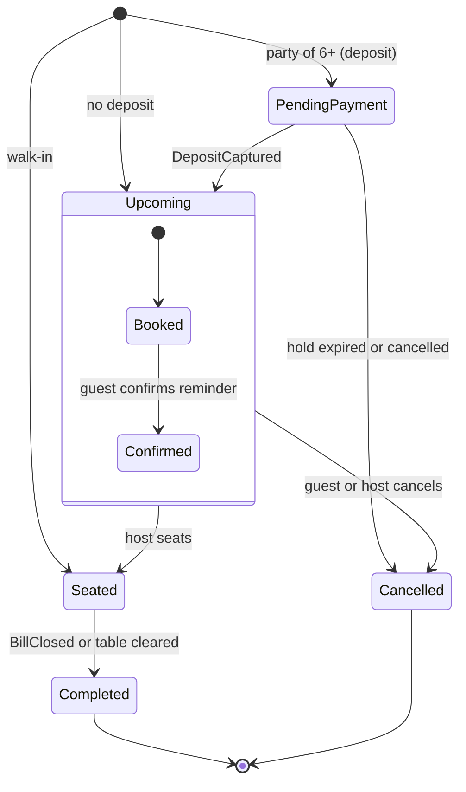

# Requirements: Reservation Demo

| | |
| --- | --- |
| **System** | Restaurant and catering reservation system, demo build |
| **Status** | Agreed and frozen (v1.1) for the demo build (3–4 weeks) |
| **Owner** | Antonio Huang |
| **Last updated** | 10 November 2026 |
| **Related** | [`Architecture.md`](Architecture.md); ADR-001 to ADR-005 |

The demo proves six capabilities in a 20-minute story set at one sample restaurant, built within 3–4 weeks. These requirements drive the target architecture, and they double as the test checklist for the build.

Event names follow the catalogue in ADR-002 (event-driven architecture). Requirement IDs in brackets (e.g. F-01) refer to the business requirements document.

---

## 0. Scope and setting

The demo follows one dinner service at a fictional restaurant, using sample data and simulated text messages and POS.

**Audience:** the POS company owner, possibly with his technical lead.

### Screens shown during the demo

| Screen | Device | Used by |
| --- | --- | --- |
| Guest booking page | A real phone, or a browser in mobile view | Guest |
| Host app: floor plan, bookings, waitlist | Tablet or laptop | Host |
| Phone panel showing text messages | Presenter screen, beside the host app | Audience |
| POS message log | Presenter screen, side panel | Audience and technical lead |

### Actors

- **Guest:** books, receives messages, confirms or cancels.
- **Host:** manages tables, walk-ins and the waitlist.
- **System:** checks availability, sends messages, raises events.
- **POS (simulated):** receives table, deposit and member messages; returns "bill paid".

### Sample venue: "Golden Dragon", a fictional Chinese restaurant in Auckland

| Setting | Value |
| --- | --- |
| Dinner service | 17:00–22:00, bookable in 15-minute slots |
| Areas and tables | Main room: 10 tables; Window: 4 tables (14 in total) |
| Table sizes | 2-seat × 5, 4-seat × 5, 6-seat × 3, 8-seat × 1 |
| Languages | English and Chinese (Simplified), switchable on every screen; English is the default |
| Currency and time zone | NZD, GST-inclusive; Pacific/Auckland |

---

## 1. Guest books a table in under a minute

**Story:** As a guest, I want to book a table on my phone in under a minute, so I can secure a time without calling.

**Covers:** F-01, F-02, F-04, F-05, F-21, F-44, F-55, N-06

**Acceptance criteria**

- [ ] **AC1.1** The guest chooses a date (today to 30 days ahead), party size (1–8) and a time; available times appear within 1 second.
- [ ] **AC1.2** Only times with a free table that fits the party, within the pacing limit, are offered.
- [ ] **AC1.3** If the chosen time is full, the 3 nearest available times are shown instead.
- [ ] **AC1.4** The guest enters a name and NZ mobile number, plus optional email, allergies and occasion. The phone number is stored in international format (+64…).
- [ ] **AC1.5** For parties of 6 or more, a deposit step appears. The booking is confirmed only after a Stripe test-mode payment succeeds.
- [ ] **AC1.6** A confirmation screen shows the booking reference, and a confirmation message appears in the phone panel within 2 seconds.
- [ ] **AC1.7** A practised user completes the whole flow in 60 seconds or less, with no account or login.
- [ ] **AC1.8** The English / 中文 switch changes all text on every guest screen.

**Screens:** guest booking in three steps (when and how many → your details → confirm or pay); phone panel.

**Events raised:** `BookingCreated`, `DepositCaptured` (for 6+ guests), `MessageSent` (`purpose: confirmation`).

**Not in this step:** guest accounts, real SMS or email, Google booking, changing a booking.

---

## 2. Booking appears instantly on the host floor plan

**Story:** As a host, I want new bookings to appear on my floor plan immediately, so I can plan seating without refreshing.

**Covers:** F-11, F-12, F-19, N-02, N-03

**Acceptance criteria**

- [ ] **AC2.1** A booking made on the guest page appears on the host floor plan and tonight's booking list within 2 seconds, with no page refresh.
- [ ] **AC2.2** Each table shows its status by colour (free, booked, seated) and, when booked or seated, the guest name, party size and time.
- [ ] **AC2.3** Tables reserved for a booking within the next 30 minutes are marked "arriving soon".
- [ ] **AC2.4** Two host screens open at once show the same state within 2 seconds of any change.
- [ ] **AC2.5** If a host screen loses its connection, it shows "reconnecting" and catches up automatically within 5 seconds of reconnecting, with no missed bookings.
- [ ] **AC2.6** Allergy notes show as an icon on the table tile, with details on tap.

**Screens:** host floor plan (fixed layout for the sample venue); tonight's booking list in time order.

**Events consumed:** `BookingCreated`, `BookingConfirmed`, `BookingCancelled`, `BookingSeated`, `TableCleared`.

**Not in this step:** editing the floor plan layout, several hosts editing the same table at once, drag-and-drop table moves.

---

## 3. Host seats a walk-in and adds a party to the waitlist

**Story:** As a host, I want to seat walk-ins in a few taps and add parties to a waitlist with a quoted wait, so service flows smoothly when we're busy.

**Covers:** F-13, F-16, F-74, N-05

**Acceptance criteria**

- [ ] **AC3.1** "Walk-in" → choose party size → the system suggests the smallest free table that fits → one tap seats them. Three taps or fewer in total; a name is optional.
- [ ] **AC3.2** The host can choose a different free table instead of the suggestion.
- [ ] **AC3.3** Seating a booked guest takes one tap on the booking ("Seat"); the table turns to seated.
- [ ] **AC3.4** If no table fits now, the host can tap "Add to waitlist" and enter a name, mobile number and party size.
- [ ] **AC3.5** The system shows a quoted wait, which the host can adjust before saving.
- [ ] **AC3.6** The waitlist shows parties in the order they joined, with party size, quoted wait and time waited so far.
- [ ] **AC3.7** Every waitlist entry ends as seated, walked away or removed, and keeps its quoted wait.
- [ ] **AC3.8** Each seat action adds an "open table" message to the POS log (step 6).

**Screens:** host app with walk-in button, waitlist panel and seat dialog.

**Events raised:** `BookingSeated` (`source: walkIn` or `booking`), `WaitlistJoined`, `WaitlistEnded`.

**Not in this step:** server sections and rotation, combining tables, online "notify me" waitlist.

---

## 4. A table frees up and the waiting guest gets a text

**Story:** As a waiting guest, I want a text when my table is ready, so I don't have to stand at the door.

**Covers:** F-16, F-62, N-22

**Acceptance criteria**

- [ ] **AC4.1** The host taps "Bill paid" or "Clear" on a seated table; it turns free within 2 seconds on every host screen.
- [ ] **AC4.2** The system highlights the first waiting party that fits the freed table; the host can pick a different party.
- [ ] **AC4.3** The host taps "Notify"; a "your table is ready" message appears in the phone panel within 2 seconds, in the guest's language.
- [ ] **AC4.4** The waitlist entry shows "notified" and the time sent; the message shows a delivery status (sent, delivered).
- [ ] **AC4.5** The host seats the notified party with one tap; the entry ends as seated and leaves the active list.
- [ ] **AC4.6** If a notified party isn't seated within 10 minutes, the entry is flagged for the host.

**Screens:** host app (floor plan and waitlist); phone panel.

**Events raised:** `TableCleared`, `WaitlistNotified`, `MessageSent` (`purpose: tableReady`), `WaitlistEnded`.

**Not in this step:** real SMS, guest replies by text, automatic seating without the host.

---

## 5. Reminder with one-tap confirm or cancel

**Story:** As a restaurant manager, I want guests to get a reminder they can confirm or cancel with one tap, so I can release tables early instead of losing them to no-shows.

**Covers:** F-03, F-22, F-23, F-26

**Acceptance criteria**

- [ ] **AC5.1** A presenter button, "Send reminders now", simulates the reminder that would normally go out 24 hours ahead, for all of tonight's unconfirmed bookings.
- [ ] **AC5.2** Each reminder appears in the phone panel with "Confirm" and "Cancel" buttons, in the guest's language.
- [ ] **AC5.3** Tapping "Confirm" marks the booking as confirmed on every host screen within 2 seconds.
- [ ] **AC5.4** Tapping "Cancel" cancels the booking and frees its table on the floor plan within 2 seconds.
- [ ] **AC5.5** If the cancelled booking paid a deposit, a full refund is issued in Stripe test mode and shown on the booking.
- [ ] **AC5.6** The booking keeps a timestamped record of the reminder, the guest's response and the policy shown at booking.

**Screens:** phone panel; host app booking list and floor plan; presenter controls.

**Events raised:** `MessageSent` (`purpose: reminder`), `BookingConfirmed`, `BookingCancelled`, `DepositRefunded`.

**Not in this step:** scheduled reminders at real times, late-cancellation fees, no-show marking and history.

---

## 6. Log of messages that would go to the POS

**Story:** As the POS company's technical lead, I want to see exactly what the reservation system would send to and expect from our POS, so we can plan the integration.

**Covers:** F-42, G-01–G-06, G-10, G-13

**Acceptance criteria**

- [ ] **AC6.1** A side panel lists POS messages as they happen, newest first, with time, direction (to or from POS), message type and key fields.
- [ ] **AC6.2** Each message expands to show its full JSON payload.
- [ ] **AC6.3** Every message carries a unique message ID (used to prevent duplicates), the venue ID, table ID and booking ID.
- [ ] **AC6.4** Messages are created only from domain events, written to an outbox, and delivered by a background worker to a mock POS adapter.
- [ ] **AC6.5** If the mock adapter is switched to "offline", messages wait in the outbox and are delivered in order, without duplicates, when it comes back online.
- [ ] **AC6.6** "Bill paid" on the host screen simulates an incoming message from the POS with a bill total, which is saved to the guest's profile.

### Message types for the demo

| Triggering event | Message | Direction |
| --- | --- | --- |
| `BookingSeated` | `OpenTable`: table, party size, guest name | To POS |
| `BookingSeated` (booking with deposit) | `ApplyDeposit`: amount, Stripe payment reference | To POS |
| `BookingCreated` | `UpsertMember`: guest name and mobile number, matched by phone | To POS |
| Host taps "Bill paid" | `BillClosed`: table, bill total (raises `BookingCompleted`) | From POS |

**Screens:** POS log side panel; presenter control to switch the mock POS online or offline.

**Not in this step:** a real POS API, menu sync, pre-orders to kitchen printers.

---

## 7. Shared business rules and venue settings

All values are settings for the sample venue, stored as configuration rather than written into code, so they can change without a rebuild.

| ID | Rule | Demo value |
| --- | --- | --- |
| BR-01 | Booking slots | Every 15 minutes, 17:00–20:30 last booking |
| BR-02 | Turn time by party size | 1–2 guests: 75 min; 3–4: 90 min; 5–8: 120 min |
| BR-03 | Pacing limit | At most 12 covers starting in any 15-minute slot |
| BR-04 | Online party size | 1–8 guests; larger parties are told to call (request form is out of scope) |
| BR-05 | Table assignment | Smallest free table that fits the party for the whole turn time |
| BR-06 | Deposit | Parties of 6 or more: NZD $20 per guest, taken through Stripe test mode |
| BR-07 | Cancellation and refund | Cancel free up to 2 hours before; deposit refunded in full when cancelled in time |
| BR-08 | Quoted wait | Time until the earliest fitting table is expected to free (seated time + turn time), rounded up to 5 minutes |
| BR-09 | Waitlist order | First come, first served among parties that fit; host can override |
| BR-10 | Notified party timeout | Flag after 10 minutes if not seated |
| BR-11 | Money and time | Money stored as whole cents in NZD, GST-inclusive; times stored in UTC, shown in Pacific/Auckland |
| BR-12 | Phone numbers | NZ mobile numbers validated and stored in international format (+64…) |
| BR-13 | Reminder timing | Reminder sent 24 hours before the booking. No reminder for a booking made less than 24 hours ahead (its confirmation carries the manage-booking link) or starting within 2 hours. Opening a Confirm or Cancel link less than 2 hours before the booking shows "cancelling now keeps your deposit" before the guest can cancel |

---

## 8. Data and booking statuses

The demo needs ten records. Every record carries a venue ID from day one, so more venues can be added later without rework. ADR-003 holds the full data rules.

| Record | Key fields | Used in steps |
| --- | --- | --- |
| Venue | name, time zone, currency, settings (section 7) | All |
| Area | venue, name (Main room, Window) | 2, 3 |
| Table | venue, area, name, seats, position on the floor plan | 2, 3, 4 |
| Guest | name, mobile (+64…), email, language, allergy notes | 1, 3, 4, 5 |
| Booking | venue, guest, table, start time, party size, status, reference, notes | 1–6 |
| Waitlist entry | venue, guest, party size, quoted wait, joined at, notified at, outcome | 3, 4 |
| Payment | booking, amount, Stripe reference, status (paid, refunded) | 1, 5, 6 |
| Message | guest, booking or waitlist entry, type, language, body, delivery status | 1, 4, 5 |
| Outbox event | event type, payload, created at, processed at | 2–6 |
| POS message | event, message type, direction, payload, message ID, delivered at | 6 |

### Booking statuses

A booking without a deposit starts as booked. A host can also seat a booked guest who never confirmed. No-show marking is out of scope for the demo.

---

## 9. Quality attributes and constraints

These are the main drivers for the architecture decisions. Each quality attribute has a scenario that can be tested before the demo.

| ID | Quality attribute | Test scenario | Target |
| --- | --- | --- | --- |
| QA-1 | Real-time sync | A guest books on the phone while two host screens are open | Both host screens update within 2 seconds, no refresh |
| QA-2 | Recovery after connection loss | A host screen's network is switched off for 30 seconds, then back on | Catches up within 5 seconds, no missed or duplicated items |
| QA-3 | Guest speed | A practised user books a table for 2 | 60 seconds or less from opening the page |
| QA-4 | Host speed | The host seats a walk-in | 3 taps or fewer; each action responds within 1 second |
| QA-5 | Reliable POS delivery | The mock POS is switched offline, three tables are seated, then it comes back | All messages delivered once each, in order |
| QA-6 | Stability | The full demo script is run end to end | Runs 3 times in a row with no errors or reloads |
| QA-7 | Language | Switch English ↔ 中文 on each screen | No untranslated text, no broken layout |
| QA-8 | Devices | Run on an iPhone (Safari), an Android phone (Chrome) and a tablet or laptop | Usable layout on each, no horizontal scrolling on phones |

### Constraints

- **Time:** ready within 3–4 weeks (about 17 working days); one developer using Claude Code.
- **Cost:** near-zero running cost; free or low-cost hosting tiers only (about USD 35 a month on AWS, ADR-005).
- **Payments:** Stripe test mode only; no real money or card data.
- **Integrations:** SMS and POS are simulated; no access to the partner's systems.
- **Data:** fictional venue and sample guests only; no real personal information.
- **Stack:** .NET API with SignalR, Next.js front end (ADR-001), PostgreSQL (ADR-003); events published through one `IEventPublisher` interface and an outbox (ADR-002).
- **Hosting:** AWS, the partner's main cloud platform; all data stays in AWS (ADR-005).
- **Reset:** a presenter button restores the sample data, so the demo can be run again from the start.

---

## 10. Demo script

About 20 minutes, followed by questions. The same script is the end-to-end test, run three times before the meeting (QA-6).

**Before starting:** press Reset; open the guest page on a phone, the host app on a tablet or laptop, and the presenter screen with the phone panel and POS log. The time is set to Tuesday evening, about 18:25, with 11 bookings already in the sample data.

| # | Time | What you do | What he sees | Step |
| --- | --- | --- | --- | --- |
| 1 | 0:00 | Introduce Golden Dragon and the three screens | The floor plan with tonight's bookings | — |
| 2 | 1:00 | On the phone, book a table for 2 at 19:30; switch to 中文 halfway | Booking done in under a minute, in Chinese | 1 |
| 3 | 2:30 | Point at the host screen | The table turns "booked" instantly; confirmation appears in the phone panel | 2 |
| 4 | 3:30 | On the phone, book for 6 at 20:00 and pay the deposit with a Stripe test card | Deposit step, then confirmation; `UpsertMember` in the POS log | 1, 6 |
| 5 | 5:30 | Choose a full time, e.g. 19:00 for 4 | The 3 nearest available times are offered | 1 |
| 6 | 6:30 | On the host app, seat a walk-in for 2 | Seated in three taps; `OpenTable` in the POS log | 3, 6 |
| 7 | 8:00 | Try a walk-in for 4 when nothing fits; add them to the waitlist | Quoted wait shown; entry appears on the waitlist | 3 |
| 8 | 9:30 | Tap "Bill paid" on a 4-seat table | `BillClosed` arrives from the POS; the table turns free; the waiting party is highlighted | 4, 6 |
| 9 | 10:30 | Tap "Notify" | "Your table is ready" appears in the phone panel; then seat them in one tap | 4 |
| 10 | 12:00 | Press "Send reminders now"; confirm one booking and cancel another | Statuses update live; the cancelled table frees up; a deposit is refunded | 5 |
| 11 | 14:00 | Switch the mock POS offline, seat a table, switch it back online | Messages wait, then arrive once each, in order | 6 |
| 12 | 15:30 | Open one POS message and show its JSON | Exactly what his POS would receive, ready for his technical team | 6 |
| 13 | 17:00 | Show the target architecture | How the demo becomes the production system with his POS | — |

**Fallback plan:** keep a 3-minute screen recording of a full run on the laptop, in case the venue Wi-Fi or a device fails.

---

## 11. Out of scope, assumptions and open questions

### Out of scope for the demo (shown as "coming in the pilot")

- Staff logins, roles and permissions
- Real SMS and email delivery; real POS integration
- Floor plan editor, combining tables, server sections
- Online "notify me" waitlist, large-party request form, Google booking
- No-show marking, late-cancellation fees, guest history and marketing
- Events and catering, reports, multiple venues
- Production hosting, backups, monitoring and scaling

### Assumptions

- One sample venue is enough to show every capability.
- A demo clock setting lets the presenter fix the "current time" (e.g. Tuesday 18:25), so the script runs the same way on any day.
- The demo is hosted on a low-cost cloud service with a public web address, so it opens on any phone.
- The audience is the owner and possibly one technical person; no live testing by them is needed, although they may try the guest page.

### Open questions

| Question | Status |
| --- | --- |
| Should the demo use neutral styling, or his POS's colours (with his permission)? | **Decided:** neutral styling |
| Which hosting to use for the demo on AWS: Lightsail containers or ECS on Fargate, with RDS for PostgreSQL? | **Decided in ADR-005:** Lightsail container + RDS for the demo; ECS on Fargate for the pilot |
| Should the guest page also be shown on his own phone during the demo? | Open |
| Which language should the sample venue default to? | **Decided:** English is the default, with 中文 as the switch |

---

## Change log

| Date | Change |
| --- | --- |
| 5 Nov 2026 | Exported from the requirements analysis doc. Event names aligned with the ADR-002 catalogue: `TableSeated` and `WalkInSeated` → `BookingSeated` (with `source`); `ConfirmationSent` and `ReminderSent` → `MessageSent` (with `purpose`); `BookingCompleted` added. Answered open questions marked as decided. |
| 9 Nov 2026 | Added BR-13 (reminder timing and the late-cancellation warning), matching Design §7.1. Status set to frozen (v1.0). |
| 10 Nov 2026 | v1.1. Demo script: 11 sample bookings (was 8) and the time about 18:25 (was 18:30), so every step works as scripted: all tables of 4+ seats are taken for the step-3 walk-in, and step 5's reminders and in-time refund don't sit on the 2-hour boundary (Design §17). |
